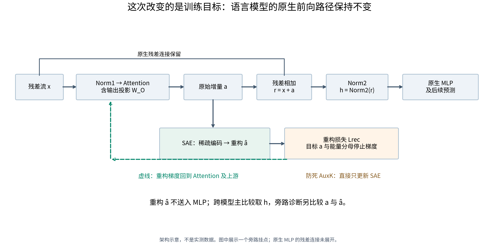
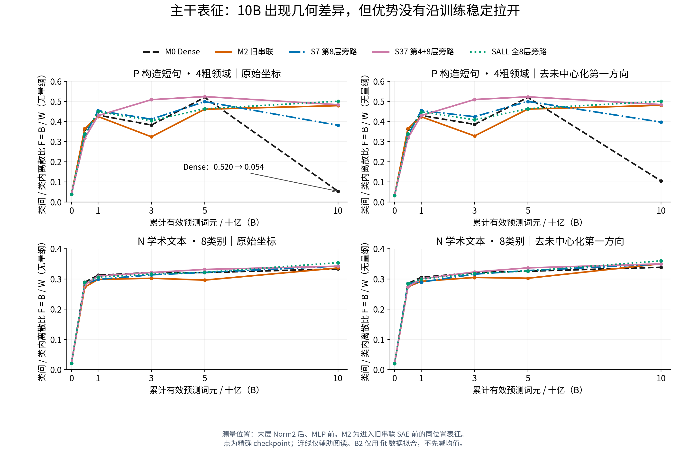
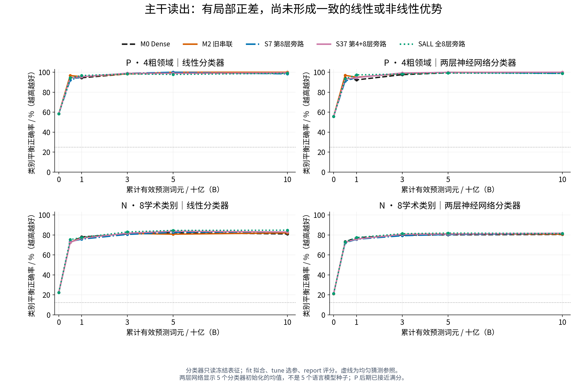
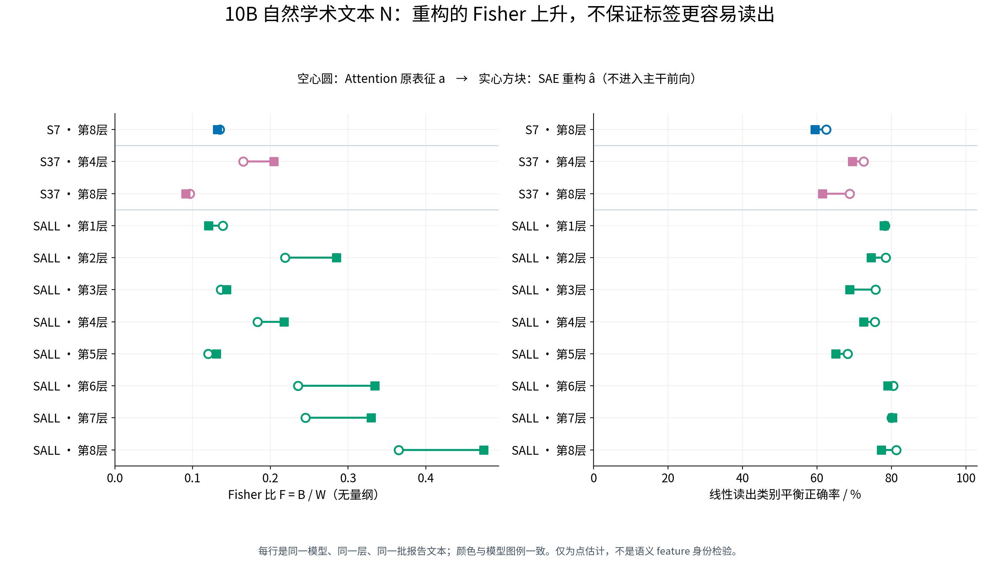
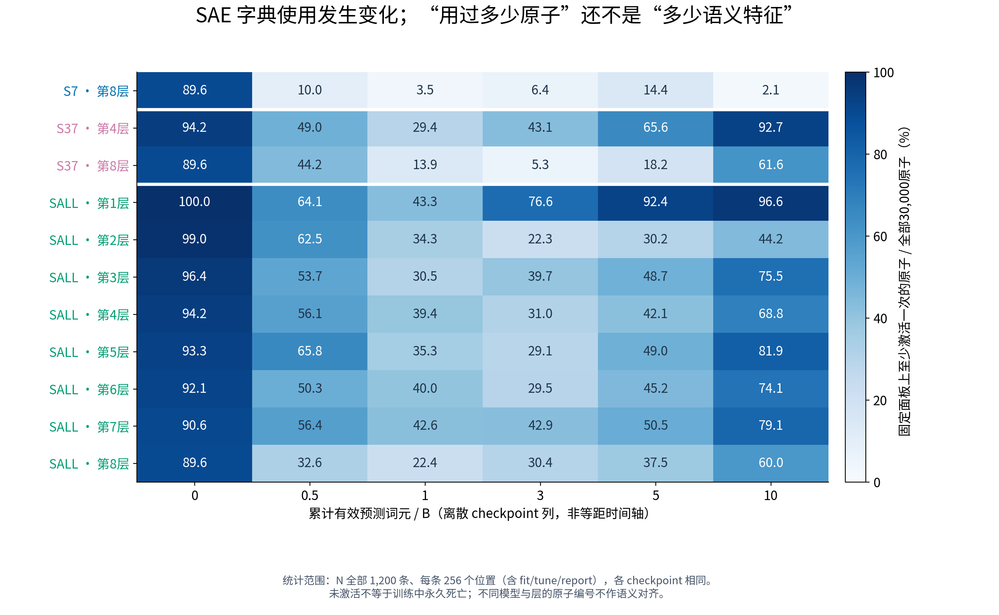
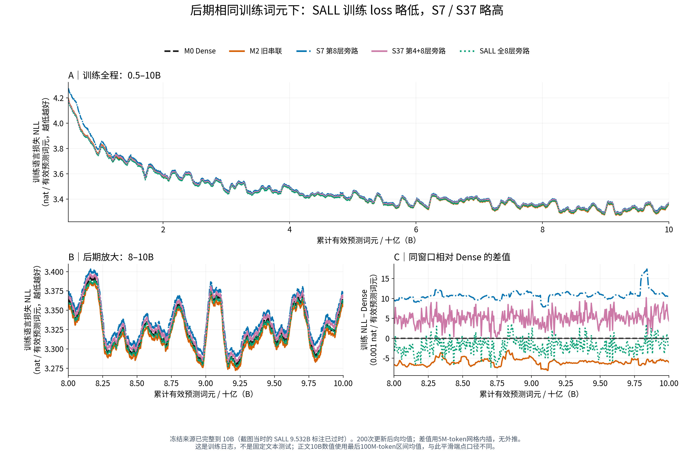
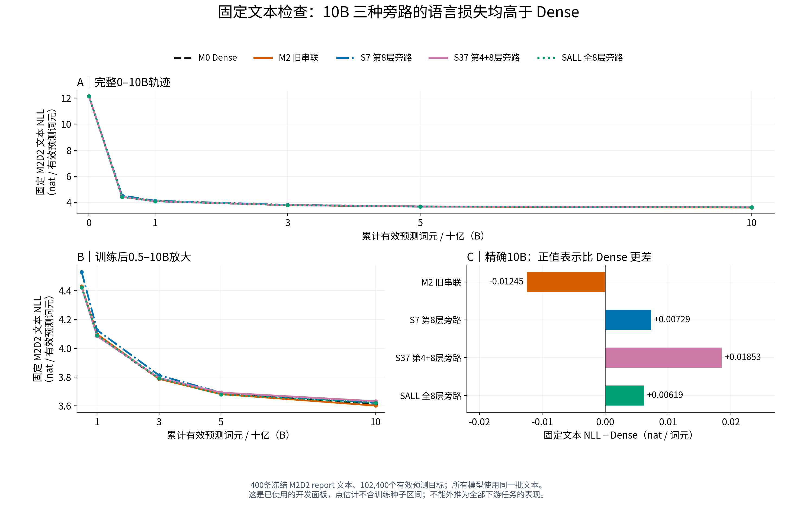
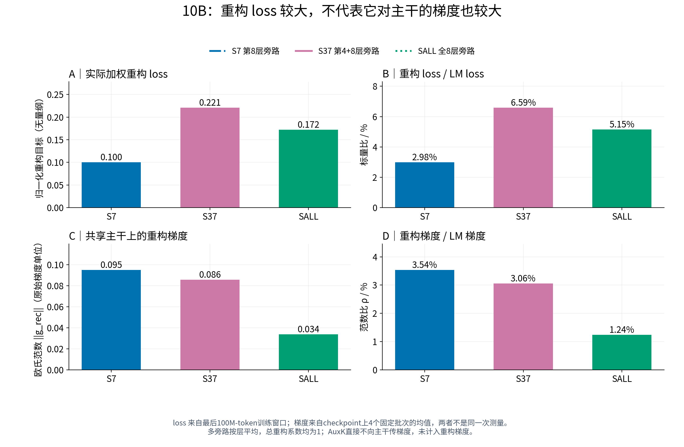
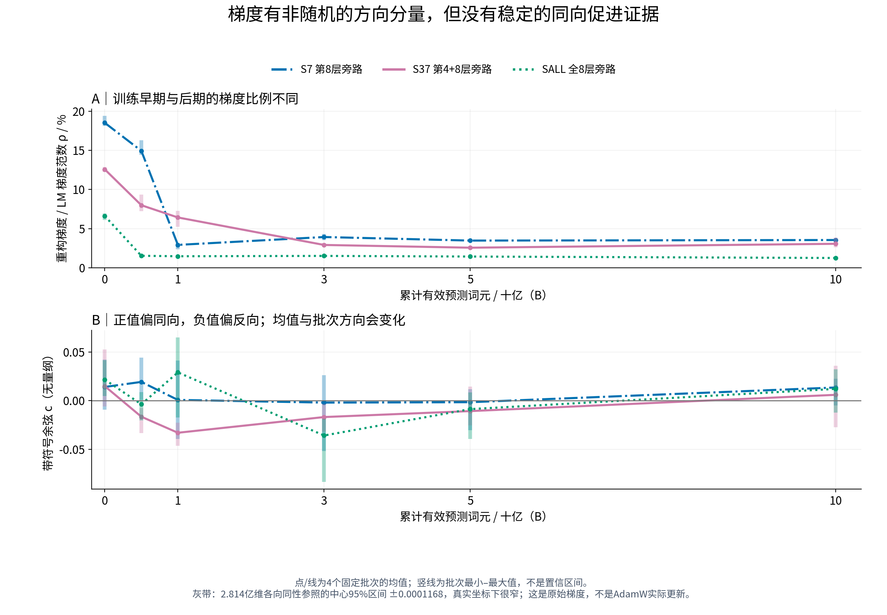

# 0918 组会：SAE 移到旁路后，主干表征和语言预测有何变化？

状态：`RESULT_AI_DRAFT_AWAITING_RESEARCHER_CONFIRMATION`。本稿是组会阅读稿，研究者尚未确认最终科学裁决。  
正式结果：[E05 中文 Summary](../../Projects/from-attention-to-search/main/experiments/A15/15_17_three_model_sae_representation_trajectory/A15_17_E05_multimodel_fisher_gradient_coefficient_audit/summary_cn.md)；来源与局限：[Detailed](../../Projects/from-attention-to-search/main/experiments/A15/15_17_three_model_sae_representation_trajectory/A15_17_E05_multimodel_fisher_gradient_coefficient_audit/detailed.md)；[测量协议](../../Projects/from-attention-to-search/main/experiments/A15/15_17_three_model_sae_representation_trajectory/A15_17_E05_multimodel_fisher_gradient_coefficient_audit/protocol.md)。

**本次要汇报的更新：移出主路径后，部分模型和训练点仍能观察到主干表征的几何差异；但还没有建立“领域信息更容易使用，因此语言预测更好”的证据链。** 最关键的限制是：SAE 重构不再送给 MLP，不能把重构空间的改善直接算作主干的改善。精确 10B 上，三个旁路模型在固定 M2D2 文本上的语言损失都高于 Dense。

## 1. 目的

回答导师的问题：**只用 SAE 的重构损失约束训练，不让重构参与语言预测，能否让主干自己的领域信息更容易被读出，并带来语言预测收益？**

导师在 0916 会议中要求先把 SAE 从主路径移出，再比较末层与“中间层＋末层”的约束；更长远关心的是，内部关系是否能被更简单地利用，从而提高模型的有效容量。本轮只检验这个方向的前两步——**领域读出与语言预测**；没有直接测量容量、持续学习或遗忘。会议依据见[导师转写第 20、46、47 段](../0916/meeting/0916_SAE_会议逐句转写.md)。

## 2. 假设

1. 如果旁路正则有益地整理了主干表征，同类与异类的几何关系应改善，冻结主干后训练的分类器也应更容易读出领域。去掉未中心化表征中最强的共同方向后，关键差异应仍然存在。
2. 如果这种变化对语言建模有用，在相同训练词元数下，固定文本上的语言预测损失应降低或至少不恶化。仅训练 loss 略低、重构更准确或梯度接近垂直，都不足以建立这一步。

这里的“更容易读出”是一个待验证的结果。即使两层分类器优于线性分类器，也只能说明**该读出器设置下可访问的信息不同**，不能单凭这个差值就认定主干形成了更好的非线性语义结构。

## 3. 分析方法

- **先分清模型计算与测量位置。**比较无 SAE 的 Dense（M0）、旧串联 SAE（M2），以及末层旁路（S7）、第 4＋8 层旁路（S37）、全部 8 层旁路（SALL）。S7/S37/SALL 的 SAE 都读取 Attention 经输出投影后的增量、在它与残差相加之前；没有额外旁支 Norm。主干仍使用原生残差与 MLP。重构损失更新 SAE 和上游主干；防死辅助项 AuxK 直接只更新 SAE。**LM loss 不经过旁路 SAE；SAE 重构不替换 MLP 输入。**多旁路的重构损失按层平均，总系数为 1。

  跨模型主读点统一为最后一层 **Norm2 后、MLP 前的原生表征 \(h\)**。旁路另测 **Attention 原表征 \(a\)** 和 **重构 \(\hat a\)**，二者仅作局部诊断。旧 M2 的 \(h\) 是串联 SAE 之前的同位置表征，其 MLP 实际消费的是重构，因此 M2 只作历史架构参考，不能冒充旁路层数的严格对照。

- **在同一文本和训练坐标上比较几何与读出。**使用精确的 0、0.5、1、3、5、10B checkpoint；B 表示十亿个有效下一词元预测目标。P 为 360 条构造英文短句，按 family 分为 120/60/180 条拟合/调参/报告样本，本轮预测数学、物理、生物、历史 **4 个粗领域**；N 为 1,200 条 M2D2 自然学术文本，600/200/400 拆分，预测 **8 个学术类别**。P 取句末有效位置，N 取前 256 个位置的均值。两套数据分开报告；本轮准确率不能直接与旧细领域任务拼接。

  几何用类间中心离散 \(B\) 与类内离散 \(W\) 的比值，即 Fisher 比 \(F=B/W\)；同时报告分子、分母。读出用线性分类器和固定两层神经网络分类器，均在拟合数据训练、调参数据选参、报告数据评分。去第一方向只在拟合数据上求方向，**不先减均值**。Fisher 的标签置换检验与模型间配对区间帮助检查数值可信度，但都不替代语言模型种子重复。

- **最后看语言损失，并核对正则施加了多大的梯度。**分开报告训练日志的语言损失，以及 400 条固定 N 报告文本上的语言损失；二者都是平均负对数似然 NLL，单位为 nat/有效预测词元，越低越好，不能与困惑度 PPL 混称。另在共享主干参数上测语言梯度 \(g_{\rm LM}\) 与加权重构梯度 \(g_{\rm rec}\)：范数比 \(\rho=\|g_{\rm rec}\|/\|g_{\rm LM}\|\) 表示相对大小；余弦 \(c\) 为正表示偏同向、为负表示偏反向。每个 checkpoint 测 4 个固定批次，均不更新模型。

**读图：**上方是原生语言模型前向，绿色虚线表示旁路重构的梯度作用。重构 \(\hat a\) 没有通向 MLP 的箭头；后面所有结果都必须按这个边界解释。

## 4. 结论

### 4.1 主干表征：部分终点有几何与读出正差，但没有稳定的整体优势

**先回答“变化是否已经出现在主干，而不仅是 SAE 重构里”：主干的同位置测量确实观察到了差异；但差异并不构成跨训练点、跨指标一致的改善。**

在 P 上，Dense 的 Fisher 从 5B 的 **0.520 降到 10B 的 0.054**；S37/SALL 在 5B 就已经是 0.524/0.464，10B 为 0.484/0.501。因此，10B 的大差距很大程度上伴随 Dense 终点下降，不能讲成“旁路模型越训越领先”。Dense 下降的机制本轮没有解释，不能替它编造原因。

**读图：**左列是原始坐标，右列是去第一方向后的结果；上下两行是不同数据。看同一数据的整条轨迹，不能只看 10B 排名。该图的 \(h\) 才是主干原生表征，不是旁路重构。

10B 时，S37/SALL 相对 Dense 的 P Fisher 差分别约 **+0.430/+0.447**，配对区间不跨零；N 上差值较小，分别约 **+0.0087/+0.0205**。去第一方向后差异仍保留，说明这些差异不能仅用这一条共同方向解释。完整不确定性见[10B 配对区间图](figures/meeting_revision/04_fisher_paired_intervals.png)，分子与分母见[B/W 绝对值轨迹](figures/meeting_revision/03_native_between_within.png)。

**再看“是不是更容易读出”：P 后期接近满分，读出差值很小；N 有局部正差，但还没有训练种子重复。**P 的 10B 线性正确率为 Dense 98.89%、S37 99.44%；N 为 Dense 81.00%、SALL 84.75%。这些是点估计，不能写成普遍或已确认的收益。

**读图：**左列检验能否用线性分类器读出，右列给读出器一层非线性变换；纵轴均为类别平衡正确率。两层读出没有形成所有模型一致的额外优势。P 的分类已接近天花板，Fisher 大幅变化也不代表正确率会同幅度变化。

允许的结论是：**部分 checkpoint 的主干几何与领域读出存在正差；“正则普遍让语义更容易形成和使用”仍未证实。**当前是已有单种子轨迹的比较，而非严格匹配的因果干预，不能把所有差异归因于旁路层数。

### 4.2 SAE feature：重构与字典使用确实不同，但“更语义化”还没有测出来

**“重构空间更可分”与“主干更好用”是两件事。**精确 10B 的 11 个旁路层位中，N 上有 8 个层位的重构 Fisher 上升，但只有 1 个层位的线性读出提高，平均正确率反而下降约 **3.3 个百分点**；P 上只有 5 个层位的重构 Fisher 上升，线性读出提高的层位为 0，平均下降约 7.4 个百分点。

**读图：**每行是一组“同模型、同层、同文本”的比较；空心圆是原始 Attention 表征，实心方块是重构。左边比值变大时，右边正确率未必更高。P 的对应图见[构造面板补图](figures/meeting_revision/06_reconstruction_P.png)。

白话解释：SAE 可能把一类内部的变化压缩得更强，从而提高类间/类内比值；这不保证分类所需的信息保存得更好。**本轮既然不使用重构进行预测，就更不能把这张图的左侧改善当作模型性能提升。**

字典使用也有明显差异：在相同 N 面板上，10B 时 S7 的第 8 层字典有 **2.07%** 原子至少激活过一次，S37 第 8 层为 **61.63%**，SALL 第 8 层为 **60.03%**。

**读图：**每格是“固定 1,200 条文本上用过的原子数 / 全部 30,000 个原子”，不是单 token 激活数，也不是语义特征的数量。使用少不等于更专一，使用多不等于更好；面板内未出现的原子也不能直接判为训练中永久死亡。

本轮可以报告字典使用范围及更替；**没有完成 feature 的稳定语义命名、跨表达复用确认或功能干预**，所以不能写“SAE 学到了更多、更稳定的语义基”。

### 4.3 语言模型性能：SALL 训练 loss 略低，但固定文本上的收益未出现

训练曲线采用您选定的“全程＋后期放大＋相对 Dense 差值”布局，所有图统一模型颜色。截图当时 SALL 只显示到 9.532B；当前冻结来源已经覆盖完整 10B，新图画到真实终点，不外推。

**读图：**上图看总体训练过程，左下看后期真实 loss，右下看同窗口差值；零线以下表示训练 loss 比 Dense 低。右下单位为 **0.001 nat/词元**，例如 −2 表示只低 0.002，不能读成下降 2%。M2 是旧串联模型，不能把它的收益算到旁路方案上。

下面使用最后完整 100M-token 训练窗口的均值，以及精确 10B checkpoint 在固定文本上的测量。它们与图中的 200 次更新平滑端点不是同一统计口径。

| 模型 | 训练 NLL：相对 Dense | 固定 M2D2 NLL：相对 Dense |
| --- | ---: | ---: |
| M2 旧串联参考 | −0.00579 | −0.01245 |
| S7 第 8 层旁路 | +0.01091 | +0.00729 |
| S37 第 4＋8 层旁路 | +0.00496 | +0.01853 |
| SALL 全 8 层旁路 | −0.00227 | +0.00619 |

单位均为 nat/有效预测词元，负值更好。Dense 对应的绝对值分别为 3.34677 和 3.61427。

**读图：**右下三个旁路模型都在零线右侧，表示固定文本损失更高。这是冻结开发面板上的点估计，没有训练种子区间；它足以阻止我们声称“已经验证语言预测收益”，但不能证明旁路在任何任务上都无效。

对昨晚会议总结的更新应这样说：**“SALL 的训练 loss 略低”保留；“所以所有层都加最好、已经提高训练效率”收回到待验证。**相同 token 下的训练 loss、固定文本预测能力、单位 GPU 时间效率是三个问题，本轮没有做下游任务基准或算力效率裁定。

### 4.4 回答学长的权重与正交性问题：正则没有在后期压倒 LM，但方向关系还不能解释收益

**先看大小。**真实训练的重构损失经过归一化，多旁路还按层平均，不能套用“原始重构误差可能上万”的量级来判断当前训练。下面把 loss 标量和共享主干上的梯度分开比较。

**10B 量级对照：以各模型自己的 LM 项为参照。**

| 模型 | LM loss | 加权 SAE 重构 loss | 重构 / LM loss | LM 梯度范数 \(\|g_{\rm LM}\|\) | 重构梯度范数 \(\|g_{\rm rec}\|\) | 重构 / LM 梯度范数 \(\rho\) |
| --- | ---: | ---: | ---: | ---: | ---: | ---: |
| S7：第 8 层旁路 | 3.3577 | 0.1002 | **2.98%**（约 1/34） | 2.6790 | 0.0949 | **3.54%**（约 1/28） |
| S37：第 4＋8 层旁路 | 3.3517 | 0.2208 | **6.59%**（约 1/15） | 2.8067 | 0.0857 | **3.06%**（约 1/33） |
| SALL：全部 8 层旁路 | 3.3445 | 0.1722 | **5.15%**（约 1/19） | 2.7256 | 0.0338 | **1.24%**（约 1/81） |

**表的结论：在本次 10B 测量上，LM loss 约为重构 loss 的 15–34 倍，LM 梯度范数约为重构梯度的 28–81 倍。重构正则是较小的附加梯度，没有在整主干梯度范数上压倒语言目标；但 S37 的重构 loss 占比最高，S7 的梯度占比最高，说明 loss 比例不能代表梯度比例。**

口径说明：

- 重构列已经计入真实总系数 \(\lambda=1\) 和跨层平均，即 \(L_{\rm rec}=K^{-1}\sum_l L_{{\rm rec},l}\)，不是多层未加权求和。防死 AuxK 不在重构列内；它直接不向主干传梯度，但仍训练 SAE，不能理解为其全部作用为零。
- loss 是最后完整 100M-token 训练窗口的均值；梯度是精确 10B checkpoint 上 4 个固定批次的均值，均在同一组共享主干参数上计算。\(\rho\) 是逐批范数比再取均值，可能与两个平均范数相除有轻微差异。两类列不是同一次批次测量。
- 表中百分数的分母是 **LM 项**，不是总 loss 或总更新。因此 3.54% 不等于“贡献了 3.54% 的参数更新”；梯度是向量，实际更新还取决于方向及 AdamW 预条件。不能将 10B 的比例外推到训练全程。

来源：[冻结 10B loss/梯度量级表](tables/exact_10b_sidecar_loss_gradient_comparison.csv)。

**读图：**S37 的标量 loss 比最大，S7 的梯度比最大，排序不一致。“每层系数相同”或“loss 数值接近”都不能保证对主干的影响相同。多旁路总梯度是沿各自路径反传后相加的向量，不能只数旁路个数。

**再看方向。**10B 三种旁路的梯度余弦约为 **0.0135、0.0060、0.0121**，对应夹角约 **89.23°、89.66°、89.31°**。角度的确接近垂直；但相对于 2.814 亿维各向同性随机向量，中心 95% 参照范围只有约 \(\pm0.0001168\)，这些余弦仍明显偏离该随机参照。

**读图：**上图是相对梯度大小；下图是带正负号的方向关系，点为 4 批均值，竖线是批次极差。真实坐标下随机灰带很窄，不能为了看起来显著而把纵轴改成不说明单位的“随机倍数”。

本轮 72 个可靠整主干测量都超出各向同性参照范围，只有 7 个与保持坐标幅度的解析符号翻转参照相容。与此同时，符号会随训练点和批次改变。因此可以说：**相对于这两种随机参照，梯度存在可检测的方向关系；但没有稳定同向关系，也没有“帮助跳出局部最优”的证据。**

两个边界要保留：这些是原始梯度，不是 AdamW 预条件后的实际参数更新；随机校准使用了解析近似，计划中的整主干跨批次随机配对尚未完成。旧 E03 的“与随机相容”测的是另一种局部表征梯度，不能与这里的整主干参数梯度混为一谈。

**对导师的口头归纳可以直接这样说：**

> 老师，我们这次已经把 SAE 从语言模型前向里拿出来了。模型做预测时仍走原来的 Attention、残差和 MLP，SAE 只通过重构损失给训练增加一个约束。结果是，部分训练点的主干领域几何和读出有所变化，但还没有稳定地更好。旁路自己的重构有时 Fisher 更高，可分类反而变差，而且重构根本不送入主干，所以不能算作主干收益。性能上，全层旁路的训练 loss 略低，但三个旁路在固定学术文本上的预测损失都没有优于 Dense。我们现在确认的是这些有边界的变化，还没有证明它提高了模型容量，或通过正交梯度带来了优化收益。

**本次待确认的唯一下一步（AI 建议，未执行）：**是否接受现有 E05 提出的 S7/SALL 梯度配平对照，用匹配训练区分“旁路层数”与“总梯度强弱”的影响。目标 \(\rho=0.02\) 只是候选，不是最优值；具体范围见正式 Summary。只有目标比例确实达到、且固定文本 NLL 不恶化，才考虑延长；如果配平后差异仍在，就停止把差异归因于梯度范数不平衡。本次修改仅整理汇报，不提交新训练。

**来源与图表检查说明。**[0917 学长会议总结](../0917/docs/meeting/meeting_brief.md)是当时讨论记录；其“全层最好”“跳出局部最优”不作为现有证据结论。P Fisher 区间在本轮按类别内的行重采样，未按 family 整组重采样；N 是已使用过的开发面板，不是全新盲测。feature 统计覆盖全部面板，不能称为 report-only 语义验证。图表只重绘冻结数值，没有重新推理、拟合或训练；脚本与源表哈希见[制图来源清单](figures/meeting_revision/figure_manifest.json)。旧图与正式结果记录保留不变。
