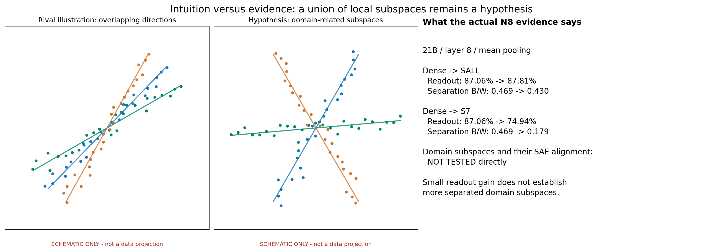
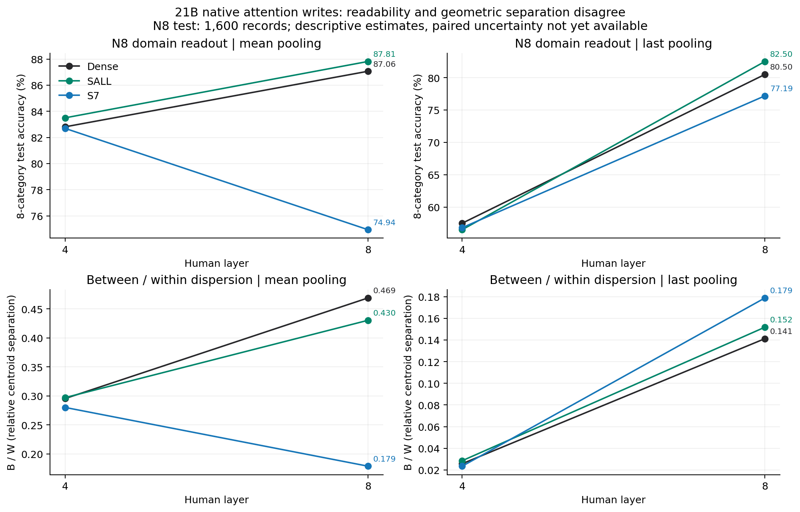
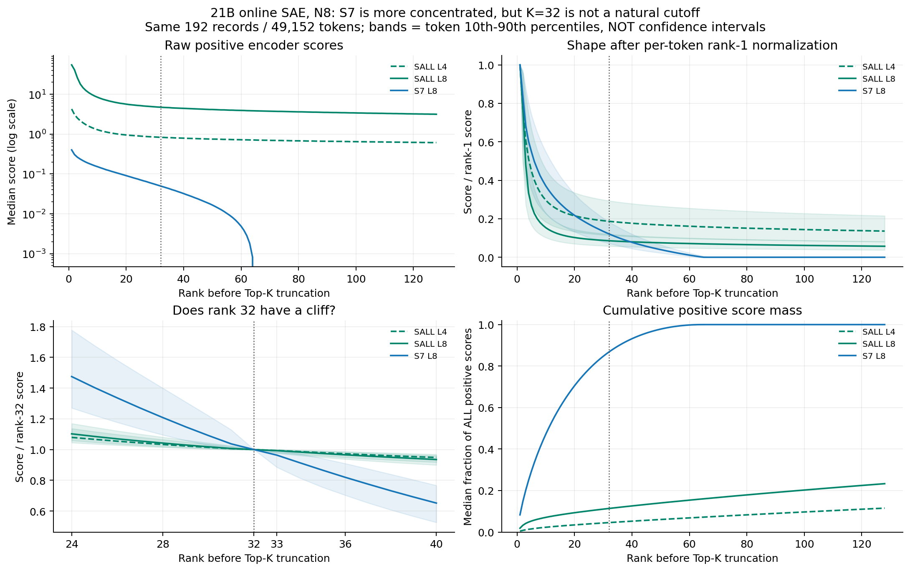
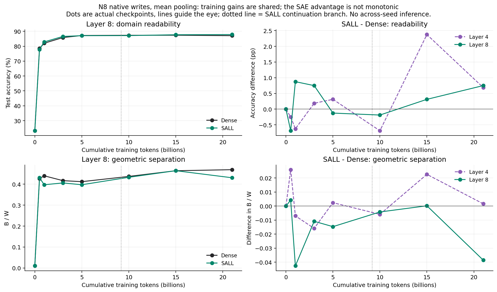

# SAE 正则是否让不同领域更容易分开？——领域主线组会稿

状态：`AI_DRAFT_AWAITING_HUMAN_CONFIRMATION`。本稿按研究者 0921 请求重组讲述顺序，**不改写 E06 已注册的关系实验主判据，也不迁移 Focus/Anchor 科学状态**。主讲 N8 领域面板；人工关系 P_rel_v2 与自然复述 PAWS 放在备查，不用于裁定本稿的领域问题。S7 始终指本轮 **21B 重加权续训版本**，不是新启动的从零训练 S7。

**可先讲的答案：领域信息可读，但尚未建立“SAE 使不同领域普遍分得更开”。SALL 有小幅、读点相关的分类正差；关键终点的几何分离反而略低。S7 的原子得分明显更集中，但领域分类更差。多线性子空间及其 SAE feature 对应关系仍是假设。**

## 1. 目的（Purpose）

检验训练中的稀疏自编码器（SAE：用少量字典方向近似一个向量）旁路约束，是否让主干中的不同领域更容易分开，并检查 SAE 的原子组合能否忠实解释这种组织。

先区分两个问题：**“领域分得更开了吗”是结果问题；“为什么 S7 与 SALL 原子激活差这么大”是解释该观察器是否可信的问题。** 原子激活差异本身不能代替领域分离的证据。

主干真实写入记作 \(a\)，取自注意力输出投影之后、残差相加之前。SAE 的稀疏系数为 \(z\)，重构为 \(\hat a\)，误差为 \(e=a-\hat a\)。正常推理使用 \(a\)；旁路的 \(\hat a\) 不替换它。字典的一列叫“原子”，它是向量方向，未经独立验证不能直接叫一个语义概念。

“分得更开”至少有三个可区分的含义：简单分类器更容易辨认领域；类中心相对类内散布更分离；不同领域对应可复用的低维方向组。前两项已测，第三项没有直接检验。它们可能不同向。

## 2. 假设（Hypothesis）

**研究者提出的直觉：** 语义表征可能近似由多个低维线性子空间组成；不同输入使用其中一组方向，SAE 的原子组合可能帮助我们找到它们。若正则帮助了领域组织，那么在未参与拟合的领域文本上，原生 \(a\) 的领域读出、相对分离和可复用方向组应给出相互支持的证据，而不是仅有 SAE 得分更尖。

用最小数学形式表达为 \(a\approx b+D_S z_S+e\)：\(b\) 是偏置，\(D_S\) 是被选中的字典列，\(S\) 随输入改变。固定 \(S\) 的重构落在至多 \(|S|\) 维的仿射子空间里；因系数非负，实际可达集合还受非负锥约束。**这是模型的构造性质，不是已经验证的语义性质。** 它不推出每个领域恰好一个子空间、不同子空间正交、不共享方向，或原生 \(a\) 只有32维。一个领域也可能覆盖多组方向，跨领域可能共享同一语义因素。

**直觉图还必须说明一处逻辑区别：** 两组样本可以分别沿两条夹角很大的、过原点的直线对称分布，两组均值却都为零，因而\(B=0\)；一个线性分类器也未必能把两条完整直线分开。因此“子空间不同”不自动推出“类中心更远”或“线性分类更好”。当前\(B/W\)和分类结果约束的是“正则改善这两种领域组织”的说法，尚不能直接证明或否定子空间并集假设；补充C正是补这个缺口。

**最强竞争解释：** 正则改变了尺度、类内散布、词汇/来源风格或字典编码偏置，让得分集中，却没有让领域相关方向更清楚。更进一步，领域类别只是论文来源标签，未必是每个256词元片段的真实语义。

**读图：** 左中两栏都是假设示意，颜色表示领域相关方向组，绝不是实测二维投影；右栏才是对应读点的真实结果。不能把理想图中的子空间形状写成已经观察到的模型结构。

## 3. 分析方法（Analysis method）

- **先测原生领域组织。** N8_v1 为八个学术细类，共4,800个256词元窗口，每类拟合/开发/测试为300/100/200；测试总计1,600条。八类是 cs.CL、cs.CV、math.AG、math.NT、physics.flu-dyn、physics.optics、q-bio.GN、q-bio.NC。用拟合集训练固定形式的线性分类器，开发集选择正则系数，测试集报告准确率；同时报告类间差异 \(B\)、类内散布 \(W\) 和 \(B/W\)。正文均值为领域主读法，最后正文词元为敏感性检查；第4/8层全部保留。
- **再测变化发生在哪里、何时发生。** 21B 比 Dense、原版 SALL、重加权 S7；15B 与0/0.5/1/3/5/10B比 Dense/SALL。比较同输入、同读点的几何关系相似度（CKA），辅以范数、方差谱及真实训练词元坐标。已有跨模型8×8层矩阵；同模型跨层矩阵仍需补。每点单独拟合读出，因而测的是各点“可读性”，不是一个固定语义方向跨时间不变。
- **最后审计 SAE 读法。** 同一 N8 小面板192条、49,152个词元，对 SALL 第4/8层与 S7 第8层检查截断前排序得分、Top-32累计正得分占比、重构及误差。排序曲线直接来自保存的前128名缓存，本次只重新汇总制图；未加载模型或训练字典。整个 E06—E08 是冻结检查点分析，主干与在线 SAE 均无优化器更新；线性分类器的拟合不能称主模型训练。

这里 \(B\) 是八个类别均值到总均值的平方距离均值，\(W\) 是每类样本到本类均值的平方距离再等权平均。\(B/W\) 更大，表示**类别中心相对类内散布**更分离，不直接证明不同语义子空间夹角更大。整体缩放同时改变 \(B,W\)，不会单独改变该比值；各向异性和读点仍会影响它。

**计算口径补充：** 现有分类器并非把未经处理的绝对幅值直接输入：它先减去拟合集均值，再除以拟合集的单一整体均方根尺度；不是逐维白化，也不是每样本单位范数化。因此S7分类下降不能仅由一个全局缩放系数解释。范数诊断中，`mean_vector_norm` 实际是“样本均值向量的范数”\(\|\mathbb E[a]\|\)，不是“各样本范数的均值”\(\mathbb E\|a\|\)；描述共同分量时须保留这个区别。

## 4. 结论（Conclusion）

### 4.1 领域结论：可读性与几何分离没有共同支持“普遍分得更开”

1. **SALL 有局部可读性正差，但不够支持更强的分离结论。** 21B 第8层正文均值准确率为 Dense **87.06%**、SALL **87.81%**、S7 **74.94%**。SALL 比 Dense 高0.75个百分点；同位置 \(B/W\) 却从 **0.469降至0.430**，S7为0.179。SALL 的 \(B\) 从755.08降至712.61，\(W\) 从1610.22升至1655.73：此读点没有“类中心更远且类内更紧”的证据。

   

   **读图：** 上排是能不能分类，下排是类中心相对散布；折线只连接实测的第4/8层。第8层均值下，SALL 上排略升、下排下降，正是两种问题不能混成一个分数的实证例子。当前 N8 输出没有配对差值区间，不能把小幅正差说成确认改善。

   | 21B同输入、同读点 | Dense准确率 | SALL准确率 | S7准确率 | Dense / SALL / S7 的 \(B/W\) |
   |---|---:|---:|---:|---|
   | 第4层·正文均值 | 82.81% | 83.50% | 82.69% | 0.296 / 0.297 / 0.280 |
   | 第8层·正文均值 | 87.06% | 87.81% | 74.94% | 0.469 / 0.430 / 0.179 |
   | 第4层·最后词元 | 57.50% | 56.50% | 56.81% | 0.0257 / 0.0285 / 0.0235 |
   | 第8层·最后词元 | 80.50% | 82.50% | 77.19% | 0.141 / 0.152 / 0.179 |

   第8层最后词元下 SALL 的准确率与 \(B/W\) 同向略好，但 S7 的 \(B/W\) 更大、准确率却更低。这进一步说明几何比值不等价于可读性。以上均为现有面板描述；未做人类逐片段语义验收，也未取得论文级来源隔离，不能声称抽象语义或新领域泛化。所有八类均在拟合时出现，测试的是同类别新记录。

### 4.2 激活差异：测量可以对应，成因尚未辨明，32不是自然断点

2. **同层同面板比较后差距仍存在。** 21B、N8、相同词元、同为第8层、各30,000原子、Top-K均为32，已核对缓存的样本ID、输入哈希和词元位置完全一致。SALL/S7 的编码器实现文件哈希相同；不是把 SALL 八个字典的原子数相加后与 S7 一个字典比较。

   | N8固定面板上的量 | SALL第4层 | SALL第8层 | S7第8层 |
   |---|---:|---:|---:|
   | 每词元截断前正得分数中位数 | 4720 | 2435 | 64 |
   | Top-32占全部正得分和，中位数 | 4.55% | 11.37% | 86.80% |
   | \((s_{32}-s_{33})/s_{32}\) 中位数 | 0.60% | 0.68% | 3.61% |
   | 第33名至少为第32名90%的词元比例 | 99.998% | 99.990% | 86.30% |
   | 整个固定面板曾入选的不同原子数 | 24596 | 17060 | 142 |

   

   **读图：** 左上看绝对值，右上逐词元除以第一名后看形状，左下放大32/33附近，右下看前若干名占全部正得分和。阴影是词元间10%—90%分位范围，**不是置信区间**。横轴只到缓存实际保存的128名；没有补画128之后的得分。

   **对导师的直接回答：SALL 的32名额从很长的正得分尾部中截出；S7 的头部整体更集中，但32与33通常仍很接近。不是“前32项都远高于余下各项”，也不是“所有原子平均一样大”。** 分布集中度与是否恰在32处断崖是两件事。正得分和占比不是重构能量、解释方差或语义质量占比；多个非正交字典方向可能相互抵消。

   “每词元有64个正候选”“最终取32个”“整个面板只用过142种原子”也分别是三个统计对象。最后一项不能当作全训练期永久死原子率。旧报告里5184/2541、84.8%等来自 **P关系面板**，本稿改用 N8对应值，不混写。

   **为什么差这么大？当前只有候选解释。** S7只有末层旁路且经历系数1→0.1的续训分叉，SALL八层旁路原版系数1；两者原生写入、编码权重/偏置与字典共同适应均不同。编码得分实际为 \(\mathrm{ReLU}(W_e(a-b)+b_e)\)；输入尺度、偏置及方向分布都可能影响正候选数。仅比较范数不足以决定哪一种原因。应先在既有缓存上按领域和位置拆开，再核查训练谱系与参数摘要；未匹配训练条件，不能把差距归因于“层数”或“正则系数”的单一因果作用。

   **更集中也不等于更忠实地保留领域信息。** 同一N8小面板测试64条、第8层正文均值，SALL/S7的相对重构均方根误差为19.48%/17.19%；S7在自身写入上的相对误差更小，却不能据此称其原生领域信息更多。各模型的目标空间本来不同。小面板32维读出与1,600条主领域读出使用的样本量和降维不同，不能并入同一排名。

   本轮保存的是截断前得分；第33名以后通常未参与主重构，尾部总和不等于“若增加K就能回收的信息”。**无32断崖只反驳天然32断点的说法，不足以证明K=32太小。** 全局方差有效维数在第8层N8均值为Dense15.45、SALL18.63、S7 13.72；它是方差集中度，不是语义维数，也不能用其小于32来判定K足够。

### 4.3 训练演化：观察已完成，领域优势没有持续扩张，稳定子空间尚未测

3. **两模型随训练学会了更多领域可读信息；SAE 的额外收益并非单调。** 第8层正文均值下，Dense 从0B的23.25%到21B的87.06%，SALL从23.25%到87.81%。SALL−Dense 在0.5/1/3/5/10/15/21B依次为 **−0.69、+0.88、+0.75、−0.13、−0.19、+0.31、+0.75个百分点**；第8层均值 \(B/W\) 在1/3/5/10/21B均低于Dense，15B近乎相同。没有持续拉大的领域分离优势。

   

   **读图：** 左边是绝对成长，右边是扣除Dense后的额外变化；上下分别是可读性与几何分离。不能把两个模型共同成长说成SAE带来的收益。虚线标出SALL在9.174B的续接分叉，点间线条只作引导，不表示观测了连续变化。

   已有的是同一训练谱系的重复观察，不是多个独立训练种子；没有跨时间整体显著性结论。0B也高于八类随机猜测12.5%，因此“可线性辨认领域”本身不能直接等同训练形成的抽象语义。**何时出现稳定语义子空间、原子是否跨时间保持语义、S7差异何时产生，均未得到本轮结论。** 本轮E08没有S7完整轨迹，不能把旧版本S7曲线接到重加权21B上。

### 4.4 进度地图：执行完成不等于机制证据全部完成

4. E06 21B、E07 15B、E08 0—10B三个既定完整分析均有终态、采集、分析 `PASS`。本次重新读取了这些本地凭据；未重新查询平台，也未启动任务。下表对应旧报告的“几何—可读性—观察器—实际使用”图及本次子空间直觉。**本消息没有单独附图，无法确认“首先看这张图”是否就是旧报告第5图；若指另一张图，其逐框覆盖仍待核对，不能据此宣称原图全测完。**

   | 要回答的内容 | 已有证据 | 还缺什么 / 当前判断 |
   |---|---|---|
   | 同领域记录能否被简单读出 | N8第4/8层、双汇聚、真实时间点；额外层为开发集探索 | 配对不确定性、来源风格对照；只能称来源类别可读 |
   | 不同领域是否几何上更分开 | 八层 \(B,W,B/W\)，第4/8层方差谱；本稿终点和轨迹图 | 类别对、归一化稳健性、来源组不确定性；未见普遍优势 |
   | 两模型整体几何是否相似 | N8跨模型8×8层CKA、置换和第一主方向敏感性 | 不是语义优劣，也不是同模型跨层矩阵 |
   | 同模型各层如何组织领域 | 各层原生池化缓存和分层几何已在 | 同模型跨层CKA及邻层曲线未见于完成输出 |
   | 原子是否自然在32处截断 | 32/33、正候选数、累计质量；本次补真实1—128排序折线 | 未支持自然32断点；最优K未知 |
   | SAE是否忠实读出原生信息 | 小面板重构、误差、有限容量读出 | 观察器样本小；领域特定原子选择性与稳定性未系统验证 |
   | 领域对应线性子空间吗 | 当前只有全局方差谱与类别统计 | 类内子空间留出重构、子空间夹角及与SAE方向组对齐未测 |
   | 训练过程中何时改变 | Dense/SALL 0—21B领域与几何轨迹；早期邻时间CKA | 不是稳定语义方向追踪；S7本轮早期轨迹缺失 |
   | 模型是否真正使用这些方向 | 正常前向路径已核对；固定文本语言损失已有 | 选择性干预未做；实际使用 Unknown |
   | 正式证据记录是否齐全 | Protocol及执行分析产物存在 | E06—E08尚缺Summary/summary_cn；旧Focus/Anchor与部分Detailed仍写无结果，待补齐事实并由研究者确认判断 |

   人工关系与不同语序/自然复述面板已执行，今天暂不展开，不等于它们被取消。21B关系主检验没有达到注册的正向标准，其不利结果保留在旧报告与原输出，不能由本稿领域小幅正差覆盖。

### 4.5 测量决策与标定口径

以下为**AI建议的明确方案**；其中“如实标注口径、保留负结果、使用现有缓存折线”已经落实于本稿，新增统计和实验留给原Agent。未把研究者尚未批准的科学阈值写成批准状态。

| 决策点 | 本次建议 | 理由及交付标准 |
|---|---|---|
| CKA多大算相似？ | 不用通用0.8/0.5阈值。报告估计值、全局乱序与类内乱序参照、采样不确定性及正参照 | 先说“高于何种随机参照”，不把显著非零叫几乎相同；宣称等价还需误差容忍度和重测参照 |
| 是否同模型跨层测？ | **测，但先做21B N8开发集，Dense/SALL/S7各一张8×8矩阵；正文均值主看、末词作对照** | 用已有池化缓存。主问题是S7是否主要在末层改变、SALL是否沿层分布；展示邻层CKA折线及原生领域曲线，不据确认集另选“最好层” |
| K=32是否合理？ | 保留“现有训练预算”，不能认定最优，也不因无断崖立即改K | 先汇报本次排序及重构；若要改K，须同时考虑重构、领域信息保留、计算预算。固定字典改推理K仅是敏感性，不是公平K训练比较 |
| 领域主读点 | 本次阅读固定21B原生\(a\)、第8层正文均值；第4层与末词全报告 | 与原计划N8均值口径一致，但它是本次事后领域重组，不追认成E06预注册主检验 |
| “分开”的证据组合 | 分类差值为可读性；\(B/W\)及类别对距离为分离；子空间测试另立可证伪预测 | 三者不替代。统计区间跨零就报不足，不将“不显著”写成相同；实际重要的最小改善幅度仍需研究者确定 |
| 可视化 | 时间、层序、激活名次用折线；CKA完整矩阵可用热图 | 不把任意模型顺序连成演化趋势；真实点、单位、汇聚、样本数、区间含义均需标明 |

**CKA已有标定并非从零开始。** 它比较同一批输入在两个空间里的样本关系结构。21B、N8开发集800条、第8层正文均值，有限样本修正版CKA：Dense–SALL为 **0.9443**，100次全局乱序最大0.0074、类内乱序最大0.5216；Dense–S7为 **0.4092**，相应最大0.0075/0.2487。由此可以描述SALL保留较强结构一致性、S7一致性较弱，但S7仍明显高于两种已观测乱序参照。100次最大值不是普适阈值，也不是精确95%分位数。已有0B Dense/SALL同输入CKA约1，提供同初始化的正向校验；同数组自比=1只能做代码校验，不能代替重测噪声上限。

采用修正版并保持样本量、估计器一致，是因为普通CKA在高维小样本下可能虚高；方法定义见 [Kornblith等原论文](https://proceedings.mlr.press/v97/kornblith19a.html)，有限样本偏差见 [Murphy等原论文](https://arxiv.org/abs/2405.01012)。上述项目标定口径是结合这些性质的分析建议，不是论文给出的通用语义阈值。类内乱序保留类别结构，用来问一致性是否超出共同领域标签；它也不是“语义完全消失”对照。

### 4.6 原实验Agent的交接清单

**交接范围：先复用合格缓存，补本次领域问题的证据链；不自动重训主干、训练新字典、扫描训练K或提交远程任务。** 当前报告是可讲的基本版本，下面是有优先级的剩余事项，不要求在组会前全部做完。

补充实验的完整科学内容见[补充实验设计附录](sae_domain_supplementary_experiments_cn.md)：把下表收敛为A领域标定、B观察器与层位置、C条件性子空间检验三个部分，明确对象、公式、参照、数据可用性与支持/不支持/不足分支。它是本次组会要求的设计提案，不是新的已批准Protocol。

| 顺序 | 要排除的不确定性 | 原Agent的具体动作与产物 | 完成 / 停止标准 |
|---|---|---|---|
| P0·先补记录 | “任务完成”和旧文档“无结果”冲突 | 按E06—E08合格运行根补Summary/summary_cn/Detailed的执行事实与有界结果，保留P主检验及历史失败根；Focus/Anchor科学判断仍由研究者确认 | 所有数值可追溯；不能把本会稿或memory当科学批准 |
| P0·领域标定 | +0.75pp是否只是有限样本波动、读点/词面效应 | 先查现存预测。当前primary目录仅见P逐题预测，N8只有汇总；如无N8预测则冻结原开发集选出的C，从现有池化缓存精确复现读出并保存逐记录预测，不重选C。按published record配对重采样，报告准确率差及\(B,W,B/W\)差区间，按类别给混淆/贡献；补词袋、长度等来源线索基线与fit-only归一化敏感性 | 保留均值与末词。论文级ID不可得则只称record级区间；旧test已看，新增解释属于探索，不冒充独立确认 |
| P1·定位S7差异 | 原子集中是跨领域共享小字典、位置效应还是少数领域驱动 | 利用现存selected_indices/values、rank_scores及sequence_label，按8类、split和固定词元位置分层，画排名/频率/重构折线；feature选择只在fit/dev，test验证。核对编码偏置、字典及谱系摘要（如需读权重，先估本地成本） | 不逐编号对齐两个独立字典；比较方向/激活对应需匹配规则。区分每词元活跃数、全样本覆盖率与永久死原子。若只是非语义位置效应就停止赋予领域解释 |
| P1·同模型层间 | 跨模型变化发生在哪些层 | 21B N8同一800条开发记录，计算三模型自身8×8有限样本修正CKA及邻层折线，标注原生\(a\)而非残差流；保留现有跨模型矩阵对照 | 不乘满全部训练点。末层变化不等于末层因果；第4层S7只有原生\(a\)，没有SAE字典，禁止补造原子统计 |
| P2·直接检验子空间假设 | 全局压缩或类均值移动是否足以解释“领域子空间” | **另行冻结的小分析方案**：只用fit学习全局或分领域低秩方向，dev定秩；test比较类内中心化重构、跨领域投影残差及子空间夹角，使用匹配秩/总容量或匹配复杂度和置乱领域标签对照。再问SAE原子组是否与可复现方向对齐 | 如标签真实分组不优于置乱、优势由更多参数或均值偏置解释，则不支持领域子空间解释；不要求一域一空间或正交。先审查方案与成本，不自动全量拟合 |
| 条件分支·实际使用 | 外部可读是否被原模型消费 | 只有前项有稳定候选且研究者授权后，设计目标方向干预、匹配随机方向及非目标行为对照 | 当前未做，不直接扩到下游能力/容量/持续学习结论 |

以上P0/P1是在现有证据上定位同一个领域问题；P2与功能干预是有条件的后续层级，不是并行开启多个研究问题。若原图另有未列出的测试框，请先做“图中问题→测量对象→现有文件→缺口”映射再扩大清单。

### 4.7 组会口头顺序与唯一下一决策

**建议8分钟：** 1分钟讲目的和子空间假设图；2分钟讲领域分类与几何分离的冲突；2分钟讲S7/SALL激活排序及32/33；1分钟讲领域训练轨迹；2分钟讲证据缺口与下一决策。备查再打开人工关系/PAWS结果。学习准备先读本稿的\(a/z/\hat a/e\)定义和\(B/W\)解释，再读CKA标定段；最小理解输出是能分别回答“可读、分开、子空间、使用”四句话，避免把监控或新跑数挤进这段时间。

**唯一下一决策（AI建议）：现有领域正差在来源、尺度与配对不确定性标定后，是否足以支持继续检验‘领域相关子空间及SAE对应’？**

完成条件：P0领域标定给出可读性与几何分离的同读点结果、混杂与区间，P1解释原子集中及层位置；研究者据此裁定是否进入P2。若只剩小幅分类正差而分离不支持，或变化被词面/尺度解释，则停在“对象特定可读性/观察器改变”，不进入语义子空间或功能使用的强主张。下一恢复动作：原Agent先读取本稿与合格运行根，补P0记录及N8配对统计的最小实现计划。

### 4.8 证据与图来源

- [E06 Protocol](../../Projects/from-attention-to-search/main/experiments/A15/15_17_three_model_sae_representation_trajectory/A15_17_E06_21b_sidecar_representation_audit/protocol.md)、[当前Focus](../0920/focus_three_model_sae_representation_audit.md)拥有原测试范围及边界；本稿不追改它们。
- [21B合格根](/data/250010109/MoE_Router/experiments/20260920_sae_representation_21b_audit/runs/full_4x5090_retry2_20260921T0200Z/)：`analysis/primary/primary_metrics.json`、`geometry/geometry_cka.json`、`observer/observer_metrics.json`；图3另使用worker_1/2的N8 observer缓存。
- [15B合格根](/data/250010109/MoE_Router/experiments/20260920_sae_representation_15b_early_audit/runs/full_15b_4x5090_20260920_wave1/)：`analysis/15b/`。
- [0—10B合格根](/data/250010109/MoE_Router/experiments/20260920_sae_representation_15b_early_audit/runs/full_early_4x5090_20260920_wave1/)：`analysis/time_*/`。只使用真实共同词元点。
- [数据审计](/data/250010109/MoE_Router/experiments/20260920_sae_representation_21b_audit/manifests/data_audit.md)与[模型登记](/data/250010109/MoE_Router/experiments/20260920_sae_representation_21b_audit/manifests/model_manifest_preflight.json)限定来源、版本与对照资格；实际完成以各运行PASS凭据为准。
- [制图脚本](report_assets/build_domain_meeting_figures.py)与[本稿图谱系清单](figures/domain_figure_manifest.json)保存所有输入路径/哈希、输出及缓存配对校验。图均物理位于本日期`figures/`；示意图是合成绘制，经验图来自既有合格JSON/缓存，无新模型前向、统计显著性检验或训练。
- [原全范围会议稿](focus_meeting_sae_representation_space_audit_cn.md)保留P/PAWS及原判据阅读入口。本稿是领域主讲版本，不覆盖原稿。
