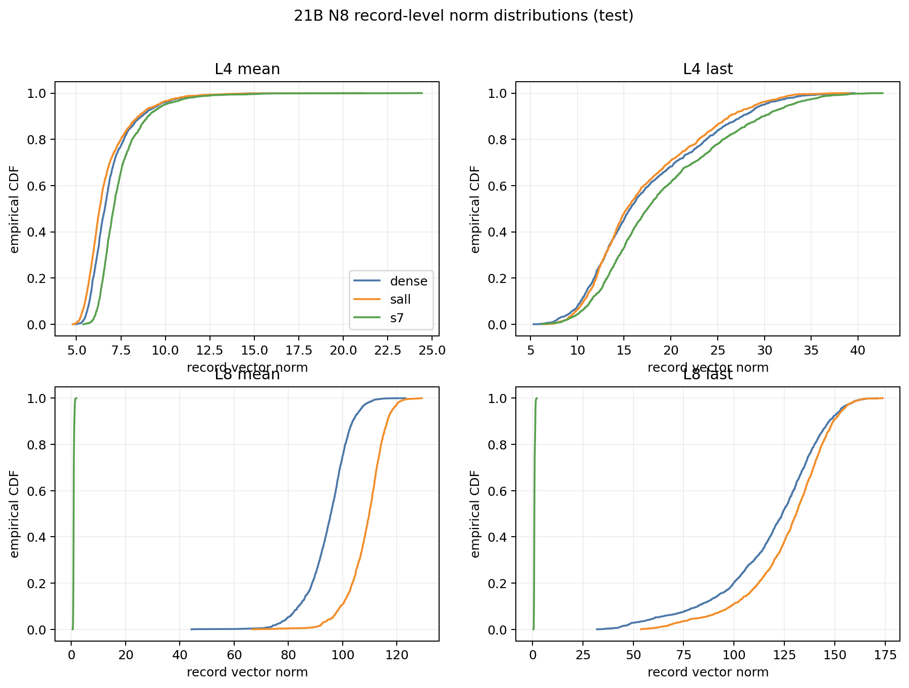
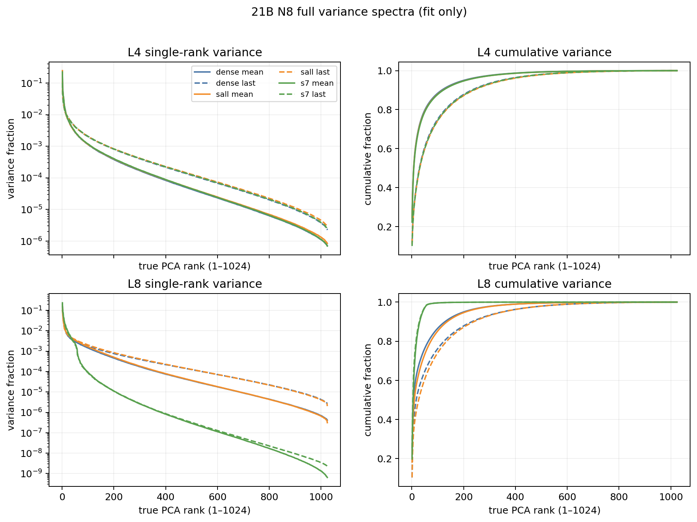
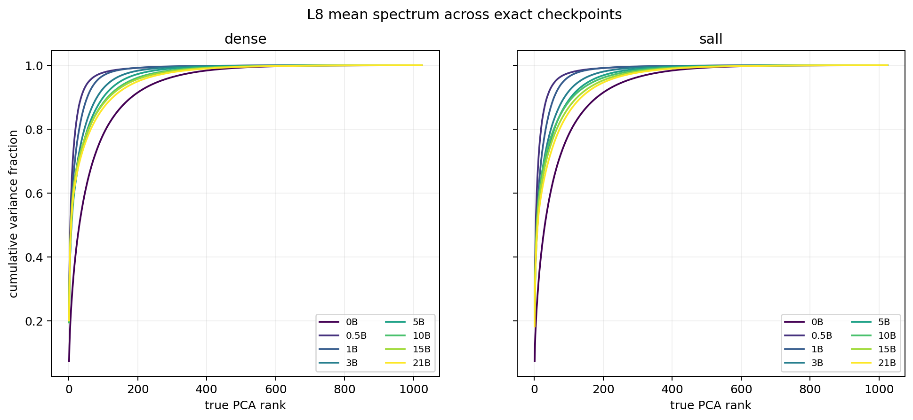
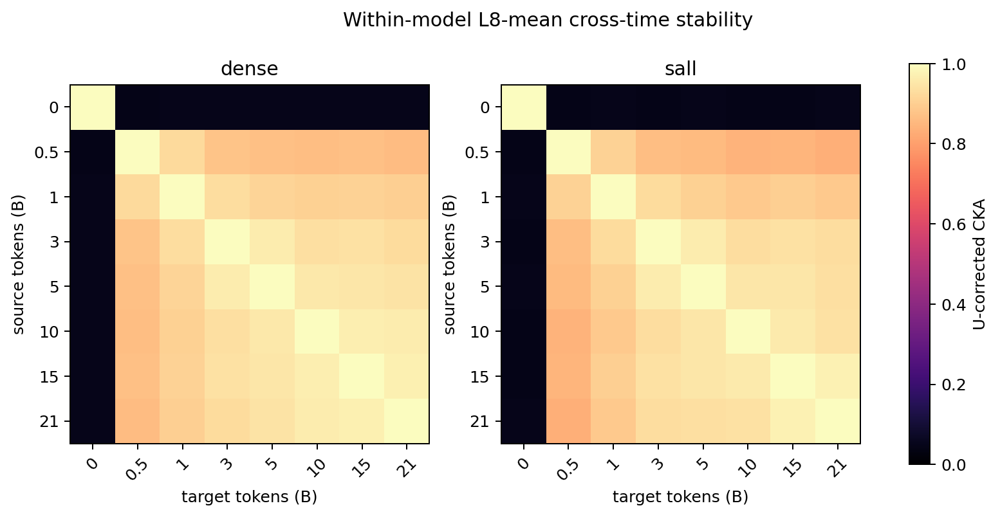
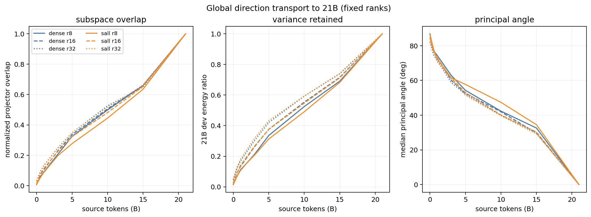
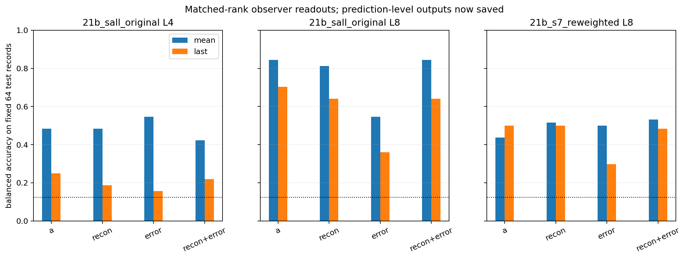

# N8结构诊断阶段I：完整结果报告

状态：`AI_DRAFT_AWAITING_HUMAN_CONFIRMATION`。本报告整理已核验结果，不修改 E06 的主判据、Focus、Anchor 或研究者科学判断。

## 一、目的

本次审计要回答一个有限问题：旁路稀疏自编码器的训练压力，是否让主干中的领域关系形成了更稳定、更清楚、也更容易由观察器忠实读出的组织；还是主要改变了注意力写入的尺度、方差如何分配、具体方向如何旋转，以及字典观察这些向量的方式？

本次只分析自然学术文本的八个发布来源类别，简称 **N8**。N8 的标签是来源类别，不是抽象语义真值。原生注意力写入 \(a\) 是注意力输出投影之后、加回残差之前的向量。稠密基线（Dense）是不含旁路稀疏重构约束的对照；原版八层旁路模型（SALL）在全部八层施加旁路；重加权末层模型（S7）只在第8层使用重加权旁路，它是分叉诊断，不是与 SALL 匹配的剂量对照。

本次术语：

- **中心化核对齐（CKA）**：比较同一批样本之间的相对关系是否相似；它不是语义质量分数。
- **主成分分析（PCA）**：按样本方差寻找正交方向；主成分数不是语义维数。
- **重构 \(hat a\)**：在线稀疏自编码器根据 \(a\) 得到的近似；它不进入当前旁路模型的正常语言预测主路径。
- **重构误差 \(e=a-hat a\)**：重构没有解释的剩余向量；它可读不等于重构中没有同一信息。

执行资格已经完整通过：任务 `pt-n1nn30xg` 平台终态为 `SUCCEEDED`；17个真实检查点的样本ID、输入哈希、来源组和标签逐项一致；五个分析阶段、终止回执、35个正式产物与持久日志全部 `PASS`。正式计算耗时96.84秒，未加载模型、未新提取、未训练，优化器更新为0。

## 二、假设

支持“语义组织改善”的最低预期是：SALL不只让向量变大或换一套坐标，而是在固定N8记录上形成更稳定的领域关系；这种变化应在原生 \(a\) 中可见，不能只存在于重构或稀疏代码里，并且不应与更差的类间／类内分离相矛盾。

最强竞争解释是：旁路主要改变共同偏移、绝对尺度、全局方差集中程度和观察器的读法。若SALL与Dense仍保持高度相似的样本关系，领域读出只出现不确定的小差异，而S7虽然几何变化巨大却读出更差，那么现有证据更支持这个竞争解释。模型是否实际使用这些信息仍需要功能测量，不能由本次几何与读出审计推出。

## 三、分析方法

1. **同一时刻看“尺度与方差怎么变”**：在21B的三模型、第4/8层、正文均值和末词上，报告1600条测试记录的向量长度分布；在2400条拟合记录上计算全部1024个方差方向及累计曲线。范数排查统一缩放和少数极端记录，完整谱排查方差是否集中到少数方向。
2. **沿训练过程看“关系和方向是否稳定”**：对Dense与SALL的0、0.5、1、3、5、10、15、21B八个真实检查点，在第8层正文均值上计算800条开发记录的同模型跨时间CKA；另用固定秩8/16/32比较全局主方向重叠、主角度和后期方差保留。CKA看样本关系，方向重叠看具体高方差轴，二者不能互相替代。
3. **把观察器拆成 \(a\)、\(hat a\) 与 \(e\)**：复用固定64/64/64拟合、开发、测试记录，所有对象都经过拟合集缩放、秩32主成分分析和同一五值正则网格；保存测试预测和八类混淆矩阵。逐词元Top-32代码只盘点，不伪造池化后的同容量读出。

## 四、结论

### 4.1 直接结论

本次新增结构证据没有改变原先的有限判断：**N8不支持“旁路SAE已经让原生领域空间整体变得更好”。** 原版SALL更像是在保留Dense式样本关系的同时，改变末层平均偏移、尺度和方差分配；S7则在最后一层发生幅度极小、谱明显集中、关系结构明显重排的变化，但这没有带来更好的领域读出。

结合此前合格结果，SALL第8层正文均值的领域读出只比Dense高 `+0.75` 个百分点，95%记录配对区间为 `[-0.5625,+2.0625]`；单位范数后缩为 `+0.25` 个百分点。与此同时，类间／类内散度比下降 `-0.03854`，而纯文本词汇基线达到 `89.8125%`。因此这个小正差不能解释成抽象领域语义改善。

### 4.2 尺度变化：SALL主要增加末层平均偏移，S7的异常局限在末层

这张图横轴是每条记录的向量长度，纵轴是“不超过该长度的记录比例”。第4层三模型仍处在相近尺度；第8层S7整体挤到接近零的位置，而不是少量离群点造成。

| 21B读点 | Dense平均长度 | SALL平均长度 | S7平均长度 |
| --- | ---: | ---: | ---: |
| 第4层正文均值 | 6.945 | 6.721 | 7.456 |
| 第8层正文均值 | 94.672 | 108.722 | 0.888 |
| 第8层末词 | 118.679 | 126.851 | 1.029 |

第8层正文均值下，SALL比Dense高 `14.050`，记录配对区间 `[13.905,14.191]`；S7比Dense低 `93.784`，区间 `[-94.170,-93.421]`。但SALL的中心化半径几乎不变：Dense为 `48.634`，SALL为 `48.666`；增加主要体现在平均向量长度从 `81.630` 到 `97.477`。这支持“尺度／平均偏移改变”，但两个模型坐标没有对齐，不能进一步声称沿同一个共同方向移动。

S7在第4层并不小，正文均值甚至比Dense高约7.35%；骤降只出现在旁路所在的第8层。这把瓶颈定位为末层注意力写入，而不是整个网络都缩小。当前没有相加后的残差流和前馈输入，仍不知道主干是否在后续位置补偿了这个小写入。

### 4.3 完整方差谱：SALL略分散，S7在第8层高度集中

左图看每一个真实秩的方差占比，右图看累计方差。第4层三模型的曲线几乎重合；第8层绿色S7曲线很快达到接近100%，说明样本差异集中到少数方向。

| 第8层读点 | 模型 | 解释50%方差所需方向 | 解释90%方差所需方向 | 解释95%方差所需方向 | 有效方差维度 |
| --- | --- | ---: | ---: | ---: | ---: |
| 正文均值 | Dense | 7 | 128 | 201 | 15.45 |
| 正文均值 | SALL | 10 | 137 | 209 | 18.63 |
| 正文均值 | S7 | 5 | 31 | 43 | 13.72 |
| 末词 | Dense | 18 | 233 | 350 | 32.94 |
| 末词 | SALL | 27 | 240 | 353 | 40.57 |
| 末词 | S7 | 5 | 29 | 41 | 10.45 |

SALL相对Dense的方差更分散，S7则显著集中。尤其是S7正文均值的首方向占比 `19.86%` 与Dense的 `20.11%` 很接近，但前16方向累计占比是 `77.28%` 对 `61.43%`，说明只看第一主成分会漏掉真正差异。完整谱中1024个方向均非数值零，但这不表示有1024个语义特征，也不表示S7“只有31维”；这些只是全局方差分配。

时间曲线显示Dense与SALL有相似轨迹：0B解释90%方差需要182个方向，0.5B骤降到36/37个，之后逐步扩展，到21B为128/137个。训练过程不是“越来越稀疏”或“越来越低维”；两条谱系都先快速集中，再逐步展开，SALL终点略更分散。

### 4.4 时间稳定性：样本关系早早稳定，但具体高方差方向仍持续旋转

热图比较同一模型在两个训练时刻如何组织同一批记录。0B到0.5B的CKA只有Dense `0.0443`、SALL `0.0460`，说明初始化关系很快被重写；从0.5B以后，相邻时刻CKA始终很高，Dense为 `0.9221–0.9724`，SALL为 `0.9094–0.9732`。所有预先登记的相邻比较都高于全局和类内乱序95%参照，但Dense与SALL轨迹近似，没有SALL独有的稳定性优势。

方向图进一步表明“样本关系稳定”不等于“具体方向固定”。以秩32为例：

| 来源→21B | Dense方向重叠 | SALL方向重叠 | Dense保留21B方差 | SALL保留21B方差 |
| --- | ---: | ---: | ---: | ---: |
| 0→21B | 0.031 | 0.031 | 0.043 | 0.050 |
| 10→21B | 0.526 | 0.518 | 0.593 | 0.593 |
| 15→21B | 0.649 | 0.659 | 0.738 | 0.741 |

因此，0.5B之后记录间关系可以高度延续，但承担最大方差的具体轴仍逐步旋转；越接近21B，方向重叠和后期方差保留越高。秩8/16/32给出相同定性图景，Dense与SALL也非常接近。这不支持“SAE形成了一组明显更固定的领域方向”。

### 4.5 SAE作为观察器：能读出大部分信号，但不是无损、唯一或功能性解释

虚线是八类机会水平12.5%。每组只含64条测试记录，因此一条记录就是1.5625个百分点。

| 条件 | 原生 \(a\) | 重构 \(\hat a\) | 误差 \(e\) | 重构与误差联合输入 |
| --- | ---: | ---: | ---: | ---: |
| SALL第4层正文均值 | 48.44% | 48.44% | 54.69% | 42.19% |
| SALL第8层正文均值 | 84.38% | 81.25% | 54.69% | 84.38% |
| SALL第8层末词 | 70.31% | 64.06% | 35.94% | 64.06% |
| S7第8层正文均值 | 43.75% | 51.56% | 50.00% | 53.13% |
| S7第8层末词 | 50.00% | 50.00% | 29.69% | 48.44% |

SALL第8层正文均值的重构保留了大部分来源类别读出，说明在线字典不是完全失真的观察器；误差仍可达到54.69%，说明剩余向量也携带可读线索。但这不证明重构独自丢失了这些信息，因为重构和误差可能含有重复线索，且联合输入仍经过新的秩32压缩。

S7中重构的读出高于原生 \(a\)，只能说明“经过该字典与匹配秩投影后，类别线索更容易被这个探针读取”；不能说字典创造了信息，更不能说语言模型使用了重构。24个复现条件中有23个测试分数与旧结果精确一致；唯一差异是S7第8层末词联合输入在64条测试中差一条，旧值50.00%、重算48.44%。开发分数与正则选择全部精确一致，该差异已作为数值边界漂移保留，没有覆盖旧结果。

逐词元稀疏代码 \(z\) 没有被静默池化成新分类器，所以本轮仍不能把Top-32解释为自然语义维数，也没有回答第33名以后是否有用。

### 4.6 认识更新、边界与下一决策

| 要回答的侧面 | 当前结果 | 认识更新 | 仍不能说 |
| --- | --- | --- | --- |
| 主干改变在哪里 | SALL主要改变第8层平均偏移和方差分配；S7的巨大变化局限在第8层 | 变化不是所有层统一发生 | 不知道相加后残差和前馈输入是否补偿 |
| 是否超出尺度 | SALL中心化半径近似不变、完整谱略分散；S7同时缩小并重排 | SALL很大一部分差异与尺度／均值有关；S7不只是统一缩放 | 不能把谱或CKA直接命名为语义机制 |
| 时间上是否更稳定 | 0.5B后两模型CKA都高，方向逐步旋转且轨迹近似 | 没有SALL独有的稳定形成史 | 单谱系检查点不能给训练因果平均效应 |
| SAE读出了什么 | 重构保留多数领域读出，误差也可读 | SAE是部分可信但不完备的观察器 | 误差可读不等于重构独自丢失；\(z\)尚无公平池化对照 |
| 模型是否使用 | 本轮没有功能干预，且重构不进入正常主路径 | 仍为未知 | 不能声称容量、持续学习或预测能力由这些变化改善 |

阶段I至此完整结束。逐词元 \(a/\hat a/e\)、第33名以后原子ID和值、领域低秩分支C、训练与功能干预均未运行。

**AI建议的唯一下一决策：**不要继续用N8追加“SAE领域收益”指标。若研究者仍要解释S7为何末层写入极小，应单独裁定是否批准一个最小传播位置审计：在固定21B小面板上同时读取残差相加前、相加后和前馈输入，检查S7的尺度与关系差异是否被主干后续路径补偿。若差异在相加后基本消失，本轮应收束为局部写入重参数化；若差异持续到下游且关联预测变化，才有理由另行设计功能干预。该建议尚未获批。

证据根：`/data/250010109/MoE_Router/experiments/20260921_sae_domain_structure_stage1/runs/full_retry_8x5090_20260921T091543Z/`。图源和阅读副本说明见[图源清单](../figures/domain_structure_stage1/README_cn.md)。
