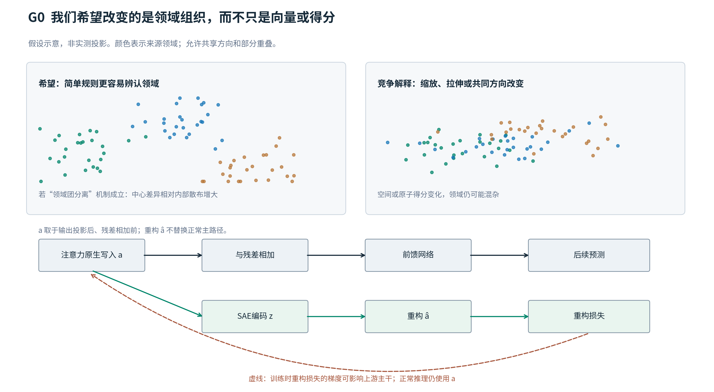
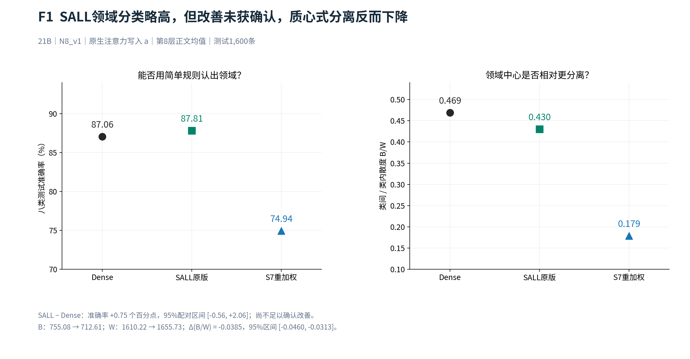
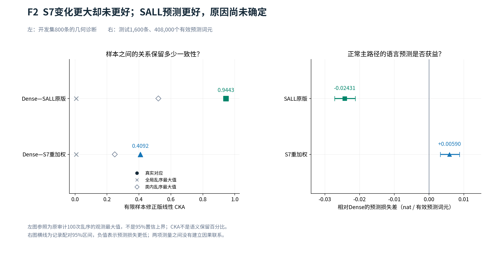
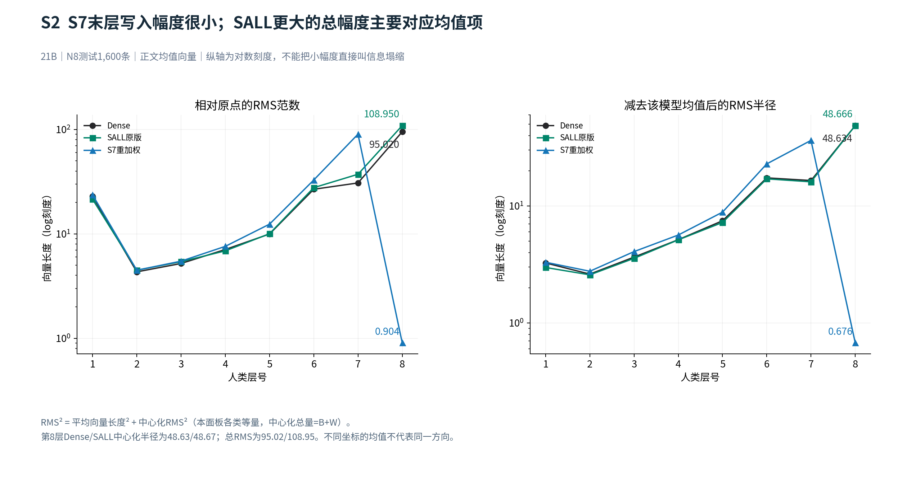
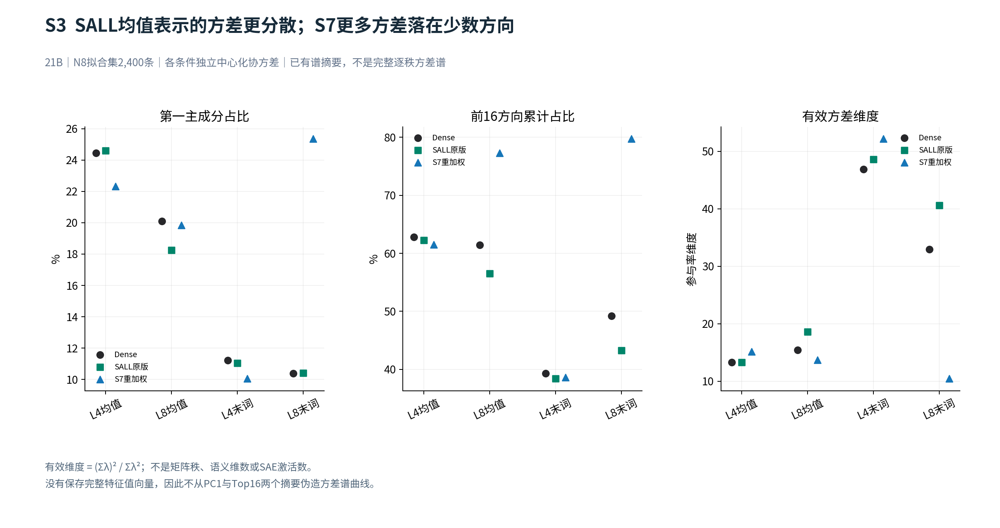
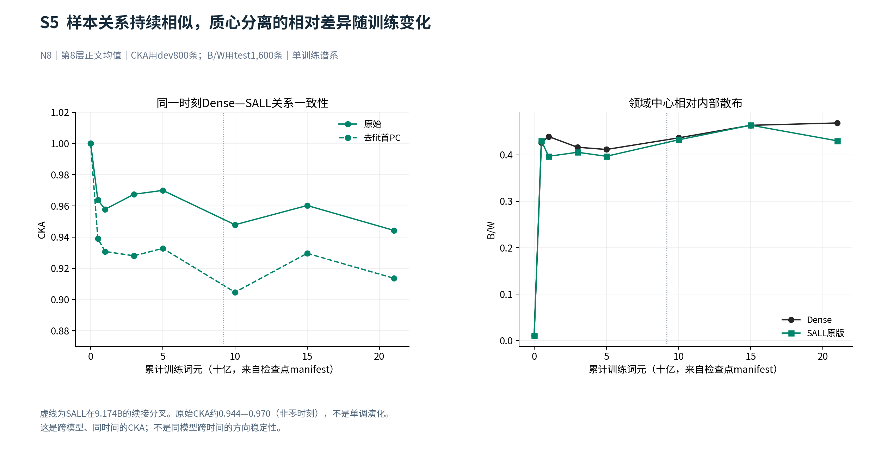
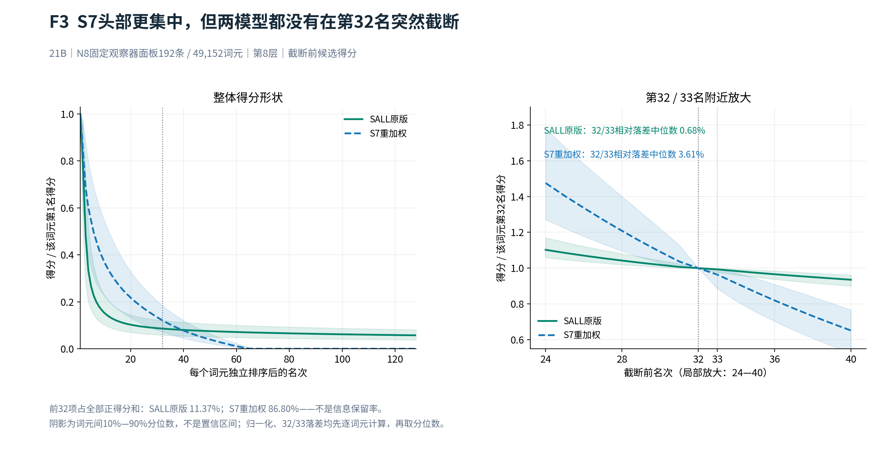

# 0921 组会完整补充版：SAE 让不同领域更容易区分了吗？

> **当前答案：尚未建立稳定改善。SALL 在这些领域文本上的语言预测更好，但不能用“领域分得更开”解释这项收益。S7 的原子得分更集中，也没有带来更好的领域识别。**
>
> 保留四段式结构和完成的补充A/B，补齐结构诊断的图、数值与训练坐标。阅读顺序：目的与假设 → 领域读出 → CKA／范数／谱／演化 → SAE观察器。完整9图和数表见[结构诊断补充分析](../../../Projects/from-attention-to-search/main/research_notes/sae_representation/20260921/meeting_domain_complete/结构诊断补充分析_cn.md)，旧四读点及原子组细节见[原备查](../../../Projects/from-attention-to-search/main/research_notes/sae_representation/20260921/meeting_domain_final/备查与证据_cn.md)。认识措辞状态：`AI_DRAFT_AWAITING_HUMAN_CONFIRMATION`。这是会议阅读稿，不替换实验记录、Focus 或 Anchor。

## 一、目的

**我们要弄清楚：在语言模型训练中加入稀疏自编码器（SAE）的重构约束后，模型内部是否更容易区分不同领域，以及 SAE 的字典方向能否帮助解释这种变化。**

具体做法是给三个模型输入同一批学术文本，取出内部向量，分别问：**领域能否被认出？领域之间是否更分开？字典是否用少量方向表达了领域线索？** 最后单独检查这些文本的语言预测表现。

本轮只主讲自然学术文本的八个来源类别，简称 **N8**。这里的“领域”是数据的来源类别，不能直接等同于片段的全部语义。人工构造关系和同义复述实验放在备查边界，不混入本次领域结论。

## 二、假设

**假设一：SAE 可能让领域信息更容易取出。** 如果成立，同样容量的线性分类器应当更容易从原始向量认出领域。如果具体原因是“不同领域形成更紧、更分开的点团”，领域中心的差异相对领域内部变化也应增大。

我们更一般的直觉是：语义空间可能由多个低维线性子空间组成，SAE 原子可能提供这些子空间的可复用方向。**这是待检验的假设。** 不同领域可以共享方向，子空间也可能相交或具有相同中心；因此，“领域点团没有更分开”不能直接否定子空间假设。

**假设二：如果 32 是得分的自然截断位置，第 32 与 33 名之间应有明显落差。** 这与“保留 32 项是否足够”不同：后者还需要预算变化下的重构和信息保留证据。

最强竞争解释是：约束改变了方向上的方差、样本幅度或字典编码，而没有改善领域组织；分类器也可能主要利用来源词汇线索。

**怎样读：**上半部分是明确标注的假设示意，不是实测二维投影。下半部分说明 SAE 是训练旁支：原始注意力输出继续进入主干，重构向量并不替代它。训练时重构损失可以通过梯度影响上游表示。

## 三、分析方法

- **用同一批输入比较领域可读性与分离程度。** N8 共 4,800 条，每条 256 个正文词元，拟合／开发／测试为 2,400／800／1,600 条，八类均衡。比较 21B 累计训练词元处的 Dense、SALL 原版和 S7 重加权版。向量统一取注意力输出投影后、残差相加前；主讲第 8 层正文均值，第 4 层及最后正文词元完整保留在备查。线性分类准确率回答“能否认出领域”；类间／类内散度比 \(B/W\) 回答“领域中心相对内部散布是否更分开”。
- **分别检查关系、幅度、方差分配和训练演化。** 中心化核对齐（CKA）比较同一批文本的相似关系，报告跨模型逐层、同模型跨层、乱序参照和去首主成分敏感性；范数区分相对原点的长度、平均向量长度和围绕均值的变化；方差谱报告首方向、前16方向占比及有效维度。以检查点实际累计训练词元数为横轴，画Dense／SALL的结构轨迹并标出分叉。语言预测损失单独读取正常主路径。谱用fit、CKA用dev、范数与散度用test；记录配对区间不包含重新训练随机性。
- **先看截断前得分，再检验字典中的类别线索。** 在固定 192 条、49,152 个词元上，逐词元排序候选得分，画第 1–128 名及第 32／33 名附近曲线；在拟合集选择 8 个类别相关原子，固定后检查开发／测试集，与高频和覆盖率匹配随机原子组比较。观察器测试仅 64 条，不能与主读出的 1,600 条混算。

SALL 在全部 8 层有旁支；S7 重加权版只在末层，并经过系数调整。**两者差异不是单独改变旁支层数的匹配因果实验。** `21B` 表示训练词元数，不是模型参数量。

## 四、结论

### 1. 领域已经容易识别，但 SALL 没有稳定地把领域分得更开

**怎样读：**左图看简单分类器能否认出领域，右图看领域中心相对内部散布是否更分开。两个指标没有同步改善。

第 8 层正文均值下，Dense／SALL／S7 的准确率为 **87.06%／87.81%／74.94%**。SALL 多出的 **0.75 个百分点**相当于测试集净多判对 12 条；新补充的 95% 配对区间是 **[−0.56，+2.06] 个百分点**，仍不足以确定稳定正向差异。

同一位置，SALL 的 \(B/W\) 从 **0.469 降到 0.430**，差值区间 **[−0.0460，−0.0313]**。在当前测量口径下，类间量减小、类内量增大，均不支持“中心更远、内部更紧”的解释。分类器只需找到有用方向，而 \(B/W\) 汇总整体散布，因此两者不同向并不矛盾；具体是哪些方向造成差异尚未定位。

补充分析还发现：只用文本词汇的分类器就达到 **89.81%**；逐样本归一化到单位长度后，SALL 的正差缩为 **+0.25 个百分点**。这进一步限制了把微小读出正差解释为抽象语义改善。第 8 层最后词元存在正向结果，但不能据此挑选读点宣布普遍改善，四种读点见备查。

**本页口述：**“我们确实能从表示中认出领域，但 SAE 没有按最初设想，稳定地把它变成更紧、更分开的领域团。”

### 2. 模型的表示组织发生了变化，SALL 也有预测收益；两者之间的原因尚未打通

**怎样读：**左图衡量样本关系的一致性，右图衡量语言预测损失的变化；两图之间没有因果箭头。

Dense—SALL 的 CKA 为 **0.9443**，Dense—S7 为 **0.4092**，两者都高于各自保留类别、打乱样本对应的参照。S7 的结构差异更大，却没有更好的领域读出。新完成的同模型跨层分析进一步定位到最后一层：第 7→8 层 CKA，Dense／SALL／S7 分别为 **0.8999／0.8670／0.4301**。

#### 结构变化还包括幅度与方差分配，不能只讲CKA

**范数回答“写入有多大”。** 21B第8层正文均值的相对原点RMS，Dense／SALL／S7分别为 **95.02／108.95／0.904**；减去各自平均向量后，RMS半径为 **48.63／48.67／0.676**。

**怎样读：**两图都沿真实层号画折线，纵轴为对数。SALL的总幅度更大，但围绕均值的变化与Dense接近；S7的末层注意力写入则在两种口径下都很小。小的是这个注意力输出，不是整个模型的状态；原读出已有尺度处理，不能用“小”直接解释分类下降。源码字段`mean_vector_norm`是平均向量的长度，不是样本长度的平均。

**方差谱回答“样本差异集中在多少方向”。** 第8层正文均值下，Dense／SALL／S7的前16主方向占比分别为 **61.43%／56.51%／77.28%**，有效方差维度为 **15.45／18.63／13.72**。末词下有效维度为 **32.94／40.57／10.45**。

**怎样读：**SALL的全局方差相对更分散，S7更集中，末词尤其明显。有效维度是方差集中度，不是语义数或激活数；它既没有把方向分配给领域，也没有验证子空间并集。本图仅画已保存摘要，完整逐秩特征值曲线仍需从旧fit缓存导出。

**CKA不是仅由一个首方向造成。** 各模型在fit学习并移除自己的首主方向后，L8均值Dense—SALL的CKA从 **0.9443降到0.9136**，Dense—S7从 **0.4092降到0.3273**。主要区别仍在；这只是排查一个竞争解释，没有定位完整机制。逐层和样本数敏感性图见[结构诊断第2节](../../../Projects/from-attention-to-search/main/research_notes/sae_representation/20260921/meeting_domain_complete/结构诊断补充分析_cn.md#2-cka不仅是第8层的一个数字)。

#### 演化已有描述性结论，但不是固定语义方向的形成史

**怎样读：**左图每个时刻比较Dense与SALL，右图看该时刻的领域分离程度。非零时刻的CKA约在 **0.944–0.970**，不单调；SALL的\(B/W\)也没有持续高于Dense。范数和谱的时间曲线见补充S6/S7：有效维度先从0B约65.45降至0.5B约11，之后回升并波动。这些变化不能排列成“越来越稀疏，所以越来越懂语义”。

本轮已逐项核验17个模型检查点：Dense／SALL为真实 **0、0.5、1、3、5、10、15、21B**，S7只有21B。SALL在 **9.174381056B** 续接到4卡，S7在 **15.465567744B** 调系数并改变microbatch划分。详见[真实坐标图和身份表](../../../Projects/from-attention-to-search/main/research_notes/sae_representation/20260921/meeting_domain_complete/结构诊断补充分析_cn.md#6-真实训练词元坐标已逐个核验不按文件名猜时间)。同词元数不自动保证所有训练条件匹配，未测过的时刻不补点。

#### 预测收益是另一条结果，不能由几何分数代替

正常语言预测则给出独立的行为结果：相对 Dense，SALL 的每词元预测损失降低 **0.02431 nat**，95% 配对区间 **[−0.02721，−0.02125]**；S7 增加 **0.00590 nat**，区间 **[+0.00322，+0.00875]**。因此可以说，**这次训练实例中，SALL 在固定 N8 文本上的预测更好；尚不能说收益来自领域分离改善。**

训练演化也有了有限答案：Dense 与 SALL 都从 0B 的 **23.25%** 提高到约 **87%**，但 SALL 相对 Dense 的差值随检查点正负交替，没有持续拉大。共同的训练成长不能全部归给 SAE；S7 本轮没有完整的早期轨迹。

**本页口述：**“模型不是没有变化，而是空间变化、领域识别和语言预测没有形成一条简单的单调关系。”

### 3. S7 的得分更集中，但 32 不是已验证的自然断点；SALL 字典中已有可复现的类别线索

**怎样读：**横轴是每个词元独立排序后的名次，不是同编号原子的轨迹。先逐词元归一化，再画中位数；阴影是词元间分布范围，不是置信区间。

在**同一层、同一批输入、各自 30,000 个字典原子、同样保留 32 项**的条件下，SALL／S7 的截断前正候选数中位数是 **2,435／64**，前 32 项占全部正得分和 **11.37%／86.80%**。S7 确实集中得多，但第 32／33 名相对落差中位数只有 **0.68%／3.61%**，没有支持第 32 名处存在明显断崖。这里测的是得分，**86.80% 不是语义信息保留率**。

所以，S7 与 SALL 的激活差距是对应输入下的真实描述性差异；它的原因还不能拆分为旁支层数、正则强度或训练谱系中的某一个因素。S7 重构自身向量的误差更低，但领域读出更差，也说明重构更准不能直接代表领域组织更好。

补充原子组检验提供了另一条正面结果：SALL 第 8 层在拟合集选出的 8 个原子，在留出测试上的类别准确率为 **57.81%**，高频组为 **35.94%**，覆盖率匹配随机组中位数为 **23.44%**。这支持“字典中有可复现的来源类别线索”，**尚不支持抽象语义原子、子空间并集，或模型实际使用了这些原子**。

**本页口述：**“SAE 能给我们一种带有类别线索的观察方式，但原子更集中不等于主干的领域组织更好。32 目前是预算，是否足够还没有答案。”

### 下一步：先补缓存中的结构细节，再决定是否进入新的机制实验

**AI建议：先完成完整谱、范数分布和同模型跨时间关系的缓存分析。** 当前时间曲线不是同模型跨时间CKA；谱摘要也不是完整谱。把这两处补齐后，才能更有根据地区分尺度、少数主方向和时间变化。

[交给实验AI的prompt](../../../Projects/from-attention-to-search/main/research_notes/sae_representation/20260921/meeting_domain_complete/交给实验AI_补充数据_prompt_cn.md)已列出输入、计算、图表、解释分支和停止条件。已有A/B不重做；原C子空间检验、K>32、残差／前馈新取点与功能干预单列为后续范围，未执行。补齐缓存诊断后，唯一下一科学决策仍是：是否有值得进一步检验的领域相关方向结构；若没有，就保留当前有限结论，而不为了支持SAE追加指标。
