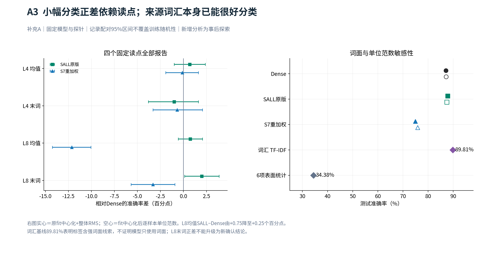
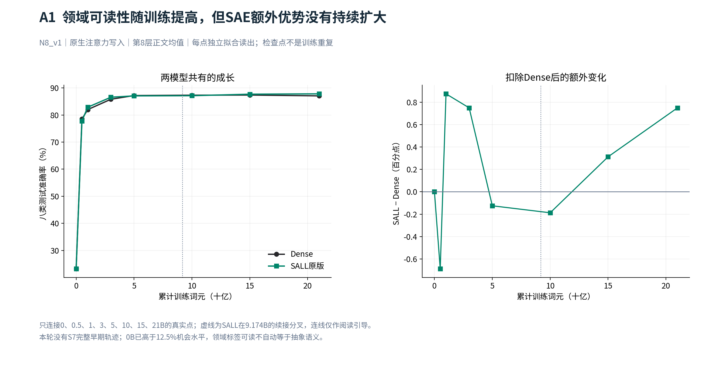
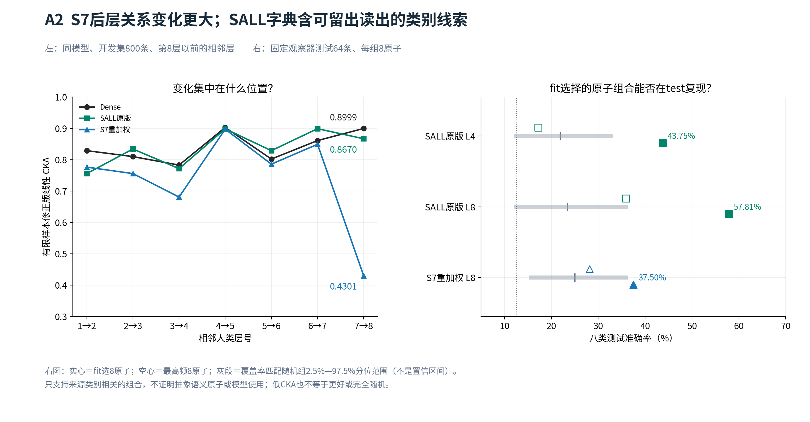

# 0921 组会备查：完整对照、标定与后续交接

主讲稿：[SAE 让不同领域更容易区分了吗？](focus_meeting_sae_domain_cn.md)。本页补充读图和追溯信息，不把事后分析改为预注册确认结果。

## 本次更新了什么

| 模板中的旧状态 | 已核验的新证据 | 报告如何更新 |
|---|---|---|
| 分类配对区间待补 | 补充 A 已完成，固定条件精确复现；记录分层配对重采样 2,000 次 | F1 写入区间，A3 展示全部四种读点 |
| 词汇、幅度和类别贡献待补 | 词汇／表面基线、单位范数读出、逐类别贡献已保存 | 保留来源线索竞争解释，避免把小正差说成抽象语义改善 |
| 同模型跨层 CKA 未完成 | 补充 B 已完成 1–8 层矩阵及标定 | A2 展示相邻层折线，定位 S7 的末层差异 |
| 原子是否对应类别待核验 | fit 选原子、dev/test 固定复核，高频／随机对照完成 | 只能称来源类别相关原子组合 |
| 决策是先执行 A/B | A/B 终态 PASS，C 未执行 | 下一决策改为是否继续领域子空间问题 |

新稿读取了合格根的终态凭证、结果 JSON 和排名缓存，不仅沿用模板中的旧快照。原模板、原报告和 0920 对话 memory 均未修改。所有新增表述仍为 AI 整理，待研究者确认科学判断。

## 数据与比较身份

八类为 `cs.CL`、`cs.CV`、`math.AG`、`math.NT`、`physics.flu-dyn`、`physics.optics`、`q-bio.GN`、`q-bio.NC`。每类 fit/dev/test 为 300/100/200 条，窗口 256 个正文词元。这是已知来源类别的新记录识别，未证明论文级隔离、预训练去重或逐片段真实语义标签。

观察器面板每类每个 split 各 8 条，总计 192 条；test 为 64 条。49,152 个词元不是独立实验重复。排名分布描述合并三个 split，原子选择则只用 fit。主干向量 $a$、重构 $\hat a$、误差 $e=a-\hat a$ 是不同观察对象。

SALL 原版为八层旁支；S7 重加权为末层旁支且系数从 1 调到 0.1 的分叉条件。二者不能作“只改层数”的因果对照。Dense 没有在线字典；本次没有给 Dense 另拟合字典。旧截图的 norm2 取点和旧 1,200 条 N 面板不得拼入本次 raw-attention N8 曲线。

## 四个读点完整对照

准确率单位为 %，差值及区间单位为百分点。类别均衡，因此本表准确率与类别平均准确率一致。

| 条件 | Dense | SALL 原版 | S7 重加权 | SALL−Dense［95%配对区间］ | S7−Dense［95%配对区间］ |
|---|---:|---:|---:|---|---|
| 第4层均值 | 82.8125 | 83.5000 | 82.6875 | +0.6875［−1.0000, +2.3750］ | −0.1250［−1.9375, +1.6250］ |
| 第4层末词 | 57.5000 | 56.5000 | 56.8125 | −1.0000［−3.8125, +1.6250］ | −0.6875［−3.3125, +2.0625］ |
| 第8层均值 | 87.0625 | 87.8125 | 74.9375 | +0.7500［−0.5625, +2.0625］ | −12.1250［−14.2500, −10.0625］ |
| 第8层末词 | 80.5000 | 82.5000 | 77.1875 | +2.0000［+0.1250, +3.8766］ | −3.3125［−5.6891, −0.9359］ |



**怎样读：**左图区间跨零时，当前记录不能确定差值方向。第8层末词的 SALL 区间不跨零，但它是四个事后条件之一，没有“任一条件阳性即成功”的预设规则。右图空心点是逐样本单位范数处理；TF-IDF 用词汇频率及其在不同文本中的区分度分类，89.8125% 说明来源标签有很强词面线索，不证明模型只使用词面，也不是容量匹配的模型能力排名。

原读出已做 fit 中心化和单一整体均方根缩放；所以不能把 S7 下降单独归因于向量整体缩小。逐样本单位范数进一步去掉记录间长度差异，L8 均值 Dense／SALL 为 87.1875%／87.4375%；它是敏感性对照，不是选出的新主指标。

### 主读点的几何分解

| 量 | Dense | SALL | SALL−Dense | 95%记录配对区间 |
|---|---:|---:|---:|---|
| 类间散度 $B$ | 755.0772 | 712.6109 | −42.4664 | [−51.9519, −32.6715] |
| 类内散度 $W$ | 1610.2226 | 1655.7266 | +45.5040 | [+33.5151, +56.6111] |
| $B/W$ | 0.468927 | 0.430392 | −0.038536 | [−0.046009, −0.031310] |

“中心更靠近、类内更散”限定于当前坐标和测量口径；跨模型原始 $B$、$W$ 的绝对值还涉及尺度，整体缩放不改变比值。因此以 $B/W$ 的下降反驳当前质心式解释，不将单个分子变化推广成所有几何性质退化。第8层末词的 $B/W$ 则约为 Dense 0.141、SALL 0.152、S7 0.179；该位置 S7 比值较大而分类较差，再次说明两个问题不等价。

## 训练演化已经回答到哪一步



| 累计训练词元（十亿） | 0 | 0.5 | 1 | 3 | 5 | 10 | 15 | 21 |
|---|---:|---:|---:|---:|---:|---:|---:|---:|
| Dense 准确率（%） | 23.25 | 78.50 | 82.00 | 85.8125 | 87.1875 | 87.3125 | 87.3750 | 87.0625 |
| SALL 准确率（%） | 23.25 | 77.8125 | 82.875 | 86.5625 | 87.0625 | 87.1250 | 87.6875 | 87.8125 |
| 差值（百分点） | 0 | −0.6875 | +0.8750 | +0.7500 | −0.1250 | −0.1875 | +0.3125 | +0.7500 |

**可讲：**领域来源信息随训练更容易线性读出，但 SALL 的额外优势没有持续扩大。**不能讲：**某个固定语义方向持续形成、跨种子规律、S7 的完整演化。每个检查点独立拟合读出；相同训练谱系不是独立重复。图中标出 SALL 9.174381056B 的续接分叉，不把全程当成未变化的训练条件。

0B 的 23.25% 已高于八类机会水平 12.5%，说明标签可读也可能依赖输入统计与随机网络保留的信息，不能把所有准确率都解释为训练学得的抽象语义。

## CKA 如何标定，同模型跨层是否要做

**采用参照标定，不设置通用的“0.8 以上相似”阈值；同模型跨层已经做完。** CKA 比较样本间关系，对统一缩放、正交坐标变化不敏感；高 CKA 不等于两个模型功能相同，低 CKA 也不表示没有信息。

F2 按模板保留原审计的 **100 次乱序最大值**。补充 B 另有真正由置换分布计算的 **95% 分位数**。二者不可换名或混用；分位参照不是观测 CKA 的置信区间，也不是语义质量阈值。

| 第8层均值比较 | 实测 CKA | 原全局乱序最大值 | 原类内乱序最大值 | 补充全局乱序 q95 | 补充类内乱序 q95 |
|---|---:|---:|---:|---:|---:|
| Dense—SALL | 0.9443 | 0.0074 | 0.5216 | 0.0022 | 0.5101 |
| Dense—S7 | 0.4092 | 0.0075 | 0.2487 | 0.0031 | 0.2429 |

类内乱序保留来源类别，却打乱同类记录的对应。真实值高于它，表明关系一致性超出了共同类别分组；仍不能称“保留 94.43% 语义”。若研究目标是证明两个表示足够等价，还需要围绕具体用途设等价界限，当前没有这样的已注册界限。



**怎样读左图：**横轴为有顺序的相邻层，连线表示同一模型沿深度的关系变化。S7 第7→8层为 0.4301，明显低于 Dense 的 0.8999 和 SALL 的 0.8670，支持末层差异的定位。不能把旁支所在位置与变化位置对应，直接升级为某个训练因素的因果效应。

## 原子差距是否对应测试，32是否合理

| 截断前指标，中位数 | SALL 第4层 | SALL 第8层 | S7 重加权第8层 |
|---|---:|---:|---:|
| 正候选原子数 | 4,720 | 2,435 | 64 |
| Top32／全部正得分和 | 4.55% | 11.37% | 86.80% |
| 逐词元 $(s_{32}-s_{33})/s_{32}$ | 0.60% | 0.68% | 3.61% |

F3 已核验 SALL／S7 共 49,152 个词元的记录身份、输入哈希和位置逐项一致。比较的是同输入下各自字典的分布，**没有假设两个字典的同编号原子对应同一种语义**。S7 的高集中现象也没有只出现在某一个 64 词元位置段；补充 B 的分段均值与本表全体中位数不是同一统计量。

当前可以回答导师：前32与后续候选既不是处处平均，也没有在32处突然断开。SALL 有大量低分长尾；S7 的总正得分更集中在头部，但第33名仍与第32名接近。**保留32是既有预算；目前既不能说最优，也不能仅凭长尾说太小。**

### 留出原子组对照

| 条件 | fit选8原子，test准确率 | 高频8原子 | 随机组中位数 | 200组随机对照的2.5%–97.5%范围 |
|---|---:|---:|---:|---|
| SALL 第4层 | 43.7500% | 17.1875% | 21.8750% | [12.4609%, 32.8125%] |
| SALL 第8层 | 57.8125% | 35.9375% | 23.4375% | [12.5000%, 35.9375%] |
| S7 第8层 | 37.5000% | 28.1250% | 25.0000% | [15.6250%, 35.9375%] |

**怎样读 A2 右图：**实心为 fit 选择的组合，空心为高频组合，灰段是覆盖率匹配随机组的分布范围，不是置信区间。SALL 第8层的8个候选在 dev/test 均保持正类别偏好；这支持小面板上的来源类别线索，不支持抽象语义命名或功能使用。64条 test 也不足以独自确认广泛稳定性。

第8层均值的整体池化相对重构误差，SALL／S7 为 **19.48%／17.19%**，说明观察器有误差，且 S7 对自己的目标重构更准。补充报告中先按类别计算再平均的约19.4%／17.3%是另一汇总口径，不混写。缓存未保存逐词元原始向量和重构，因此分位置重构误差仍为 **MISSING**。

## 覆盖矩阵与未回答问题

| 要回答的问题 | 当前状态 | 能更新的认识／剩余边界 |
|---|---|---|
| SAE是否改善领域可读性 | 终点、四读点、配对区间、词汇及幅度对照完成 | 主读点小正差不稳；不支持普遍改善 |
| 领域团是否更分离 | $B$、$W$、比值及配对区间完成 | 主读点质心式解释不获支持；非所有子空间性质 |
| 表示变化在哪些层 | 跨模型及同模型1–8层CKA完成 | S7末层变化突出；没有训练因素因果归因 |
| 训练中如何形成 | Dense/SALL真实0–21B点完成 | 额外优势不持续增长；无S7全轨迹、无方向跨时间对齐 |
| 是否伴随预测收益 | 固定N8正常路径NLL及配对区间完成 | SALL正面结果；不证明由领域分离中介 |
| 原子是否带类别线索 | fit选组、留出验证、高频／随机对照完成 | 来源类别相关组合；非抽象语义或使用证据 |
| 32是否自然断点 | 截断前排名、边界、分位置得分完成 | 不支持明显断点；最优K仍未知 |
| 是否存在稳定领域子空间 | **C NOT RUN** | 未直接验证子空间并集、可复用方向或跨时间稳定性 |
| 模型是否使用这些方向 | **未执行干预** | 外部读出不能替代功能证据 |

人工关系和自然复述分析不进入本次主讲。原21B人工关系 P 面板的注册正向主判据未通过；N8的局部正差不能覆盖它。图中的 N8 Dense—S7 CKA 是0.4092，不能以旧 P 面板约0.196替代。

## 剩余任务如何交接

**当前只有一个待研究者裁定的决策：是否继续领域相关子空间问题。** 下列是条件式交接内容，不表示本次已经批准或执行新实验。

| 优先级／触发条件 | 原实验Agent需完成的内容 | 可判读的交付与停止规则 |
|---|---|---|
| 已有结果归档 | 核对E06–E08的Summary／Detailed与合格结果根，补齐事实记录；保持N8事后属性及P主判据 | 不从会议稿反向生成科学批准；发现源冲突先保留并定位 |
| 仅当研究者选择继续C | 固定21B、L8-mean、Dense/SALL、相同样本与变换；只在fit估计领域方向；先冻结主秩和多秩解释规则 | 在留出集比较本类投影与异类／随机分组、同容量全局方向对照，报告方向重用和模型差异 |
| C的目的与假设 | 目的：分清“共同的类别低秩结构”与“SAE使该结构更强”。假设：fit方向可在留出记录复现，且有超出同容量对照的领域特异性 | 只有共同结构：不叫SAE收益；SALL优势未分离或只在挑选秩成立：不支持增益；样本不足或数值不稳：Unknown |
| 若未来单独研究K预算 | 先补第33名以后原子ID及解码所需系数；固定字典的推理K敏感性与重新训练不同K分开 | 同时报告重构与领域信息变化；不能只画正得分和选择K；不在本轮启动训练扫描 |
| 若未来研究模型使用 | 为具体方向设计受控干预、匹配扰动及功能读出 | 必须排除普遍破坏效应；当前外部分类和CKA均不足以回答 |

现有 `rank_scores_1_to_128` 只有得分，保存的原子ID限Top32，**不足以直接解码K>32**。分位置重构也需要新增提取。这两项不应交接成“仅靠已有缓存即可完成”的任务。

若停止领域收益分支，本轮已足以汇报三条认识及其边界，不需要为了组会补一张看起来分开的二维投影。

## 图源、复现与文件清单

主图G0／F1／F2／F3，备查A1／A2／A3；每图都有PNG、PDF、SVG。模型固定配色：Dense深灰圆点，SALL绿方块，S7蓝三角。时间、层号、名次用折线；无序模型用点图，不使用柱状图或任意连线。

- [完整图源清单与SHA256](../figures/domain_meeting_final/figure_manifest.json)：120个输入文件、7图、21个输出及筛选字段。
- [制图脚本](assets/build_figures.py)：只读取完成结果和缓存；不加载模型、不拟合分类器、不重采样、不改统计检验。排名曲线只重新汇总已有得分。
- [图中数值摘录](assets/figure_values.json)：用于核对主图、训练曲线与原子组数值。
- [原文件哈希快照](assets/input_document_hashes.json)：核验本次没有改写输入文档。
- [原四段式模板](../docs/meeting/0921_SAE领域表征_四段式组会稿与制图规范_cn.md)、[领域主线旧稿](../focus_meeting_sae_domain_separation_cn.md)、[已完成补充A/B报告](../sae_domain_supplementary_results_cn.md)、[原补充设计](../sae_domain_supplementary_experiments_cn.md)。设计中的NOT RUN不是最新执行状态；执行以合格根为准。

执行工作区原始证据保留在原位置，未复制到研究主线：

```text
R21=/data/250010109/MoE_Router/experiments/20260920_sae_representation_21b_audit/runs/full_4x5090_retry2_20260921T0200Z
R15=/data/250010109/MoE_Router/experiments/20260920_sae_representation_15b_early_audit/runs/full_15b_4x5090_20260920_wave1
R08=/data/250010109/MoE_Router/experiments/20260920_sae_representation_15b_early_audit/runs/full_early_4x5090_20260920_wave1
RS=/data/250010109/MoE_Router/experiments/20260921_sae_domain_supplementary_analysis/runs/full_local_cpu_20260921T0645Z
```

| 图 | 数据入口与口径 |
|---|---|
| G0 | 人工假设示意；无实测嵌入、无模型数值 |
| F1 | R21 `analysis/primary/primary_metrics.json`、`analysis/geometry/geometry_cka.json`；RS `readout/domain_readout_metrics.json`；N8/L8/mean |
| F2 | R21 `analysis/geometry/geometry_cka.json` 的 `n8_cka_dev_permutations`；`analysis/cost/n8_test_nll.json` 的 `paired_contrasts` |
| F3 | R21 worker_1／2 的observer manifest及N8/L8 NPZ；逐词元归一化后汇总10/50/90分位；输入身份严格匹配 |
| A1 | R08 `analysis/time_<真实词元数>`、R15 `analysis/15b`、R21 `analysis`，均为N8/L8/mean |
| A2 | RS `observer/observer_and_layer_metrics.json`；同模型mean/U修正矩阵及固定原子组留出结果 |
| A3 | RS `readout/domain_readout_metrics.json`；四读点配对、两种幅度处理、词汇与表面基线 |

复现命令：`python daily_research_reports/0921/meeting_domain_final/assets/build_figures.py`。需原执行工作区、NumPy、Matplotlib、fontTools；脚本使用Noto Sans SC中文字体，缺失时从Google Fonts官方仓库下载，生成常规／粗体静态字重。输出覆盖范围仅限本次新增图目录及数值摘录。

**恢复点：**从研究者对是否继续C的判断恢复，不重新执行已完成A/B，也不把会议阅读稿当作执行授权。
