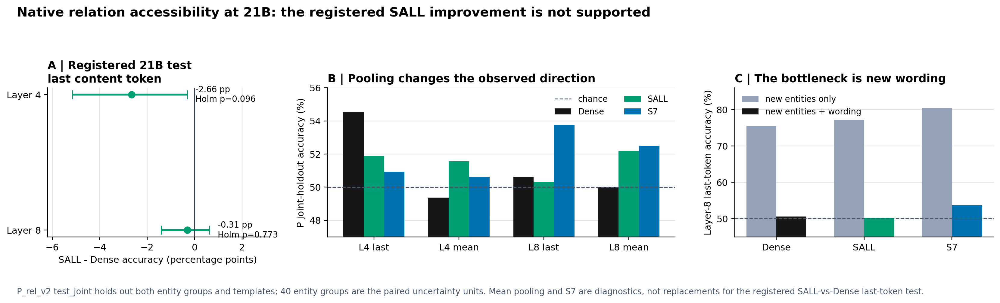
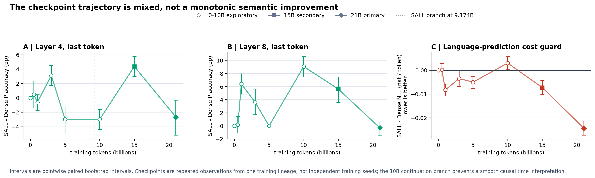
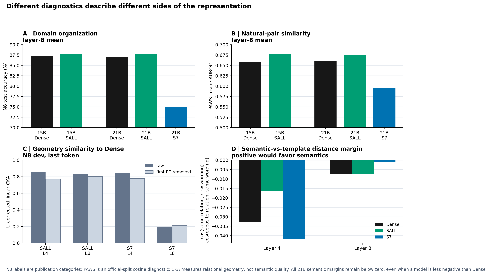
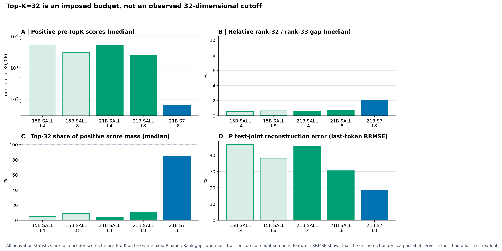
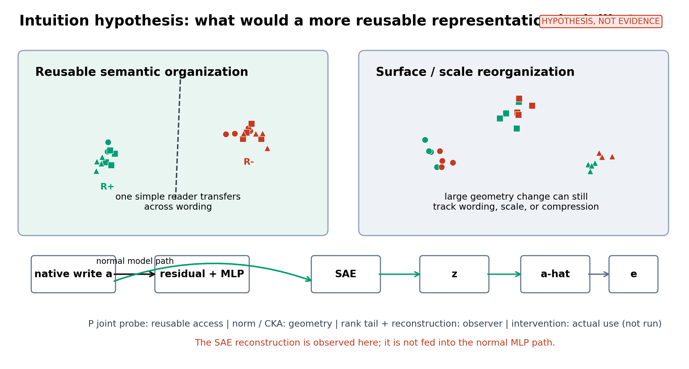

# SAE 旁路是否形成了更可复用的表征？——冻结 checkpoint 表征空间审计

```text
status: AI_DRAFT_AWAITING_HUMAN_CONFIRMATION
scope: A15_17_E06 + E07 + E08 completed full runs
result_role: meeting brief and explanatory reading surface, not a Focus/Anchor state transition
```

**一句话结论：** 旁路训练确实改变了主干注意力写入的尺度和样本间几何关系，也在领域分类、自然句对和部分训练点上出现局部正差；但预注册的 21B 主检验没有发现 SALL 在未见实体、未见表达上的关系方向更容易从原始主干写入中读出。因此，本轮不支持“SAE 旁路已经把主干组织成更稳定、可跨表达复用的关系语义空间”。SAE 也只是部分观察器，Top-K=32 不是数据中自然出现的 32 维断点。模型是否实际使用这些信息仍未被本轮检验。

## 1. 目的

本轮问的不是“Dense、SALL、S7 谁赢”，而是一个机制问题：训练时给注意力输出加稀疏重构压力，是否让主干把同一层意思在不同说法、不同语境中放到更稳定、简单读法也能复用的位置；还是主要改变了向量大小、样本聚散、模板反应或 SAE 自己的观察方式。我们在完全冻结的 checkpoint 上读取原生注意力写入 \(a\)，不训练主干、不训练新字典，也不把 SAE 重构送回模型正常前向。

这里必须分清四个对象：\(a\) 是主干原生注意力写入；\(z\) 是 SAE 选出的稀疏系数；\(\hat a\) 是 SAE 重构；\(e=a-\hat a\) 是重构误差。主问题看 \(a\)，因为正常模型继续计算时真正进入残差路径的是 \(a\)；\(z\)、\(\hat a\)、\(e\) 只用来检查 SAE 是否把 \(a\) 看清楚。

## 2. 假设

如果旁路真的形成了更可复用的关系组织，那么在相同输入、相同层、相同位置上，一个只在拟合集学习的简单线性读法，应当能在**新实体和新表达同时出现**时，从 SALL 的原生 \(a\) 中比 Dense 更准确地读出关系方向；这种优势不能只存在于某一个模板、某一种汇聚方式或某一个训练点。

最强竞争解释是：旁路确实改变了空间，但改变主要是尺度、共同方向、类内压缩、模板偏置或 SAE 重构方式。这样会让 CKA、范数、谱、某些读出甚至某个 checkpoint 看起来不同，却不形成跨表达可复用的语义轴。即使线性探针成功，也只说明“外部简单读法能取出”，不能自动说明模型自己在预测时使用了这部分信息。

## 3. 分析方法

- **先问原生主干里能不能跨表达读出。** 在 Dense、原版八层旁路 SALL 和重加权单层旁路 S7 的冻结写入 \(a\) 上，P_rel_v2 同时留出实体组与模板；21B 的 SALL−Dense、第4/8层、最后正文词元是预注册主检验。正文均值、S7、15B 和 0–10B 轨迹是定位与稳健性检查，不能替换 21B 主结果。
- **再问差异到底是语义还是观察方式。** 实体单留出、模板单留出、词袋对称反例和语义距离间隔检查表面线索；N8 看学术领域组织，PAWS 看自然句对相似；范数、谱、类间/类内量 \(B/W\) 和 CKA 分别检查尺度、集中度、类别分离和样本间几何关系。任何一个几何指标都不单独定义“语义更好”。
- **最后问 SAE 看到了多少，以及是否有代价或实际使用证据。** 在同一输入上比较 \(a,z,\hat a,e\)，检查第32/33名激活、正激活数量、Top-32 得分质量和重构误差；固定 N8 文本上的 NLL 只作语言预测代价护栏。本轮没有做选择性功能干预，因此不回答模型是否使用某个候选语义方向。

| 分析/指标 | 白话定义 | 看模型哪一面 | 本轮不能据此声称 |
|---|---|---|---|
| P `test_joint` 线性准确率 | 在实体和说法都没见过时，简单直线能否分开两个关系方向 | 跨实体、跨表达的线性可读性；本轮主指标 | 模型实际使用、整体语义质量 |
| 配对 bootstrap、符号翻转、Holm 校正 | 以40个实体组为独立单位，检查模型差值是否稳定并控制两层多重检验 | 主差值的不确定性与判决资格 | 多训练种子的因果平均效果 |
| P 实体/模板单留出与词袋反例 | 分别只换实体、只换表达，并用完全词袋对称的正反例排除捷径 | 差异卡在实体还是表达，是否能由词面解释 | 自然语言全面泛化 |
| 语义距离间隔 | “同关系不同说法”的相似度减去“反关系同说法”的相似度 | 空间更跟语义走，还是更跟模板走 | 线性可读性或模型使用 |
| N8 准确率 | 从写入向量预测八个论文来源类别 | 粗粒度领域组织 | 逐段语义、关系语义 |
| PAWS AUROC/AP | 用两句话向量的余弦相似度区分复述与非复述 | 自然句对相似结构 | 来源隔离后的确认性结论或下游任务收益 |
| 范数、谱、\(B/W\) | 看大小、方差是否集中、类间差异相对类内噪声多大 | 尺度、压缩和类别几何 | “维度越低/聚类越紧就越语义” |
| 线性 CKA | 比较两模型对同一批样本的两两关系结构是否相似 | 整体几何是否重排，以及去掉第一共同方向后是否仍不同 | 哪个空间更好、差异是否由 SAE 导致 |
| 第32/33名、正激活数、Top-32质量 | 在截断前看第32名是否出现自然断崖，Top-32占全部正得分多少 | K=32 是自然稀疏尺度还是人为预算 | 主干只有32维、原子数等于语义特征数 |
| 重构 RRMSE 与 \(a/\hat a/e\) 匹配读出 | 看 SAE 重构离原向量多远，误差是否还携带标签信息 | SAE 作为观察器的忠实度 | \(e\) 能预测就等于 \(\hat a\) 已丢失信息 |
| 固定文本 NLL | 同一批文本上每个有效预测词元的语言损失，越低越好 | 语言预测代价护栏 | 表征是否更语义 |

## 4. 结论

1. **21B 主问题的直接答案是不支持改善。** SALL−Dense 的 P 联合留出差值在第4层为 \(-2.66\) 个百分点，95% 配对区间 \([-5.16,-0.31]\)，但两层 Holm 校正后 \(p=0.096\)；第8层为 \(-0.31\) 个百分点，区间 \([-1.41,+0.63]\)。所以预注册的正向标准两层都没有通过。第4层方向上更差，但校正后未过 0.05，不能进一步升级为“已确认稳定退化”。正文均值下两层都出现约 \(+2.19\) 个百分点的描述性正差，反而说明结果依赖观察位置，不能用均值结果替换最后词元主检验。

   

   **怎么看：** 左图是唯一预注册主差值；中图显示换成正文均值会改变方向；右图显示三个模型在只换实体时都能达到约 76%–80%，但实体与说法一起换时都跌回约 50%–54%。这把主要瓶颈定位在跨表达，而不是“完全没有关系信息”。词袋、长度、末词和实体集合完全匹配的反例基线正好是 50%，所以这个失败不能简单归因于这些显式词面特征。

2. **训练过程中出现过局部正差，但它不是稳定、单调的关系语义改进。** 15B 时 SALL−Dense 在第4/8层最后词元分别为 \(+4.38\)、\(+5.63\) 个百分点，但增益主要来自 containment 一类；同一时点的语义距离间隔仍为负，而且 SALL 比 Dense 更负。0–10B 更是反复换号：例如10B 第4层为 \(-2.97\) 个百分点，而第8层为 \(+9.06\)；到21B两层又都不支持正差。checkpoint 是同一训练谱系中的重复观察，不是独立训练种子，且 SALL 在 9.174B 有续接分叉，因此不能把折线解释成平滑因果轨迹。

   

   **怎么看：** 左、中两图在零线上下反复变化，表示跨表达读出没有持续同向；右图显示 NLL 也会换号——10B SALL 略差，15B 和21B反而较好。loss 是必须保留的代价证据，但没有资格替代语义判定。

3. **“空间发生变化”成立，但“变化就是更好的语义组织”不成立。** 21B 的领域读出中，SALL 第8层正文均值为 87.81%，Dense 为 87.06%，只差 \(+0.75\) 个百分点；PAWS AUROC 为 0.6755 对 0.6609，差 \(+0.0146\)。这些是小幅、对象特定的正差，说明不能把主结果说成整体表征塌缩。相反，S7 第8层相对 Dense 的 U-corrected CKA 只有约 0.196，P 写入均值范数也从约 123 降到约 1.01，几何变化极大；但它的 N8 准确率从 87.06% 降到 74.94%，PAWS AUROC 从 0.6609 降到 0.5964。这个对照直接说明“大幅重排/压缩”不等于“语义更好”。去掉第一主方向后，Dense–SALL 的第4/8层 CKA 仍约为 0.770/0.804，说明变化也不只是一个共同方向或纯尺度问题。

   

   **怎么看：** 上排分别是领域和自然句对，回答“某类信息是否可读”；左下 CKA 只回答“空间关系变了多少”；右下语义间隔在所有21B模型上都小于零，表示同模板的影响仍强于同关系跨模板的对齐。四幅图不能合成一个“表征总分”。

4. **SAE 是部分观察器，当前数据不支持把 K=32 当成自然语义维数。** 对21B SALL 的 P 面板，第4/8层截断前每个词元的正得分原子中位数约为 5,184/2,541；第32名相对第33名的中位差只有 0.60%/0.68%，Top-32 只占全部正得分质量约 4.54%/11.02%。S7 更尖锐：中位正得分约64个、Top-32约占84.8%，但第32/33名中位差仍只有2.05%，且约94.3%的词元上第33名至少达到第32名的90%。因此 S7 比 SALL 更接近稀疏分布，但仍没有32处的明显断崖。P 最后词元重构 RRMSE 在21B SALL 第4/8层约为45.7%/30.5%，S7 第8层约18.5%；观察器不是无损复制。小规模匹配容量读出中，\(a,\hat a,e\) 在 P 上大多接近随机水平，没有稳定证据证明重构完整保留或误差稳定新增了关系信息。

   

   **怎么看：** 左上与左下说明 SALL 的32个名额只截取了大量正得分中的一小部分；右上没有明显的32/33断崖；右下说明字典只近似观察原始写入。这里的“正原子数”和“得分质量”都不是语义特征数。

5. **模型是否实际使用这些信息仍是未知。** 21B 固定 N8 文本上，SALL−Dense NLL 为 \(-0.02431\) nat/词元，95%记录配对区间 \([-0.02721,-0.02125]\)，即 SALL 在这批文本上语言预测更好；S7−Dense 为 \(+0.00590\)，区间 \([+0.00322,+0.00875]\)，即略差。这些结果排除了“所有旁路终点都必然付出同方向语言代价”的简单说法，但没有告诉我们模型是否使用 P 中的关系方向。只有对稳定候选做选择性干预，并观察目标行为与非目标行为，才能补上“可读信息→模型使用”的因果环节；本轮没有做这一步。

### AI 建议：唯一下一决策

先不要改 loss、增加 SAE、扫描 K 或训练离线字典。下一步只裁定一个瓶颈：**关系方向是否存在于跨表达共享的“位移方向”中，只是被每种模板的大偏置盖住；还是原生写入根本没有稳定的跨模板关系方向。** 最小分析是在现有冻结缓存上，对同实体、同模板的正反句做向量差，先抵消模板共同分量，再用 fit/development 固定方向，在全新模板上检查位移余弦与线性泛化。若跨模板位移稳定为正，才值得设计少量选择性功能干预；若仍不稳定，就停止把当前旁路称为改善关系语义，转而把 N8/PAWS 正差视为对象特定的组织变化。

### 直觉假设图建议

建议把图画成“两种竞争世界 + 一条真实计算路径”，而不是画一张漂亮的降维散点图：颜色表示关系方向，点形表示不同表达模板。左侧假设中，同颜色、不同点形仍聚在一起，一个简单分界能跨模板复用；右侧竞争解释中，点主要按点形聚集，颜色在每个模板簇里混杂，即使整体尺度、压缩或 CKA 变化很大，也不是可复用语义。底部明确画出主路径 `$a → residual → MLP` 和观察器路径 `$a → SAE → z,\hat a,e$`，并标注重构不进入正常 MLP。P 联合留出对应“跨表达分界”，范数/CKA对应“几何变化”，激活尾部/重构对应“观察器”，功能干预对应尚未完成的“实际使用”。



这张图应一直标注“假设，不是结果”：它的用途是让每个后续指标都有明确归属，并防止把一张二维投影图本身当成“语义更好”的证据。

### 证据入口

- 21B E06 full run: `/data/250010109/MoE_Router/experiments/20260920_sae_representation_21b_audit/runs/full_4x5090_retry2_20260921T0200Z/`
- 15B E07 full run: `/data/250010109/MoE_Router/experiments/20260920_sae_representation_15b_early_audit/runs/full_15b_4x5090_20260920_wave1/`
- 0–10B E08 full run: `/data/250010109/MoE_Router/experiments/20260920_sae_representation_15b_early_audit/runs/full_early_4x5090_20260920_wave1/`
- Figure lineage: `figures/figure_manifest.json`

本稿给出的是依据已完成证据和预注册规则形成的 AI 结果阅读。研究者确认或修正“认识更新、不能声称、唯一下一决策”之前，不更新 Focus、Anchor 或项目科学状态。
