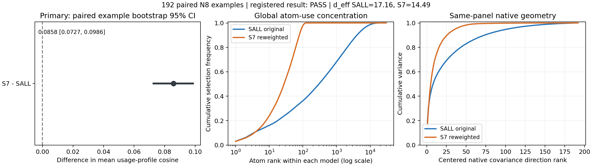
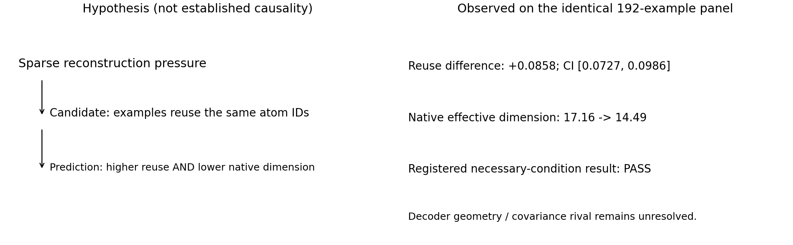

> 派生组会阅读副本；[唯一正式中文摘要](/data/250010109/Research_System/Projects/from-attention-to-search/main/experiments/A15/15_17_three_model_sae_representation_trajectory/A15_17_01_E01_shared_direction_reuse_audit/summary_cn.md)拥有结果正文，图为本日期本地副本。

# E01：S7低有效维数是否伴随更强的跨样本原子复用？

Primary Anchor: [shared atom reuse](/data/250010109/Research_System/Projects/from-attention-to-search/main/problem_anchors/15_spectral_representation_and_functional_routing/15_17_three_model_sae_representation_trajectory/subanchors/15_17_01_sae_shared_direction_reuse_anchor.md).  
Frozen Protocol: [E01-full-v1-A2](/data/250010109/Research_System/Projects/from-attention-to-search/main/experiments/A15/15_17_three_model_sae_representation_trajectory/A15_17_01_E01_shared_direction_reuse_audit/protocol.md).  
Detailed record: [complete evidence ledger](/data/250010109/Research_System/Projects/from-attention-to-search/main/experiments/A15/15_17_three_model_sae_representation_trajectory/A15_17_01_E01_shared_direction_reuse_audit/detailed.md).  
Execution: COMPLETE; measurement: ELIGIBLE for the registered existing-panel test.  
Registered branch: PASS — necessary condition only. Human mechanism judgment: AWAITING_RESEARCHER.  
Verified: 2026-09-22T09:08:48.084508+00:00. No new scientific judgment or subsequent experiment is approved by this record.

## 1. 目的

检验S7较低的原生表征有效维数，是否伴随不同样本更频繁地使用同一批SAE原子，从而检验“共享原子复用”这一候选解释的必要预测。**本轮不检验领域语义是否分得更开。**

## 2. 假设

- **主假设H1：** 如果共享原子复用参与了S7的低维现象，在相同输入、层位与每词元Top-32预算下，S7不同样本的原子使用频率应更相似，同时其原生表征有效维数更低。全局使用应更集中，但集中度只是辅助描述，不能代替主检验。
- **竞争解释H2：** 低维也可能来自不同字典方向共线，或原子系数共同变化；因此不必仅由“重复使用相同编号”解释。H1和H2可以同时成立，观察到H1的必要预测不能排除H2。

## 3. 分析方法

1. **先保证对应测试。** 比较训练到同一21B有效预测token位置的两个冻结模型：S7是仅末层旁路SAE、重加权续训的分支；SALL是原版八层旁路SAE分支。二者使用相同192条N8记录、每条256个正文token、第8层、30,000个原子、每词元32个入选原子。原生注意力写入指输出投影之后、加残差之前的向量，不是SAE重构。四个提取worker均合格；没有训练、标签参与或样本剔除。**SALL不是无SAE的Dense基线，两模型也不是只改变正则强度的匹配对照。**
2. **再测跨样本“用的是不是同一批原子”。** 对每条记录统计原子占全部入选槽位的频率：$u_{ij}=\sum_t1[j\in S_{it}]/(256\times32)$。对同模型不同记录的频率向量取平均余弦相似度$R$；越高表示使用分布越相似，不表示语义越相似。主对比为$\Delta R=R_{S7}-R_{SALL}$。以同一记录ID配对、有放回重采样2,000次，种子20260922，计算百分位95%区间；不是把相关的样本对或词元当独立重复。原子ID只在各自模型内比较，不跨模型对齐编号。
3. **最后联合判断复用和低维。** 同次前向、相同正文token均值得到每条记录的原生表征；中心化协方差$\Sigma$的有效维数为$d_{eff}=(\mathrm{tr}\Sigma)^2/\mathrm{tr}(\Sigma^2)$，意为方差分布相当于多少个等权方向，不是语义概念数。预注册判据：测量合格、S7维数更低且$\Delta R$区间下界大于0才通过必要条件检查；维数更低但区间上界不大于0则不通过；区间跨0或维数条件不成立则证据不足。事后独立CPU重算复用、维数和全部bootstrap，均复现，并核验22份产物哈希；该检查不改变判据。

## 4. 结论

### 4.1 直接结果：必要条件检查通过，但不是机制因果证明

| 测量 | SALL | S7 |
|---|---:|---:|
| 跨样本使用频率平均余弦$R$ | 0.512117 | 0.597905 |
| 同面板原生有效维数 | 17.160447 | 14.486918 |

**$\Delta R=+0.085788$，95%区间$[0.072687,\ 0.098599]$，整个区间大于0，且S7有效维数更低。因此按已批准规则，必要条件检查为PASS。** 数据源：[主结果表](/data/250010109/Research_System/Projects/from-attention-to-search/main/experiments/A15/15_17_three_model_sae_representation_trajectory/A15_17_01_E01_shared_direction_reuse_audit/tables/primary.csv)、[条件表](/data/250010109/Research_System/Projects/from-attention-to-search/main/experiments/A15/15_17_three_model_sae_representation_trajectory/A15_17_01_E01_shared_direction_reuse_audit/tables/conditions.csv)；[独立复算](/data/250010109/MoE_Router/experiments/20260922_sae_shared_direction_reuse_audit/runs/full_4x5090_20260922T074451Z/independent_audit.json)。这是冻结模型间的对比，不是观察同一个模型从17.16降到14.49的训练轨迹。维数排序是已注册点估计条件，本轮没有给维数差做置信区间，不能称其“统计显著下降”。

**如何读图：** 左图点与区间完全位于0右侧，是主检验；中图橙线总体更早累积到全部使用质量，表示S7选中原子的使用更集中；右图橙线更早累积原生方差，表示同面板方差更集中。两条折线均按各模型自身排序，排名不是跨模型对齐的语义方向；中图不是激活幅值或重构能量，右图不是语义信息量。两条曲线为辅助点估计，没有置信带，不能替代左图判据。图源为本run的result.json与concentration_curves.csv，哈希见本目录图来源清单。

### 4.2 原子数量悬殊是真实的面板观察，不能直接翻译为语义数量

全体49,152个正文token上，S7共选中过**142**个不同原子，SALL为**17,060**个；按使用频率计算的等效原子数分别为**73.99**与**229.34**。这些是全局覆盖数和频率集中度，**不是“每个token激活142/17,060个”**：两模型仍均为每token选32个。SALL大量编号处于低频尾部，因此不同ID总数与等效原子数差距很大；不能只用142对17,060估计主干维数或语义容量。[来源：条件表](/data/250010109/Research_System/Projects/from-attention-to-search/main/experiments/A15/15_17_three_model_sae_representation_trajectory/A15_17_01_E01_shared_direction_reuse_audit/tables/conditions.csv)

对整个面板原生Top-32与旧top128前32提取的支持集合做了直接复核，两个模型均为**0个token不一致**。确有32/33名同分，但本次没有造成选择ID差异，因此不能用这个提取风险解释当前两模型的数量差距。这里比较的是本次同分数前向下两种选择操作，不是对所有历史平台的通用一致性保证。[来源：原始结果](/data/250010109/MoE_Router/experiments/20260922_sae_shared_direction_reuse_audit/runs/full_4x5090_20260922T074451Z/analysis/result.json)

### 4.3 Intuition与结果：预测出现了，因果箭头仍未建立

**如何读图：** 左侧是待证的“稀疏重构压力→跨样本复用→低维”解释；右侧仅展示实测的“更高复用与更低维数同时出现”。右侧17.16→14.49表示SALL与S7的条件对比，不是时间演化。不能把右侧的共现倒推成左侧因果链已被证明。

- **能说：** 在此固定面板与这两个21B检查点上，S7原子使用分布的跨样本相似性更高，而且原生均值表征的有效维数更低；预先指定的必要预测得到支持。
- **仍不能说：** 复用增加导致低维；它是主要机制；正则强度单独造成差异；SAE语义特征更好、领域分离更强、任务性能改善；32是最优预算；低维意味着塌缩或训练中如何演化。这些对象未由本轮测量。
- **范围限制：** 这是继承的固定观察面板，包含开发中已见的smoke样本，不是新封存的确认集。按记录重采样未建立来源文章独立性，也不覆盖训练随机种子不确定性。字典几何、系数协方差、重构残差及其与重构的协方差仍未分解。

### 4.4 下一步分析（AI建议，尚未批准执行）

**唯一待研究者决策：是否让“共享同-ID复用”继续作为候选，并进入能区分它与字典方向共线/系数协方差贡献的最小控制实验？** 理由是本轮已经补上“复用是否实际增加”，但没有回答它对原生低维的贡献大小。仅再画更多激活数量图无法消除这个不确定性。

完成标准是先明确可构造的控制、保持不变的对象、两种解释的不同预测、残差边界及停止规则，再由研究者确认合同；若控制无法区分解释，停止扩跑并修改设计。本轮不提交新任务。研究者的“当前机制及理由/确认或削弱了什么/最终下一决策”仍待填写；这里仅记录可复核的直接结果与已批准规则的机械判定，不代填其科学认识更新。
