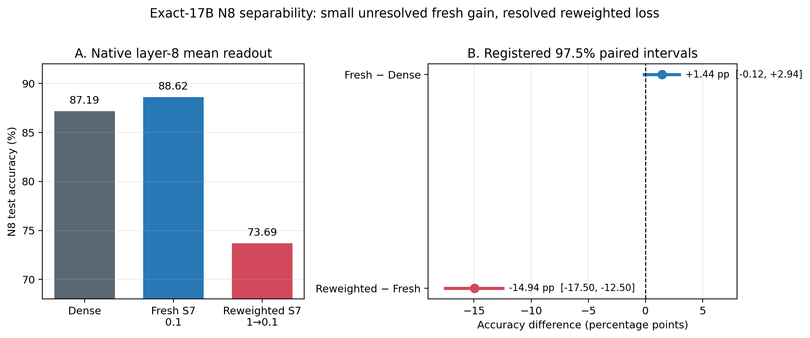

# 组会汇报：SAE 表征集中是否增强 N8 领域可分性？

```text
status: AI_DRAFT_AWAITING_HUMAN_CONFIRMATION
experiment: A15_17_02_E01
execution: PASS, job pt-3nidnrq0
evidence_eligibility: ELIGIBLE for the registered checkpoint-conditional N8 comparison
human_mechanism_judgment: AWAITING_RESEARCHER
```

Canonical draft result reading: [English Summary](../../../../Projects/from-attention-to-search/main/experiments/A15/15_17_three_model_sae_representation_trajectory/A15_17_02_E01_n8_17b_separability_audit/summary.md) ·
[中文 Summary](../../../../Projects/from-attention-to-search/main/experiments/A15/15_17_three_model_sae_representation_trajectory/A15_17_02_E01_n8_17b_separability_audit/summary_cn.md)

## 一、目的，以及为此探究的问题

我们的目的不是再次证明“SAE 会改变表征”，而是检验这种变化是否是我们真正关心的
变化：**SAE 的重构约束是否让原生注意力表征中的领域信息更容易被简单方法读出？**

这里把问题限定得很具体：在完全相同的精确 17B 训练坐标、N8 八类学术来源数据、
第 8 层原生注意力写入和正文均值汇聚下，比较三个冻结模型：无 SAE 的 Dense、全程
重构系数 0.1 的 fresh S7，以及约 15.47B 前系数为 1、之后降为 0.1 的 reweighted S7。

围绕这个目的，我们实际问了三个递进问题：

1. fresh S7 的领域线性可读性是否高于 Dense？这是预注册的主假设。
2. 已知更集中的 reweighted S7，是否也具有更高的领域可读性？这检验“集中是否有用”。
3. 线性读出、无标签聚类和类间／类内散度是否同向？这区分“可被监督线性规则读取”
   与“自然形成距离类别团”两种不同结构。

本轮不回答全部语言语义、模型是否实际使用该信息、语言模型性能或训练效率。

## 二、因此构建的分析方法

- **同坐标、同输入、同读点比较：** 三个模型都使用冻结的 `N8_v1`，包含
  2,400 条 fit、800 条 dev、1,600 条 test 记录，每条 256 个正文词元；只读取第 8 层
  注意力输出投影后、残差相加前的原生写入。这样排除跨面板、跨训练坐标和跨取点拼接。
- **以线性读出作为主判据：** 只用 fit 拟合 L2 多类线性分类器，用 dev 选择正则强度，
  最后在 test 上计算准确率。对 fresh−Dense 和 reweighted−fresh 做 2,000 次按类别分层的
  记录级配对 bootstrap；因为有两个预注册比较，方向判断使用 97.5% 区间。
- **用几何和聚类限定解释：** 在同一 test 表征上计算有效维数、前 16 主方向方差占比、
  类间／类内散度比，并以五个固定种子的 K-means 报告 ARI。它们说明表征怎样组织，
  但不能替换主准确率。最后正文词元和 S7 重构表征只作敏感性或观察者分析。

执行完整性通过：三个条件均完成 4,800 条记录和 1,228,800 个正文词元；检查点、输入、
掩码和样本顺序一致，模型状态前后哈希不变，`optimizer_updates=0`，分析失败列表为空，
作业 `pt-3nidnrq0` 终态为 `SUCCEEDED`。本结果是冻结检查点条件下的表示分析，不包含训练
种子不确定性。

## 三、在该方法中得到的结论



读图：左侧是三个模型在 1,600 条 test 记录上的领域准确率；右侧是两个预注册差值及
97.5% 区间。区间跨过零表示方向未解决，不表示等效。

| 第 8 层正文均值 | Dense | fresh S7 0.1 | reweighted S7 1→0.1 |
|---|---:|---:|---:|
| N8 test 准确率 | 87.1875% | 88.6250% | 73.6875% |
| 有效维数，越低越集中 | 13.7074 | 20.7354 | 7.4958 |
| 前 16 方向方差占比 | 0.6356 | 0.5496 | 0.7929 |
| 类间／类内散度比 | 0.4425 | 0.3704 | 0.1324 |
| 五种子 K-means ARI 均值 | 0.3806 | 0.4328 | 0.1220 |

1. **fresh S7 相对 Dense 有小幅正点估计，但主假设没有通过预注册门槛。** 差值为
   `+1.4375` 个百分点；95% 区间为 `[+0.0625,+2.7500]`，但用于两个方向判断的
   97.5% 区间为 `[−0.1250,+2.9375]`，跨过零。因此可以说本次点估计略高，不能说
   “fresh S7 已稳定提高领域可读性”。它的有效维数反而更高，即表征更分散，而不是
   更集中；其 ARI 较高，但类间／类内比更低，几何诊断也不是单向一致。

2. **reweighted S7 显著低于 fresh S7，并构成“更集中不等于更可分”的直接反例。**
   准确率差为 `−14.9375` 个百分点，97.5% 区间
   `[−17.5000,−12.5000]`，完全低于零。与此同时，它的有效维数最低、前 16 方向占比
   最高，说明三者中最集中；但类间／类内比和 K-means ARI 也最低。也就是说，强集中
   与较差的线性读出、质心分离和无标签分组同时出现。

3. **这一结论对位置和重构读法没有被“补救”。** 最后正文词元准确率为
   Dense/fresh/reweighted=`81.25%/80.25%/78.25%`，fresh 的小幅均值优势没有延伸到该
   位置。SAE 重构均值的准确率为 fresh `87.1875%`、reweighted `64.9375%`；这只是
   模型局部观察者读数，不能替代原生表征主结果。

## 四、与原假设的区别，以及认知更新

原假设隐含的链条是：

```text
SAE 重构压力
→ 表征更集中或更有组织
→ 领域区别更容易被线性读出
→ 若形成类别团，聚类与类间／类内分离也应改善
```

实测结果只保留了第一条中的“SAE 训练历史会改变表征组织”，没有支持后面的单调链条。
fresh S7 的线性读出点估计略高，但它并不更集中，而且预注册区间仍跨零；reweighted S7
明显更集中，却在准确率、类间／类内比和 ARI 上都更差。因此，本轮最稳定的认知更新是：

> **表征集中度不是领域可分性的可靠代理。SAE 的作用更像是训练历史依赖的表征重组；
> 这种重组可以保留、增强或压缩不同方向，但“压到更少方向”本身不说明保留的是领域
> 判别信息。**

这比原假设更窄，也更具体：我们不再把有效维数下降或头部方差增加作为“语义更好”的
支持证据。对于 fresh S7，只能保留“可能存在小幅线性可读性优势”的待确认说法；对于
reweighted S7，可以稳定地说“更集中并未伴随更好的 N8 领域组织”。

边界同样明确：三个训练谱系还混有微批、交叉熵分块和随机历史差异，因此不能声称
“系数变化因果地造成准确率下降”；N8 也只测八类学术来源可读性，不能推出全部语义、
模型实际利用或语言模型性能。

**唯一下一决策（AI 建议）：** 停止继续验证“集中是否普遍有利”，转而判断 reweighted
条件丢失的是领域判别方向，还是仅发生了可逆的尺度／条件数变化。完成条件是用只在 fit
上确定的变换后，观察其相对 fresh 的 `−14.9375` 个百分点缺口是否被大幅恢复；若恢复，
转向尺度机制，若不恢复，转向判别方向丢失机制。正式采用这一下一步前需研究者确认。

### 组会收尾口径

> 我们原来猜测 SAE 让表征更集中后，领域信息会更容易区分。现在同一 17B、同一 N8
> 面板的结果表明：fresh S7 只有 1.44 个百分点的正点估计，预注册区间仍跨零；而最集中的
> reweighted S7 反而低了 14.94 个百分点，并且聚类和类间／类内分离也更差。因此，
> SAE 确实重组了表征，但集中度本身不是语义可分性的证据。下一步应解释 reweighted
> 条件具体丢失了哪些判别结构，而不是继续把维数下降当作收益。
