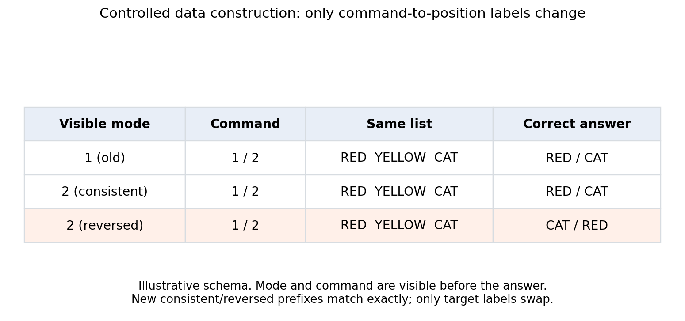
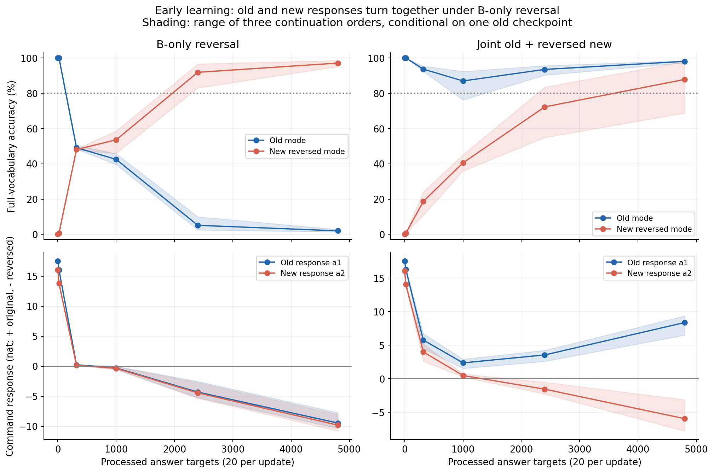
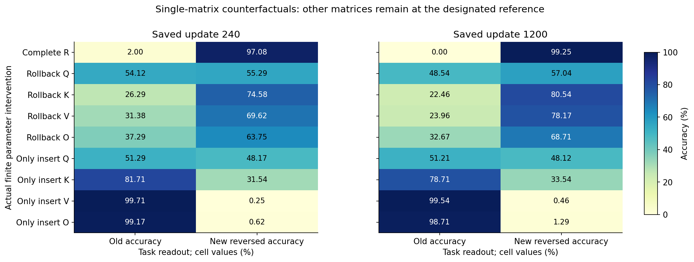
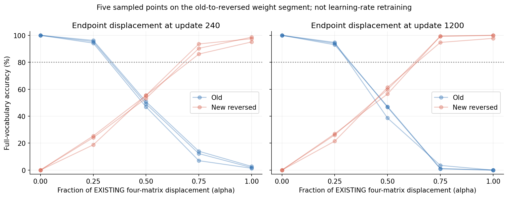
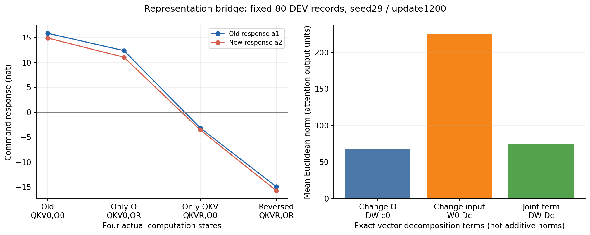
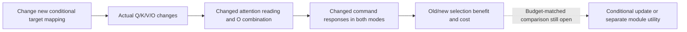

派生阅读副本；科学含义及 Unknown 状态不变。
原件：`daily_research_reports/1012/meeting_report/a17_r02_mechanism_meeting.md`。
[精确原始文件](../../../../sources/daily_research_reports/1012/meeting_report/a17_r02_mechanism_meeting.md)；仅引用目标改为包内读本或固定项目版本。

---

# A17 R02 meeting script: why does learning a new rule damage the old rule?

[中文](a17_r02_mechanism_meeting_cn.md) · [Canonical R02 Summary](../../../Projects/from-attention-to-search/main/experiments/A17/17_04_conditional_mapping_transfer/A17_04_E01_consistent_reversed_mapping/rounds/R02_single_layer_adamw/summary.md) · [Detailed record](../../../Projects/from-attention-to-search/main/experiments/A17/17_04_conditional_mapping_transfer/A17_04_E01_consistent_reversed_mapping/rounds/R02_single_layer_adamw/detailed.md)

This is the speaking document for 12 October 2026. It explains the question, actual model, established results, and new parameter interventions before discussing the remaining decision about sharing parameters. Researcher acceptance of the mechanism and question closure remain `Unknown`; this derived report does not replace the Anchor, Protocol, or canonical results.

> **The bounded mechanism experiment is complete.** Single-matrix rollback/insertion changes old/new selection but no tested condition preserves both rules. The same O change has different effects under old versus reversed QKV. The report separates this parameter evidence from the established training phenomenon and the remaining reasons for the training path.

## 1. The question in two sentences

**Parent question: when should different prediction requirements share trainable parameters, and when is separate processing worth its cost?**

**This round: after a model learns the old command rule, which actual parameter changes make both the old and new modes reverse their command meanings when only the new mode receives reversed supervision?**

Sharing means that both modes use the same trainable weights, so new training changes weights used by old predictions. Separate processing means restricting some changes to their relevant input condition. It can occur within one shared model or through separate parameters; it does not automatically mean adding experts.

## 2. Actual model, data, and training

An input contains a visible mode, a neutral command, and three distinct familiar tokens. The model predicts one token after the answer marker. Neutral commands avoid giving the first/last mapping through pretrained instruction semantics.

The vocabulary contains 20 answer words verified as single Qwen3 tokens. Each rule world has 2,400 TRAIN records, with 120 occurrences of every answer word, and 800 DEV records in two 400-answer panels, with 20 occurrences per answer word in each panel. DEV is the development evaluation set already used repeatedly for diagnosis. The 24,000 training answers per primary branch are repeated exposures to these records, **not 24,000 independent examples**.

```text
Same list: red  yellow  cat

Old mode 1                    New mode 2: consistent experiment
command A -> red              command A -> red
command B -> cat              command B -> cat

                              New mode 2: reversed experiment
                              command A -> cat
                              command B -> red
```

This is a construction schematic, not a measured result. Consistent and reversed mappings belong to different experiments. Within either experiment, a complete input has one unambiguous label because its mode is visible. Red and cat have no permanent correct/incorrect status; their roles follow from position and rule.



Figure 1 is a construction table without numerical axes. Commands 1/2 denote the actual Chinese commands 甲/乙 in the plot only; the consistent and reversed new prefixes match exactly, while their target positions swap.

We use Qwen3-0.6B Base and train only the final attention layer's Q/K/V/O weight matrices: 6,291,456 parameters. Q/K govern attention matching, V supplies information being read, and O projects the attention result into the representation used downstream. These computational roles do not establish dedicated rule functions.

Every continuation starts from the same saved old model, which reaches 100% in both unseen panels and both commands. A checkpoint stores weights and state at a training point. Fresh AdamW clears old accumulated moments. Seeds 29, 43, and 71 change continuation order, not the independently trained old model.

| Continuation | Supervision | Exposure per branch | Interpretation |
|---|---|---|---|
| Consistent | Only mode 2, original command mapping | 1,200 updates; 24,000 new answers | Retention when the mapping is reusable |
| Reversed | Only mode 2, swapped command mapping | 1,200 updates; 24,000 new answers | Retention cost of learning the reversed mapping |
| Joint | 10 old plus 10 reversed-new answers per update | 12,000 old and 12,000 new answers | Feasibility of satisfying both mappings in shared parameters |

The two primary continuations have identical new inputs, sample order, answer marginals, and training budget; only labels swap. AdamW uses learning rate 0.0001, zero weight decay, and global gradient clipping at 1: gradients exceeding total length 1 are proportionally rescaled. Loss applies only to the single answer token. Joint training changes old supervision and halves new exposure, so it is a feasibility witness rather than a matched utility comparison.

Unseen-order evaluation rearranges a familiar three-token set into an unseen order. Unseen-combination evaluation uses familiar tokens in a previously unseen set. Each panel has 400 answers; the combined result weights them equally. Neither is an unseen-vocabulary test.

## 3. One update, and why it cannot explain a whole trajectory

Let \(\theta_t\) be the trainable weights before update \(t\), and let \(d_t=\theta_{t+1}-\theta_t\) be the actual optimizer displacement. For AdamW it need not be a scalar multiple of the current negative gradient. Let \(L_A\) be mean answer cross-entropy on a fixed old DEV panel, measured in nat/answer; a nat is the numerical unit associated with natural logarithms. CE is the negative log probability of the correct answer; lower is better.

\[
\Delta L_{A,t}
=L_A(\theta_t+d_t)-L_A(\theta_t)
=\nabla L_A(\theta_t)^\top d_t+R_t.
\]

The left side is measured harm or benefit. The first term on the right is a first-order prediction. The remainder \(R_t\) is defined as the actual change minus that prediction; it includes finite-step nonlinearity and remaining numerical differences. The decomposition is exact by definition, while the first term alone is useful only when the remainder is sufficiently small.

A single update does not determine continued learning:

1. Each update changes the model state and the gradients of later updates.
2. AdamW's accumulated moments affect later coordinate-wise displacements.
3. Correct-token probability can rise while a competing token rises more, so improved CE need not mean improved selection.
4. Q/K/V/O change attention jointly. Changing Q/K/V also changes the input to O, invalidating a fixed-input, single-linear-matrix account.

The multi-step change telescopes exactly:

\[
L_A(\theta_T)-L_A(\theta_0)
=\sum_{t=0}^{T-1}\left[\nabla L_A(\theta_t)^\top d_t+R_t\right].
\]

This identity is not an identified long-term mechanism. Explaining the trajectory requires the changing states, actual displacements, and resulting prediction competition.

## 4. Established conclusion, mechanism hypothesis, and rivals

**Established conclusion:** reversed-new-only training severely damages an already acquired old mapping, while joint supervision lets the same trainable matrices almost satisfy both mappings. The two visible rules are therefore not inherently impossible to represent together in this model.

**Mechanism hypothesis:** reversed continuation changes command-to-position computation used by both modes without sufficiently restricting that change to the new mode, so both modes reverse together.

The shared response is currently an output observation. Actual weight interventions are needed before naming a parameter mediator; similar outputs do not locate a shared module.

**Strongest surviving explanation:** different initial difficulty and missing old supervision may explain the selected training path. The consistent new task begins at 99.875% accuracy, the reversed task at 0%, and new-only training does not constrain old labels. Joint supervision changes both labels and exposure; it does not isolate their individual causal contributions. This explanation can coexist with a parameter account of how the resulting changes damage predictions.

A narrower account tested tonight is that the model simply moves too far along its realized displacement. Retreating partway might retain old skill while acquiring new skill. Five-scale weight interpolation tests only this limited possibility; it does not replace lower-learning-rate retraining or eliminate the strongest surviving explanation.

Candidate-token adaptation remains a separate rival: CE can improve merely because more probability enters the list vocabulary. We therefore measure selection within candidates and relative answer preference.

## 5. Update one: the damage concerns rule selection

For an old input, let \(y_A\) be its correct endpoint and \(o_A\) the opposite endpoint. Define rule margin:

\[
m_A(x)=\log p_\theta(y_A\mid x_A)-\log p_\theta(o_A\mid x_A).
\]

A positive value favors the correct endpoint; a negative value favors the opposite endpoint; zero means equal endpoint probability. Full-vocabulary accuracy selects the most probable token from the entire vocabulary and checks the answer; it is still needed because a third token can beat both endpoints. Values below average equally over three continuation orders and two DEV panels; CE and margin use nat/answer.

| Condition | Old CE | Old accuracy | Old margin | New CE | New accuracy | New margin |
|---|---:|---:|---:|---:|---:|---:|
| Old starting point | 0.000691 | 100% | +17.525 | — | — | — |
| Consistent new only | 0.000041 | 100% | +23.146 | 0.000041 | 100% | +22.851 |
| Reversed new only | 15.819206 | 0% | −15.793 | 0.031350 | 99.25% | +16.190 |
| Joint old/new | 0.004841 | 99.83% | +18.106 | 0.009108 | 99.67% | +15.650 |

The reversed task is learned while all three old readouts deteriorate. Joint results establish representational feasibility under different supervision, not a net benefit of separate parameters.

| Training/evaluated task | Unseen order | Unseen combination | Equal-weight combined |
|---|---:|---:|---:|
| Consistent/old | 100.00% | 100.00% | 100.00% |
| Consistent/new | 100.00% | 100.00% | 100.00% |
| Reversed/old | 0.00% | 0.00% | 0.00% |
| Reversed/new | 99.00% | 99.50% | 99.25% |
| Joint/old | 99.83% | 99.83% | 99.83% |
| Joint/new | 99.67% | 99.67% | 99.67% |

Old failure occurs in both panels. The three reversed endpoints select the opposite endpoint in 100%, 100%, and 97.5% of old answers; mean probability assigned to the three list candidates remains 99.6211%.

For list candidate set \(S(x)\), CE decomposes exactly:

\[
-\log p_\theta(y\mid x)
=-\log P_\theta(S\mid x)
-\log\frac{p_\theta(y\mid x)}{P_\theta(S\mid x)}.
\]

The first term measures probability entering the candidates, the second selection within them. Of old reversed CE 15.819206, within-candidate selection contributes 15.810429. This weakens a candidate-access account without locating the internal cause.

For the illustrative list red/yellow/cat, old command A should produce red and B cat. After reversed continuation, old mode also produces cat/red. Joint supervision restores old red/cat while new mode produces cat/red. This example was selected after observing results; population rates come from all evaluated records.

Sources: [canonical Summary](../../../Projects/from-attention-to-search/main/experiments/A17/17_04_conditional_mapping_transfer/A17_04_E01_consistent_reversed_mapping/rounds/R02_single_layer_adamw/summary.md), [native results](../../../../selected_provenance/r02_results.json), and [post-hoc error counts](../../../../selected_provenance/r02_posthoc_rule_choice.json).

## 6. Update two: observed joint reversal versus parameter cause

For each list, evaluate both commands under both modes. Let \(s_{m,c}\) be last-minus-first log probability and \(a_m\) compare how command B versus A favors the last item:

\[
s_{m,c}=\log p(L_3\mid x_{m,c})-\log p(L_1\mid x_{m,c}),\qquad
a_m=\frac{s_{m,B}-s_{m,A}}2.
\]

Positive response favors A-first/B-last; negative response favors A-last/B-first. This is an output coordinate, not a recovered internal neuron direction.

Because commands are balanced, old mean endpoint margin equals \(a_1\), and reversed-new mean endpoint margin equals \(-a_2\). These responses organize the same output information by mode; they are not independent second evidence for a mechanism.

| Actual seed-29 endpoint | Old response \(a_1\) | New response \(a_2\) | Behavior |
|---|---:|---:|---|
| Consistent | +23.309 | +23.068 | Original mapping in both modes |
| Reversed | −15.076 | −15.605 | Both modes reverse |
| Joint | +17.911 | −15.685 | Old retained, new reversed |

### New trajectory evidence: damage precedes endpoint training

We independently recompute the 72 existing native evaluation files rather than retrain. Across all three continuation orders, mean old and new command responses are still positive at saved update 16 and both negative at update 50, before reliable new acquisition.

| Continuation order | Update-16 old/new response | Update-50 old/new response | Update-50 old/new accuracy |
|---|---:|---:|---:|
| 29 | +0.209/+0.144 | −0.484/−0.580 | 39.50%/58.625% |
| 43 | +0.193/+0.122 | −0.371/−0.433 | 42.25%/56.250% |
| 71 | +0.288/+0.201 | −0.020/−0.068 | 45.75%/45.875% |

Values equally combine the two DEV panels; responses use nat. Damage therefore is not confined to unnecessary endpoint training after the new rule is already mastered. This does not rule out learning-rate or path effects, and saved intervals do not locate the exact first sign change.



Horizontal axes count all processed answer targets, 20 per update; top vertical axes show full-vocabulary accuracy (%), bottom axes show response (nat, positive original/negative reversed). Curves are equal-seed means and shading shows seed minimum/maximum, not confidence intervals; joint exposure includes old and new answers, and connecting lines do not measure unsaved steps.

**The independent CPU audit is VALID.** It retokenizes all 9,600 TRAIN/DEV records, checks 27 explicit checkpoint identities and matrix states, and recomputes 72 native evaluation files containing 115,200 prediction-record appearances. Accuracy is recomputed from saved full-vocabulary argmax IDs. It finds no label, prefix, checkpoint, or response-sign error; GPU workers separately reproduce no-op and restoration records exactly.

Sources: [per-seed/panel trajectories](../../../../selected_tables/r02_trajectories_by_seed_panel.md) and [independent audit](../../../../selected_provenance/mapping_audit_results.json).

### Finite parameter intervention

We now replace one matrix at a time in the same reversed checkpoint with its old value, keeping all other weights fixed. Each condition starts from a full independent restore and evaluates identical old/new DEV inputs. With old matrix \(W_{0,j}\) and reversed matrices \(W_{R,j}\):

\[
\theta_{R\leftarrow0,j}=(W_{R,1},\ldots,W_{0,j},\ldots,W_{R,4}).
\]

This intervenes on an entire realized matrix displacement. An improvement establishes participation in the checkpoint's function, not uniqueness, necessity across all solutions, or an independent rule module. Both old recovery and new loss must be reported.

### Actual result: old recovery accompanies loss of new selection

The table averages all three continuation orders at update 1200 over full DEV. Rollback restores one old matrix in the complete reversed model; insertion installs one reversed matrix in the old model. CE and correctly oriented endpoint margin use nat/answer, accuracy uses percent.

| Parameter condition | Old CE | Old accuracy | Old margin | New CE | New accuracy | New margin |
|---|---:|---:|---:|---:|---:|---:|
| Complete reversed | 15.819 | 0.00% | −15.793 | 0.031 | 99.25% | +16.190 |
| Rollback Q | 3.729 | 48.54% | −0.219 | 2.155 | 57.04% | +2.396 |
| Rollback K | 6.810 | 22.46% | −5.404 | 1.045 | 80.54% | +6.696 |
| Rollback V | 7.538 | 23.96% | −6.704 | 0.748 | 78.17% | +6.951 |
| Rollback O | 5.572 | 32.67% | −4.338 | 1.172 | 68.71% | +4.562 |
| Insert Q only | 4.300 | 51.21% | +1.555 | 5.692 | 48.13% | −0.996 |
| Insert K only | 1.713 | 78.71% | +6.824 | 7.171 | 33.54% | −4.317 |
| Insert V only | 0.014 | 99.54% | +10.996 | 9.698 | 0.46% | −9.676 |
| Insert O only | 0.037 | 98.71% | +14.077 | 12.461 | 1.29% | −12.411 |

Every one of the 24 rollback conditions raises old accuracy while lowering new accuracy. No single rollback or insertion qualifies all old/new cells. This advances joint output reversal to finite causal participation of actual parameter changes, without identifying a separate rule matrix. Two- and three-matrix combinations were not exhausted, so it does not show that all four matrices are required.

Panel-specific accuracy retains the distinction between unseen order and unseen combination. Each cell lists old/new accuracy; combined weights panels equally.

| Intervention | Unseen order: old/new | Unseen combination: old/new | Combined: old/new |
|---|---:|---:|---:|
| Rollback Q | 47.08%/57.75% | 50.00%/56.33% | 48.54%/57.04% |
| Rollback K | 21.08%/81.50% | 23.83%/79.58% | 22.46%/80.54% |
| Rollback V | 23.33%/78.92% | 24.58%/77.42% | 23.96%/78.17% |
| Rollback O | 32.08%/69.17% | 33.25%/68.25% | 32.67%/68.71% |
| Insert Q only | 52.00%/48.25% | 50.42%/48.00% | 51.21%/48.13% |
| Insert K only | 78.50%/34.17% | 78.92%/32.92% | 78.71%/33.54% |
| Insert V only | 99.50%/0.42% | 99.58%/0.50% | 99.54%/0.46% |
| Insert O only | 98.75%/1.08% | 98.67%/1.50% | 98.71%/1.29% |



The horizontal axis separates old/new task readouts; the vertical axis lists interventions, and color shows accuracy (%), not parameter norm. Rollback and insertion use different backgrounds, so their effects are not additive components of one displacement; neither finds a single-matrix solution preserving both.

At update 240 the complete reversed state scores 2.00%/97.08% old/new, versus 54.125%/55.29% after Q rollback and 37.29%/63.75% after O rollback. The effect is therefore also present before the final endpoint. Full per-seed, per-panel CE, margins, and states remain in the [native intervention table](../../../../selected_tables/full_parameter_rollback.md).

## 7. Update three: can shrinking the realized displacement preserve both?

Interpolate all four matrices together, leaving other weights frozen:

\[
\theta(\alpha)=\theta_0+\alpha(\theta_R-\theta_0),
\quad\alpha\in\{0,0.25,0.5,0.75,1\}.
\]

Zero is the old model; one is the reversed model. Evaluate whether all eight task/panel/command cells reach the 80% acquisition threshold. Success establishes a compatible measured point on this weight segment. Failure establishes only that the sampled points fail, not that every intermediate point or every other parameter path fails.

| Scale \(\alpha\) | Update-240 displacement: old/new accuracy | Update-1200 displacement: old/new accuracy |
|---:|---:|---:|
| 0 | 100.00%/0.00% | 100.00%/0.00% |
| 0.25 | 95.29%/22.75% | 93.92%/24.88% |
| 0.50 | 48.92%/54.75% | 44.13%/59.21% |
| 0.75 | 11.08%/90.04% | 1.88%/97.83% |
| 1 | 2.00%/97.08% | 0.00%/99.25% |

These are equal-order combined DEV means. Across three orders, two checkpoints, and five scales, **0 of 30 measured points qualifies all eight cells**. The largest observed minimum-cell accuracy is only 13.5%.



Horizontal axes show retained displacement fraction alpha, vertical axes show full-vocabulary accuracy (%), curves retain all three orders, and the dashed line marks 80%. These five sampled scales fail to preserve both mappings; unsampled narrow intervals and other training paths remain open.

Sources: [30-point eight-cell qualification](../../../../selected_tables/full_interpolation_compatibility.md) and [native finite readouts](../../../../selected_tables/full_parameter_rollback.md).

Interpolation performs no optimization and changes neither optimizer moments nor subsequent gradients. It is not a lower-learning-rate training run and cannot settle that counterfactual.

## 8. A bounded representation bridge

A representation is an input-dependent vector computed inside the network; it is not the weight matrix itself. The small representation panel fixes seed29/update1200 and selects the first 10 lists per DEV panel, with both modes and commands: 80 inputs. Four actual forward conditions combine old/reversed QKV reading with old/reversed O: old, reversed, reversed with old O, and old with reversed O.

Earlier layers are frozen, so the same input reaches the last attention layer with the same incoming representation. Let \(c\) be the attention result before O, and \(a=W_Oc\) after O. With old state 0, reversed state R, \(\Delta c=c_R-c_0\) and \(\Delta W=W_{O,R}-W_{O,0}\), the exact change is:

\[
\Delta a=\Delta Wc_0+W_{O,0}\Delta c+\Delta W\Delta c.
\]

These terms separate changing O on old reading, changing reading under old O, and their interaction. Their norms alone do not identify their output contributions.

Let \(F_{ij}\) be an actually evaluated output quantity, such as the endpoint logit difference. A logit is the model's token score before conversion to probabilities; its two-token difference equals the log-probability difference. The first index selects old/reversed O and the second selects old/reversed QKV reading. Thus \(F_{10}\) inserts reversed O into old QKV, while \(F_{01}\) rolls O back under reversed QKV. Their finite non-additivity is:

\[
I_F=F_{11}-F_{10}-F_{01}+F_{00}.
\]

This measures interaction among these four forward combinations; it is not proof of a uniquely separated parameter function. For final normalized hidden vector \(h\) and frozen vocabulary rows \(w_{L_3},w_{L_1}\):

\[
z_{L_3}-z_{L_1}=(w_{L_3}-w_{L_1})^\top h.
\]

This exact output bridge checks how a vector change alters answer competition. An identity check is not a new empirical discovery, and the small panel cannot replace whole-DEV interventions.

### Actual representation result: O depends on what QKV supplies

| Actual combination | Condition | Old correct-endpoint margin | Reversed-new correct-endpoint margin |
|---|---|---:|---:|
| Old QKV + old O | \(F_{00}\): old model | +15.882 | −14.937 |
| Old QKV + reversed O | \(F_{10}\): O insertion | +12.414 | −11.076 |
| Reversed QKV + old O | \(F_{01}\): O rollback | −3.109 | +3.510 |
| Reversed QKV + reversed O | \(F_{11}\): complete reversed | −14.943 | +15.741 |

These average the two panels over the 80 preselected inputs, in nat. Changing O lowers old margin by 3.468 under old QKV but by 11.834 under reversed QKV. The same matrix displacement has different functional effects depending on the representation supplied by other matrices.

Old-margin non-additivity is −8.366 nat and reversed-new correct-margin non-additivity is +8.369 nat. This finite interaction passes through downstream nonlinear MLP/norm computation; it cannot be assigned entirely to the raw \(\Delta W\Delta c\) vector term or claimed as a unique causal contribution.



The left horizontal axis lists four parameter combinations, **not training time**, and its vertical axis shows responses \(a_1,a_2\) in nat; reversed-new correct margin is \(-a_2\), so a negative red response favors the new reversed rule. The right horizontal axis lists vector-change terms and the vertical axis shows mean per-input Euclidean norms, not additive functional contributions.

The exact vector decomposition is numerically verified with relative residual \(5.39\times10^{-7}\). Mean term norms are 225.489 for changed reading, 67.938 for changed O, and 73.941 for their cross term. These describe vector magnitude, not respective rule contributions or percentages.

Sources: [representation analysis](../../../../selected_provenance/representation_analysis.json) and [rule-oriented four-condition readouts](../../../../selected_tables/representation_signed_response.md). Whole-DEV interventions support the general finite result; this small panel explains a concrete computational bridge.

## 9. Three takeaways and the next decision

1. Task relation changes old retention in shared continuation: consistent training retains 100% old accuracy, reversed training reduces it to 0%, mostly by choosing the opposite endpoint.
2. Joint representability does not guarantee sequential retention: identical trainable matrices achieve 99.83%/99.67% with joint supervision, so the next issue is limiting updates by mode, not asserting inherent incompatibility.
3. **New parameter evidence concerns cooperation, not one independently extractable rule matrix.** Every single rollback recovers some old selection while losing new selection; O's effect depends on its QKV background (−3.468 versus −11.834 nat old margin). None of 30 sampled interpolation points qualifies all eight cells. Simple editing of this realized displacement does not solve conditional retention, while other scales, paths, and module designs remain open.

**AI suggestion:** test whether restricting realized new changes to the new mode can retain old selection and new acquisition, then compare against a shared model with old supervision. The present tradeoff makes old recovery alone an inadequate repair criterion: both must qualify. A claim that separate parameters are worthwhile still needs parameter, answer-exposure, and compute accounting, including retained transfer benefits and controls for old supervision and initial difficulty.



The first five objects have training observations and actual finite substitutions as evidence: changing parameter combinations changes their real forward representations and answer margins. **Why new-only optimization selected this trajectory remains unisolated**, and the final utility comparison remains unrun. The schematic itself supplies neither missing bridge.

Scope remains one trained old endpoint, three continuation orders, previously used DEV, unequal initial new skill, and a joint control with extra old labels and half new exposure. These bound generalization and design decisions without invalidating the observed effects.

## 10. Speaking script

Our parent question is when different prediction requirements should share parameters and when separate processing is worth its cost. This experiment asks a controlled version: after the model learns old command meanings, why does reversing them in a new visible mode also reverse its old answers?

We use three-token lists. In old mode, A selects the first item and B the last. Two separate new-mode experiments either retain or swap that mapping. New inputs, vocabulary frequencies, and training exposure match. We train only the final attention layer's four projection matrices in Qwen3-0.6B.

One update measures immediate benefit or harm, but continued training changes model states, optimizer history, and answer competition. We therefore inspect actual checkpoints and complete continuation outcomes.

Consistent continuation retains 100% old accuracy. Reversed continuation learns the new rule to 99.25%, while old accuracy falls to zero. Old predictions almost always choose the opposite endpoint, even though over 99% of probability still goes to the list candidates. The failure concerns rule selection, not merely candidate access.

Independent recomputation shows both modes' mean command responses change sign between saved updates 16 and 50 for every continuation order. New accuracy at update 50 is only about 46–59%. Damage starts before reliable new acquisition, rather than appearing only at the final endpoint.

Yet joint supervision lets the same parameters almost satisfy both rules. The problem is therefore not inherent inability to share. It is failure of this new-only trajectory to retain old conditional selection.

Our mechanism hypothesis is that reversed continuation changes computation used by both modes without sufficiently restricting the change to the new mode. We test actual matrix rollback and interpolation along the realized weight displacement.

The new interventions make the account more concrete. Each matrix rollback partially recovers old accuracy while losing new accuracy. Q rollback, the strongest aggregate old recovery, achieves only 48.54% old and 57.04% new. Installing a single reversed matrix in the old model also fails to acquire the complete new rule.

The representation comparison reveals background dependence. The same O change lowers old margin by 3.468 with old QKV reading but by 11.834 with reversed QKV reading. These four actual forward comparisons show cooperative effects on selection, rather than a fixed shared or unique function identifiable from matrix magnitude.

Finally, five scales along each of six realized displacements yield thirty measured points, none qualifying all eight old/new cells. This constrains direct shrinkage of the existing displacement; it is not lower-learning-rate retraining and does not exclude other paths.

The next question is what conditional update can retain reusable computation while limiting harmful cross-mode transfer. Only then can a budget-accounted separate-module comparison determine whether extra parameters are worthwhile.

## 11. Two likely follow-up questions

**Why does this comparison distinguish the explanations?** Primary continuations match new inputs and answer marginals; old evaluation preserves its original labels. Rule margin and opposite-endpoint counts test selection directly. Same-checkpoint matrix replacement measures a finite parameter effect, while interpolation tests only a realized-displacement magnitude account.

**Why not claim experts are better or identify a common module?** Joint supervision already supplies a shared feasible solution, and no budget-matched separate-module comparison has been run. Matrix rollback may disrupt cooperation among matrices. Output coordinates, parameter coordinates, and hidden representations are different objects.

## 12. Evidence and self-review

- [Owning Focus](../../../Projects/from-attention-to-search/main/focus/focus_conditional_mapping_transfer.md).
- [Owning Anchor](../../../Projects/from-attention-to-search/main/problem_anchors/17_shared_and_interference_learning/17_04_conditional_mapping_transfer/17_04_conditional_mapping_transfer_anchor.md).
- [R02 Protocol](../../../Projects/from-attention-to-search/main/experiments/A17/17_04_conditional_mapping_transfer/A17_04_E01_consistent_reversed_mapping/rounds/R02_single_layer_adamw/protocol.md), [Summary](../../../Projects/from-attention-to-search/main/experiments/A17/17_04_conditional_mapping_transfer/A17_04_E01_consistent_reversed_mapping/rounds/R02_single_layer_adamw/summary.md), [Detailed](../../../Projects/from-attention-to-search/main/experiments/A17/17_04_conditional_mapping_transfer/A17_04_E01_consistent_reversed_mapping/rounds/R02_single_layer_adamw/detailed.md).
- [E03 acquisition qualification](../../../Projects/from-attention-to-search/main/experiments/A17/17_04_conditional_mapping_transfer/A17_04_E03_single_attention_acquisition/summary.md).
- New audit: [R03 Protocol](../../../Projects/from-attention-to-search/main/experiments/A17/17_04_conditional_mapping_transfer/A17_04_E01_consistent_reversed_mapping/rounds/R03_mechanism_audit/protocol.md), [R03 Summary](../../../Projects/from-attention-to-search/main/experiments/A17/17_04_conditional_mapping_transfer/A17_04_E01_consistent_reversed_mapping/rounds/R03_mechanism_audit/summary.md), and [independent finite-output audit](../../../../selected_provenance/finite_outputs_audit.json).

Smoke `pt-p6uri2px` and formal job `pt-o3rvi0s1` complete. Independent audit checks 88 native files, 140,800 prediction-record appearances, 300 finite-readout rows, and 30 eight-cell interpolation qualifications without errors; actual no-op, restoration, and frozen-state guards pass. This audit is not a second complete GPU execution, and per-condition complete weight snapshots were not independently persisted.

Self-review follows `research-reasoning-auditor`, separating observation, exact relationships, finite interventions, and architecture utility. It does not claim researcher acceptance or independent reader comprehension.
