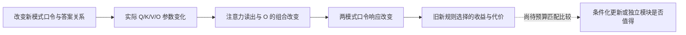

# A17 R02 组会汇报：新规则为什么会改坏旧规则？

[English](a17_r02_mechanism_meeting.md) · [正式 R02 总结](../../../Projects/from-attention-to-search/main/experiments/A17/17_04_conditional_mapping_transfer/A17_04_E01_consistent_reversed_mapping/rounds/R02_single_layer_adamw/summary_cn.md) · [详细记录](../../../Projects/from-attention-to-search/main/experiments/A17/17_04_conditional_mapping_transfer/A17_04_E01_consistent_reversed_mapping/rounds/R02_single_layer_adamw/detailed_cn.md)

这是 2026 年 10 月 12 日组会的讲述稿。先讲清楚问题、模型和已经成立的结果，再报告本次参数干预；最后说明它离“什么时候值得分开参数”还差哪一步。研究者的机制接受和问题关闭仍为 `Unknown`，本文不替代 Anchor、Protocol 或正式结果。

> **本轮有限机制实验已完成。** 反转参数的单矩阵回滚／插入会实际改变旧新选择，但没有一个被测条件同时保住两套规则；O 的同一变化在旧／新 QKV 背景中作用不同。下面区分这一新增参数证据、已经成立的训练现象，以及仍未隔离的训练路径原因。

## 1. 先用两句话固定问题

**大问题：不同数据要模型做的事，什么时候适合共享参数来学，什么时候值得分开处理？**

**本轮小问题：模型已经会按旧口令选列表位置；新模式把口令含义反过来以后，哪些实际参数变化让模型连旧模式也跟着反过来？**

“共享参数”指两种模式都使用同一套可训练权重，新学习会改动旧预测也要经过的权重。“分开处理”指把部分变化限制在对应输入条件下；它可以通过同一模型的条件计算实现，也可以通过独立参数实现，不能先把它等同于增加专家。

这次实验要解释一个具体代价，再判断后续应该比较哪种处理方式。我们没有把“测出遗忘”当成分开学习必然更好的证据。

## 2. 我们实际训练的模型与数据

### 2.1 为什么构造这个列表任务？

每条输入给模型一个模式、一个口令和三个不同的词。模型在“答案：”后预测一个词，正确词由口令和模式共同决定。使用“甲、乙”这两个没有预先规定首末含义的口令，是为了让模型从训练中学对应关系。

候选词表有 20 个经 Qwen3 分词器核验的单词元答案词。每个规则世界有 2,400 条训练记录，每个答案词出现 120 次；DEV 是本轮已反复使用的开发评估集，有 800 条记录，分为两个各 400 条的面板，每个面板中每个答案词出现 20 次。主分支的 24,000 个训练答案是重复呈现这些记录，**不是 24,000 个独立样本**。

我们让不同实验使用同样的列表、口令和模式二前文，只交换正确答案。这能控制输入内容和答案词出现次数，集中研究“同一个口令在新条件下要做什么”改变以后，旧学习会怎样。

```text
同一列表：红　黄　猫

旧模式一                       新模式二：同向实验
模式：一；口令：甲；答案：红    模式：二；口令：甲；答案：红
模式：一；口令：乙；答案：猫    模式：二；口令：乙；答案：猫

                               新模式二：反转实验
                               模式：二；口令：甲；答案：猫
                               模式：二；口令：乙；答案：红
```

这是数据构造示意，不是实验结果。同向和反转是两个独立训练实验；同一完整输入不会在一个实验内部同时被要求输出“红”和“猫”。“红”是这个列表的首项，“猫”是末项，“黄”是中间项；这些词本身没有固定的正确或错误身份。


图1是数据样式表，没有数值横纵轴；图中命令 1／2 只是甲／乙的绘图代号，训练前文仍使用甲／乙。新模式同向与反转的前文完全相同，正确答案交换，因此比较改变的是输入条件与目标位置的对应关系。

### 2.2 只改动哪里？

基座是 Qwen3-0.6B Base。我们只训练最后一层注意力中的 Q、K、V、O 四张权重矩阵，共 6,291,456 个参数，其余权重冻结。Q 和 K 决定注意力如何匹配并读取位置，V 提供被读取的信息，O 将注意力结果变回后续网络使用的表示；这只是说明计算角色，不表示本次已确认某一张矩阵专门负责某条规则。

旧模式先学到两个未见面板、两个口令全部 100% 正确。检查点就是训练某一时刻保存的权重与状态；所有新分支都从这同一个真实旧检查点开始，重新清空 AdamW 的历史累计量。三个续训顺序种子 29、43、71 只改变新阶段样本顺序，**不是三个独立训练出来的旧模型**。

| 续训方式 | 具体做什么 | 每个分支的训练曝光 | 这个比较回答什么 |
|---|---|---|---|
| 同向 | 只训练模式二，甲仍取首项、乙仍取末项 | 1,200 步，共 24,000 个新答案 | 复用已有映射时，旧规则能否保留？ |
| 反转 | 只训练模式二，甲改取末项、乙改取首项 | 1,200 步，共 24,000 个新答案 | 改变新映射时，旧规则付出什么代价？ |
| 旧新联合监督 | 每步 10 个旧模式答案，加 10 个反转新模式答案 | 1,200 步，共 12,000 个旧答案和 12,000 个新答案 | 同一套参数是否存在同时满足两套规则的解？ |

AdamW 的学习率是 0.0001，权重衰减为 0，全局梯度裁剪阈值为 1，即梯度总长度超过 1 时按比例缩小。损失只计算答案这个词元，不计算前文。联合监督有额外旧标签，新答案曝光也只有主分支的一半，因此它是“可以同时学会”的见证，不能直接当成资源匹配的优胜方案。

我们分别报告两种未见数据。“未见排列”是训练见过的三词集合换成没见过的顺序；“未见组合”是熟悉的词组成没一起出现过的三词集合。它们都不是未见词；两个面板各 400 个答案，合并结果是两者等权平均。

## 3. 数学模型：一步说明什么，为什么还要看多步？

### 3.1 单次更新模型

先固定当前模型。新任务产生一次实际参数变化，再看这个变化让旧任务的损失升了还是降了。这里“实际变化”是优化器更新后减去更新前的权重；对 AdamW，不能把它直接叫作负梯度。

令 \(\theta_t\) 为第 \(t\) 步更新前的可训练权重，\(d_t=\theta_{t+1}-\theta_t\) 为实际位移。\(L_A\) 是同一批固定旧 DEV 样本的平均答案交叉熵，简称 CE，单位是 nat/答案；nat 是使用自然对数时的数值单位。CE 就是正确词概率取负对数，越低表示给正确词的概率越高。

\[
\Delta L_{A,t}
=L_A(\theta_t+d_t)-L_A(\theta_t)
=\nabla L_A(\theta_t)^\top d_t+R_t.
\]

左边是实际测到的旧损失变化，正值表示损害，负值表示帮助。右边第一项是当前状态下的一阶近似：旧损失梯度与实际位移做内积。\(R_t\) 定义为实际变化减去一阶项；它保留有限步的非线性与残余数值差，不能仅凭它判断唯一原因。上述分解按定义精确成立，一阶项单独预测实际变化则需要余项足够小。

### 3.2 为什么一次更新不够？

1. **模型每学一步，下一步的起点就变了。** 某个方向在最初帮助旧任务，后面不一定继续帮助；旧梯度和新梯度都随模型变化。
2. **AdamW 会累计更新历史。** 它根据过去的梯度调整不同坐标的步幅，因此后面的实际位移不是最初那一次位移的重复。
3. **选对答案取决于词之间的竞争。** 正确词概率升高，错误词也可能升得更多；平均 CE 改善不保证准确率改善。
4. **Q/K/V/O 会共同改变注意力读取。** 改动 Q/K/V 后，O 接收的表示也会变化，不能把原来“固定输入、只改一张线性矩阵”的分析照搬到四矩阵训练。

连续训练的旧损失总变化可以精确写成每一步实际变化的和：

\[
L_A(\theta_T)-L_A(\theta_0)
=\sum_{t=0}^{T-1}\left[\nabla L_A(\theta_t)^\top d_t+R_t\right].
\]

这条式子是望远镜求和，不是已经找到了长期机制。要解释长期结果，必须知道沿途模型状态、实际位移和具体预测如何变化，不能只测起点的一次梯度内积。

## 4. 已有结论、机制假设与最强竞争解释

### 4.1 已经能够说什么？

**只续学反转的新规则，会把已经学会的旧规则严重改坏；但同一套共享参数在旧新同时受监督时，又几乎可以同时答对。** 这说明当前损害不能解释为“两套可见规则原则上无法共存”。它发生在当前只接受新模式监督的训练轨迹中。

### 4.2 我们用一句话提出机制假设

**反转续训改动了两种模式共同使用的口令—位置计算，却没有把这种改变充分限制在新模式中，所以旧、新模式的口令含义一起反转。**

这句话里的“共同使用”目前首先是可测的输出现象：两模式在不同口令下，答案偏好一起变了。要把它推进到参数解释，需要真的替换权重并测后果；不能只看到响应相似，就声称找到了共同模块。

### 4.3 最强的竞争解释是什么？

**最重要且本轮仍未隔离的解释是：反转任务从零准确率开始，而且训练不再提供旧标签，优化目标没有要求它保留旧规则。** 同向新任务在起点已经 99.875% 正确，联合监督又增加了旧标签；原主实验不能单独分清难度、监督缺失与训练路径各自的作用。它解释模型为什么走上这条路径，与“哪些参数变化怎样改坏预测”的内部后果链可以同时成立。

本轮能直接约束的一个较窄解释是：**模型只是沿已经发生的位移走得太远。** 如果沿这条位移退回一部分，就能同时保住旧任务并学会新任务，这个简单幅度解释仍有价值；因此我们补测五个权重插值尺度。它不能替代真实小学习率续训，更不能排除上述监督与难度解释。

“只是更会输出列表里的词”也是竞争解释，但已有候选概率与规则选择读数能直接约束它。下面先给出这项区分，再报告新增参数干预。

## 5. 认识更新一：新学习损害的是规则选择，不只是答案词概率

### 原来的判断怎样改变？

此前有些实验中，正确词 CE 下降，却没有相同程度的规则选择改善。所以我们始终保留“只是提高了候选词概率”的解释。本轮反转学习之后，旧模型仍几乎把所有概率放在列表词上，却稳定选择了相反端点，因而可以明确说旧规则选择被破坏。

先定义“规则选择优势”：对一条旧输入，用正确端点词的对数概率减去相反端点词的对数概率。正值表示正确端点更受偏好，负值表示相反端点更受偏好，0 表示两端点同概率。它还不能代替全词表准确率；后者取整个词表里概率最大的词，判断是不是正确答案，因为第三个词也可能超过这两个端点。

\[
m_A(x)=\log p_\theta(y_A\mid x_A)-\log p_\theta(o_A\mid x_A).
\]

\(y_A\) 是旧规则正确端点，\(o_A\) 是相反端点，\(x_A\) 包含旧模式、口令与列表。表中报告固定旧 DEV 上的平均优势，单位 nat。

| 训练条件 | 旧 CE | 旧准确率 | 旧规则优势 | 新 CE | 新准确率 | 新规则优势 |
|---|---:|---:|---:|---:|---:|---:|
| 已学旧起点 | 0.000691 | 100% | +17.525 | — | — | — |
| 只学同向新规则 | 0.000041 | 100% | +23.146 | 0.000041 | 100% | +22.851 |
| 只学反转新规则 | 15.819206 | 0% | −15.793 | 0.031350 | 99.25% | +16.190 |
| 旧新联合监督 | 0.004841 | 99.83% | +18.106 | 0.009108 | 99.67% | +15.650 |

表中是三个续训顺序、两 DEV 面板等权的真实终点均值，CE 和优势均以 nat/答案报告。反转的新任务学会时，旧 CE、准确率和规则优势同时恶化；联合监督的旧新表现说明相同参数范围可以表达两套规则。

两种未见数据的准确率也应分开读，不能只看合并值：

| 训练条件／被测任务 | 未见排列 | 未见组合 | 等权合并 |
|---|---:|---:|---:|
| 同向／旧 | 100.00% | 100.00% | 100.00% |
| 同向／新 | 100.00% | 100.00% | 100.00% |
| 反转／旧 | 0.00% | 0.00% | 0.00% |
| 反转／新 | 99.00% | 99.50% | 99.25% |
| 联合／旧 | 99.83% | 99.83% | 99.83% |
| 联合／新 | 99.67% | 99.67% | 99.67% |

反转旧准确率在两种未见数据上均为 0%，因此它不是只在某一种泛化设置里失效。三个分支最终旧预测分别有 100%、100%、97.5% 落到相反端点，旧输入上的列表三词总概率仍平均 99.6211%。

把正确答案 CE 精确拆成两项，可以更清楚地看见损害发生在哪里。\(S(x)\) 是当前列表三个候选词的集合，\(P_\theta(S\mid x)\) 是模型给这三个词的总概率：

\[
-\log p_\theta(y\mid x)
=\underbrace{-\log P_\theta(S\mid x)}_{\text{给列表候选词多少概率}}
+\underbrace{-\log\frac{p_\theta(y\mid x)}{P_\theta(S\mid x)}}_{\text{在列表词里选对多少概率}}.
\]

反转后的旧 CE 为 15.819206，其中候选内选择损失为 15.810429。这支持“模型主要选错了该选的位置”，削弱“只是不会输出候选词”的解释；它尚未指出内部哪种计算改变了。

**具体样本：** 列表“红 黄 猫”的旧模式甲应该答“红”、乙应该答“猫”。反转续训后，旧模式也改成甲答“猫”、乙答“红”；联合监督后，旧模式保持红／猫，新模式可以答猫／红。这个样本是事后挑选的教学例子，频率判断依据上面的全体计数。

证据：[正式 R02 总结](../../../Projects/from-attention-to-search/main/experiments/A17/17_04_conditional_mapping_transfer/A17_04_E01_consistent_reversed_mapping/rounds/R02_single_layer_adamw/summary_cn.md)，[原生结果](</data/250010109/MoE_Router/experiments/20261011_a17_single_layer_mapping_transfer/runs/transfer_20261011T160256Z/analysis/results.json>)，[错误归类](</data/250010109/MoE_Router/experiments/20261011_a17_single_layer_mapping_transfer/runs/transfer_20261011T160256Z/analysis_posthoc_rule_choice.json>)。

## 6. 认识更新二：两模式一起翻转是输出事实，参数原因需要干预

### 我们怎样量化“口令含义一起变了”？

保持同一列表，分别输入两种模式和两个口令，得到四个答案分布。对每个分布，用末项对数概率减首项对数概率，记作 \(s_{m,c}\)。再比较“乙”相对“甲”把预测推向末项多少，定义口令响应 \(a_m\)：

\[
s_{m,c}=\log p(L_3\mid x_{m,c})-\log p(L_1\mid x_{m,c}),\qquad
a_m=\frac{s_{m,\text{乙}}-s_{m,\text{甲}}}{2}.
\]

这里 \(L_1,L_3\) 是首末项词，\(m\) 是可见模式，\(c\) 是口令。\(a_m>0\) 表示更倾向“甲首、乙末”，\(a_m<0\) 表示更倾向“甲末、乙首”；它描述输出响应，不是找出一根内部神经元方向。

本数据中两个口令均衡，因此旧任务的平均端点优势恰好等于 \(a_1\)，反转新任务的平均端点优势恰好等于 \(-a_2\)。口令响应是将同一输出按模式组织起来，**不是与规则优势独立的第二份机制证据**。

| seed 29 的真实终点 | 旧模式口令响应 \(a_1\) | 新模式口令响应 \(a_2\) | 输出上发生什么？ |
|---|---:|---:|---|
| 同向续训 | +23.309 | +23.068 | 两模式都保持甲首乙末 |
| 反转续训 | −15.076 | −15.605 | 两模式一起变成甲末乙首 |
| 联合监督 | +17.911 | −15.685 | 旧模式保留，新模式反转 |

这个对比让机制问题更具体：我们要解释什么参数变化让两模式一起变号，以及什么改变能把它们分开。不能仅把两个响应的平均值叫“共同模块”，再把差值叫“独特模块”；这只是输出数值的重写。

### 新增轨迹证据：不是只到终点才发生损害

我们独立重算已有 72 份原生评估记录，保留三个续训顺序和两个未见面板，不重新训练。三个顺序在保存的第 16 步平均口令响应仍为正，第 50 步则都为负；新任务此时还未可靠学会。

| 续训顺序 | 第16步旧／新口令响应 | 第50步旧／新口令响应 | 第50步旧／新准确率 |
|---|---:|---:|---:|
| 29 | +0.209／+0.144 | −0.484／−0.580 | 39.50%／58.625% |
| 43 | +0.193／+0.122 | −0.371／−0.433 | 42.25%／56.250% |
| 71 | +0.288／+0.201 | −0.020／−0.068 | 45.75%／45.875% |

这些是两 DEV 面板等权合并的实测值，口令响应单位 nat。损害在新规则还未熟练时已出现，因此不能把旧 0% 简单解释成“新任务早已学会后，终点额外训练才造成的损害”；它仍不能排除学习率或优化路径的作用。


横轴是累计训练答案目标数，每步共 20 个；上排纵轴是全词表准确率（%），下排纵轴是口令响应（nat，正为原映射、负为反转映射）。折线是三个续训顺序均值，阴影是最小至最大范围、不是置信区间；联合分支横轴包含旧新答案，新曝光仅占一半，图中连线不代表未保存步骤已被测量。

**独立实现审计为 VALID。** 全部 9,600 条 TRAIN／DEV 记录重新分词，27 个明确检查点的来源和四矩阵状态核验通过，72 份原生评估／115,200 次预测记录的输出重算通过；没有发现标签、前缀、检查点身份或响应符号错误。CPU 准确率由保存的全词表最大概率词 ID 重算；GPU worker 另做真实 no-op 与恢复复现，记录完全一致，不能把两种核验混为一项。

来源：[逐顺序、逐面板轨迹](</data/250010109/MoE_Router/experiments/20261012_a17_r02_mechanism_audit/independent_audit/r02_trajectories_by_seed_panel.csv>)、[独立审计结果](</data/250010109/MoE_Router/experiments/20261012_a17_r02_mechanism_audit/independent_audit/mapping_audit_results.json>)。

### 本次最小参数干预怎样做？

从同一个反转检查点出发，每次只把 Q、K、V、O 中的一张权重恢复为旧检查点的值，其余三张保持反转终点。每个条件都重新恢复完整状态，再在同一组旧新 DEV 上测 CE、准确率和口令响应；这样比较的是“去掉这张矩阵的实际训练变化”造成的有限预测后果。

令 \(W_{0,j}\) 是旧检查点第 \(j\) 张投影，\(W_{R,j}\) 是反转检查点对应投影。一次回滚的定义为：

\[
\theta_{R\leftarrow0,j}
=\left(W_{R,1},\ldots,W_{0,j},\ldots,W_{R,4}\right).
\]

四张矩阵之外的权重始终冻结。这里的因果对象是“一整张矩阵的已发生参数变化”，不是某个单独 feature；回滚后旧任务改善只能说明这张矩阵的变化参与当前结果，不能证明它是唯一中介或独立规则模块。

### 实际结果：回滚能改变旧选择，但也会损害新学习

下面是第 1,200 步、三个续训顺序等权的全 DEV 结果。回滚是“在完整反转模型里换回一张旧矩阵”；插入是“在旧模型里只换上一张反转矩阵”。每行 CE／优势单位为 nat/答案，准确率为百分比，优势均按各任务的正确端点定向。

| 参数条件 | 旧 CE | 旧准确率 | 旧优势 | 新 CE | 新准确率 | 新优势 |
|---|---:|---:|---:|---:|---:|---:|
| 完整反转模型 | 15.819 | 0.00% | −15.793 | 0.031 | 99.25% | +16.190 |
| 回滚 Q | 3.729 | 48.54% | −0.219 | 2.155 | 57.04% | +2.396 |
| 回滚 K | 6.810 | 22.46% | −5.404 | 1.045 | 80.54% | +6.696 |
| 回滚 V | 7.538 | 23.96% | −6.704 | 0.748 | 78.17% | +6.951 |
| 回滚 O | 5.572 | 32.67% | −4.338 | 1.172 | 68.71% | +4.562 |
| 只插入 Q | 4.300 | 51.21% | +1.555 | 5.692 | 48.13% | −0.996 |
| 只插入 K | 1.713 | 78.71% | +6.824 | 7.171 | 33.54% | −4.317 |
| 只插入 V | 0.014 | 99.54% | +10.996 | 9.698 | 0.46% | −9.676 |
| 只插入 O | 0.037 | 98.71% | +14.077 | 12.461 | 1.29% | −12.411 |

这是真实替换权重后的有限效果：24 个单矩阵回滚条件都让旧准确率上升，但新准确率同时下降；没有一张回滚或单独插入使所有旧新分项同时达标。它把认识从“输出一起翻转”推进到“实际参数变化参与这种取舍”，但没有找到一个已经分开的独立规则矩阵；本轮未穷尽两张、三张组合，不能说四张矩阵全部必需。

两种未见面板的准确率分别如下。每格依次列旧／新准确率，合并值是两个面板等权平均。

| 干预 | 未见排列：旧／新 | 未见组合：旧／新 | 合并：旧／新 |
|---|---:|---:|---:|
| 回滚 Q | 47.08%／57.75% | 50.00%／56.33% | 48.54%／57.04% |
| 回滚 K | 21.08%／81.50% | 23.83%／79.58% | 22.46%／80.54% |
| 回滚 V | 23.33%／78.92% | 24.58%／77.42% | 23.96%／78.17% |
| 回滚 O | 32.08%／69.17% | 33.25%／68.25% | 32.67%／68.71% |
| 只插入 Q | 52.00%／48.25% | 50.42%／48.00% | 51.21%／48.13% |
| 只插入 K | 78.50%／34.17% | 78.92%／32.92% | 78.71%／33.54% |
| 只插入 V | 99.50%／0.42% | 99.58%／0.50% | 99.54%／0.46% |
| 只插入 O | 98.75%／1.08% | 98.67%／1.50% | 98.71%／1.29% |


图3横轴区分旧任务／新任务，纵轴是参数干预条件；色值是准确率（%），不是权重范数。回滚和插入使用不同参数背景，不能把二者当成相同变化量的可加贡献；两种操作均未找到同时兼顾旧新的单矩阵方案。

第 240 步也测到同类取舍：完整反转模型旧／新为 2.00%／97.08%，回滚 Q 后为 54.125%／55.29%，回滚 O 后为 37.29%／63.75%。因此单矩阵替换的影响也不是只在最终终点才可见；完整逐顺序与逐面板 CE、优势和状态读数保留在[真实干预表](</data/250010109/MoE_Router/experiments/20261012_a17_r02_mechanism_audit/runs/audit_20261012_r03_v1/full_parameter_rollback.csv>)。

## 7. 认识更新三：沿实际位移缩回去，能不能兼顾旧新？

这个比较专门判断“只是沿当前方向移动过多”是否能解释损害。从旧权重到反转权重之间取若干中间点，四张矩阵一起缩放，其余权重不变。

\[
\theta(\alpha)=\theta_0+\alpha(\theta_R-\theta_0),
\qquad\alpha\in\{0,0.25,0.5,0.75,1\}.
\]

\(\alpha=0\) 是原旧模型，\(\alpha=1\) 是完整反转模型。我们测每个点的旧新两任务、两个面板、两个口令共八个分项是否同时达到 80%；若达到，说明存在一个已测兼顾点。若未达到，只能说明这些离散点没有解决问题，不能证明所有中间点都失败，更不能说别的参数路径没有可行解。

| 缩放尺度 \(\alpha\) | 第240步位移：旧／新准确率 | 第1200步位移：旧／新准确率 |
|---:|---:|---:|
| 0 | 100.00%／0.00% | 100.00%／0.00% |
| 0.25 | 95.29%／22.75% | 93.92%／24.88% |
| 0.50 | 48.92%／54.75% | 44.13%／59.21% |
| 0.75 | 11.08%／90.04% | 1.88%／97.83% |
| 1 | 2.00%／97.08% | 0.00%／99.25% |

这些是三个续训顺序等权的合并 DEV 准确率。共 3 个顺序 × 2 个反转检查点 × 5 个尺度，即 30 个被测点，**0 个点八分项同时达标**；其中表现最好的“最弱分项”也只有 13.5%。


图4横轴是总位移保留比例 \(\alpha\)，纵轴是旧／新全词表准确率（%），各折线保留三个续训顺序，80%虚线是最低学习资格。只缩放现有位移在这些被测点没有兼顾两套规则；这削弱的是“五个采样尺度可直接修复”的解释，未排除点间窄区间或其他训练路径。

来源：[30 个点的八分项资格](</data/250010109/MoE_Router/experiments/20261012_a17_r02_mechanism_audit/runs/audit_20261012_r03_v1/full_interpolation_compatibility.csv>)；[原始有限读数](</data/250010109/MoE_Router/experiments/20261012_a17_r02_mechanism_audit/runs/audit_20261012_r03_v1/full_parameter_rollback.csv>)。

插值不执行训练，不改变优化器历史，也不重新生成后续梯度。因此，**它不是降低学习率重训**。无论它成功还是失败，都不能单独裁决小学习率完整续训的结果。

## 8. 表征空间能解释到什么程度？

“表征”是网络在某层为当前输入算出的向量。参数变化会改变这些向量，向量再经过后续网络影响答案概率；它与权重矩阵本身不是同一个对象。

本轮已经有两类不同证据：口令响应描述具体预测怎样变；矩阵回滚直接改变实际权重并测预测后果。新增的小面板分析进一步检查，注意力读出的向量和 O 矩阵怎样一起改变答案竞争。

### 表征分析怎样与实际干预接起来？

我们只取 seed29 反转终点，预先选每种 DEV 面板前 10 个列表、每个列表的两模式两口令，共 80 条输入。对于同一输入，比较四个真实前向条件：完整旧模型、完整反转模型、反转模型把 O 恢复成旧值、旧模型只换上反转后的 O。这正好分别组合“旧／新 QKV 读出的向量”与“旧／新 O 矩阵”。这里的“新”指反转续训后的值，不是一个独立专家。

最后一层以前的权重全冻结，所以同一输入到达这一层时的表示相同。记注意力读出、尚未经过 O 的向量为 \(c\)，经过 O 的向量为 \(a=W_Oc\)。旧状态记为 0，反转状态记为 R；令 \(\Delta c=c_R-c_0\)、\(\Delta W=W_{O,R}-W_{O,0}\)。则有精确关系：

\[
\Delta a=\Delta Wc_0+W_{O,0}\Delta c+\Delta W\Delta c.
\]

第一项是在旧读取结果上单独换 O，第二项是用旧 O 处理改变后的读取结果，第三项是两者一起改变的交互项。它们是同一注意力输出向量变化的代数分解，不能仅凭范数就判断各自对答案的贡献。

为测真正的答案后果，分别用四个真实前向条件得到某个输出量 \(F\)，例如末项相对首项的 logit 差；logit 是模型把词变成概率以前的打分，两词打分差等于它们的对数概率差。令下标第一位表示使用旧／新 O，第二位表示使用旧／新 QKV 读取向量；\(F_{00}\) 是完整旧模型，\(F_{10}\) 是只插入新 O，\(F_{01}\) 是新 QKV 背景中回滚 O，\(F_{11}\) 是完整反转模型。四个读数的非加和量为：

\[
I_F=F_{11}-F_{10}-F_{01}+F_{00}.
\]

这个量测当前四种组合的实际函数交互；它不是独立参数功能的证明，也不要求后续网络是线性的。

再往后，最终归一化表示记作 \(h\)，冻结的输出词表矩阵记作 \(W_{\mathrm{vocab}}\)。末项与首项的 logit 差精确等于：

\[
z_{L_3}-z_{L_1}=
\left(w_{L_3}-w_{L_1}\right)^\top h.
\]

\(w_{L_3},w_{L_1}\) 是输出矩阵中对应两个词的权重向量。这个关系让我们核对“内部向量改变”是否真的改变两个答案的竞争；恒等式本身不算新发现，也不能证明特定表征方向就是可独立训练的共享模块。

### 实际表征结果：同一张 O 的作用依赖它接收什么向量

| 真实参数组合 | 对应条件 | 旧正确端点优势 | 新反转正确端点优势 |
|---|---|---:|---:|
| 旧 QKV＋旧 O | \(F_{00}\)：完整旧模型 | +15.882 | −14.937 |
| 旧 QKV＋新 O | \(F_{10}\)：只插入 O | +12.414 | −11.076 |
| 新 QKV＋旧 O | \(F_{01}\)：回滚 O | −3.109 | +3.510 |
| 新 QKV＋新 O | \(F_{11}\)：完整反转模型 | −14.943 | +15.741 |

表中是 80 条预选输入的两面板等权读数，单位 nat。O 从旧值换成新值，在旧 QKV 背景下使旧优势下降 3.468 nat，在新 QKV 背景下却下降 11.834 nat；相同 O 变化的函数后果取决于其他矩阵生成的输入。

旧优势的非加和量为 −8.366 nat，新正确优势的非加和量为 +8.369 nat。它说明这四个实际组合具有明显背景依赖；该量经过后续非线性网络，不能全部归给注意力向量分解中的 \(\Delta W\Delta c\)，也不能叫作唯一因果贡献。


图5左侧横轴是四种参数组合，**不是训练时间**，纵轴为口令响应 \(a_1,a_2\)（nat）；新反转正确优势是 \(-a_2\)，因此红线变负表示新反转选择增强。右侧横轴是三项向量变化，纵轴为逐样本欧氏范数（向量长度）的平均值；它只描述大小，不是三项对规则功能的可加贡献。

表征向量分解也通过数值核验，\(\Delta a\) 相对重构误差为 \(5.39\times10^{-7}\)。三项逐样本范数的平均值为：读取变化项 225.489，O 变化项 67.938，交互项 73.941；这些数值仅描述向量变化大小，**不能解释成 225／68／74 的功能贡献或比例**。

来源：[表征分析原件](</data/250010109/MoE_Router/experiments/20261012_a17_r02_mechanism_audit/runs/audit_20261012_r03_v1/full/seed_29/representation_analysis.json>)；[按规则符号对齐的四条件读数](</data/250010109/MoE_Router/experiments/20261012_a17_r02_mechanism_audit/independent_audit/representation_signed_response.csv>)。总体结论仍以全 DEV 的实际干预为主，小面板提供具体计算桥。

仅有权重位移范数、余弦或两模式输出响应，还不足以命名“共享表征子空间”。位移范数大也不等于它对预测贡献大，必须与真实干预结果一起判断。

## 9. 本次汇报应留下的三条结论与下一步

1. **任务关系会显著改变共享续训的旧保持。** 在同一合格旧起点、相同新输入与曝光设置下，同向旧准确率保持 100%，反转旧准确率降到 0%；主要错成新规则要求的相反端点，而不是随机输出。
2. **可同时表示，不等于顺序训练会自动保留。** 同一套四矩阵在联合监督下旧新准确率达 99.83%／99.67%，因此应该研究更新如何按模式限制，而不能直接宣布两个规则必须使用独立参数。
3. **新增参数证据指向多矩阵配合，而非一张可以独立抽出的规则矩阵。** 单张回滚恢复部分旧选择，却同时失去新选择；O 的同一变化在旧／新 QKV 背景下造成不同幅度的旧损害（−3.468／−11.834 nat）。30 个已测插值点也未兼顾八分项，说明本次现有位移的简单裁剪没有解决条件区分；未证明其他尺度、其他路径或独立模块无效。

**下一步的 AI 建议：** 研究“把实际新变化限制在新模式”能否保住旧规则并保留新学习，再与接受旧监督的共享模型比较。本轮回滚已经显露功能取舍，不能把“旧恢复”直接当作修复成功；真正有价值的目标是旧、新一起合格。要声称“分开更划算”，仍需在参数、训练答案和计算预算下比较共享与按已知模式分开的模块，衡量旧保持、新学习和失去的迁移收益；监督缺失与初始难度仍应单独控制。



前五项已有训练观察与实际有限替换作为证据：回滚／插入改变参数组合，真实前向读出与答案优势随之改变。**为什么只接受新监督的优化器选择这条训练路径，仍未被本轮隔离**；最后的分开净收益也未测，示意图本身不补足这些箭头。

目前边界是：一个已训练旧终点、三个续训顺序、已使用 DEV；同向起点已会、反转起点不会；联合监督获得额外旧标签且新曝光减半。它们不否定当前结果，但限制推广和设计决策。

## 10. 可以直接讲的口述稿

我们的大问题是：不同数据要求模型做不同的预测时，什么时候适合共享参数学习，什么时候值得分开处理。这次只研究一个可以控制的小问题：模型已经学会旧口令，新模式把口令含义反过来以后，为什么连旧模式也跟着答反？

我们用三词列表。旧模式中甲取第一项，乙取最后一项；新模式有两种独立实验，一种沿用原规则，另一种交换甲乙含义。两种新实验的输入、词频和训练次数都相同，只改变标签对应。模型使用 Qwen3-0.6B，只训练最后一层注意力的四张投影矩阵。

一次更新可以测它让旧损失升还是降，但不能直接解释持续训练：模型状态会改变，AdamW 会累计历史，正确词与错误词的竞争也会变化。因此我们同时看保存点和完整续训结果。

结果是：只学同向新规则，旧任务仍然百分之百正确；只学反转新规则，新任务学到百分之九十九点二五，旧任务却降到零。旧预测几乎都选成相反端点，而给列表三词的总概率仍超过百分之九十九。因此，损害主要发生在按规则选位置，不能解释成只是不会输出列表词。

独立重算还发现，三个续训顺序都在第十六步和第五十步的保存点之间，让两种模式的平均口令响应一起变号；第五十步的新准确率只有约百分之四十六到五十九。因此，损害并不是只在训练终点才出现，也不是等新任务已经学好后才突然发生。

但我们把旧新模式一起监督以后，同一套参数又能让两种规则都接近百分之百正确。所以，两套规则并非原则上不能共享；问题是当前只接受新监督的更新，没有保住旧模式的条件选择。

我们据此提出一个机制假设：反转续训改写了两模式共同使用的口令—位置计算，却没有充分把变化限制到新模式。本次再做两种实际干预：每次把一张矩阵恢复成旧值，测旧新各自改变；以及沿实际权重位移取中间点，检查是不是简单移动过多。

新增干预给出了更具体的认识。把四张矩阵分别换回旧值，旧准确率都恢复一部分，但新准确率同时下降；最好恢复旧选择的 Q 回滚，也只得到旧百分之四十八点五四、新百分之五十七点零四，没有实现两者兼顾。只把某一张新矩阵放进旧模型，也没有单独学会完整的新映射。

我们进一步看注意力内部向量。相同的 O 矩阵变化，如果接收旧 QKV 产生的向量，只让旧答案优势下降三点四六八；如果接收新 QKV 的向量，旧优势下降十一点八三四。这是四个真实前向对照测到的背景依赖，说明矩阵之间的配合会改变规则选择，不能按一张矩阵的变化大小给它命名共享或独有功能。

最后，沿旧权重到反转权重之间取五个尺度，三个顺序、两个检查点共三十个被测点，都没有让旧新八个分项同时达到百分之八十。它约束了简单缩回现有位移的解释，但不等于换小学习率重训，也没有排除其他参数路径。

目前能明确推进的是：不能只凭规则不同就决定分开，也不能只凭同一模型能表示两套规则就认为共享训练没有代价。我们下一步要比较的是，什么样的条件化更新能保留可复用部分，同时限制新旧规则之间的错误迁移；再检验独立参数是否值得额外预算。

## 11. 可能被追问的两个问题

**为什么这个比较能区分你的解释？** 同向与反转保持新输入和答案词频一致，旧规则始终用原标签评估；规则优势和反端点计数直接检验有没有选错位置。参数回滚在同一检查点只替换一张矩阵，能测该实际变化的有限函数作用；插值只约束已有位移上的简单幅度解释。

**为什么还不能说分专家更好，或者找到了共同模块？** 联合监督已经给出共享参数的可行解，且未做预算匹配的独立模块比较；一张矩阵回滚改变行为，也可能源于多矩阵配合被打断。输出坐标、参数坐标和内部表征不是同一对象，目前不能跨层级命名模块。

## 12. 证据位置与自审说明

- 当前问题：[Focus](../../../Projects/from-attention-to-search/main/focus/focus_conditional_mapping_transfer_cn.md)。
- 当前设计：[Anchor](../../../Projects/from-attention-to-search/main/problem_anchors/17_shared_and_interference_learning/17_04_conditional_mapping_transfer/17_04_conditional_mapping_transfer_anchor_cn.md)。
- 主实验合同与原始数值：[R02 Protocol](../../../Projects/from-attention-to-search/main/experiments/A17/17_04_conditional_mapping_transfer/A17_04_E01_consistent_reversed_mapping/rounds/R02_single_layer_adamw/protocol_cn.md)、[Summary](../../../Projects/from-attention-to-search/main/experiments/A17/17_04_conditional_mapping_transfer/A17_04_E01_consistent_reversed_mapping/rounds/R02_single_layer_adamw/summary_cn.md)、[Detailed](../../../Projects/from-attention-to-search/main/experiments/A17/17_04_conditional_mapping_transfer/A17_04_E01_consistent_reversed_mapping/rounds/R02_single_layer_adamw/detailed_cn.md)。
- 先前学习资格测试：[E03 Summary](../../../Projects/from-attention-to-search/main/experiments/A17/17_04_conditional_mapping_transfer/A17_04_E03_single_attention_acquisition/summary_cn.md)。
- 本次机制审计：[R03 Protocol](../../../Projects/from-attention-to-search/main/experiments/A17/17_04_conditional_mapping_transfer/A17_04_E01_consistent_reversed_mapping/rounds/R03_mechanism_audit/protocol_cn.md)、[R03 Summary](../../../Projects/from-attention-to-search/main/experiments/A17/17_04_conditional_mapping_transfer/A17_04_E01_consistent_reversed_mapping/rounds/R03_mechanism_audit/summary_cn.md)、[独立有限结果核验](</data/250010109/MoE_Router/experiments/20261012_a17_r02_mechanism_audit/independent_audit/finite_outputs_audit.json>)。

本轮 Smoke `pt-p6uri2px`、正式任务 `pt-o3rvi0s1` 完成。独立审计复算 88 份原生结果、140,800 次预测记录、300 行有限干预汇总和 30 行八分项插值资格，无错误；真实 no-op、恢复和冻结守卫通过。独立审计没有另起第二次 GPU 全量执行，每条件完整参数快照也未单独保存，因而不把保存读数的一致性说成独立重跑全部干预。

稿件依据 `research-reasoning-auditor` 区分观察、精确关系、有限参数干预和架构决策。当前为自审，未声称经过研究者机制接受或独立读者理解测试。
