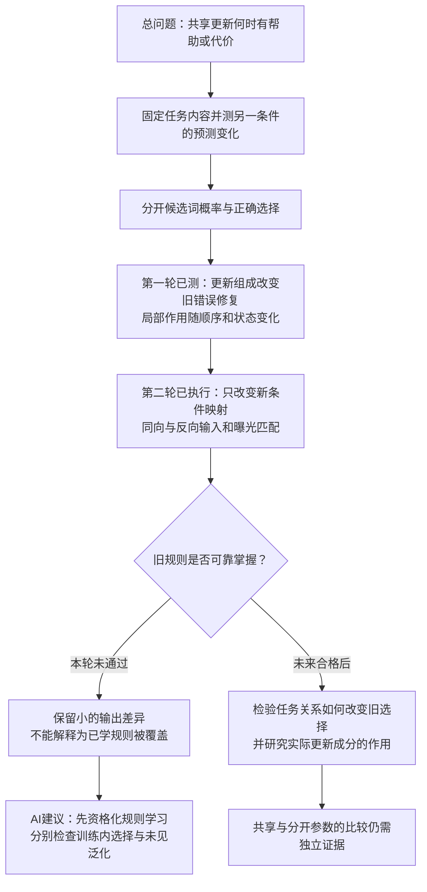

# 1012 组会：从共享损失收益到条件规则学习

[English](meeting_brief_conditional_mapping.md)

本次可以确定：第一轮揭示了损失与旧答案选择的差别；第二轮按同向／反向条件映射完成了受控实验，但没有充分学会新构造的口令规则。因此，第二轮尚不能回答“反转映射是否损害已经掌握的旧规则”。它明确了一个需要先满足的前提：模型的损失下降，必须伴随可靠的条件选择，才能进入规则迁移的判断。

阅读顺序：先看下面的目的、模型、假设、结论，再看逻辑图和数学解释。主结果以[第二轮 Summary](/data/250010109/Research_System/Projects/from-attention-to-search/main/experiments/A17/17_04_conditional_mapping_transfer/A17_04_E01_consistent_reversed_mapping/summary_cn.md)为准；设置、核验和完整分项见[Detailed](/data/250010109/Research_System/Projects/from-attention-to-search/main/experiments/A17/17_04_conditional_mapping_transfer/A17_04_E01_consistent_reversed_mapping/detailed_cn.md)。本文是组会阅读稿，不改变科研裁决。

## 1. 目的

我们的总问题是：新数据的学习什么时候能帮助其他数据的预测，什么时候会产生学习代价；哪些预测需求可以复用，哪些条件差异需要额外处理。这最终服务于共享与差异化学习的选择。目前测量的是同一组参数被更新后，另一种输入条件下的预测如何改变。

两轮分工明确。第一轮固定首项／末项任务，改变一次参数更新的组成，解释为什么旧损失改善时，旧错误修复仍可能不同。第二轮固定输入内容和预算，改变新任务的条件映射，检查任务关系是否改变旧预测收益。

合并后的第二轮只有一个主实验。此前“改变任务关系”的想法成为同向／反向标签干预；“模型是复用原有关系还是按条件修正”的想法成为模式与口令的输出分析。两者分别回答发生条件和预测后果，没有重复训练两套同义实验。

## 2. 模型

实际模型是 Qwen3-0.6B Base。我们只训练最后一层 Attention 的输出矩阵 \(W\)，其形状为 \(1024\times2048\)，其余参数冻结。对固定输入，矩阵前的向量 \(a(x)\) 不随训练改变；矩阵输出的实际变化为 \(\Delta W a(x)\)。后面的冻结 MLP、归一化和输出头仍会非线性地影响概率，所以损失与答案变化需要实际测量。

输入包含一个可见模式、一个口令和一个三词列表。口令本身不直接写出首项或末项含义；目标对应关系由训练数据规定。例如固定列表为“红 蓝 绿”：

| 模式／条件 | 甲的正确答案 | 乙的正确答案 |
|---|---|---|
| 模式一，旧任务 | 红，首项 | 绿，末项 |
| 模式二，同向新任务 | 红，首项 | 绿，末项 |
| 模式二，反向新任务 | 绿，末项 | 红，首项 |

同向和反向是两个分别运行的实验世界。它们的新输入完全相同，只改变标签；每个世界内部没有同一完整输入的矛盾标签。模型能够看到模式一／二，原则上可以区分它们。

每个种子先训练旧模式240步，再从同一旧终点分别训练同向240步、反向240步；每步20个答案词元，只计算答案损失。三个种子使用相同数据、配对批次规则和预算。另做一次等范数来源更新，以及旧新混合的反向联合检查。联合检查的新答案曝光只有主分支的一半，提供额外旧监督，只用于检查一个有限的共学实例。

两个测试面板分别是“训练见过三词集合、没见过该排列”和“训练没见过该三词集合”。它们都使用已见词表。分别汇报，再等权合并。

## 3. 假设

候选假设是：反转新模式的口令—位置关系，会比沿用关系更削弱旧答案的选择优势。它要求先形成可辨认的旧条件规则，且新训练不能仅被当作规则学习成功。

主要竞争解释仍然保留：模型可能只是把更多概率分给列表中的候选词；反转任务可能更难；冻结范围可能不利于学习模式与口令的组合；更新幅度和优化路径也可能不同。对照控制部分因素，不能自动排除这些解释。

旧模式已经监督首项和末项，所以本轮不检验“学习末项补齐旧模型从未学过的位置知识”。这是原先直觉中另一个可以单独讨论的前提。

## 4. 结论

两次任务提交均成功，预定训练和独立分析完成。Smoke为 `pt-jw3bhrzi`，Full为 `pt-qs6ndgat`，均使用4卡H100 reserved。工程完成与科研支持分开：科研判定为 **旧映射掌握前提不足**。

旧阶段的测试准确率从34.75%升至49.75%，但开发集逐口令、逐面板准确率仅33%—54%，三个种子都未达到预登记80%门槛。不能把该终点称为可靠掌握旧映射。

以下为三个种子等权平均、两测试面板等权合并的旧模式读数。答案优势是正确端点词相对另一端点词的对数概率差，单位为nat；准确率使用全词表最大概率答案。

| 旧模式读数 | 旧训练终点 | 再学同向新模式 | 再学反向新模式 |
|---|---:|---:|---:|
| 正确答案CE，越低越好 | 1.12044 | 1.03860 | 1.04174 |
| 全词表准确率 | 49.75% | 49.71% | 49.96% |
| 正确端点相对另一端点的优势 | 0.04572 | 0.06428 | 0.05911 |

反向比同向少增加旧答案优势0.005165 nat。两个分项差分别为：未见排列−0.001529、未见组合−0.008802。三个种子方向一致，但合并幅度未达到预登记0.01 nat约定；更关键的是旧规则掌握门槛失败。两分支的旧平均CE和端点优势均改善，不能据此声称平均净损害。

新模式也没有可靠掌握。同向测试准确率46.75%→47.21%，反向46.25%→48.17%；三种子、两分支均未达到DEV熟练度匹配点。联合分支的旧／新测试准确率约50.21%／47.50%，没有给出合格共学实例。失败不能证明容量不足。

最明确的认识更新来自损失分解。反向新模式CE下降0.109310，其中三词总概率项下降0.107779，三词内部正确选择项仅下降0.001531。与此同时，正确首末优势−0.005240→−0.005931，没有改善。模型更集中地预测候选词，仍未可靠地执行条件反转。

## 5. 分析：逻辑链与剩余环节

第一轮的已有认识没有失效。[轨迹实验](/data/250010109/Research_System/Projects/from-attention-to-search/main/experiments/A17/17_03_old_task_sensitive_update/A17_03_E03_trajectory_mechanism/summary_cn.md)中，100步普通／限制更新修复旧错误72／36次；中途36个同状态对照里，有24个显示限制操作较少改善原旧错误集的平均首末优势。两个顺序和不同保存点仍有异质性，因此它没有给出完整轨迹的统一机制。

第二轮改变了所检验的条件关系，但旧映射没有充分形成。当前缺的最早环节是“训练数据规定了条件规则”到“当前可训练范围已经可靠学会条件规则”。这个环节未通过时，小的同向／反向差不能被赋予已学功能冲突的含义。

### 损失下降到底说明什么

对一条输入，令 \(P_3\) 表示列表三个词的总概率，\(y\) 是正确词。精确恒等式为：

\[
\mathrm{CE}=-\log P_3-\log\frac{p(y)}{P_3}.
\]

第一项问“多少概率留给三个候选词”，第二项问“在三个候选词内部多大程度选对”。各项先对每条输入计算，再取平均；不能用平均概率的对数替换平均对数。

旧阶段CE下降1.325015，其中总概率项下降1.276094，选择项下降0.048921。约96.3%的损失降幅出现在总概率项。这是算术分解，不能说96.3%的内部因果机制已被识别。继续学习后，旧模式同向CE变化为−0.086275＋0.004429＝−0.081846；反向为−0.085028＋0.006319＝−0.078708。总概率项改善，三词选择项却略恶化。

一个具体的旧输入是“模式一，甲，列表：马 花 猫”，正确答案应为马。seed71反向分支中，马概率46.001%→47.285%，猫概率42.347%→47.471%，马的CE0.776499→0.748983，但最大概率答案由马变为猫。马获得更多概率，猫增加得更多。这个事后挑选的说明样本不能代表平均净损害，也不能证明内部模式处理失败的完整机制。

### 为什么反向标签不强迫整个更新方向反向

以下是结果后补充的精确代数说明，不是新的实验发现。在**同一矩阵状态、同一批模式二配对输入**上，记同向标签的平均损失为 \(L_s\)，反向标签的平均损失为 \(L_r\)。对一个列表，令 \(s_c=\log p(\text{末项}\mid c)-\log p(\text{首项}\mid c)\)；口令响应 \(a_2\) 是 \((s_乙-s_甲)/2\) 对列表的平均。

两套标签的CE归一化项相同，逐甲乙配对相减后得到：

\[
L_r-L_s=a_2,\qquad G=\frac{L_s+L_r}{2},
\qquad L_s=G-\frac{a_2}{2},\quad L_r=G+\frac{a_2}{2}.
\]

因此，原始参数梯度精确分解为：

\[
g_s=\nabla_W G-\frac12\nabla_W a_2,
\qquad g_r=\nabla_W G+\frac12\nabla_W a_2.
\]

反转标签改变映射区分项的符号，两个完整梯度还含同号项。\(G\)是两个标签世界的平均损失，包含提高首末总概率和限制过强首末偏好的作用；它不是纯候选词适应，也不是共同专家或内部基础模块。

同一旧终点上，新模式同向／反向CE为1.192306／1.197546，差为0.005240，等于该状态的口令响应。这个恒等式已对72个同状态面板核对，最大误差约 \(5.59\times10^{-9}\)。不同分支终点的损失不能直接代入这个关系。

当前还没有测得 \(\nabla G\) 与 \(\nabla a_2\) 的大小、夹角及对旧选择的有限作用。\(G\)下降大或\(a_2\)小，不能推出哪个梯度更大。实际更新还经过裁剪或范数匹配。若 \(d_s=-\eta_sg_s\)、\(d_r=-\eta_rg_r\)，则：

\[
d_r-d_s=(\eta_s-\eta_r)\nabla_WG
-\frac{\eta_s+\eta_r}{2}\nabla_Wa_2.
\]

相同范数不保证相同比例 \(\eta\)，所以不能把所有更新差都归结为映射区分项。这指出了一个明确但尚未完成的机制检验。

### 下一步的思路

AI建议先做DEV限定的旧模式资格诊断：在训练样本上是否形成甲／乙选择，再检查未见排列和组合。若训练内选择未形成，先检验预登记的有限预算阶梯；若训练内成功、未见失败，再讨论泛化和数据覆盖。不能从当前失败直接推导增加专家。

旧规则可靠掌握后，才把同状态来源梯度分为 \(\nabla G\) 和 \(\nabla a_2\)，比较它们对旧候选概率和旧选择优势的实际作用。它们仍是操作定义的损失梯度，功能是否可复用需要效果证据。共享／分开架构的收益还需要预算匹配的独立比较。

本轮TEST已经打开，后续开发不能用它选择预算；新的正式确认应使用新的封存测试集。当前事实记录全部完成，主问题和机制接受仍由研究者裁决。

### 组会可以怎样讲

“我们先发现，共享更新降低损失时，未必修复旧规则错误。第一轮通过相同状态的参数更新干预，把这件事落到了具体答案竞争上。第二轮主动改变条件映射，但当前只训练末层输出矩阵的设置，没有充分学会新构造的口令规则。损失改善大部分来自候选词概率，因此现在应先建立可信的条件选择，再检验哪些更新提供可复用选择信号、哪些造成代价。我们还没有证据说明需要分开专家。”

### 两个关键追问

**为什么这次对照有意义？** 两个新世界的输入、词频、同一旧起点和曝光完全匹配，只改变条件映射。它能识别这个改变在指定算法下的预测作用，避免把内容或答案边际频率差当成任务关系。但可靠规则没有形成，当前只能保留有限输出差异。

**为什么不能说反转已经造成干扰？** 旧平均损失和端点优势仍改善，主差也小；旧掌握门槛和新熟练度匹配未通过。观察到个别旧错误，不足以证明已掌握规则的稳定净损害。

证据：[配对全量分析](/data/250010109/MoE_Router/experiments/20261011_a17_conditional_mapping_transfer/runs/mapping_20261011T095038Z/analysis/results.json) · [同状态损失核验](/data/250010109/MoE_Router/experiments/20261011_a17_conditional_mapping_transfer/runs/mapping_20261011T095038Z/analysis/paired_loss_identity.json) · [Focus](/data/250010109/Research_System/Projects/from-attention-to-search/main/focus/focus_conditional_mapping_transfer_cn.md)。
