# 局部层级关系图

每个面板固定一个候选节点，完整展示其复核约简图的直接出邻居，每面板最多六个。节点标 ID、复核频率、支持数和深度；箭头标发现／复核共同支持及复核条件概率。箭头表示统计包含方向，不表示因果或信息传播。完整图见 graphs/reduced_D.json 和 reduced_V.json。

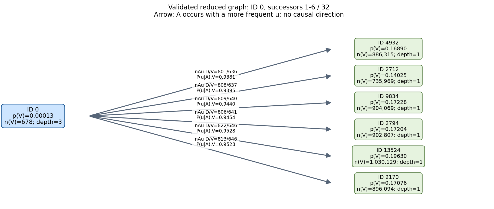

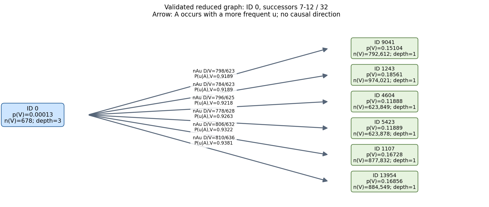

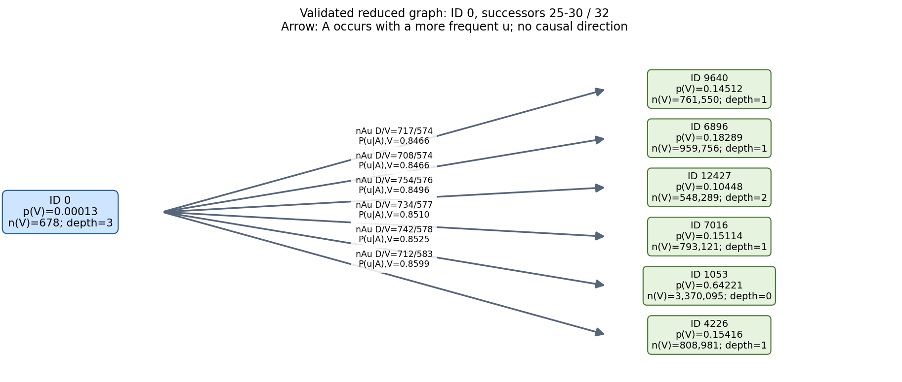

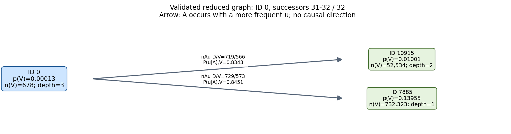

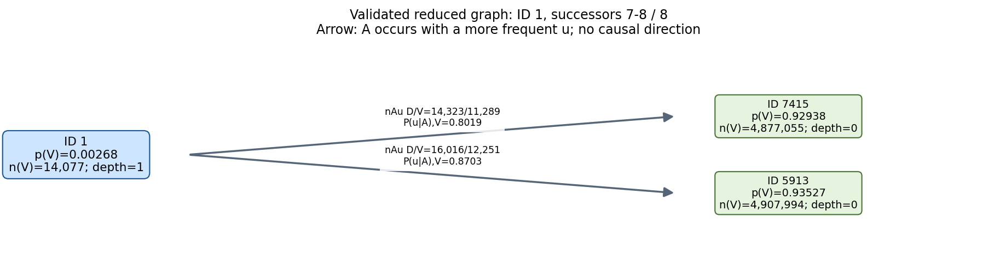

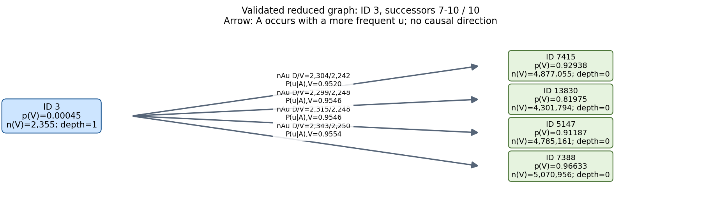

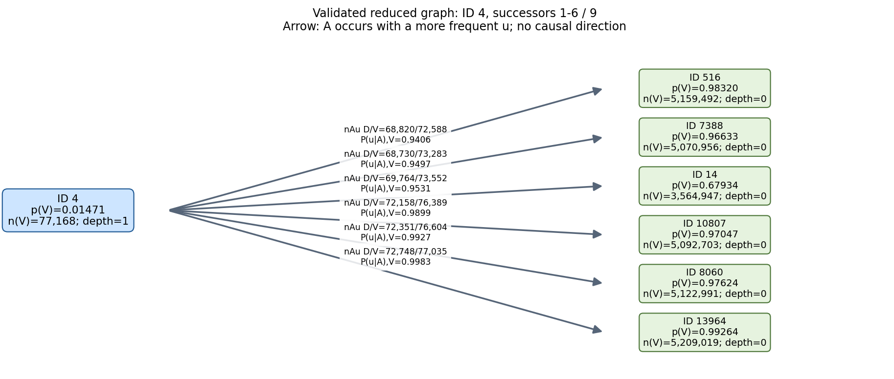

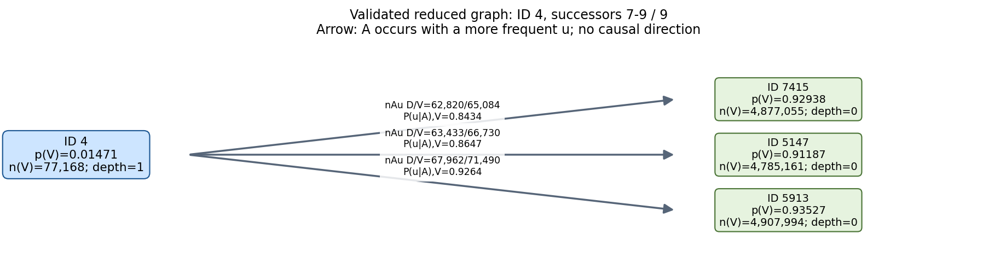

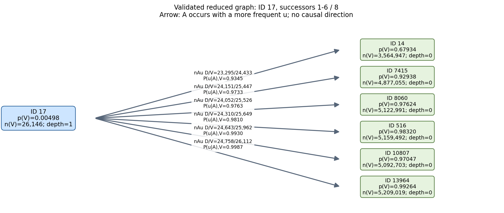

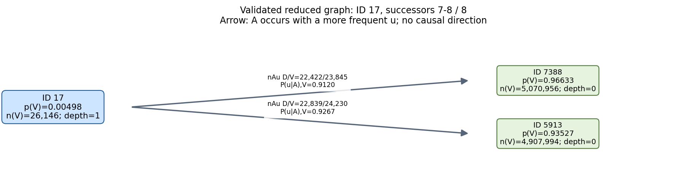

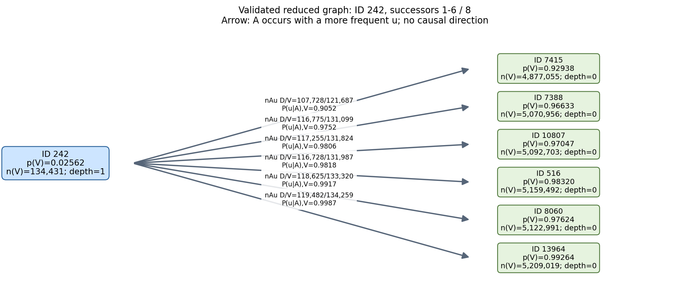

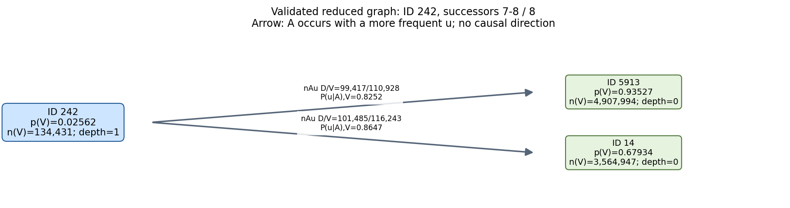

## 14层解码贡献

左图为层间幅度占比（无正式候选时展示解码范数），右图为含零位置的平均激活×解码范数，使用冻结归一化激活坐标，未做层间占比归一。由于共享同一个激活值，非零特征的层间占比等于解码范数占比。数值见 layer_contribution.csv。

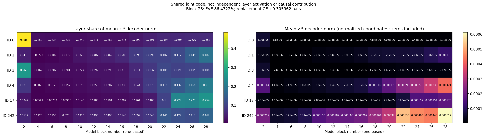
