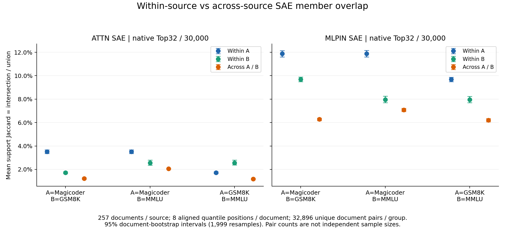

# 1104 组会：自然数据集内部 SAE 成员更重叠吗？

**问题。** 将构造文本上的H1成员重叠观察扩展到自然问题语料：同源文档是否比跨源更相似？

**观察结论。** 两套字典、3个配对中，6/6满足预设双侧判据；仅在已测模型、题干前缀与采样条件内成立，不能直接解释为领域知识。

**结论下关键数据。** 每源257篇，8位置/篇；各组32896个不同文档对。文档级95%区间及六检验Holm如下。

| SAE | pair | A_within | B_within | cross | pooled_difference_95CI | Holm_p | both_sides |
|---|---|---|---|---|---|---|---|
| ATTN_SAE | Magicoder/GSM8K | 0.0351 | 0.0171 | 0.0122 | 0.0139 [0.0129,0.0149] | 0.006 | BOTH_WITHIN_HIGHER |
| ATTN_SAE | Magicoder/MMLU | 0.0351 | 0.0256 | 0.0206 | 0.0098 [0.0086,0.0111] | 0.006 | BOTH_WITHIN_HIGHER |
| ATTN_SAE | GSM8K/MMLU | 0.0171 | 0.0256 | 0.0118 | 0.0096 [0.0084,0.0109] | 0.006 | BOTH_WITHIN_HIGHER |
| MLPIN_SAE | Magicoder/GSM8K | 0.1187 | 0.0968 | 0.0627 | 0.0450 [0.0433,0.0468] | 0.006 | BOTH_WITHIN_HIGHER |
| MLPIN_SAE | Magicoder/MMLU | 0.1187 | 0.0796 | 0.0707 | 0.0284 [0.0268,0.0302] | 0.006 | BOTH_WITHIN_HIGHER |
| MLPIN_SAE | GSM8K/MMLU | 0.0968 | 0.0796 | 0.0620 | 0.0262 [0.0242,0.0282] | 0.006 | BOTH_WITHIN_HIGHER |

**实验做法。** Magicoder-OSS problem、GSM8K/MMLU question；相同题干字段规则，不用解答、选项或答案。固定种子精确去重抽样；原Qwen3-0.6B、block27 Attention输出/MLP输入分别用自己的Top32字典。每文档对平均8个相同分位位置的交集÷并集；1999文档bootstrap、999文档标签置换。补充完整长度分箱、16/32token固定上下文和相同字面token控制；幅值单列。

**边界。** Numina限定搜索未找到，学长精确SFT数据当前不可读，不冒充复现。长度中位数252/56/50token；Magicoder代码围栏158/257，另外两源0/257。完整长度匹配Magicoder/GSM8K仅11篇/侧，证据能力弱。固定前缀与同token对照不能排除来源、主题、任务和格式。两套SAE ID不对应，本轮无训练、无干预，也不推导router功能。科研接受/问题关闭Unknown。

[完整中文Summary](/data/250010109/Research_System/research/from-attention-to-search/main/experiments/A15/15_27_natural_language_feature_response/R17_20261102_feature_composition_v02/diagnostics/R17_D1/controlled_steps/S08_dataset_support_overlap_1104/summary_cn.md) · [全部对照与局限](/data/250010109/Research_System/research/from-attention-to-search/main/experiments/A15/15_27_natural_language_feature_response/R17_20261102_feature_composition_v02/diagnostics/R17_D1/controlled_steps/S08_dataset_support_overlap_1104/detailed_cn.md) · [逐格原始统计](/data/250010109/Research_System/research/from-attention-to-search/main/experiments/A15/15_27_natural_language_feature_response/R17_20261102_feature_composition_v02/diagnostics/R17_D1/controlled_steps/S08_dataset_support_overlap_1104/tables/overlap_summary.csv)

**认识更新与反例。** 上述四类有限对照均保留正向两侧区间；重叠子预测扩展到三种自然问题来源，尚不识别知识机制。MLPIN中MMLU相对Magicoder仍有57/257篇文档呈反向局部差，均值相似性不等于每篇更相似；题干含softmax与entropy的MMLU:test:row6874，内部0.071092、跨Magicoder0.086829。这是事后描述性反例。
