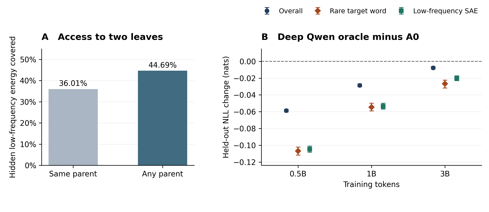

# 11 月 28 日小模型组会讨论稿：哪两个特征值得合学？

**目的。** 让小模型用更少的训练数据和计算，学会新文本中的长尾规则，同时守住整体语言建模质量。今天要决定的是，用什么证据把一组特征交给同一位专家。下面的研究问题和消融顺序为 **AI 建议，待星宇判断**。[项目入口](../../../research/small-model-moe/README.md)

## 一分钟口播

我们想让小模型用更少的数据学会长尾。现在应放宽“每个特征只归一个分支”。同一套叶允许跨父选择后，找回的低频特征能量从 36% 升到 45%。同时，深四层沿树分工的模型训练到 30 亿 token，稀有词困惑度从原生 MoE 的 242 降到 235，层级值得保留。下一步我建议直接测：在一篇文本上学特征 A，会让另一篇里特征 B 的预测变好还是变差？如果跨父的两种特征确实能互相教会，就让它们共用一个叶，保持每个词调用的专家数，再做一次消融。

左图使用 1,009 篇留出文档的前缀，共 15,309 个可判词位，比较限于同父和允许跨父两种选法。每个位置用选中叶接住的低频系数平方和除以该位置所有隐藏低频系数平方和，先在篇内取均值，再对有可判位置的文档等权平均。右图低于零表示 Qwen-HD4-Oracle 的 NLL 较低，短线是 1,024 条相同留出序列配对重抽的 95% 区间。右图比较整套教师路由与 A0；左图的跨父规则尚未进入这个训练对照。[PDF](../../../research/small-model-moe/main/explore/1128_feature_grouping/figures/feature_grouping.pdf) · [逐数核对表](../../../research/small-model-moe/main/explore/1128_feature_grouping/figures/numeric_check.csv) · [图源与统计口径](../../../research/small-model-moe/main/explore/1128_feature_grouping/figures/SOURCES.md)

## 导师讨论的要点与明确待办

以下时间均为相应录音段内时间。原稿的说话人编号由机器聚类，归属以现场对话和本人回应为依据。工程示例、学长自行安排及本轮 AI 建议各有独立来源。[11 月 27 日三段逐字稿](<../../../research/small-model-moe/sources/meetings/1127 小模型训练 3 · 三段讨论逐字稿与会议纪要.md>)

| 谁承接 | 明确要回答或交付什么 | 会议定位 |
|---|---|---|
| 星宇 | 列出原假设中哪些在真实模型失配，逐条指出这会动摇哪一步推导、哪些结论仍有较弱的充分条件。向组内解释 1.22× 衡量的对象。 | 第三段 01:05–01:41、03:14、07:05–08:47 |
| 星宇 | 给出决定两个 feature 应在一个 expert 合学，还是分到两个 expert 的度量。浅层冲突较小可能因为稀有信息尚未形成。导师预期中后层需要更多专门专家，先定义度量，再谈自适应增加专家。 | 第三段 00:52–02:29 |
| 星宇 | 跟踪长尾表征方向怎样变化；把它与下游复杂任务成绩的相关性单独验证。说明当下的代理量怎样桥接最终性能。 | 第三段 02:35–03:14、08:48 |
| 理论组，现场请 HRJ 回答 | 从无噪声、同一对 \(x,y\) 的 \(Ax=y\) 起步，证明 1,000 维和 10,000 维 Dense 学一个 common feature 的数据效率，再监测训练中的方向轨迹。容量、数据效率、训练计算效率各自给出结论及假设。 | 第三段 04:00–07:05、07:57–09:09 |
| 第一段汇报组 | 给一个人人能懂的交叉反例，说明两种语义各共享什么、各自独有何物。按 SAE 结构先跑通一个低维 gating baseline，导师举 8 维为起点，再明确应监测什么。 | 第一段 03:02–05:29、19:32 |
| 平台负责人（第二段现场称“振中”） | 按会上周末时点搭可远程访问、有 UI 的 infer 平台。把监测、测试、提交作业和训练控制固化为可检查的 Python，大模型负责辅助编写或调用。使用迁移后的机器，给快速试错留出 GPU。平台上应能看方向如何随训练改变。 | 第一段约 16–19 分钟；第二段 00:00–01:28、03:30；第三段 03:30、08:48 |
| 丁宇；两位黄同学 | 丁宇在平台上启动后训练相关测试。两位黄同学会后复盘“看到交叉，为何没继续追问树到底给了什么性质”，独立检验导师解释。第二段的百万参数视觉模型、489 步是快速试验示例；机器狗下周五上路是团队理想进度。 | 第一段 19:53；第二段 01:28–03:30 |

**方法论变化。** 上会先交代一次简化为了解释什么。例如唯一父节点既限制可达的专家，也让活跃路径容易计数。遇到反例，先核对理论和实验是否在学同一个目标、使用相同的输入与优化条件；对齐之后，再撤去一条假设，看结论是否还能推出。低维线索可以用来快速分类，类内处理所需的表征宽度要另外测。每个实验在跑前写下什么结果会让我们改变做法；清楚证明某项设计为何做不到，也构成进展。[第一段 08:39–14:04、19:53；第三段 07:05–09:09](<../../../research/small-model-moe/sources/meetings/1127 小模型训练 3 · 三段讨论逐字稿与会议纪要.md>)

**HRJ 11 月 28 日另行安排的三件事。** 数每个 token 在各 HIFER 深度激活几个特征，用来考虑平坦分配；加大样本、改变阈值，复核“进图约占全字典 25%”的初估；检查概率父子边究竟对应什么语义。建议回传全字典覆盖、激活事件覆盖与能量覆盖三个分母，并保留图外特征。语义核对可用不参与建图的文本做盲判，核对父主题、子细节和反例。后两句是 AI 对检验方式的建议。[HRJ 原文](../../../research/small-model-moe/sources/meetings/1128-沟通内容.md)

## 用于讨论的目的、假设、模型与实验分析

| 组会环节 | 供研究者修改的候选 |
|---|---|
| 目的 | 到达同一尾部质量且总体合格，需要多少有效训练 token、全模型 FLOPs、同硬件 GPU 小时。更远的知识终点用可翻转答案的独立题验证。 |
| 已有认识 | **受众交叉、浅深有统计包含、树形计算有收益可以同时成立。** CHJ 的 Gemma 特征受众对有 80.7% 交叉；HRJ 测得深组已出现时浅组也出现的比例为 63.9%，频率匹配随机为 54.7%。CHJ 对齐后的 64 专家里，共现分组与随机分块验证损失为 4.9796 与 4.9705。单凭共现指定共享参数，理由还不够。 |
| 假设与对手 | 若同一细节在不同父域里要求相容的更新，共享叶可汇集长尾样本。若富集只是在筛相同目标词或重现教师偏好，配平词频与负载后，真实配对应与打乱相当。 |
| 模型 | 保留浅四层原生 MoE、深四层共享根和分层分支。把特征共现、学生实际调用、更新对另一组的帮助分别记录。导师的极简例题已有一个条件解：同样的输入范数、平方和损失、同一步长，单样本相对预测误差的每步收缩与维度无关。 |
| 最小实验 | 用同一早期存档的末层公共专家。在 A 的一组文档上作可撤销的等范数更新，在另一批 B 的文档测 NLL，再反向做一次。比较同父与跨父配对，并加频率、支持和负载匹配的随机对照。相同初态下，学 A 一步，合学与分学在 A 上改善相同，两者的差恰是 B 从这一步得到的收益乘以 B 的评价权重。再用独立文档检验。 |
| 支持 / 不支持 / 不足 | 若跨父互助能复现且优于打乱，首个架构改动只放宽最后一跳的叶资格，每 token 仍走相同数量和宽度的专家。若匹配后真实组与随机相当，保留原树及学习型平坦参照；若特征过稀或区间太宽，先补独立文档、校准代理，暂缓长训。 |
| 训练后如何分析 | 报同 token 的总体、稀有目标词、低频 SAE 三种 NLL。整体均值可能掩盖取舍：在约 10 亿 token，新旧深层教师总体近乎持平，新教师低频 SAE NLL 低 0.02225，稀有词 NLL 却高 0.00933。另查留出规则题和实际成本。 |

**供你裁定的一项选择**：是否将“独立文本上的双向更新收益能否指导长尾特征共用叶专家”作为这轮唯一首要问题，并把“同一叶池，只放宽最后一跳”列为通过诊断后才进入短训的第一候选？[完整条件推导、对照和跑前分支](../../../research/small-model-moe/main/explore/1128_feature_grouping/log.md) · [模型与同预算证据](../../../research/small-model-moe/main/research_notes/1128_prior_work.md)
