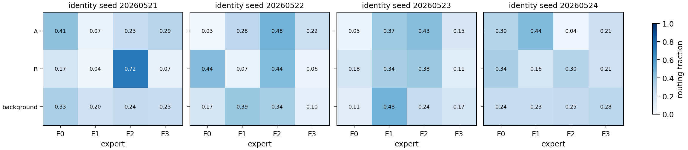
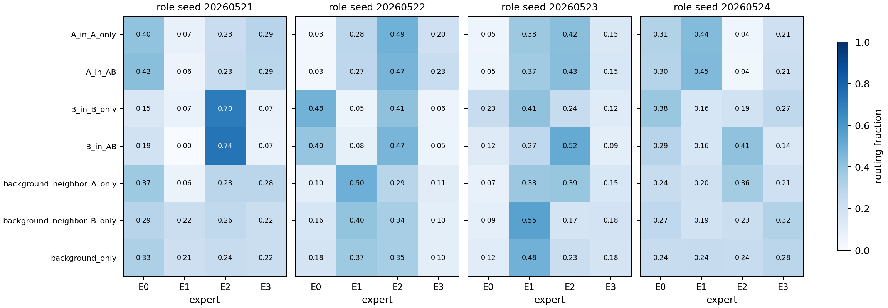
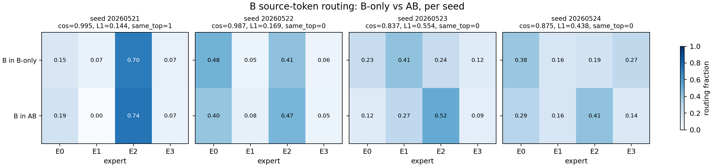

# Reporting Card: H0521b Seq32 Contiguous AB

Source closure:

```text
Projects/from-attention-to-search/XingyuD/main/hypotheses/A01_router_feature_specialization_audit/A01_E02_seq32_contiguous_ab/hypothesis_closure.md
```

## Oral Report Card - Fill Before Meeting

目的：

假设：

结论：

证据：

1.
2.
3.

## Closure Snapshot

# 假设闭环：H0521b Seq32 Contiguous AB

## 1. 目的

这轮实验要回答：当 A/B/AB motif 被放进更长的 `seq_len=32` 背景序列后，source-token gating 是否能形成干净的 A/B/background token identity bucket。

它是 H0521a 的延伸：H0521a 看 prediction-position 的最小 A/B/AB routing；H0521b 更接近 Reverse Index 的 KV source-token 场景，因为真正被检索的是历史 source token 的 KV，而不是只看最后预测位置。

## 2. 假设

H：普通无负载均衡 top-1 MoE 在 `seq_len=32` 连续 AB motif setup 中，不会自然形成稳定、干净的 source-token identity bucket。

Rival 1：source-token gating 会按 token identity 分 expert，即 A token、B token、background token 形成稳定不同 bucket。

Rival 2：source-token gating 不按 identity，而主要由 source position 或 causal left context 调制。

Rival 3：source-token routing 虽然不形成 hard partition，但仍保留 identity anchor，可作为弱检索信号。

## 3. 数学建模

令 source position 为 $s$，source hidden state 为：

$$
h_s = F_\theta(x_{\le s})
$$

source token identity 为 $u_s \in \{A,B,\text{background}\}$，source role 为：

```text
A_in_A_only, A_in_AB, B_in_B_only, B_in_AB, background
```

top-1 router 为：

$$
g_i(h_s)=w_i^\top h_s,\qquad e^*(h_s)=\arg\max_i g_i(h_s)
$$

如果 source-token identity bucket 成立，应看到：

```text
A token -> stable expert_A
B token -> stable expert_B
background -> stable expert_bg
```

并且这种分配应在不同 context 和不同 seed 内稳定。主判定量是 `source-token routing purity`：逐 seed 统计 $P(e \mid \text{source role})$、dominant expert consistency，以及 source identity / source role 与 expert id 的 NMI。

关键因果边界是：Transformer 是 causal 的。连续 `[A,B]` 中，A 的 source hidden 看不到未来 B；B 的 source hidden 可以看到左侧 A。因此 A_in_AB 不应该被期待天然知道完整 AB motif，但 B_in_AB 可能被 left context 调制。

## 4. 实验设置

输入是 32 个 token 的 prefix，目标是 next token：

```text
A-only:       background 中插入 [A, r] -> y_A
B-only:       background 中插入 [r, B] -> y_B
AB-composite: background 中插入 [A, B] -> y_AB
background:  全 background token -> r_k
```

本轮主指标是 `source-token routing purity`。它在 inference 阶段看 A token、B token 和 background token 自己被 routed 到哪个 expert，并且逐 seed 分析，最后只取跨 seed 稳定结论。

Seed 改变模型初始化、synthetic 样本抽样、batch 顺序和优化轨迹；不改变任务规则、模型结构、超参和指标定义。由于 expert id 有 permutation symmetry，平均 routing matrix 只能作为辅助可视化，主结论必须来自 per-seed 规则交集。

## 5. 结论

H0521b 支持一个更明确的负结果：ordinary no-load-balance top-1 MoE 在 `seq_len=32` 连续 AB motif setup 中，没有形成稳定、干净的 source-token identity bucket。

更准确地说，不是“完全没有 identity signal”，而是：source-token routing 存在 identity anchor，但会被 causal context 调制；当前 expert bucket 仍不能直接作为干净 feature-level Reverse Index candidate。

## 6. 证据

1. 任务可学：dense 和 MoE 都学会了任务，A-only 和 B-only accuracy 都是 `1.0`，AB-composite accuracy 约为 `0.999-1.0`。因此 routing 诊断有意义。

2. 跨 seed 稳定规则不支持干净 identity partition：

```text
A token 在 A-only 和 AB 中 dominant expert 一致：4/4 seeds
B token 在 B-only 和 AB 中 dominant expert 一致：1/4 seeds
A token 与 B token 是否进入不同 dominant expert：2/4 seeds
source identity NMI: mean 0.047
source role NMI: mean 0.042
```

3. source identity routing by seed 显示：A/B/background 没有形成跨 seed 稳定的一一 expert partition。



4. source role routing by seed 显示：A_in_A_only 和 A_in_AB 在每个 seed 内较一致，但 B_in_B_only 和 B_in_AB 不稳定。



5. 直接比较 B-only 与 AB 中的 B source routing 后，前两个 seed 的分布非常相似；后两个 seed 有明显 context 调制，但仍保留 B identity trace。这支持 “identity anchor + causal context modulation”，而不是干净 hard bucket。



## 7. 结论边界

能说：

```text
在当前 ordinary top-1 MoE、无 load balance、无 router supervision 的设置下，source-token gating 没有稳定形成 A/B/background token identity partition。
```

不能说：

```text
所有 router 都无法形成 source-token feature bucket；identity signal 完全不存在；prediction-position routing 可以替代 source-token bucket 质量。
```

最弱点：source-token hidden state 是 causal 的，A source 看不到未来 B；因此 A 与 B 的 routing 稳定性不能用同一语义要求直接比较。

## 8. 下一步决策

下一步应做 source-token rule audit：枚举 token identity、source position、left context，直接分析 router score 和 expert id，判断同一 expert 的共同特征到底是 token identity、position embedding，还是 causal left context。

## 9. 结果文档

- 实验摘要：`Projects/from-attention-to-search/XingyuD/main/experiments/A01/A01_router_feature_specialization_audit/A01_E02_seq32_contiguous_ab/summary.md`
- 详细报告：`Projects/from-attention-to-search/XingyuD/main/experiments/A01/A01_router_feature_specialization_audit/A01_E02_seq32_contiguous_ab/detailed.md`
- 运行结果目录：`Projects/from-attention-to-search/XingyuD/Attention_Search_Experiments/active/synthetic_data_understanding/results/h0521b_seq32_contiguous_ab/h0521b_seq32_contiguous_ab_4gpu_20260521/`
