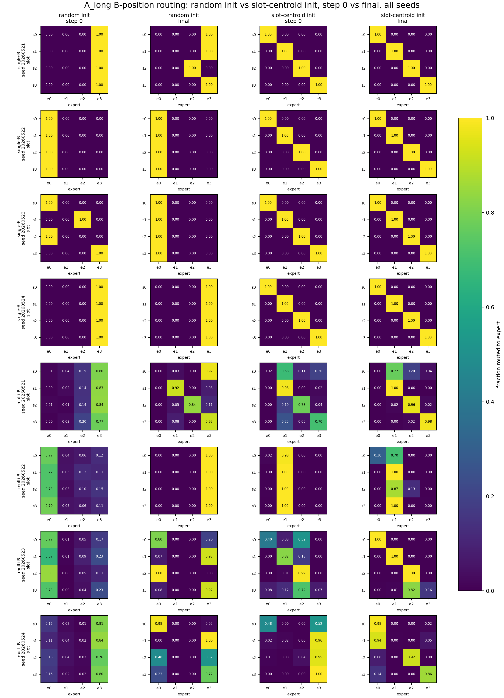
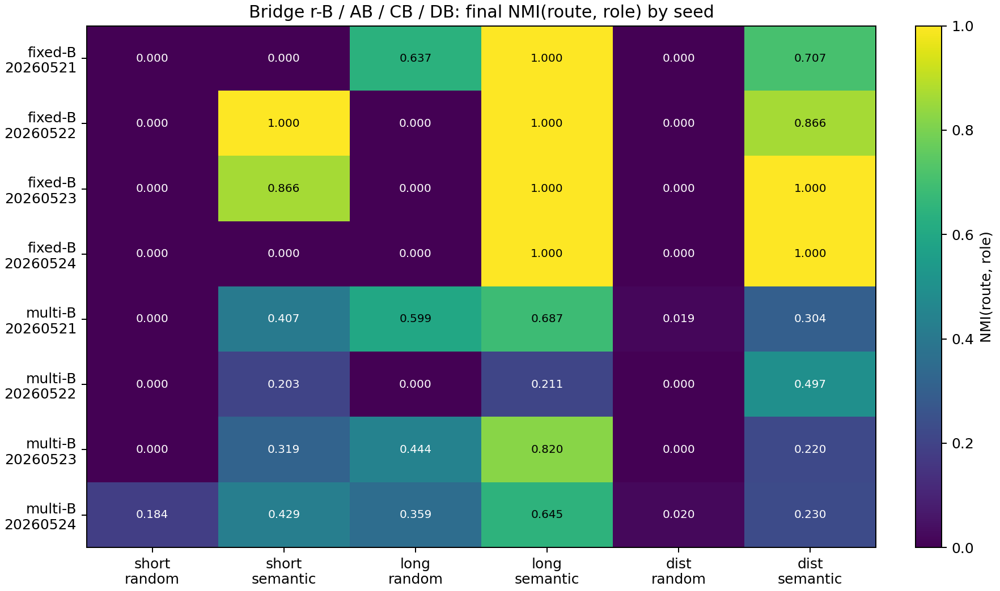
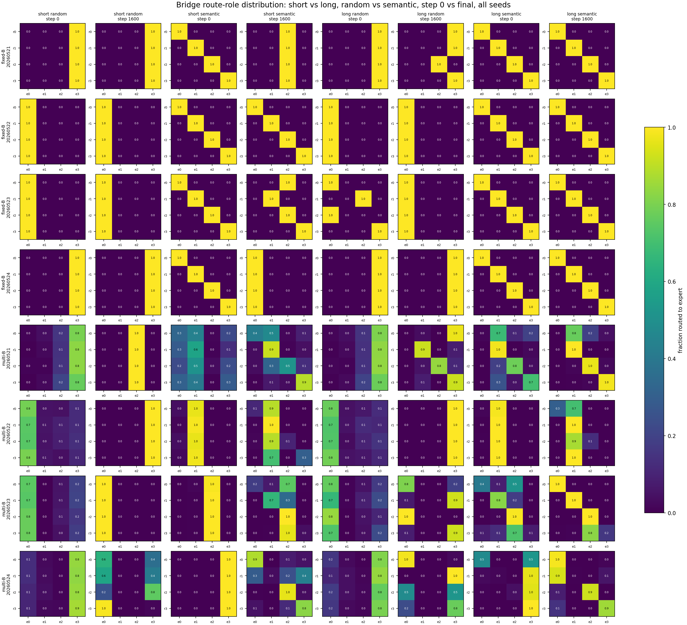

# 0526 Slot-Context 30 秒汇报稿

## 0. 只讲这一版

### 1. 我在解决什么问题

我现在做的是 MoE 里 router 为什么没有按 slot / feature 分 expert 的问题。

### 2. 我这轮问什么

之前我们看到 short slot 初始化一开始有用，但训练后会下降。我这轮想确认：是不是因为 slot 信息太短、太弱，被 B token identity 或 common feature 压过去了。

### 3. 我做了什么实验

所以我把 slot 前面的上下文加长，并让同一个 B 在不同 slot 下对应不同 target。然后分 fixed-B 和 multi-B：fixed-B 去掉 B identity 干扰，multi-B 把 B identity 干扰加回来。

### 4. 我的结果和边界

结果是 fixed-B 下 router 基本能按 slot 分；multi-B 下也有增强，但不稳定。所以我现在的结论是：增强 slot 信息确实会增强 router 按 slot 分发的趋势，但只靠这个还不足以形成稳定的 expert specialization。

## 1. 图怎么用

最重要的背景文件：

```text
anchor/01_slot_context_dominance_router_specialization_anchor.md
```

如果导师问“你整个问题定义是什么”，直接打开这个文件，看开头的：

```text
Thinking Card
Question
Current Evidence
Claim Boundary
```

### 图 1：主结果图

看：

```text
figures/discussion_random_vs_slot_init_init_final_route_heatmaps.png
```

对应文档：

```text
docs/slot_context_summary.md
A01_slot_context_dominance_router_specialization/detailed.md
```

怎么说：

```text
这张图比较 short / long context 和 random / slot init 的始末 routing。
fixed-B 下 long context 更接近按 slot 分；multi-B 下有增强但不稳定。
```



### 图 2：fixed-B 和 multi-B seed 结果

看：

```text
figures/bridge_abcd_final_nmi_by_seed_heatmap.png
```

对应文档：

```text
docs/bridge_abcd_summary.md
A01_slot_context_bridge_abcd_context_length/detailed.md
```

怎么说：

```text
fixed-B long semantic 基本是满的，说明去掉 B identity 后 slot 能控制 routing；
multi-B 也提升，但 seed 间不稳定，说明 B identity 仍然干扰。
```



### 图 3：bridge 对照图

看：

```text
figures/bridge_abcd_short_long_init_final_route_heatmaps.png
```

对应文档：

```text
docs/bridge_abcd_summary.md
```

怎么说：

```text
这张图说明旧实验里 semantic prior 会下降，和现在 fixed-B 结果不矛盾：
旧实验说明 semantic init alone 不够；现在说明 long context 确实能增强 routing alignment。
```



## 2. 最后一句边界

```text
我现在不能 claim top-1 MoE 已经自然形成稳定 slot experts；
我只能 claim：slot context 变强会增强 router 按 slot 分发的趋势。
下一步要看怎么把 routing 和 expert utility 绑定起来。
```
