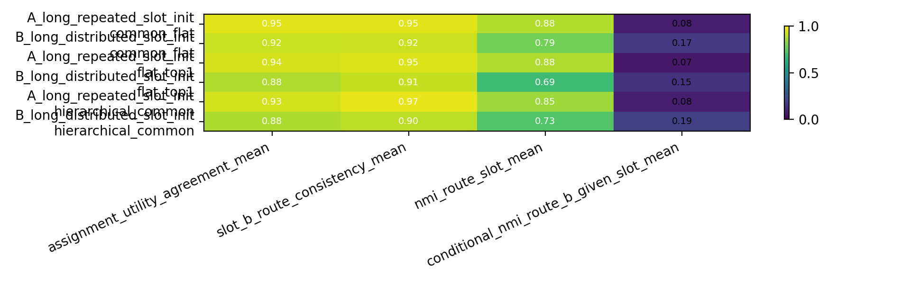
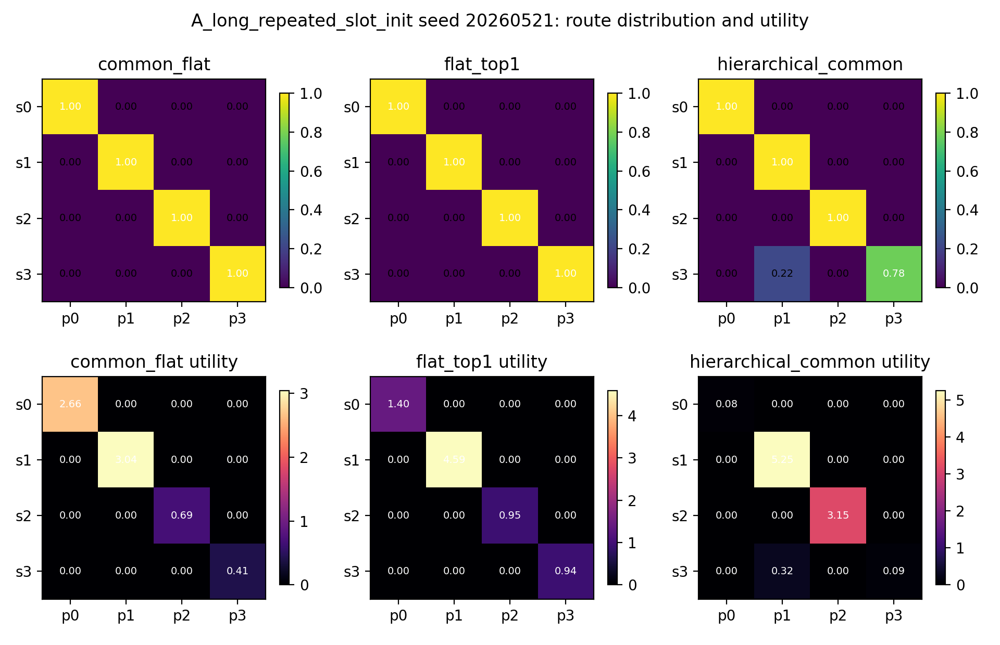
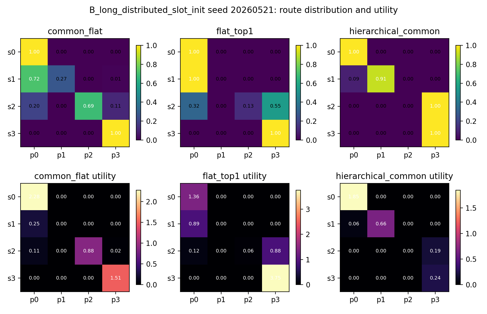
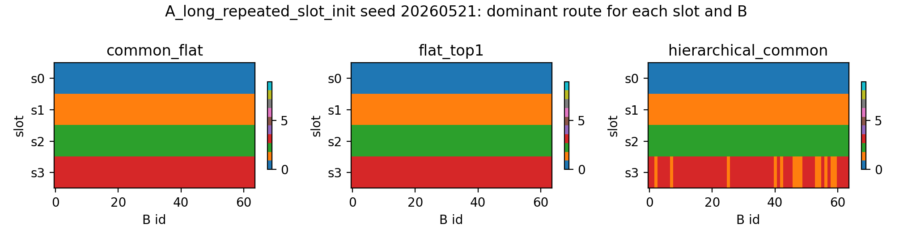
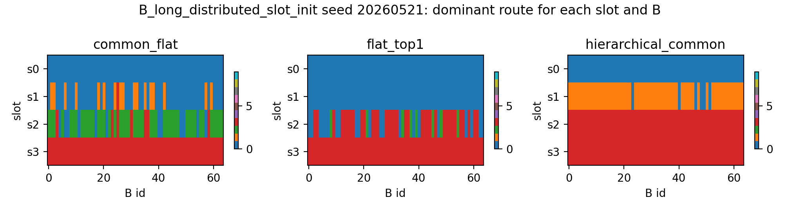
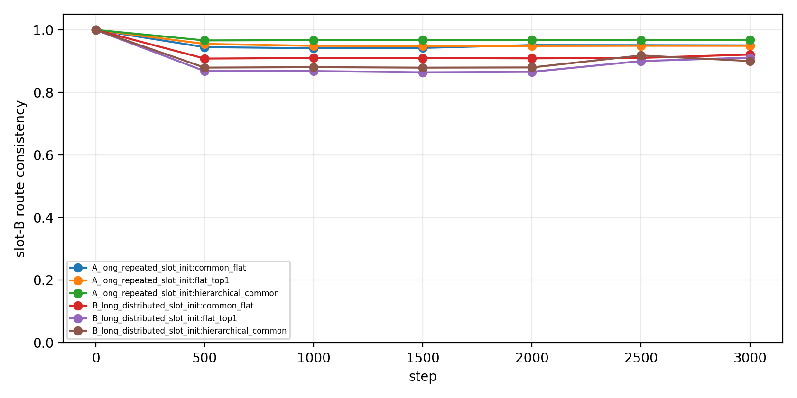

# Detailed Result: hierarchical_route_utility_binding

Anchor:

```text
Projects/from-attention-to-search/main/problem_anchors/03_hierarchical_route_utility_binding_anchor.md
```

Story:

```text
common path 是否能接住共享计算，leaf route 是否因此更愿意承担 slot-specific 的预测责任？
```

## 0. Quick Recap

目的：

测试 hierarchical/common MoE 是否解决上一轮 multi-B 中看到的 route-function binding failure。

假设：

如果 common path 吸收 $B_i$ identity / shared computation，leaf path 应该更容易按 slot 分，并且 selected path 应该等于 utility-best path。

实验思路：

在 uniform 64-B slot-context synthetic 上比较三个模型：`flat_top1`、`common_flat`、`hierarchical_common`。三者 active FFN width 都对齐到 256，训练都用 full NTP。

结论：

`common_flat` 平均最好；`hierarchical_common` 没有稳定超过 `common_flat`。因此结果支持“common path 可能有帮助”，但削弱“层级结构本身足以解决 binding failure”的强假设。

证据：

`B_long_distributed` 是更有区分度的条件：Assign-Utility 为 `flat_top1=0.880`、`common_flat=0.918`、`hierarchical_common=0.878`。

## 1. Anchor Link And Decision Point

Parent question:

```text
MoE router 如何形成稳定、可解释、可复用的 feature-level expert specialization？
```

This experiment updates:

```text
hierarchical/common path 是否应成为解决普通 top-1 route-function binding failure 的主线机制。
```

## 2. Data Construction

Data motif:

```text
seq_len = 32
positions 10-14: slot/context prefix
position 15: B_i
position 16: Y_{slot,i}
slots = 4
B identities = 64
```

Target rule:

$$
Y_{s,i}=target\_start+s \times 64+i.
$$

Data scale:

```text
train rows / condition / seed = 20,000
eval rows / condition / seed = 6,400
unique (slot, B) pairs = 256
average train repeats per (slot, B) = 78.125
```

Important boundary:

This is moderate multi-B. It is deliberately easier than the previous 256-B hard stress, because we also wanted to inspect whether route is consistent across different $B_i$ within the same slot.

## 3. Models

All models use full NTP training, no load balance, and selected-gate top-1 routing where selected expert output is multiplied by its gate probability.

### flat_top1

```text
4 experts
expert ffn_dim = 256
active FFN width = 256
```

### common_flat

```text
global common expert ffn_dim = 64
4 leaf experts, leaf ffn_dim = 192
active FFN width = 64 + 192 = 256
```

### hierarchical_common

```text
global common ffn_dim = 32
root router: 2 groups
selected group common ffn_dim = 48
inner router: 2 leaves per group
selected leaf ffn_dim = 176
active FFN width = 32 + 48 + 176 = 256
```

Parameter audit:

| Model | Total Params | FFN Params |
|---|---:|---:|
| flat_top1 | 729,604 | 264,196 |
| common_flat | 680,388 | 214,980 |
| hierarchical_common | 680,902 | 215,494 |

The comparison is active-compute matched. Total parameters are not the reason `common_flat` wins; if anything, `flat_top1` has more total and FFN parameters.

## 4. Training Setup

```text
steps = 3000
batch_size = 384
seeds = 20260521, 20260522, 20260523, 20260524
conditions = A_long_repeated_slot_init, B_long_distributed_slot_init
models = flat_top1, common_flat, hierarchical_common
jobs = 24
```

Training objective:

```text
loss = mean CE(x_t -> x_{t+1}) over all positions
```

`target_ce` at B position is logged only as a diagnostic.

## 5. Metrics

Primary:

```text
assignment_utility_agreement
```

It asks whether the actually selected path is also the path whose ablation hurts that slot most.

Supporting:

```text
route-slot NMI
route-B NMI
conditional route-B NMI within slot
slot-B route consistency
forced path target CE
ablation utility delta
common / group-common ablation delta
full_ntp_ce / target_ce / target_accuracy
```

## 6. Results

Main table:

| Condition | Model | Assign-Utility | Slot-B Consistency | Route-Slot NMI | Cond. B-NMI | Target CE | Acc |
|---|---|---:|---:|---:|---:|---:|---:|
| A_long | flat_top1 | 0.935 | 0.948 | 0.883 | 0.069 | 0.00047 | 1.0 |
| A_long | common_flat | **0.952** | 0.951 | 0.883 | 0.085 | 0.00049 | 1.0 |
| A_long | hierarchical_common | 0.932 | **0.968** | 0.853 | 0.083 | 0.00049 | 1.0 |
| B_long | flat_top1 | 0.880 | 0.912 | 0.689 | 0.147 | 0.00063 | 1.0 |
| B_long | common_flat | **0.918** | **0.921** | **0.787** | 0.167 | 0.00091 | 1.0 |
| B_long | hierarchical_common | 0.878 | 0.900 | 0.727 | 0.189 | 0.00060 | 1.0 |



Interpretation: common_flat gives the best average Assign-Utility. Hierarchical_common is not a reliable improvement over flat or common_flat.

## 7. Seed-Level Behavior

`A_long` is relatively easy: several seeds are already near clean routing.

```text
A_long seed 20260521:
flat_top1 Assign-Utility = 1.000
common_flat Assign-Utility = 1.000
hierarchical_common Assign-Utility = 0.805
```



`B_long` is more diagnostic:

```text
B_long seed 20260521:
flat_top1 Assign-Utility = 0.887
common_flat Assign-Utility = 0.851
hierarchical_common Assign-Utility = 0.978
```



But this is not stable across seeds:

```text
B_long seed 20260523:
flat_top1 = 0.792
common_flat = 0.934
hierarchical_common = 0.821

B_long seed 20260524:
flat_top1 = 0.885
common_flat = 0.933
hierarchical_common = 0.787
```

This is why the conclusion is not “hierarchy works”; it is “common_flat is a better current candidate than two-level hierarchy.”

## 8. B-Consistency Check

The `slot x B` route map checks whether the same slot keeps the same route across different $B_i$.







Interpretation: 64-B data makes within-slot route consistency mostly high. That is useful for diagnosis, but it also means this run is not as hard as the previous 256-B stress test.

## 9. Common-Path Utility

Global common ablation delta is small but nonzero:

```text
A_long common_flat global common delta mean = 0.00110
B_long common_flat global common delta mean = 0.00146
```

For hierarchical_common:

```text
A_long global common delta mean = 0.00052
A_long group common delta mean = 0.00208
B_long global common delta mean = 0.00053
B_long group common delta mean = 0.00105
```

Interpretation: common/group-common paths carry some useful computation, but they do not automatically make the leaf routing more functionally aligned.

## 10. Claim Boundary

This result supports:

```text
common path is worth keeping as a candidate mechanism.
```

This result weakens:

```text
two-level H-MoE structure alone solves route-utility binding.
```

This result cannot claim:

```text
success on 256-B hard stress;
success under Zipf frequency;
transfer to real corpus;
system-side swapping benefit.
```

## 11. Artifact-Repro Map

Code workspace:

```text
Projects/from-attention-to-search/XingyuD/Attention_Search_Experiments/active/synthetic_data_understanding
```

Runner:

```text
scripts/run_hierarchical_route_utility_binding.py
```

Config:

```text
configs/hierarchical_route_utility_binding.json
```

Submit:

```text
scripts/submit_hierarchical_route_utility_binding_4gpu_acp.sh
```

Result dir:

```text
results/A03_hierarchical_route_utility_binding/hierarchical_route_utility_binding_full_20260528
```

Figure dir:

```text
figures/A03_hierarchical_route_utility_binding/hierarchical_route_utility_binding_full_20260528
```

Curated local tables:

```text
Projects/from-attention-to-search/main/experiments/A03/A03_hierarchical_route_utility_binding/tables/
```

Curated local figures:

```text
Projects/from-attention-to-search/main/experiments/A03/A03_hierarchical_route_utility_binding/figures/
```

ACP job:

```text
pt-7y7u65m5
```

Runtime log:

```text
logs/acp/hierarchical_route_utility_binding_full_20260528_runtime_20260528_170028.log
```

Repro command:

```bash
HIER_ROUTE_UTILITY_ALLOW_REAL_SUBMIT=1 \
RUN_NAME=hierarchical_route_utility_binding_full_20260528 \
JOB_NAME=ats-hier-route-utility-4gpu-0528 \
bash scripts/submit_hierarchical_route_utility_binding_4gpu_acp.sh
```

## 12. Next Decision

Do not jump to Zipf yet. The next clean experiment should decide whether the useful ingredient is:

```text
common path alone
```

or

```text
common-residual input to the leaf router
```

Recommended next run:

```text
common_flat vs common_residual_leaf_router
on 64-B and 256-B
with the same Assign-Utility / slot-B consistency metrics.
```
