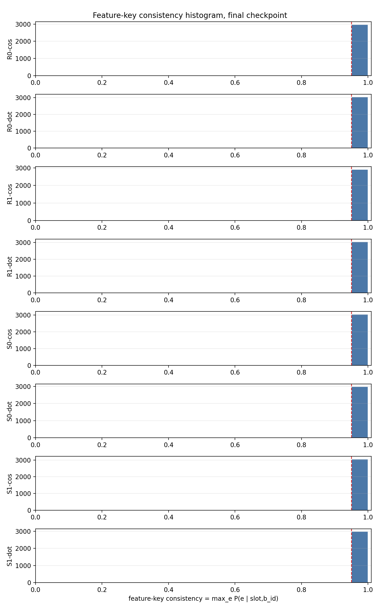
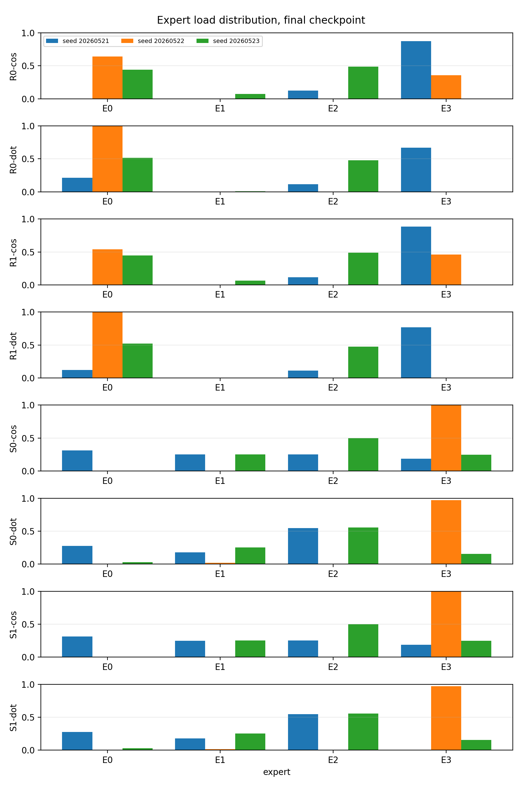
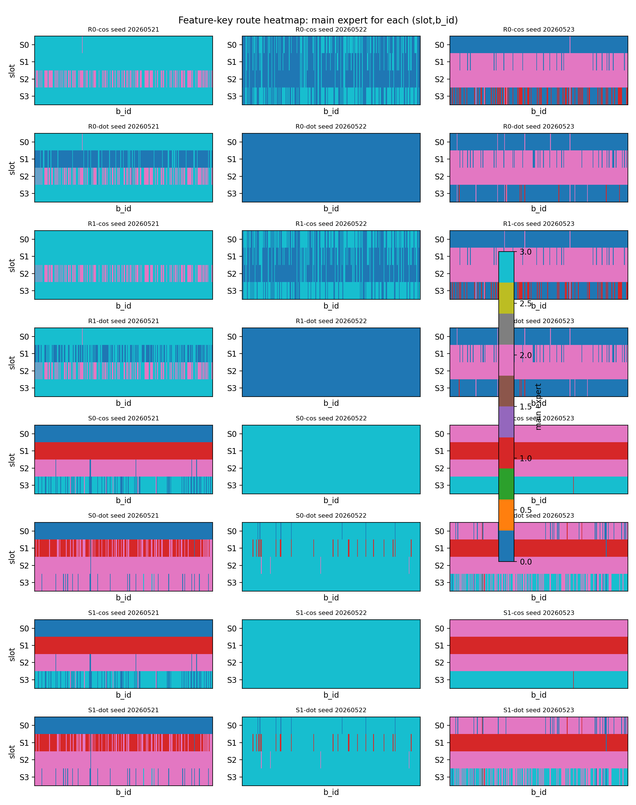
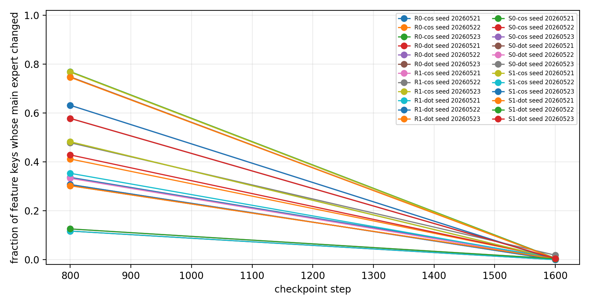

# Result Summary: H0604a Feature-Key Routing Stability Center-Only

Anchor:

```text
../../problem_anchors/05_failure_mechanism/05_01_geometric_inhibition_anchor.md
```

Story:

Test whether the same concrete feature key $(slot_id,b_id)$ is routed stably to the same expert under random init, slot init, and center separation only.

Mainline graph:

```text
../../visualizations/feature_axis_mainline_graph.html
```

## 0. Closure Summary

目的：

验证同一个具体 feature key $(s,i)=(slot_id,b_id)$ 是否稳定 route 到同一个 expert。这里不加入 `Feature Separation Objective`，不加入 supervised token margin。

假设 / 问题：

如果 router 学到 feature-key-stable routing，那么同一个 $(s,i)$ 的多个 eval variants 应该高度集中到某个 expert：

$$
\max_e P(e\mid s,i)\approx 1
$$

同时必须用 expert load entropy 排除 all-to-one collapse。

结论：

H0604a 支持 advisor 的 weak toy claim：在 operational feature key $(slot_id,b_id)$ 下，同一个 feature 可以稳定 route 到一个 expert。FeatureKeyConsistency 在所有条件中都接近 0.99。

但 H0604a 不支持 “center separation only 让 feature key 更稳定进入同一个 expert”。原因是：FeatureKeyConsistency 在 random NTP-only baseline 中也已经很高；center separation only 没有带来决定性提升。这个指标本身容易被 deterministic feature-key routing 或 collapse 满足。

关键证据：

| Condition | FeatureKeyConsistency | Load entropy norm min | Max load max | Route-slot NMI |
|---|---:|---:|---:|---:|
| R0-dot | 0.9987 | 0.0000 | 1.0000 | 0.3456 |
| R1-dot | 0.9982 | 0.0000 | 1.0000 | 0.2975 |
| S0-dot | 0.9942 | 0.1131 | 0.9711 | 0.4516 |
| S1-dot | 0.9942 | 0.1131 | 0.9711 | 0.4516 |
| R0-cos | 0.9945 | 0.2701 | 0.8762 | 0.3132 |
| R1-cos | 0.9889 | 0.2614 | 0.8823 | 0.3182 |
| S0-cos | 0.9991 | 0.0000 | 1.0000 | 0.5711 |
| S1-cos | 0.9991 | 0.0000 | 1.0000 | 0.5711 |

Most important observation:

Several conditions have near-perfect FeatureKeyConsistency while a seed collapses to one expert. For example, S1-cos has FeatureKeyConsistency 1.0000 in seed `20260522`, but expert load entropy norm is 0 and max load is 1.0000. This is a collapse false positive.

Non-collapse read:

After dropping collapse / near-collapse seeds, `S0-cos` and `S1-cos` have the best slot-aligned routing, but they are effectively identical. Therefore the non-collapsed result supports cosine router + slot init as the strongest current structure, not an independent center-separation gain.

结论边界：

This result uses artificial nuisance variants at fixed non-target positions. It tests routing stability under these variants, not real-language robustness. It also does not prove expert utility specialization.

下一步决策：

Do not use FeatureKeyConsistency alone as a specialization metric. Before route-utility binding, use the existing H0604a route logs/checkpoints to audit what the router treats as the feature: slot, $B_i$, or atomic $(slot,B_i)$.

## Hypothesis Evidence Map

| Hypothesis / rival | Deciding result or figure | What it explains | Current read |
|---|---|---|---|
| H1: same operational feature routes to the same expert | `feature_key_consistency_histogram.png`; FeatureKeyConsistency near 0.99 | Tests the advisor's weak toy claim under feature key $(slot_id,b_id)$ | Supported as a weak consistency claim |
| Rival: high consistency is collapse | `expert_load_distribution.png`; seed-level max load / load entropy | Separates stable feature routing from all-to-one or near-all-to-one routing | Rival is real; collapse guard is required |
| H2: center separation only adds feature-key stability | compact decision table; `S0 ~= S1`, `S0-cos ~= S1-cos` | Tests whether center separation has an independent gain over NTP-only with same init/router | Weakened |
| H3: cosine router + slot init gives better non-collapsed route structure | filtered non-collapse table; route-slot heatmap | Tests whether the best valid structure is tied to cosine + slot init rather than center separation | Supported, but not utility specialization |
| Open question: routed feature is slot, $B_i$, or $(slot,B_i)$ | next diagnostic: NMI(route; slot/B_i/slot+B_i) and per-expert composition | Decides the operational feature axis before route-utility binding | Not answered yet |

## Key Figures

Feature-key consistency:



Interpretation:

Almost all conditions show high feature-key consistency, so the metric alone does not distinguish successful specialization from baseline or collapse.

Hypothesis link:

This figure supports the weak same-feature consistency claim, but it cannot support feature specialization without the load figure.

Expert load:



Interpretation:

High consistency can coincide with low expert-load entropy or single-expert collapse. This is the decisive guardrail.

Hypothesis link:

This figure tests the collapse rival. It is the reason high FeatureKeyConsistency cannot be promoted to specialization.

Feature-key route map:



Interpretation:

The per-seed route maps show that stable feature-key assignment can still be many-to-one or collapsed, not necessarily feature-specialized.

Hypothesis link:

This figure is a composition diagnostic. It tells whether stable routing is structured or just concentrated.

Checkpoint drift:



Interpretation:

Most feature-key main experts stabilize from mid to final checkpoint, but this does not imply good specialization when the stable map is collapsed.

Hypothesis link:

This figure tests whether the main expert assignment drifts through training. It does not test whether the final assignment is the right feature axis.

## Claim Update

Supported:

- Under the advisor's weak toy definition, same-feature consistency is basically true.
- FeatureKeyConsistency is high for many conditions, including random baselines.
- Collapse guard is necessary; otherwise all-to-one routing looks like perfect feature-key stability.

Weakened:

- Center separation only does not improve feature-key consistency over NTP-only baselines.
- Slot init + center separation does not prevent all seeds from collapsing.
- Center separation shows no independent gain in H0604a because `S0 ~= S1` and `S0-cos ~= S1-cos`.

Still unclear:

- What operational feature the router binds to: slot, $B_i$, or atomic $(slot,B_i)$.
- Whether the best non-collapsed structure is enough to justify a route-utility binding diagnostic.

## What Cannot Be Claimed

Cannot claim feature-level expert specialization from high $\max_e P(e\mid s,i)$ alone.

Cannot claim center separation solved feature-key routing stability.

Cannot claim real-data robustness.

## Next Diagnostic

Use existing H0604a logs/checkpoints to compute:

1. $\mathrm{mean}_f\max_e P(route=e\mid feature=f)$ for `slot`, `B_i`, and `slot+B_i`;
2. `NMI(route; slot)`;
3. `NMI(route; B_i)`;
4. `NMI(route; slot+B_i)`;
5. load entropy / max load;
6. per-expert composition table.
