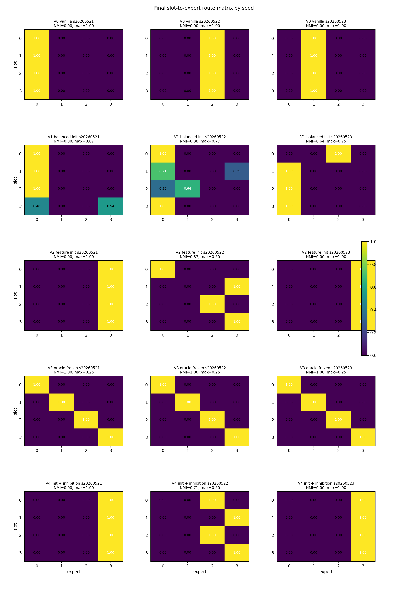
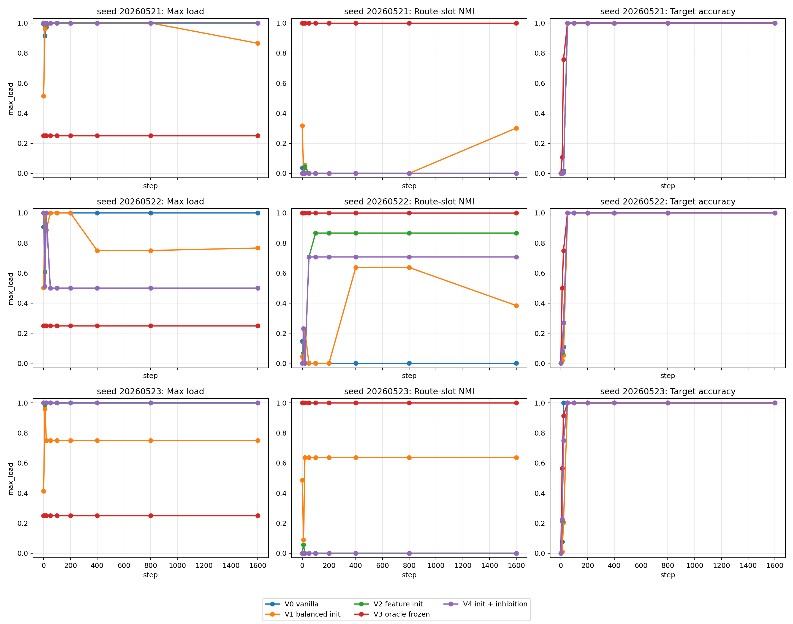

# Report Card: A05_04 No-Position Slot Specialization Audit

## Source Files

Anchor:

`Projects/from-attention-to-search/main/problem_anchors/05_failure_mechanism/05_04_01_uniform_feature_specialization_after_position_removal_anchor.md`

Summary:

`Projects/from-attention-to-search/main/experiments/A05/A05_04_01_no_position_forced_feature_init_trajectory/summary.md`

Detailed:

`Projects/from-attention-to-search/main/experiments/A05/A05_04_01_no_position_forced_feature_init_trajectory/detailed.md`

Figures / Tables:

`Projects/from-attention-to-search/main/experiments/A05/A05_04_01_no_position_forced_feature_init_trajectory/figures/a05_04_forced_feature_init_trajectory_4gpu_20260609/report/`

## 0. Executive Summary

Goal:

Test whether top-1 MoE routing can form slot-level expert specialization after removing positional embeddings and randomizing the logical routed token position.

Minimal mechanism audit:

Compare vanilla routing, balanced random init, trainable slot init, frozen oracle slot routing, and slot init plus inhibition across three seeds.

Clear hypothesis:

If slot information and slot-level expert utility are sufficient, then trainable routing should approach the frozen oracle slot router after position signals are removed.

Key finding:

Frozen oracle slot routing succeeds perfectly in all seeds, but the tested trainable routers do not reliably discover or preserve that structure.

Current conclusion:

The remaining failure is not explained by missing slot information or by slot routing being useless; it points to trainable top-1 routing stability.

Claim boundary:

This is a one-B slot-level diagnostic. It does not prove that all inhibition or feature-init methods fail, and it does not solve the multi-B feature-level setting.

Next step:

Run a frozen-oracle-to-trainable release test and measure when route-slot NMI drops or max load rises.

## 1. Research Process Update

| item | content |
|---|---|
| Previous mainline | 05_03 showed that position/template common offset explains much of original step-0 routing imbalance, but not final training-time collapse. |
| New probe | Remove positional embedding, randomize logical B position, and compare trainable routing against a frozen oracle slot router. |
| New evidence | `V3_oracle_frozen` gives `NMI=1.0`, `max_load=0.25`, `accuracy=1.0` for all three seeds; vanilla collapses with `NMI=0.0`, `max_load=1.0`. |
| Knowledge update | Slot-level specialization is feasible and useful, but current trainable routing controls are seed-dependent and unstable. |
| Next decision | Test whether specialization breaks after unfreezing a verified oracle router. |

## 2. Terms Used Here

- `route-slot NMI`: how strongly routed expert identity matches slot identity; `1.0` means perfect slot-to-expert structure.
- `max_load`: largest expert load fraction at the logical B token; with 4 experts, `0.25` is ideal balance.
- `oracle frozen router`: a non-trainable routing control that sends each slot to its assigned expert.
- `logical B position`: the actual sequence position containing the B token for the current example, not a fixed absolute index.

## 3. Key Figures

### Figure 1: Final Slot-To-Expert Routing By Seed

What to see:

`V3_oracle_frozen` is perfectly diagonal in all seeds, while `V2` and `V4` only recover structure in seed `20260522` and collapse in the other two seeds.

Supports:

Slot-level specialization is feasible, but current trainable slot-init/inhibition is not robust.

Cannot prove:

It cannot prove that every possible inhibition or initialization method fails.

### Figure 2: Per-Seed Training Trajectories

What to see:

All variants reach target accuracy 1.0, but only the frozen oracle router keeps high route-slot NMI and ideal load in every seed.

Supports:

Target accuracy is not a valid proxy for routing specialization.

Cannot prove:

It cannot identify the exact gradient mechanism causing trainable routing to lose or fail to recover specialization.

## 4. Current Claim

After position removal and logical-position randomization, the toy task still admits perfect slot-level specialization under oracle routing. Therefore the main remaining bottleneck is not missing slot information or useless slot routing, but the stability of trainable top-1 routing.

## 5. Claim Boundary

Can claim:

- Oracle slot routing is feasible and reaches perfect target accuracy across all tested seeds.
- Vanilla top-1 routing collapses across all tested seeds.
- Current trainable slot-init and inhibition are seed-dependent and not reliable in this setting.

Cannot claim:

- The full multi-B feature-level problem is solved.
- Inhibition or feature initialization is generally ineffective.
- Final utility matrices reveal the initial causal utility landscape, because experts co-adapt during training.

## 6. Next Step

Start from a verified frozen oracle slot router, train until accuracy is high, then unfreeze the router under controlled regularizers. The deciding evidence is the first checkpoint where `route-slot NMI` drops or `max_load` rises.
