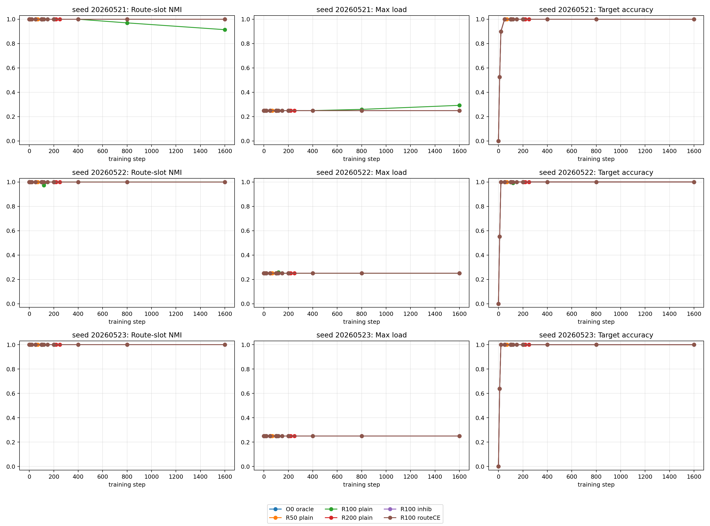
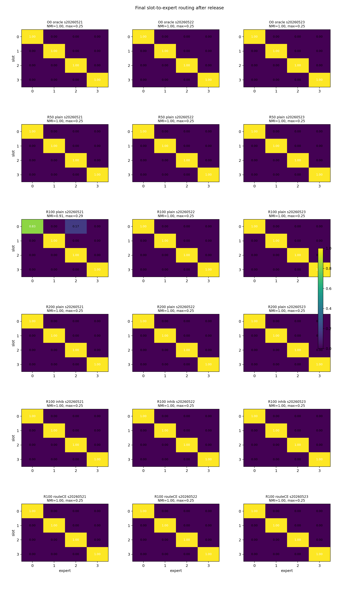

# Report Card: A05_05 Oracle-To-Trainable Release

## Source Files

Anchor:

`Projects/from-attention-to-search/main/problem_anchors/05_failure_mechanism/05_04_01_uniform_feature_specialization_after_position_removal_anchor.md`

Summary:

`Projects/from-attention-to-search/main/experiments/A05_05_oracle_to_trainable_release/summary.md`

Detailed:

`Projects/from-attention-to-search/main/experiments/A05_05_oracle_to_trainable_release/detailed.md`

Figures / Tables:

`Projects/from-attention-to-search/main/experiments/A05_05_oracle_to_trainable_release/figures/a05_05_oracle_to_trainable_release_4gpu_20260609/`

## 0. Executive Summary

Goal:

Decide whether a correct slot-to-expert partition is destroyed by training after the router is released.

Minimal mechanism audit:

Train with oracle routing, calibrate the natural router to the oracle partition, verify `NMI=1.0`, then continue trainable top-1 routing.

Clear hypothesis:

If collapse is mainly a preservation failure, the calibrated router should lose slot-level specialization after release.

Key finding:

All released runs start from `post_calibration_nmi=1.0` and `max_load=0.25`; almost all remain perfect through step 1600.

Current conclusion:

The one-B slot-level failure is more likely a route-entry / initialization-basin problem than a training-preservation problem.

Claim boundary:

The calibration uses slot labels, so this is a diagnostic, not an unsupervised routing solution.

Next step:

Repeat the same separation test for the harder multi-B exact-feature setting.

## 1. Research Process Update

| item | content |
|---|---|
| Previous mainline | A05_04 showed oracle slot routing works, but ordinary trainable routers do not reliably find it. |
| New probe | Start from oracle routing, calibrate the natural router, then release it. |
| New evidence | Release variants preserve `NMI=1.0` and `max_load=0.25` in nearly all seeds. |
| Knowledge update | Correct specialization is not inevitably destroyed once established. |
| Next decision | Test whether exact-feature routing in the multi-B setting is also preservable after calibrated entry. |

## 2. Terms Used Here

- `route-entry`: whether the router reaches the intended slot-to-expert partition.
- `preservation`: whether the router keeps the partition after normal training continues.
- `calibrated router`: a router fitted to reproduce oracle slot routes from current hidden states.
- `route-slot NMI`: agreement between slot id and routed expert; `1.0` means perfect slot-level specialization.

## 3. Key Figures

### Figure 1: Release Trajectories

What to see:

After release, NMI stays near 1.0 and max load stays near 0.25 in all seeds.

Supports:

The correct partition can be preserved after release.

Cannot prove:

It does not prove the router can discover this partition without calibration.

### Figure 2: Final Routing Heatmaps

What to see:

Final routing is diagonal in every run except one mild spillover in `R100 plain` seed `20260521`.

Supports:

The released partition does not collapse into a single expert.

Cannot prove:

It does not decide the harder multi-B exact-feature setting.

## 4. Current Claim

In the no-position one-B slot setting, collapse is not inevitable after correct specialization is established. The main bottleneck is entering the correct routing partition.

## 5. Claim Boundary

Can claim:

- Oracle/calibrated slot routing is stable through 1600 steps in almost all tested runs.
- The previous trainable-router failure is more likely a basin-entry problem than a preservation problem.

Cannot claim:

- Calibration is a deployable unsupervised method.
- Multi-B exact-feature specialization will be equally stable.
- Longer runs or more seeds would never show erosion.

## 6. Next Step

Run the same oracle/calibrated release diagnostic in the multi-B exact-feature setting. If that partition is stable, focus on unsupervised route-entry; if it breaks, focus on preservation under harder feature definitions.
