# Detailed Result: A05_03_uniform_collapse_common_offset

Anchor: `05_03_uniform_collapse_common_offset_anchor.md`

Story: mechanism audit of whether a shared hidden component creates an expert-specific common offset that seeds uniform-feature collapse.

## 0. Quick Recap

Purpose: diagnose and intervene on the early mechanism behind uniform-feature collapse after frequency and random-initialization audits.

Hypothesis: for routed hidden centroids $h_f=c+r_f$, the term $w_e^T c$ creates an expert-specific common score. The highest common-score expert should dominate step-0 routing; top-1 training can then amplify the early winner.

Experiment logic: P0 verifies prerequisites; P1/P2 measure common-source and common-score prediction; P3 cancels common offset during training; P4/P5 test initialization and stable subtraction variants; P6 adds anti-lock-in warmup; P7 runs forced-routing utility after training.

Conclusion: common-offset is the strongest current explanation for step-0 dominant expert selection. Offset-only controls reduce early load and hard collapse, but P6A auxiliary load-balance warmup is the strongest tested final-load control. P7 prevents a utility-mismatch overclaim.

Evidence: `tables/p2_common_score_prediction.csv`, `tables/p3_summary_by_condition.csv`, `tables/remaining_training_summary_by_condition.csv`, `tables/remaining_p7_forced_utility_summary.csv`, and all figures in `figures/`.

## 1. Anchor Link And Decision Point

Anchor: `05_03_uniform_collapse_common_offset_anchor.md`

Parent question: why does ordinary top-1 MoE routing collapse under uniform features?

This experiment updates: the collapse mechanism boundary. It shifts the next decision from broad inhibition to a focused anti-lock-in verification.

## 2. Purpose

A05_03 was created because A05_01 and A05_02 showed that route consistency, target accuracy, and even inhibition can be contaminated by collapse. The experiment asks whether the shared hidden component is an actionable source of early collapse.

## 3. Hypothesis And Rival Explanations

Hypothesis: the shared hidden component induces an effective router bias $w_e^T c$ even though the router has no explicit bias term.

Rival explanation 1: data, target, or random-initialization bugs cause collapse. P0 checks this boundary by relying on the earlier audit artifacts.

Rival explanation 2: common component exists but is not causal. P1/P2/P3 test this by prediction and intervention.

Rival explanation 3: initialization scale or row geometry is the main cause independent of common offset. P4 tests common-aware initialization.

Rival explanation 4: offset control is enough. P5 and P6 test whether training still needs anti-lock-in pressure.

Rival explanation 5: the route expert is simply utility-wrong. P7 tests post-training forced-routing utility.

## 4. Experiment Logic

Core model:

$$
h_f=c+r_f
$$

Router logit:

$$
z_{f,e}=w_e^T h_f=w_e^T c+w_e^T r_f
$$

Common-score prediction:

$$
\arg\max_e w_e^T c
$$

If this predicts the step-0 dominant expert and canceling $w_e^T c$ reduces step-0 load, common-offset is a valid mechanism target.

## 5. Setup

Workspace: `Projects/from-attention-to-search/XingyuD/Attention_Search_Experiments/active/synthetic_data_understanding`

Anchor: `../../problem_anchors/05_failure_mechanism/05_03_uniform_collapse_common_offset_anchor.md`

Protocol: `protocol_for_approval.md`

P0-P3 runner: `scripts/run_a05_03_common_offset_experiments.py`

P4-P7 runner: `scripts/run_a05_03_remaining_experiments.py`

Seeds: `20260521`, `20260522`, `20260523`.

Slot patterns:

- `repeated`: repeated slot-code pattern.
- `distributed_complex`: non-repeated distributed slot-code pattern.

Training for mechanism runs: 400 steps, 2000 train samples per slot, batch size 256, eval batch size 512, 4 variants per key.

Execution boundary: P0-P3 manifest records `device=cpu`; P4-P7 manifest records `device=cuda:0`, `torch_cuda_device_count=2`. This is not full 4-card verification.

## 6. Primary Metric And Decision Rule

Primary metric: max-load fraction. It directly measures the largest expert's routed-token fraction. Target accuracy is a validity guard, not the main routing result.

Success for the mechanism hypothesis:

- common-score argmax agreement is far above the random baseline 0.25;
- common-offset cancellation reduces step-0 max-load;
- final collapse improves under anti-lock-in controls while accuracy remains high.

Failure:

- common-score argmax does not predict the step-0 expert;
- cancellation does not reduce early load;
- accuracy fails after intervention.

Insufficient evidence:

- only averaged figures exist;
- full 4-card verification is missing;
- a method lowers load but destroys task learning.

## 7. Main Result

Final conclusion: common-offset explains step-0 dominant expert selection; final collapse also needs training-amplified top-1 lock-in. P6A is the strongest tested control, but the result remains a mechanism-stage finding.

## 8. Key Figures

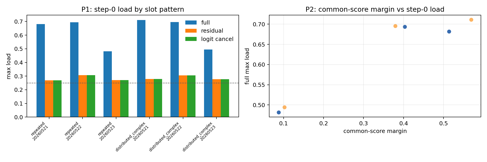

Supports: common-score prediction and step-0 cancellation are the decisive evidence for the common-offset mechanism.

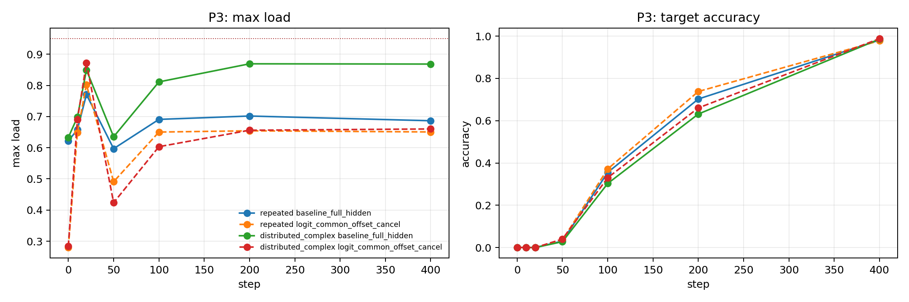

Supports: offset cancellation improves mean collapse behavior while accuracy remains high.

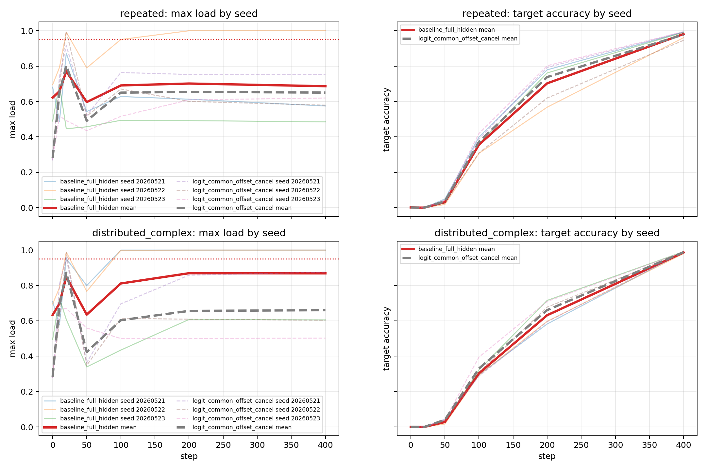

Supports: final behavior is seed-dependent; averages alone are not enough.

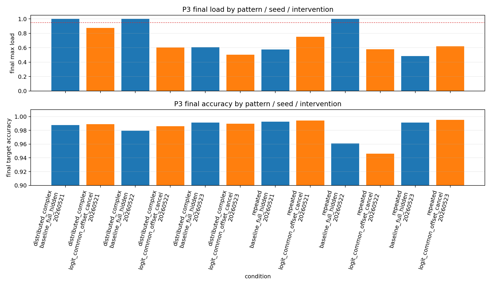

Supports: cancellation helps the worst seeds but does not guarantee universal improvement.

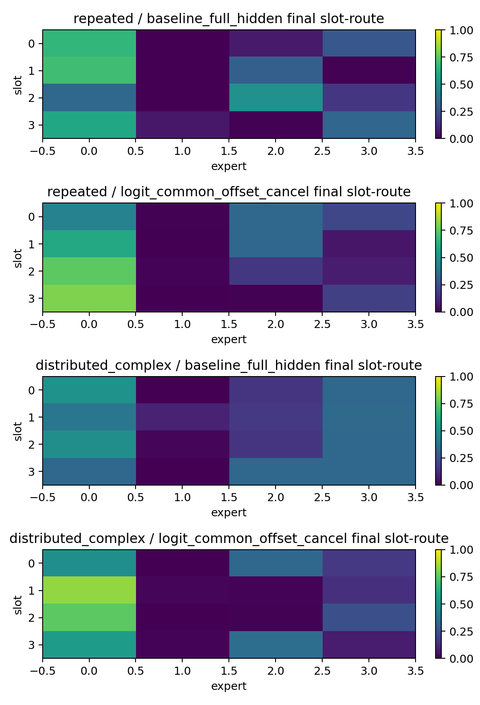

Supports: route structure remains load-sensitive after intervention.

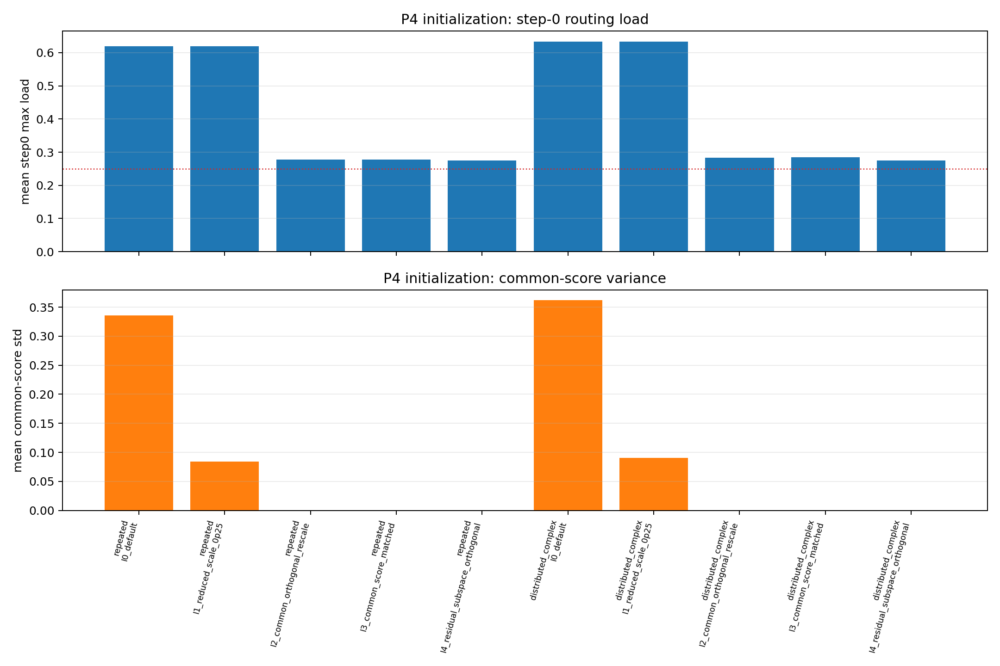

Supports: common-aware initialization can balance step-0 routing.

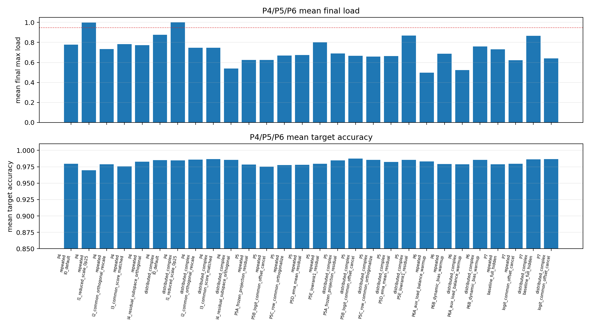

Supports: P6A is the strongest tested final-load control.

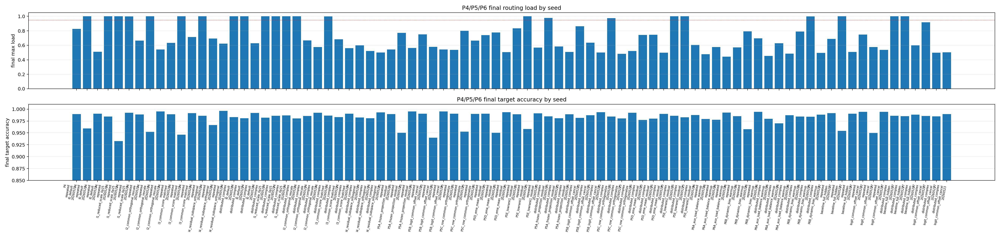

Supports: the result must be read by seed.

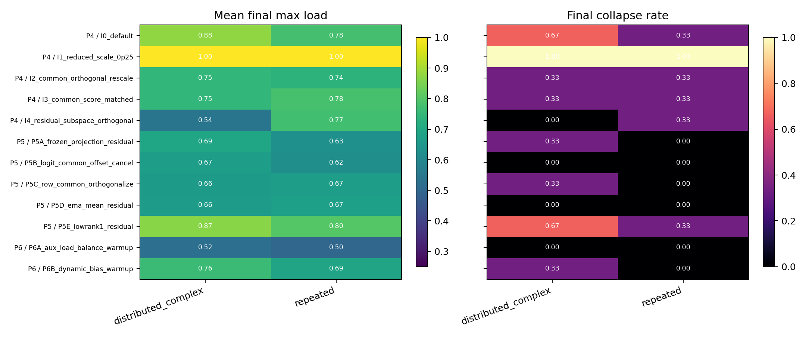

Supports: broad variant comparison across P4, P5, and P6.

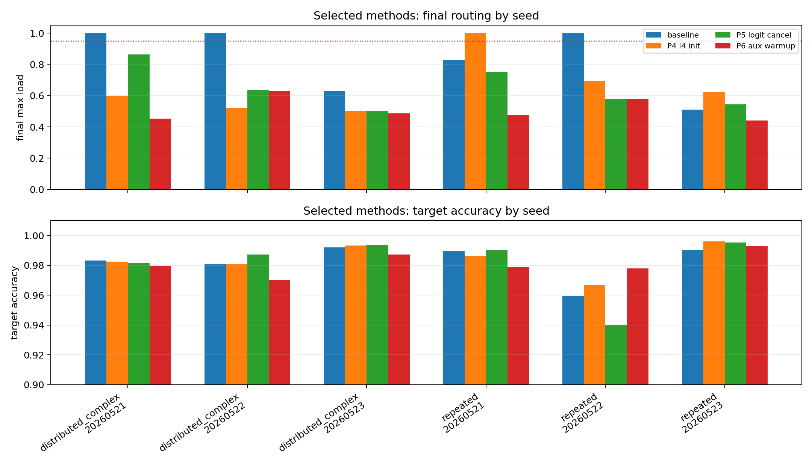

Supports: P6A reduces seed-level concentration while preserving accuracy.

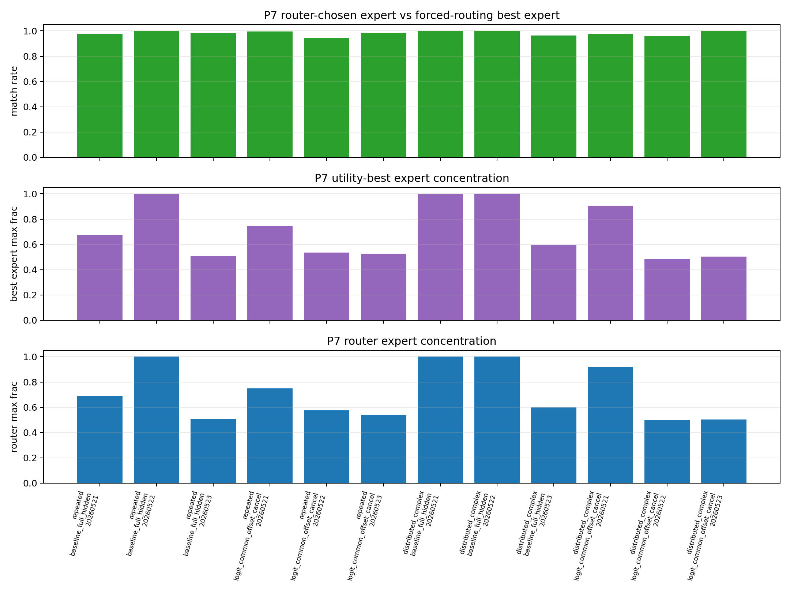

Supports: forced-routing utility does not show obvious post-training utility mismatch.

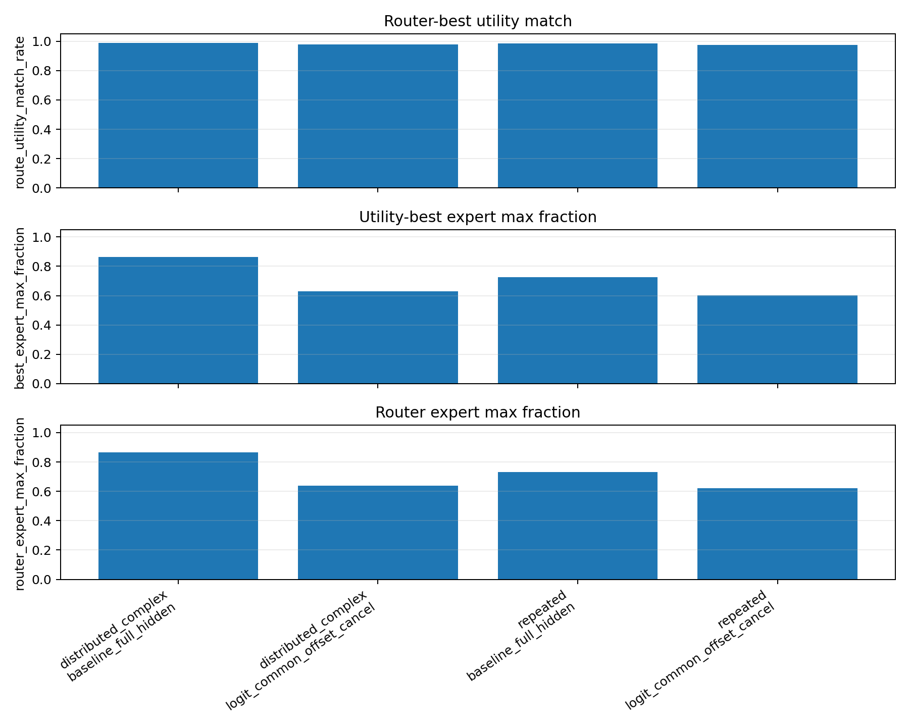

Supports: route-utility match remains high across tested variants.

## 9. Evidence Walkthrough

### 9.1 P0: Prerequisite Audit Closure

Question: can the mechanism test proceed without treating data or initialization bugs as the default explanation?

Result: required 0607 audit artifacts exist. P0 therefore permits mechanism intervention, but it does not itself prove the common-offset hypothesis.

Boundary: P0 is a validity gate, not a mechanism result.

### 9.2 P1/P2: Step-0 Common Source And Common-Score Prediction

| Pattern | Metric | Common-score agreement | Random baseline | Mean full max-load | Mean residual max-load | Mean logit-cancel step0 max-load |
|---|---|---:|---:|---:|---:|---:|
| repeated | dot_product | 1.000 | 0.250 | 0.619 | 0.282 | 0.282 |
| repeated | cosine | 1.000 | 0.250 | 0.628 | 0.278 | 0.405 |
| distributed_complex | dot_product | 1.000 | 0.250 | 0.633 | 0.287 | 0.287 |
| distributed_complex | cosine | 1.000 | 0.250 | 0.640 | 0.281 | 0.436 |

Interpretation: $w_e^T c$ predicts the step-0 dominant expert in every tested seed/pattern/metric group. Dot-product cancellation lowers step-0 load close to the balanced baseline of 0.25.

Boundary: cosine cancellation is weaker because normalizing hidden/router vectors changes how common components enter the score.

### 9.3 P3: Training With Common-Offset Cancellation

| Pattern | Intervention | n | Final collapse rate | Final max-load mean | Entropy mean | Target accuracy mean | Feature-key consistency mean |
|---|---|---:|---:|---:|---:|---:|---:|
| repeated | baseline_full_hidden | 3 | 0.333 | 0.687 | 0.439 | 0.982 | 0.996 |
| repeated | logit_common_offset_cancel | 3 | 0.000 | 0.651 | 0.483 | 0.978 | 0.993 |
| distributed_complex | baseline_full_hidden | 3 | 0.667 | 0.868 | 0.223 | 0.986 | 0.999 |
| distributed_complex | logit_common_offset_cancel | 3 | 0.000 | 0.660 | 0.467 | 0.988 | 0.993 |

Interpretation: cancellation reduces hard collapse and preserves accuracy, especially for distributed-complex baseline. It does not make final load close to uniform.

Boundary: P3 is CPU-shortened mechanism evidence, not final training verification.

### 9.4 P4: Common-Aware Initialization

P4 tests whether router initialization can remove common-score imbalance before training.

Step-0 observation: I2/I3/I4 reduce step-0 max-load from about 0.62-0.63 toward 0.27-0.30 in both slot patterns.

Important final rows:

| Pattern | Variant | Collapse rate | Final max-load mean | Target accuracy mean |
|---|---|---:|---:|---:|
| repeated | I0_default | 0.333 | 0.779 | 0.980 |
| repeated | I4_residual_subspace_orthogonal | 0.333 | 0.771 | 0.983 |
| distributed_complex | I0_default | 0.667 | 0.876 | 0.985 |
| distributed_complex | I4_residual_subspace_orthogonal | 0.000 | 0.540 | 0.985 |

Interpretation: common-aware initialization can solve step-0 geometry and helps distributed-complex I4, but it is not a universal final-collapse solution.

### 9.5 P5: Stable Common-Subtraction Estimators

Important P5 rows:

| Pattern | Variant | Collapse rate | Final max-load mean | Target accuracy mean |
|---|---|---:|---:|---:|
| repeated | P5B_logit_common_offset_cancel | 0.000 | 0.625 | 0.975 |
| distributed_complex | P5B_logit_common_offset_cancel | 0.000 | 0.667 | 0.987 |
| distributed_complex | P5E_lowrank1_residual | 0.667 | 0.868 | 0.985 |

Interpretation: direct logit common-offset cancellation is the most stable P5 control. General low-rank residual cleanup is not reliable.

### 9.6 P6: Anti-Lock-In Warmup

Important P6 rows:

| Pattern | Variant | Collapse rate | Final max-load mean | Entropy mean | Target accuracy mean |
|---|---|---:|---:|---:|---:|
| repeated | P6A_aux_load_balance_warmup | 0.000 | 0.499 | 0.755 | 0.983 |
| repeated | P6B_dynamic_bias_warmup | 0.000 | 0.687 | 0.485 | 0.979 |
| distributed_complex | P6A_aux_load_balance_warmup | 0.000 | 0.523 | 0.698 | 0.979 |
| distributed_complex | P6B_dynamic_bias_warmup | 0.333 | 0.761 | 0.366 | 0.986 |

Interpretation: P6A is the strongest tested control because it acts during the early amplification window, not only at initialization or score preprocessing.

Boundary: P6A lowers collapse risk but does not prove feature-level specialization.

### 9.7 P7: Forced-Routing Utility Diagnostic

Aggregate P7 result:

| Pattern | Variant | Route-utility match rate | Mean utility gap loss | Best-expert max fraction | Router-expert max fraction |
|---|---|---:|---:|---:|---:|
| distributed_complex | baseline_full_hidden | 0.987 | 1.736 | 0.864 | 0.866 |
| distributed_complex | logit_common_offset_cancel | 0.979 | 2.280 | 0.630 | 0.640 |
| repeated | baseline_full_hidden | 0.986 | 1.949 | 0.727 | 0.732 |
| repeated | logit_common_offset_cancel | 0.976 | 2.684 | 0.603 | 0.621 |

Interpretation: after training, the router-chosen expert is usually the forced-routing best expert. Collapsed baseline seeds also often have concentrated best-expert distributions. This supports route-expert co-adaptation rather than a simple "router picks the wrong expert" story.

Boundary: P7 is post-training utility. It cannot decide whether early route choices were utility-correct before experts co-adapted.

## 10. Stage Evidence And Failure Decomposition

| Stage | Evidence | Passed / Failed / Unclear | Failure Reason | What This Rules Out |
|---|---|---|---|---|
| P0 prerequisite | audit artifacts exist | Passed | none | not blocked by missing prior audit |
| P1 common source | residual/cancel step-0 load near 0.28 | Passed | none | full hidden load is not pure random load |
| P2 common-score prediction | agreement 1.0 vs random 0.25 | Passed | none | common score is not a weak correlate |
| P3 cancellation training | hard collapse reduced, accuracy high | Partial pass | final load remains high | offset control alone does not solve collapse |
| P4 initialization | step-0 load balanced by I2/I3/I4 | Partial pass | final seed dependence remains | initialization alone is insufficient |
| P5 stable subtraction | P5B best stable offset control | Partial pass | final max-load still 0.62-0.67 | score control helps but does not prove specialization |
| P6 anti-lock-in | P6A collapse rate 0, lower max-load | Passed for shortened run | not full 4-card verified | anti-lock-in is the next best intervention |
| P7 utility | route-utility match about 0.98-0.99 | Passed as diagnostic | post-training only | utility-mismatch overclaim |

Falsified physical prior: verified uniform data and random router initialization are not enough to prevent early concentration.

Falsified operationalization / proxy: common-offset cancellation alone is not enough to call collapse solved.

Remaining rival explanations: early utility dynamics, longer-training effects, and feature-structure validity after P6A remain open.

## 11. Goal / Metric Audit

Trigger: P3/P4/P5 reduce hard collapse but still produce high final max-load.

Old goal / metric: remove or equalize common offset.

Repeated failure pattern: step-0 load improves more consistently than final load.

Downstream decision: the next experiment must test training-time anti-lock-in, not only initialization or logit preprocessing.

Revised goal / metric: compare full-hidden baseline, P5B, P4-I4, and P6A under full verification using final max-load, collapse rate, and accuracy.

Errors now acceptable: a method can lower feature-key consistency if it reduces collapse and keeps accuracy high.

Errors still harmful: load balance without feature structure should not be called specialization.

## 12. Full Experiment Record

P0-P3 command:

```bash
python Projects/from-attention-to-search/main/experiments/A05_03_uniform_collapse_common_offset/scripts/run_a05_03_common_offset_experiments.py \
  --seeds 20260521,20260522,20260523 \
  --train-steps 400 \
  --train-samples-per-slot 2000 \
  --batch-size 256 \
  --eval-batch-size 512 \
  --variants-per-key 4
```

P4-P7 command:

```bash
python Projects/from-attention-to-search/main/experiments/A05_03_uniform_collapse_common_offset/scripts/run_a05_03_remaining_experiments.py \
  --protocols P4,P5,P6,P7 \
  --seeds 20260521,20260522,20260523 \
  --train-steps 400 \
  --train-samples-per-slot 2000 \
  --batch-size 256 \
  --eval-batch-size 512 \
  --variants-per-key 4
```

Run manifests:

- `tables/run_manifest.json`
- `tables/remaining_run_manifest.json`

P0-P3 tables:

- `tables/p0_audit_closure.csv`
- `tables/data_pattern_counts.csv`
- `tables/p1_step0_common_source.csv`
- `tables/p2_common_score_prediction.csv`
- `tables/p3_training_metrics_by_step.csv`
- `tables/p3_slot_route_heatmap.csv`
- `tables/p3_summary_by_condition.csv`

P4-P7 tables:

- `tables/remaining_p4_init_step0.csv`
- `tables/remaining_training_metrics_by_step.csv`
- `tables/remaining_training_summary_by_condition.csv`
- `tables/remaining_slot_route_heatmap.csv`
- `tables/remaining_p7_forced_utility_summary.csv`
- `tables/remaining_p7_forced_utility_by_feature.csv`

Figures:

- `figures/p1_p2_common_source_prediction.png`
- `figures/p3_training_load_accuracy.png`
- `figures/p3_seed_level_training_load_accuracy.png`
- `figures/p3_seed_final_comparison.png`
- `figures/p3_route_heatmap_by_condition.png`
- `figures/remaining_p4_init_step0.png`
- `figures/remaining_p4_p5_p6_summary.png`
- `figures/remaining_p4_p5_p6_final_by_seed.png`
- `figures/remaining_protocol_variant_heatmap.png`
- `figures/remaining_selected_methods_by_seed.png`
- `figures/remaining_p7_forced_utility.png`
- `figures/remaining_p7_utility_aggregate.png`

## 13. Interpretation

The result separates early mechanism from final training outcome. The early mechanism is clear: common hidden direction creates unequal expert common scores. The final training outcome requires an amplification account: even if the early offset is reduced, hard top-1 routing can re-concentrate load unless an anti-lock-in pressure is present.

The P7 result is important for wording. The report should not say "collapse happens because the router selects utility-wrong experts" after training. It should say: early routing shapes which experts train on which features, and route-expert utility can co-adapt around that assignment.

## 14. Claim Boundary

Can claim:

- Common-offset is the strongest current explanation for step-0 dominant expert selection in this uniform toy setting.
- Offset cancellation and common-aware initialization can reduce early concentration.
- Final collapse still requires training-amplified lock-in.
- P6A is the strongest tested shortened-run control.
- P7 prevents a post-training utility-mismatch claim.

Cannot claim:

- Collapse is solved.
- Full 4-card verification has been completed.
- Lower load is feature-level specialization.
- Selected experts are utility-wrong after training.
- The mechanism transfers directly to compositional features or real language data.

## 15. Next Decision

Run full 4-card verification of:

1. `baseline_full_hidden`
2. `P5B_logit_common_offset_cancel`
3. `P4_I4_residual_subspace_orthogonal`
4. `P6A_aux_load_balance_warmup`

Primary decision metrics: final max-load and collapse rate. Validity guard: target accuracy. Secondary readout: feature-key consistency and route heatmaps, interpreted only if load is valid.

## 16. Links And Artifact Map

anchor: `05_03_uniform_collapse_common_offset_anchor.md`

summary: `summary.md`

code workspace: `Projects/from-attention-to-search/XingyuD/Attention_Search_Experiments/active/synthetic_data_understanding`

runner: `scripts/run_a05_03_common_offset_experiments.py`; `scripts/run_a05_03_remaining_experiments.py`

config: `active/synthetic_data_understanding/configs/h0605a_true_token_conditioned_inhibition_replay.json`

key code files:

- `scripts/run_a05_03_common_offset_experiments.py`
- `scripts/run_a05_03_remaining_experiments.py`
- `scripts/plot_a05_03_seed_figures.py`
- `scripts/plot_a05_03_remaining_summary.py`

data / manifest:

- `tables/run_manifest.json`
- `tables/remaining_run_manifest.json`

result dir: this experiment folder.

figure dir: `figures/`

key tables: all `tables/*.csv`

logs / checkpoints: shortened local mechanism runs; no ACP/SCO job id recorded.

repro command: see Section 12.
