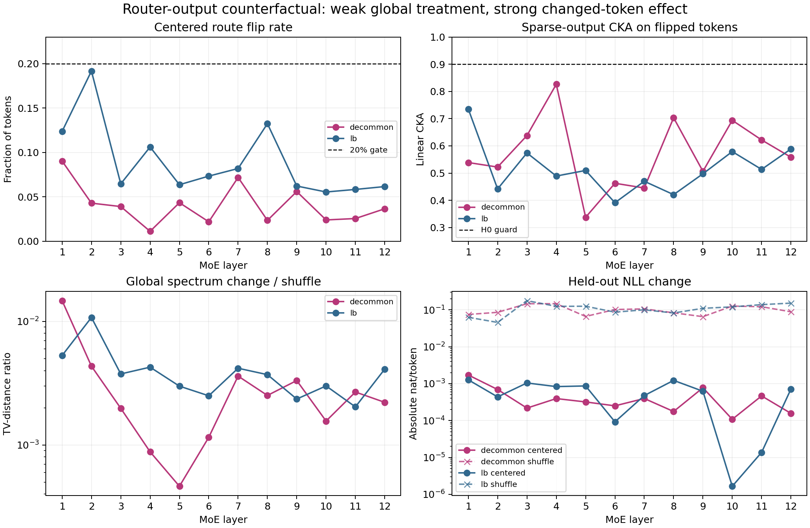
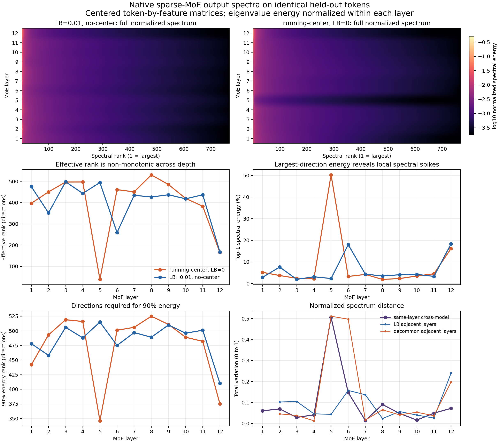

# Summary: Router Output Counterfactual Audit

Primary anchor: diagnostic companion to [A06_00 functional specialization contract](../../../../../../Projects/from-attention-to-search/main/problem_anchors/06_geometry_proxy_preservation/06_00_functional_specialization_contract/06_00_functional_specialization_contract_anchor.md)  
Protocol: [protocol.md](protocol.md)

## Result Snapshot

**Verdict: insufficient evidence under the preregistered decision rule.** Neither model had one layer reach the required 20% centered route-flip rate after exact native-load matching; therefore the very small all-token representation and loss effects cannot support H0.

**What we established:** global singular spectra can remain nearly unchanged while the tokens that actually change expert receive substantially different sparse outputs. The median flip-only CKA was 0.503 for LB and 0.548 for decommon, far below the 0.90 equivalence guard.

**What the experiment shows:** the structured centered treatment was weak after exact quota repair. Median centered flip rate was 6.89% for LB and 3.77% for decommon, compared with 87.05% and 83.54% for load-matched shuffle. This makes the tiny all-token $R_\ell$, logit KL, and NLL changes non-decisive about Router importance.

**What we do next:** do not start a from-scratch Router training comparison. First decide whether a load-and-flip-matched structured reassignment produces different downstream effects from a random reassignment with the same changed-token budget.

## Purpose And Exact Setup

The audit freezes one model at a time, uses the same 64 held-out DCLM documents, and intervenes at one of 12 MoE layers. It evaluates the registered LB and decommon step-40k checkpoints separately. For every token it fixes the actual Router reference, expert input, native top-1 gate weight, expert parameters, exact eight-expert load vector, shared expert, and all other layers. Only the selected sparse-expert identity changes.

A no-op audit exposed an important implementation fact: both checkpoints use `gating_reference=oracle`. The Router reads the attention-branch output, while the experts read the post-attention normalized hidden state. The corrected run captures both tensors separately. All 24 corrected no-op layer/model cases had block and final-hidden CKA exactly 1.0, logit KL 0, and NLL difference 0.

## Terminology / Definitions

| Term | Computation | Decision role | Cannot prove |
| --- | --- | --- | --- |
| Centered flip | Capacity-constrained assignment from $W(g_\ell-\hat\mu_\ell)$ differs from Native | Treatment strength | Functional benefit |
| All-token $R_\ell$ | centered CKA change divided by shuffle CKA change | Registered primary metric | Per-changed-token equivalence when flip rates differ |
| Flip-only CKA | sparse-output CKA on centered-flipped tokens only | Detects unchanged-token dilution | Final loss effect |
| Spectrum TV ratio | centered normalized-spectrum distance divided by shuffle distance | Aggregate spectral stability | Token correspondence |
| NLL delta | counterfactual minus Native next-token NLL | Functional guard | Training-time formation |

## Primary Result

| Model | Eligible layers | Center flip median / max | Flip-only CKA median / min | $R_\ell$ median | Spectrum-TV ratio median | Final CKA median | KL ratio median | Max $|\Delta$NLL$|$ |
| --- | ---: | ---: | ---: | ---: | ---: | ---: | ---: | ---: |
| LB | 0/12 | .0689 / .1916 | .503 / .391 | .00699 | .00373 | .999714 | .0132 | .00127 |
| decommon | 0/12 | .0377 / .0902 | .548 / .337 | .00306 | .00237 | .999837 | .0080 | .00172 |

The formal verdict is insufficient because all 24 layers failed only the centered-flip gate; exact loads, finite all-expert outputs, shared invariance, no-op replay, and shuffle effectiveness all passed.

## Knowledge Update

1. **Stable global spectra do not imply Router irrelevance.** Median centered spectrum-TV change was only 0.24%--0.37% of shuffle, and the top-32 subspace moved only 0.36--0.46 degrees versus 40--43 degrees under shuffle. Yet flip-only sparse-output CKA was about 0.5. The strongest rival in the protocol is observed directly: aggregate spectrum hides token-specific expert substitution.
2. **The immediate global effect of frozen centering is small on this surface, but the treatment is too weak to establish equivalence.** Block/final CKA exceed 0.999, and NLL changes are at most 0.00172 nat/token, but only 1.1%--19.2% of tokens changed route at any layer.
3. **Experts are not locally interchangeable for changed tokens.** The registered 0.90 flip-only CKA guard failed at every layer in both models. This is representation sensitivity, not evidence that the Native expert is more useful.
4. **Router and expert inputs must be modeled separately in these checkpoints.** Any spectral audit that substitutes the expert input for the actual attention-branch Router reference is not an audit of the deployed Router geometry.

## Central Figure

**Question:** does centered reassignment create enough route change, and do global spectra, changed-token geometry, and NLL agree?  
**Data and aggregation:** 64 held-out documents, 16,384 tokens, 12 layers per frozen model. Each point is one layer.  
**How to read:** the top-left panel applies the preregistered treatment-strength gate; the top-right tests changed-token equivalence; the bottom panels show global-spectrum and NLL dilution relative to shuffle.  
**Observed:** no layer reaches 20% flip, but every layer is far below 0.90 flip-only CKA. Global spectrum and NLL remain much closer to Native than shuffle.  
**Allowed claim:** the treatment is globally weak, while changed-token expert outputs are not interchangeable.  
**Not allowed:** Router impact is globally negligible, centered routing is better, or the Router caused expert formation.

## Descriptive Native-Spectrum Appendix

The complete natural-forward spectrum was subsequently measured for both models on the identical 16,384 evaluation tokens. For each layer, the Native sparse-output matrix was feature-centered and its covariance eigenvalues were normalized by total centered variance. The replay exactly reproduced all 24 previously reported 90%-energy ranks; the maximum effective-rank discrepancy was 0.0047.

There is no monotonic depth-to-rank trend. The decommon checkpoint has a sharp layer-5 concentration (effective rank 38.8; first direction 50.3% of energy) that disappears at layer 6, whereas LB has a milder concentration at layer 6 (effective rank 259.2; first direction 18.0%). Both checkpoints concentrate again at layer 12 (effective rank 165.1/167.8; first-direction energy 16.2%/18.3%). Same-layer cross-model spectrum TV has median 0.0546 and is at most 0.10 in 10/12 layers, but reaches 0.506 at layer 5. Thus the descriptive difference is localized, not a gradual divergence with depth. It cannot be attributed causally to centering or load balance.

## Claim Boundary

**Can claim:** under the exact frozen within-model intervention, global spectra are insensitive to the small centered reassignment, while rerouted tokens receive substantially different sparse outputs; shared and residual paths strongly dilute the final global effect.

**Cannot claim:** H0 is supported or rejected under the registered primary rule; Native assignments are useful; decommon or LB caused the pattern; the same pattern holds during training; or a new Router improves loss/FLOP.

## Next Decision

Use one stronger but still controlled intervention: match both the exact native expert loads and the number of flipped tokens between structured centered reassignment and random reassignment. The decision metric remains changed-token sparse CKA plus final logit KL/NLL. Only after that comparison separates treatment size from assignment structure should a from-scratch training experiment be considered.

## Files

- [model summary](tables/model_summary.csv)
- [all layer metrics](tables/layer_metrics.csv)
- [native spectral summary](tables/native_layer_spectral_summary.csv)
- [complete native spectral distribution](tables/native_layer_spectral_distribution.csv)
- [native spectral comparison](tables/native_layer_spectral_comparison.csv)
- [combined verdict](results/combined_verdict.json)
- [runner](run_experiment.py)
- [native-spectrum runner](analyze_native_layer_spectra.py)
- [complete evidence ledger](detailed.md)
