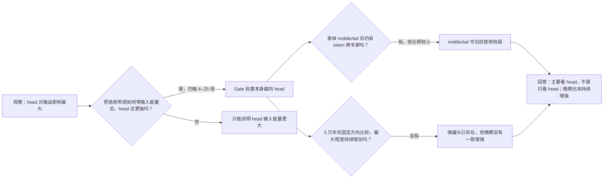

# 训练后的线性 Router 是否被持续训练成只依赖大奇异值方向？

状态：Q1 已形成初步认识更新；等待研究者审核表述，不再等待实验结果。

## 1. 本日唯一回答的问题

**问题：** 现有训练证据是否支持这样一个强判断：线性 Router 被持续训练成主要依赖大奇异值方向，而不只是因为这些方向的输入能量更大？

**为什么重要：** 只有区分“输入大造成的表象”和“Gate 学到的方向偏好”，我们才能判断 middle/tail 是真的难以访问，还是只是被 head 的能量遮住。

## 2. 认识更新

**一句话回答：** 这两个训练后的 Router 确实主要偏向大奇异值方向，但不是只看得见这些方向；而且 3 万步之后，这种相对偏好没有在两个模型和 head 对 middle/tail 的比较中持续一致增强。

这里的 Gate 是给每个 token 的候选专家打分并据此选择专家的线性层；大奇异值方向是输入表征变化最强的方向。为便于叙述，下面把大、中、小方差方向简称为 head、middle、tail。先解释“等能比较”：我们把不同频带放到相同输入能量的尺度，再比较它们能造成多大的专家间分数差；分数变化越大，就越可能改变选哪个专家。这样，head 不能再仅靠“输入更大”获胜。等能后，head 每个方向造成的分数变化仍约为 middle 的 4--6 倍、tail 的 15--25 倍，因此 Gate 权重本身确实偏向 head。

但 middle/tail 不是不可见。我们拿掉某个频带，再看 token 是否换专家；在训练 8 万步的保存状态，拿掉 middle 仍会让约 9%--13% 的 token 换专家，拿掉 tail 也会让约 1%--2% 换专家。它们参与了当前路由，只是影响远弱于 head。

最后，我们把“什么方向算 head”固定住，只比较训练到 3 万、4 万、8 万步时保存的 Gate 权重。结果显示：3 万步时强偏头已经存在；之后新增的权重虽然单独看也偏 head，却没有一致提高已有 Gate 的 head 相对 middle/tail 的偏好。直观地说，往一个已经非常偏 head 的 Gate 中加入一个“仍偏 head、但偏得更少”的更新，整体偏好反而可能被稀释。

**概念与指标解释：** 下面的“head:middle 等能比”表示：给两组方向同样的输入能量时，head 造成的专家间分数变化平方强度是 middle 的多少倍；大于 1 才表示 Gate 权重本身偏 head，而不是输入方差机械放大。

$$R_{H:M}=\frac{\text{同等输入能量下 head 造成的专家间分数变化平方强度}}{\text{同等输入能量下 middle 造成的专家间分数变化平方强度}}.$$

## 3. 关键证据表

| 要区分的解释 | 怎么看 | 最少直接证据 | 认识更新 |
| --- | --- | --- | --- |
| head 强只是因为输入能量大 | 把各频带放到同等输入能量后再比较 | 4 万/8 万步：head:middle 约 4--6 倍，head:tail 约 15--25 倍 | Gate 权重本身偏 head |
| Router 只看得见 head | 拿掉 middle/tail，看 token 是否换专家 | 8 万步：middle 使约 9%--13% 翻转，tail 使约 1%--2% 翻转 | middle/tail 可见但较弱 |
| 3 万步后训练一直让 Gate 更偏 head | 固定频带定义，只改变不同训练步保存的 Gate 权重 | 两个谱系的 head:middle 相对偏好在两段都没有增强 | 强偏头状态存在，但晚期持续增强不成立 |

**读表结论：** Router 的现状是“主要使用 head，同时弱使用 middle/tail”；现有三个保存状态不能支持“训练一直把 Router 推向只看 head”。

**完整证据：** [Q1 中文结果摘要](../../../../../Projects/from-attention-to-search/main/experiments/A15/15_00_router_input_spectral_geometry/A15_00_E01_actual_router_input_spectral_access/summary_cn.md)

## 4. 解释流程图

## 5. 边界与下一步

- **成立范围：** 两个 12 层线性 Gate 谱系在训练 3 万、4 万、8 万步时的保存状态，以及 Gate 真正接收的表征。
- **仍不能说：** head 偏好一定有益、middle/tail 没有额外功能信息、偏头由大方差因果产生，或所有 Router 都如此；三个保存状态也不是逐步训练动力学。
- **最强未决解释：** 强偏头可能在 3 万步之前由早期梯度、优化器或上游表征共同形成，当前证据无法定位起点。
- **唯一下一决策：** 频谱能否在线性 Router 分数之外，预测哪些 token 放在同一专家训练时更兼容？
- **完成判据：** 独立 token 上的增量预测必须稳定超过随机同维、错误层、范数/离群值和 batch 重采样对照。
- **恢复时第一动作：** 审核 Q2 的最小局部功能 Protocol；在通过该准入前不启动复杂频谱 Router 联合训练。
