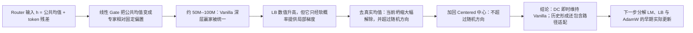

# 历史快照：相同负载均衡损失下，为什么 Vanilla Router 仍然坍缩？

> 该 focus 已在 2026-08-09 因主线切换归档；当前唯一日常 focus 位于 `daily_research_reports/backup/2026/08/0809/focus.md`。

## 1. 本次回答的问题

**问题：** 六种 Router 都从 step 0 使用相同的 $\lambda_{LB}=0.01$，为什么 Vanilla-Full 的深层仍在约 50M--100M token 把几乎所有 token 送给一个专家，而 Centered-Full 没有？

## 2. 认识更新

**一句话回答：** Vanilla 输入中跨 token 共享的均值会被线性 Gate 变成“所有 token 都偏向同一专家”的固定分数偏置，它即时维持当前坍缩；但 Centered 在无该偏置的条件下共同适配了 Gate 与表征，因此事后加回中心并不能特异地重建 Vanilla 坍缩。

“最忙专家占比”表示八个专家中接收 token 最多者的比例，0.125 是均匀，1 是单专家。冻结模型后只去掉 Vanilla 的真实均值，该比例平均下降 0.6868；向 Centered 加回保存中心只上升 0.1422，而且普通同幅随机方向往往造成更大变化。因此注册裁定是 `necessary_only`：公共项是当前 Vanilla 坍缩的即时维持因素，但不是跨训练状态的充分原因。

“LB 数值”衡量负载不均惩罚有多大，均匀时为 1、完全单专家时接近 8；“LB 梯度杠杆”衡量该惩罚当下能通过软概率改变 logit 的局部能力。Vanilla 坍缩后 LB 数值长期很大，但梯度杠杆随层和阶段变化：第 4 层饱和后可以很小，第 3 层却没有普遍消失，所以不能概括成“LB 完全没梯度”。

更准确的机制是：公共偏置很早统一了硬 top-1 赢家；同一个 LB 目标虽然看见负载很差，却只通过软概率反传，并不保证在语言模型梯度、AdamW 与专家反馈共同作用下把硬赢家拉回来。

## 3. 决定性证据

| 冻结反事实 | 最忙专家占比平均变化 | 文档配对 95% 区间 | 同幅随机 q95 | 判断 |
| --- | ---: | ---: | ---: | --- |
| Vanilla 去真实均值 | 0.68678 | [0.68435, 0.68922] | 0.18326 | 真实方向特异地维持坍缩 |
| Centered 加回中心 | 0.14225 | [0.14010, 0.14446] | 0.22588 | 不足以证明方向特异充分性 |

补充读数：去均值使 Vanilla 深层平均 72.63% token 换专家；真实 DC 在 99.75% token 上支持原生赢家，其逐单元中位贡献约为最终赢家 margin 的 1.09 倍。

## 4. 解释流程图

## 5. 边界与唯一下一决策

- **成立：** 在 seed-17 的四层 DCLM Vanilla/Centered 冻结检查点上，真实公共分量是当前 Vanilla 深层坍缩的方向特异即时维持因素。
- **不能说：** 公共分量是历史唯一原因；LB 系数 0.01 普遍过小；直接增大 LB 一定有效；离线路由恢复会改善 NLL；Centered 的收益只来自一个静态平移。
- **最强剩余解释：** LM 梯度、LB 梯度、AdamW moment 与专家反馈在最早 100M token 内共同改变 Gate；去中心改变的是这条共同学习路径。
- **唯一下一决策：** 是否启动 step 0--127 的 Vanilla/Centered 配对梯度—优化器审计，在相同 batch 上分开 LM-only、LB-only、DC/残差方向和 AdamW 实际更新。
- **完成判据与恢复动作：** 找到主导专家 margin 增长由哪一项造成，并据此只选择一种匹配修复进入短训；恢复时从 [A16_00_01_E01 结果摘要](../../../../../Projects/from-attention-to-search/main/experiments/A16/A16_00_01_E01_dc_sustainer_audit/summary_cn.md) 开始。
