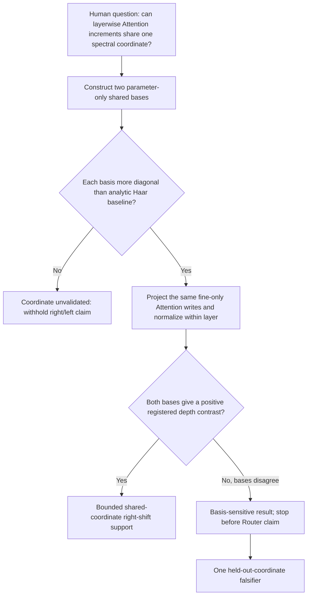

# Does conditional-fine Attention-write variance move later in a shared MLP parameter coordinate?

```text
type: daily_research_report
status: AI_DRAFT_AWAITING_HUMAN_CONFIRMATION
date: 2026-08-11
topic: shared_parameter_basis_attention_projection
canonical_anchor: Projects/from-attention-to-search/main/problem_anchors/15_spectral_representation_and_functional_routing/15_02_layerwise_representation_spectral_atlas/15_02_layerwise_representation_spectral_atlas_anchor.md
frozen_protocol: Projects/from-attention-to-search/main/experiments/A15/15_02_layerwise_representation_spectral_atlas/A15_02_06_E02_shared_parameter_basis_attention_projection/protocol.md
canonical_summary: Projects/from-attention-to-search/main/experiments/A15/15_02_layerwise_representation_spectral_atlas/A15_02_06_E02_shared_parameter_basis_attention_projection/summary.md
canonical_detailed: Projects/from-attention-to-search/main/experiments/A15/15_02_layerwise_representation_spectral_atlas/A15_02_06_E02_shared_parameter_basis_attention_projection/detailed.md
```

## Abstract

The question was whether layerwise Attention writes can be compared in one parameter-defined spectrum before using their depth-specific information for routing. Two parameter-only coordinates were frozen: a gain-sensitive mean-response basis and a gain-invariant rank-consensus basis. Both were slightly more aligned with each layer's MLP operator than a random orientation, but they disagreed on the decisive depth contrast: mean response gave $T=+0.03171$ with 95% parent-bootstrap interval $[+0.02058,+0.04433]$, whereas rank consensus gave $T=-0.00755$ with interval $[-0.01869,+0.00121]$. This report's pending-confirmation judgment is that the apparent right shift is coordinate-dependent and cannot yet support a universal shared-rank or Router claim. The only next decision is a held-out-coordinate falsifier using blocks 13--24 to build both bases and the unchanged early/late windows to evaluate them.

## 1. From The Human Question To One Adjudicable Question

### 1.1 Source and unresolved gap

The 0802--0810 meeting sequence proposed a common plot: order parameter-spectrum directions on the x-axis and plot cross-example variance of projected activations on the y-axis. It also fixed the operational activation as the direct Attention `o_proj` output before residual addition. The intended interpretation was that deeper blocks may create more focused, low-rank information at later spectral positions, eventually enabling layerwise routing.

Earlier local-spectrum plots could not answer the cross-layer question. Rank 500 in block $\ell$ and rank 500 in block $m$ are only ordinal labels of different eigenvectors. A later centroid in each layer's own basis is therefore not motion in one common vector space. The strongest rival explanation was coordinate choice: a shared basis that preserves parameter-gain magnitude could show a shift that disappears when only cross-layer rank order is retained.

### 1.2 The unique question

> First, do two parameter-only shared bases contain more per-layer spectral structure than a random orientation? Only if they do, does conditional-fine variance of the isolated Attention write have the same positive early-to-late rank shift in both bases?

| Human prior | Testable version here | Boundary |
| --- | --- | --- |
| Added information moves later in parameter spectrum with depth | Conditional-fine between-child variance of post-`o_proj` writes has positive late-minus-early centroid in two frozen common bases | Does not establish residual-relative novelty, low rank, semantic fineness, or Router utility |

## 2. Task, Data, And Terms

### 2.1 Model and frozen semantic task

The frozen model is Qwen3-8B with 36 decoder blocks and residual width 4096. The data are one balanced TAX cube: eight broad academic parents, eight children within each parent, four label-free prompt templates, and two fact bundles, for 512 records. Every record is read at the same final `Classification:` colon position after masked left padding.

Only fine identity within a parent is used. For example, a mathematics child is compared with the other seven mathematics children after averaging its eight prompt expressions. Coarse parents are not compared in this experiment.

No model, probe, direction, or basis is trained on these activations. The semantic cache is used only after both bases are fixed from model parameters.

### 2.2 Precise objects

| Name | Plain-language meaning | Exact object | Does not mean |
| --- | --- | --- | --- |
| Attention write | Output newly produced by the current Attention branch | direct `self_attn.o_proj` output before residual addition | information absent from the incoming residual |
| Conditional-fine variance | variation between child means after removing each parent mean | $B^{fine}_\ell=\frac1{64}\sum_{p,c}d_{\ell pc}d_{\ell pc}^{\top}$ | expression reliability or coarse/fine difference |
| Mean-response rank | average normalized MLP parameter response order | eigen-rank of $\frac1{36}\sum_\ell K_\ell/\operatorname{tr}K_\ell$ | equal influence of every local eigenvalue shape |
| Rank-consensus rank | agreement that a direction belongs to an early or late local band | eigen-rank of the averaged 16-band ordinal score operator | parameter-gain magnitude |
| Rank centroid | center of within-layer normalized variance over rank percentile | $C_{\ell,V}=\sum_jp_{\ell j}(j-1/2)/4096$ | absolute semantic variance strength |

## 3. Method And Logical Dependency

For each block,

$$
K_\ell=W_{gate,\ell}^{\top}W_{gate,\ell}
+W_{up,\ell}^{\top}W_{up,\ell}.
$$

$x^{\top}K_\ell x$ is the squared input-side parameter response for direction $x$. The mean-response basis diagonalizes the average trace-normalized $K_\ell$. The rank-consensus basis first replaces every local eigenvalue by one of 16 ordinal band scores, averages the resulting score operators, and diagonalizes that average. Thus the first coordinate preserves gain and the second deliberately removes it.

For fixed shared basis vector $v_j$,

$$
e_{\ell j}=v_j^{\top}B^{fine}_\ell v_j,
\qquad
p_{\ell j}=e_{\ell j}/\sum_ke_{\ell k}.
$$

The normalized curves plot $4096p_{\ell j}$ on a log scale. The 129-rank moving average is display-only; all judgments use unsmoothed $p_{\ell j}$.



## 4. Hypotheses, Controls, And Decision Rules

### 4.1 Decisive comparison

| Question | Treatment | Comparator held fixed | Rival addressed |
| --- | --- | --- | --- |
| Does gain scale create the shift? | mean-response ordering retains local eigenvalue magnitude | rank-consensus uses the same $K_\ell$, layers, dimension, semantic cache, normalization, and windows but keeps only ordinal 256-rank bands | right shift is a consequence of gain-sensitive coordinate construction |

### 4.2 Metrics and frozen mapping

The coordinate guard is the fraction of each $K_\ell$'s Frobenius energy appearing on the diagonal in the shared basis, divided by its analytic Haar-random expectation. A basis passes only if the median ratio exceeds one and at least 30 of 36 layers exceed one.

The depth statistic is

$$
T_V=\operatorname{median}_{25:35}C_{\ell,V}
-\operatorname{median}_{1:12}C_{\ell,V}.
$$

Block 36 is displayed but excluded. Two thousand bootstrap draws resample the eight parent domains, recompute normalized centroids, and then recompute $T$. `shared_coordinate_right_shift` requires both bases' lower 95% bounds above zero and positive A/B expression-half contrasts. Disagreement maps to `basis_sensitive_shift`.

### 4.3 Evidence eligibility

All model files and all 36 cached Attention files match their frozen SHA-256 manifests. Projection energy is conserved to $2.33\times10^{-7}$ relative error, shared-basis orthogonality error is below $2.71\times10^{-6}$, and the largest local eigensolver residual is $1.73\times10^{-5}$. Six unit tests, the three-layer real-data smoke, and full-resolution audit of all five figures pass. The evidence is eligible for the registered bounded comparison.

## 5. Results

### 5.1 Both bases are non-random coordinates, but only minimally

Mean response and rank consensus exceed the Haar baseline in 36/36 layers. Their median ratios are 1.0777 and 1.0527. The median diagonal-energy fractions are 0.7225 and 0.7180, compared with the exact local-eigenbasis optimum of 1. Passing the guard therefore means “better than random,” not “one exact spectrum shared by every layer.”

### 5.2 The right-shift decision changes with the basis

| Basis | Early median centroid | Late median centroid | $T$ and 95% interval | Protocol reading |
| --- | ---: | ---: | --- | --- |
| Mean response | 0.44549 | 0.47721 | +0.03171 [+0.02058, +0.04433] | positive shift Pass |
| Rank consensus | 0.48816 | 0.48061 | -0.00755 [-0.01869, +0.00121] | no positive shift |

The expression halves reproduce their own directions: +0.03304/+0.03320 for mean response and -0.00749/-0.00526 for rank consensus.


The two bases are globally similar: shared-rank correlation is 0.906 and mean same-256-band overlap is 0.467, far above the random 0.0625 expectation. The disagreement is concentrated in shallow blocks. The median mean-response minus rank-consensus centroid is -0.0422 in blocks 1--12 but +0.0006 in blocks 25--35. The gain-sensitive basis therefore creates its positive contrast mainly by placing shallow-layer variance earlier; the two bases nearly agree on late-layer location.


The curves normalize each layer to unit total variance. They do not show absolute strength. The absolute conditional-fine trace has a late-window median about 607 times the early-window median, so normalization hides a large scale change that this experiment is not designed to interpret.

## 6. Conclusion, Boundary, And One Next Decision

### 6.1 Pending-confirmation knowledge update

The original unknown was whether a common parameter spectrum makes the proposed depth shift well-defined. Two defensible parameter-only coordinates both pass a weak non-random guard, yet their decisive semantic-location results differ. Retaining parameter-gain magnitude yields a clear positive early-to-late contrast; removing magnitude and keeping only ordinal cross-layer band agreement yields a slightly negative, unresolved contrast. The safest current update is therefore that the right shift is a gain-sensitive coordinate description rather than a stable shared-rank property. This weakens the proposed basis for routing and blocks any claim that deeper blocks universally place new fine information later in one common spectrum.

### 6.2 What cannot be inferred

- The Attention write has not been shown to contain information absent from the incoming residual stream.
- Neither low effective rank nor finer semantic granularity was tested by this fine-only normalized location analysis.
- A non-random shared coordinate does not give individual cross-layer eigenvectors stable identities.
- No causal MLP use, routing accuracy, training benefit, or inference benefit was tested.

### 6.3 One next decision and parked questions

- **Only next decision:** construct the same two bases from blocks 13--24 only and evaluate the unchanged blocks 1--12 versus 25--35 contrast.
- **Completion criterion:** if both held-out basis readings have positive lower 95% bounds and positive A/B contrasts, retain the shared-rank hypothesis; if they disagree again, close the universal common-rank right-shift hypothesis and record only basis-specific geometry.

Questions about residual-relative novelty, low rank, semantic granularity, and Router utility remain parked until this coordinate issue is closed.

## 7. Evidence And Sources

- **Question sources:** [0802 curve note](../../0802/meeting_notes/0802%20%E6%9B%B2%E7%BA%BF%E8%A7%A3%E6%9E%90_%E7%AC%94%E8%AE%B0.md), [0803 variance note](../../0803/meeting_notes/0803%20variance%E5%BA%A6%E9%87%8F_%E7%AC%94%E8%AE%B0.md), [0805 transcript](../../0806/meeting_notes/0805%20%E8%B0%B1%E9%97%B4%E5%88%86%E5%8F%91_%E5%8E%9F%E6%96%87.md), [0807 note](../../0807/meeting_notes/notes.md), [0810 note](../../0810/meeting_notes/note.md)
- **Anchor:** [A15_02 anchor](../../../Projects/from-attention-to-search/main/problem_anchors/15_spectral_representation_and_functional_routing/15_02_layerwise_representation_spectral_atlas/15_02_layerwise_representation_spectral_atlas_anchor.md)
- **Frozen Protocol:** [A15_02_06_E02 protocol](../../../Projects/from-attention-to-search/main/experiments/A15/15_02_layerwise_representation_spectral_atlas/A15_02_06_E02_shared_parameter_basis_attention_projection/protocol.md)
- **Canonical Summary:** [summary.md](../../../Projects/from-attention-to-search/main/experiments/A15/15_02_layerwise_representation_spectral_atlas/A15_02_06_E02_shared_parameter_basis_attention_projection/summary.md)
- **Canonical Detailed:** [detailed.md](../../../Projects/from-attention-to-search/main/experiments/A15/15_02_layerwise_representation_spectral_atlas/A15_02_06_E02_shared_parameter_basis_attention_projection/detailed.md)
- **Decisive tables:** [basis_summary.csv](../../../Projects/from-attention-to-search/main/experiments/A15/15_02_layerwise_representation_spectral_atlas/A15_02_06_E02_shared_parameter_basis_attention_projection/tables/basis_summary.csv), [coordinate_validity.csv](../../../Projects/from-attention-to-search/main/experiments/A15/15_02_layerwise_representation_spectral_atlas/A15_02_06_E02_shared_parameter_basis_attention_projection/tables/coordinate_validity.csv), [projection_diagnostics.csv](../../../Projects/from-attention-to-search/main/experiments/A15/15_02_layerwise_representation_spectral_atlas/A15_02_06_E02_shared_parameter_basis_attention_projection/tables/projection_diagnostics.csv)
