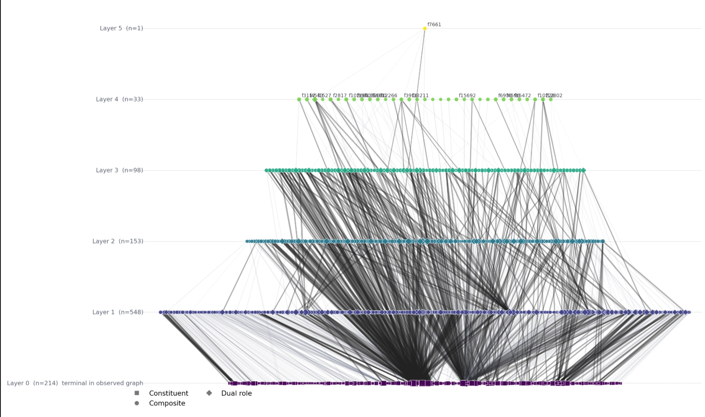
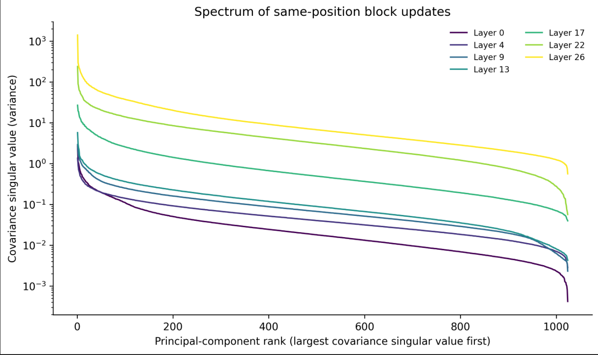
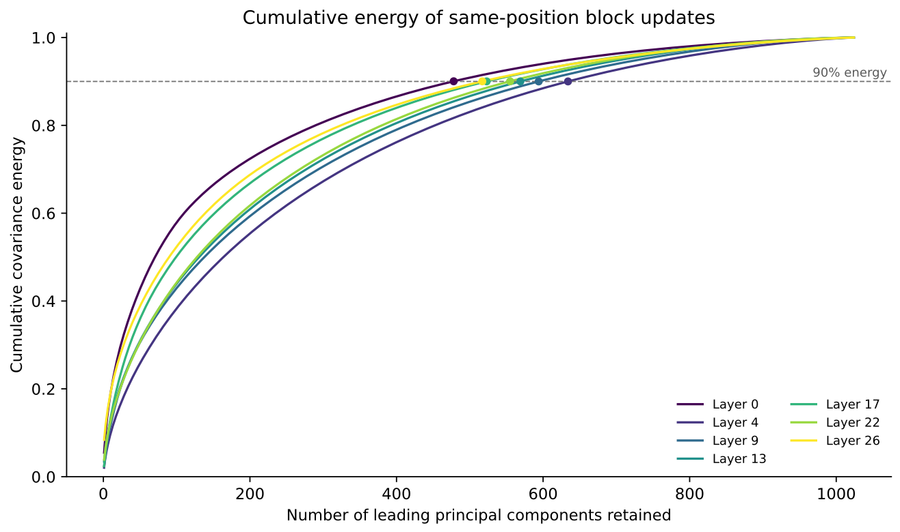
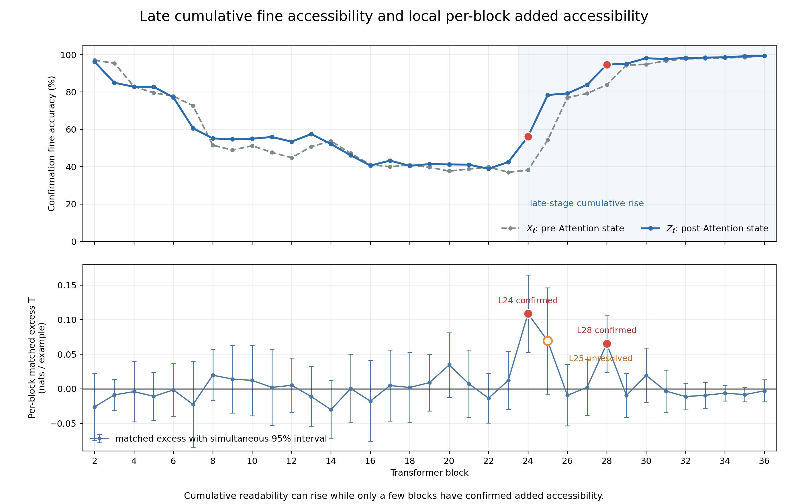

# feature

# 共识假设\&目标

**目标****：****找到深层和浅层之间有差别的信息来指导分发**

**假设1****：****模型深层在浅层基础上学到新信息**

**假设2****：****新信息位于****低秩****子空间**

## zx

**目标**：找到深层和浅层之间有差别的信息来指导LLM MoE模型的分发，也就是找到深层独有的新信息而不要被之前层的旧信息干扰
**分析方法**：多domain数据表征混合进行谱分解，找到每个方向主要在解释哪个domain的方差

**实验结果**：

1. 单个domain的方差主要集中在低秩子空间，但是不同domain所处的子空间不同，这就解释了为什么我们之前观察到是整体高秩的现象。

2. 单个domain子空间的基并不是连续出现，且没有明显规律，这就引出新的子问题（如何在不能提前知道domain信息的情况下找到具有domain区分性的方向？）

**新的子问题：如何在不能提前知道domain信息的情况下找到具有domain区分性的方向？**

1. 我们利用了一种叫Sparse Auto Encoder的分析工具，通过训练找30000个1024维的向量，训练目标是让每个token的表征只能选择其中32个向量来重构自身。结果是

    1. 只需要32个向量就能很好重构单个token的表征，表明局部低秩

    2. 但是不同token的表征激活的32个向量之间不同，表明整体高秩

2. 然后我们统计这30000个方向，也就是30000个feature的激活情况，发现如果我们按照feature激活关系来构造层级结构，那么:

    1. 越往高层的组合节点越能区分更细粒度的domain

    2. 低层的leaf节点几乎被所有的domain都使用，只看是否激活无法区分domain

## car

#### 0819

结论：

1. 区分一种特定语义信息只需要很少的方向，同时区分多种语义信息需要更多方向

2. 这些最有利于区分特定语义信息的方向不是方差最大的几个方向

实验结果：

1. 两种挑低秩子空间的方式：红色每次挑剩余方向中最能区分domain的方向；蓝色按方差从大到小的顺序挑选方向，红色策略的domain分类正确率提升显著更快。

2. 最有利于区分语义的方向不是方差最大的方向

二分类（区分某个domain和非该domain）

多分类（同时区分不同domain）

3. 不同domain最利于区分的低秩子空间相似度较低

4. 不同层之间的比较

#### 0817

**目标**：找到深层和浅层之间有差别的信息来指导LLM MoE模型的分发，也就是找到深层独有的新信息而不要被之前层的旧信息干扰
**分析方法**：前后两层\[1000, 1M\]形状的整层输出相减得到的矩阵上计算covariance矩阵，看谱空间

**实验结果**：新信息的covariance并不低秩，1000个方向中至少用到500个方向，有些层甚至需要600多个方向

#### 0813

**分析目标**

我们希望区分：第 $n$ 层 Attention 输出中的哪些信息可以由该层输入预测，哪些变化可能是 Attention 新引入的。

**输入表征**

$X$：模型第 $n$ 层的输入表征；

$Y$：模型第 $n$ 层 Attention 模块的输出，不加 residual。

**寻找公共坐标**

由于 $X$ 和 $Y$ 位于不同的表征空间中，我们不能直接比较它们的对应维度。

CCA 分别在两个空间中寻找一组相互对应的投影方向：

$z_x=(X-\mu_x)A_x\\\\z_y=(Y-\mu_y)A_y$

使同一个 token 在对应坐标上的 $z_x$ 与 $z_y$ 尽可能同步变化，相关性高的坐标认为是可靠的公共坐标。

**我们从 Attention 输出中识别两类坐标：**

1. 公共坐标：$z_x$ 与 $z_y$ 相关性较高；

2. Attention\-private 候选坐标：与 $X$ 的相关性较低，但在 Attention 输出中具有较大能量。

**新信息可能出现在哪里**

1. $z_y$中无法被$z_x$表示的部分。

在每个公共坐标上，先根据输入预测 Attention 输出：

$z_{\mathrm{predictable}}=\beta\odot z_x$

再计算实际 Attention 输出与预测值之差：

$z_{\mathrm{update}} = z_y-\beta\odot z_x$

它表示 Attention 在已有公共坐标上额外产生的变化。

2. Attention\-private 坐标中表示的部分

实验结果：

1. 公共坐标占整个表征空间的比例

2. 定义的“新信息”没表现出比“旧信息”更高的domain区分性

## Hrj

**目标**：找到深层和浅层之间有差别的信息来指导LLM MoE模型的分发

**分析方法： **定义一种跨层比较方式，找到浅层和深层中表示相同信息的子空间，再分析深层表征在这些共同信息子空间之外的分量的语义信息。

**子目标： 1\. 是否少数数据的分类都需要很高的维度？ 2\. 新信息到底是什么**

**结论：单独区分少量domain数据【比如区分3类domain】不需要高维的信息，但是区分多个domian的数据需要高维**

实验： 区分不同维度的表征的分类准确度

##### Attention 完整表征

线性分类

kmens聚类

##### mlp输入

##### attention相减

##### mlp相减

##### 不同domain

### 0817

**目标**：找到深层和浅层之间有差别的信息来指导LLM MoE模型的分发，也就是找到深层独有的新信息而不要被之前层的旧信息干扰

**分析方法： **定义一种跨层比较方式，找到浅层和深层中表示相同信息的子空间，再分析深层表征在这些共同信息子空间之外的分量的语义信息。因为我们认为这个分量就是更为合理的跨层表征相减的分量，且同时看这部分信息的方差以及谱空间性质

**结论：实验结果：新信息的covariance并不低秩，大约用到500多个方向【总共1000维】；没有观察到新信息空间在不同方法和不同表征上稳定具有更强的domain区分性。**

**浅层表征 \(X\)：** 第 \(n\) 层的 attention输出表征。**深层表征 \(Y\)：** 第 \(n\+1\) 层的 attention输出表征。

例如，如果数学 token 在浅层的某个方向上取值较大，在深层的另一个方向上也取值较大，那么这种对应关系所在的子空间就应当是旧信息所在的子空间，而新信息落在无法找到这种关系的子空间中。

数学上，通过求解下面的优化问题寻找成对方向 $u_i$ 和 $v_i$： $\arg\max_{u,v}
\operatorname{Corr}(Xu,Yv).$

- 浅层共同信息子空间：$\mathcal S_X=\operatorname{span}(u_1,\ldots,u_r)$；

- 深层共同信息子空间：$\mathcal S_Y=\operatorname{span}(v_1,\ldots,v_r)$。

然后使用浅层共同信息的投影值重构深层表征：

$\widehat Y=XU B+\mu_Y.$

其中，$\widehat Y$ 是浅层共同信息能够解释的深层部分。深层中不能被这些共同信息解释的部分为：

$R_Y=Y-\widehat Y.$

因此，我们暂时认为新的信息可能位于 $R_Y$ 中。这里不认为 $R_Y$ 全部都是新信息，只把它作为候选区域。

最后对 $R_Y$ 做PCA，取方差最大的若干方向作为新信息空间，并与以下空间进行同维比较：

- **旧信息空间：** 深层共同信息子空间 $\mathcal S_Y$；

- **新信息补空间：** 去掉新信息分量后，深层剩余表征中方差最大的方向；

- **Random：** 随机选择的同维方向

#### 实验结果1：相邻层MLP输入表征

这里的 $X$ 和 $Y$ 分别是相邻两层的MLP输入表征。

**结论：** Candidate明显高于random，但是低于完整子空间表征

#### 实验结果2：相邻层Attention输出表征

这里的 $X$ 和 $Y$ 分别是相邻两层的raw attention output。

**结论：** Candidate与random基本相同，并明显低于shared old和backbone。说明在相邻层attention输出中，不能由浅层共同信息解释的部分没有表现出更强的domain信息。

#### 实验结果3：同层Residual与Attention输出

这里的 $X$ 是进入本层attention前的residual，$Y$ 是本层raw attention output。

## dxy

#### 目的：

表征的高秩性是否主要来自多个语义 domain 的不同局部子空间叠加？同时判断，在单个细粒度分类任务中，是否存在一个低维子空间，可以在未见数据上保留完整的新增信息$R_u$的大部分增量分类功能。

1. $R_u$**的定义**：定义第 $\ell$ 层同一个 token 的 Attention 写入前后状态：$X_\ell\rightarrow Z_\ell$。其中，$X_\ell=N_\ell(h_\ell)$ 是无本层 Attention 写入时的归一化旧状态，$Z_\ell=N_\ell(h_\ell+a_\ell)$ 是加入本层 Attention 写入后的实际 MLP/候选 Router 输入。二者之差 $U_\ell=Z_\ell-X_\ell$ 是本层造成的精确更新；再去除旧状态能够线性预测的部分，得到候选新增更新：$R_{U,\ell}=U_\ell-\widehat{\mathbb E}_{lin}[U_\ell\mid X_\ell].$

    - 这里，$h_\ell$ 是本层 Attention 写入前的 residual，$a_\ell$ 是本层 Attention write，$N_\ell$ 是同一个 post\-Attention RMSNorm。将$R_{U,\ell}$设定为分析的对象，其意义可以认作“经过Attention之后相比输入新增的信息”

#### 分析方法：

首先定义：奇异值曲线下降越慢、尾部越长，就表示谱越宽、越不“奇异”。

##### 实验一：表征中宽谱是不是多个粗类内部的细分类方向拼起来的

1. 使用的数据仍是我们之前的粗细粒度自然语言数据。取出不同层的表征构造一样大的两组任务：一组是同一粗类内部的 8 个细类；另一组从 8 个粗类各取一个细类，同样是 8 类、每类 10 条。比较谱宽，并检查每个粗类的细分类方向能否重复、不同粗类的方向是否真的不同。

##### 实验二：是否存在低秩子空间能够保持层间新信息的任务分类性能，与PCA头部子空间是什么关系？

1. 将 $R_U$ 投影到 $1,2,4,8,16,32,64,128,256,512$ 维，比较 PCA 头部、PCA 尾部、64 条嵌套随机子空间、监督降秩岭回归低秩投影（也就是可学习的低秩投影） 和 完整 $R_U$。

#### 结论：

1. 跨粗类之间的频谱更宽，并且不同粗类合并后稳定产生新的方向

    1. 跨粗类的谱更宽

    2. 不同的domain之间合并，带来新方向

2. 完整新信息表征可以是高秩的，但在分类任务上，可以使用一个较低维的子空间投影保留层间新信息的分类性能，这个低秩子空间不是方差最大的那几个方向，和middle谱段（约 **12\.5%–15\.6%** 的排名区间）重合度较高（24和28层都是）。

    - 解析：左边是第24层的结果，右边是28层的结果。用这两层来进行实验是因为在之前的实验中，这两层的层间新信息$R_u$对于分类任务产生了明显的正收益，所以我们探究$R_u$的哪一个子空间能够保留$R_u$的分类性能，该空间是否是低秩的。如图结果可以看作：可学习的低秩子空间在很小的秩容量下就恢复了$R_u$的分类性能，但是PCA所需的维度要高于这个最小维度。

    - 解析：上图是我们监督学习的低秩子空间和谱方向重合程度。我们的实验是在8个粗类别中分辨8个细类别，然后我们的低秩分类低秩子空间学习公式如下，低秩子空间是先学习，然后固定：

        - $\min_{P_r^\top P_r=I,\;A_r} \left\|T_{\mathrm{corr}}-R_UP_rA_r\right\|_F^2 +\lambda\left\|A_r\right\|_F^2$

            $R_U\in\mathbb R^{n\times4096}$：该层不能由旧状态 $X$ 线性预测的更新。

            $P_r\in\mathbb R^{4096\times r}$：学习出的 $r$ 维输入子空间。

            $A_r\in\mathbb R^{r\times8}$：从低维坐标到 8 个类别 logits 的映射。

            $r$：投影维数，取 $1,2,4,\ldots,512$。

            $\|\cdot\|_F^2$：所有样本、所有类别预测误差的平方和。

            $\lambda$：岭正则强度，限制参数过拟合，由 DEVELOPMENT 集选择。

            $P_r^\top P_r=I$：要求投影方向互相正交。

        可以看到所学的低秩子空间并不与方差最大的方向align，而是和513\-639段的子空间方向更加align\. 需要注意的边界是，这个低秩子空间学习是有标签的，只能说明用于分类的低秩空间“存在性”，实践中的求法探究。

### 0817

目的：模型深层累计表征是否更能区分细粒度语义；哪些层的精确更新在旧状态之外增加了这种区分度？其中每一层增加的区分度，是否能够被一个低秩的子空间稳定激活？

#### 分析方法：

1. 首先定义第 $\ell$ 层同一个 token 的 Attention 写入前后状态：$X_\ell\rightarrow Z_\ell$。其中，$X_\ell=N_\ell(h_\ell)$ 是无本层 Attention 写入时的归一化旧状态，$Z_\ell=N_\ell(h_\ell+a_\ell)$ 是加入本层 Attention 写入后的实际 MLP/候选 Router 输入。二者之差 $U_\ell=Z_\ell-X_\ell$ 是本层造成的精确更新；再去除旧状态能够线性预测的部分，得到候选新增更新：$R_{U,\ell}=U_\ell-\widehat{\mathbb E}_{lin}[U_\ell\mid X_\ell].$

这里，$h_\ell$ 是本层 Attention 写入前的 residual，$a_\ell$ 是本层 Attention write，$N_\ell$ 是同一个 post\-Attention RMSNorm。将$R_{U,\ell}$设定为分析的对象，其意义可以认作“经过Attention之后相比输入新增的信息”

2. 验证$R_{U,\ell}$在已知粗粒度的分类信息下，是否能够增加细粒度信息的分类准确率。然后使用PCA，检验使用多少Rank能够保持表征的功能作用

3. 完成以上过程后，使用之前的公共基的分析方法寻找公共子空间

#### 结论：

1. 新定义的信息是有意义的：我们定义的层间新信息$R_u$在公平对照下能够增加表征$X_l$（前一层输出经过RMS\_Norm）对于细粒度语义的线性分类性

2. 表征信息在模型层之间的传递可以分为3个阶段：

    1. 浅层线性可分性较强，但不代表模型真正理解了语义信息（后半句会成为新的假设需要验证）

    2. 模型中层的表征线性可分性较弱，模型正在对表征进行重组

    3. 模型深层产生可以传递到更深层的可分性细粒度信息

图片解析：

上图为$X_l
$和$Z_l$对于细粒度信息的区分准确率

下图为增加使用L层新信息$R_{u,l}$相比于使用L层attention之前的输入$X_l$，在控制分类器参数量一致情况下，增加的对于细粒度语义线性读出的收益

- 横坐标：Transformer block，即考察哪一层Attention更新。

- 纵坐标：本层扣除对照后的新增收益 $T_\ell$，单位是 nats/example：

$T_\ell= G_\ell^{true} - \max\left( G_\ell^{duplicate-X}, q_{.95}G_\ell^{mismatch} \right).$

其中：

- $G^{true}$：在旧状态上加入真实 $R_U$ 后，交叉熵降低了多少；

- $G^{duplicate-X}$：只是多给同一个 $X$ 一个分支时的容量收益；

- $G^{mismatch}$：加入其他样本的错配 $R_U$ 时的收益。

该实验使用的数据依旧是之前的粗细粒度语义数据，实验步骤可以归纳为：

> 我们先把同一个 token 在 Attention 写入前后的状态相减，得到本层更新；再减掉旧状态能够线性预测的部分，得到 $R_U$。随后保持旧状态分支完全相同，一条路线只使用旧状态，另一条路线额外加入真实 $R_U$。但是多一个分支本身也可能提高性能，所以我们还用重复的 $X$ 和错配的 $R_U$ 做对照。只有真实更新带来的收益显著超过这些对照，才认为这一层增加了新的细粒度可访问性。
> 
> 

3. 我们抽取新信息发生稳定增益的两层实验。在24、28层，仅需要通过PCA保留少量秩（256，full dimension=4096）能达到和全秩新增信息 $R_u$ 80%的预测效果，并且超过同维的随机子空间。说明$R_u$是功能低秩的

4. 在 Mean Response 这把固定公共参数尺子下，深层新信息能量的平均位置相对浅层略向弱响应方向移动，深浅层谱质心差为 \(\+0\.0285\)，同时区间为 \(\[0\.0218,0\.0352\]\)。

Next decision：

