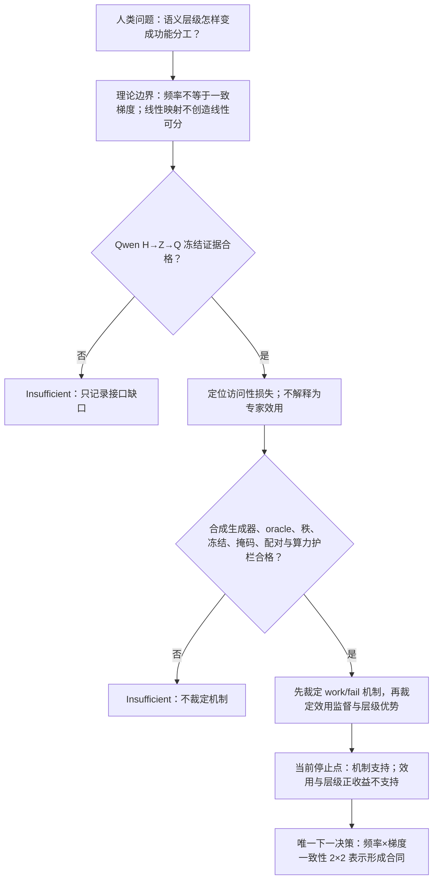

# 正确父类残差分解能否同时带来可实现性与训练优势？

```text
type: daily_research_report
status: HUMAN_CONFIRMED
confirmed: 2026-08-30
date: 2026-08-30
topic: gradient_consistent_hierarchical_routing_h100
canonical_anchor: Projects/from-attention-to-search/main/problem_anchors/15_spectral_representation_and_functional_routing/15_11_gradient_consistent_hierarchical_routing/15_11_gradient_consistent_hierarchical_routing_anchor.md
frozen_protocol: Projects/from-attention-to-search/main/experiments/A15/15_11_gradient_consistent_hierarchical_routing/A15_11_E01H_qwen_native_router_access_gap_h100/protocol.md; Projects/from-attention-to-search/main/experiments/A15/15_11_gradient_consistent_hierarchical_routing/A15_11_E03H_counterfactual_utility_residual_tree_h100/protocol.md
canonical_summary: Projects/from-attention-to-search/main/experiments/A15/15_11_gradient_consistent_hierarchical_routing/A15_11_E01H_qwen_native_router_access_gap_h100/summary.md; Projects/from-attention-to-search/main/experiments/A15/15_11_gradient_consistent_hierarchical_routing/A15_11_E03H_counterfactual_utility_residual_tree_h100/summary.md
canonical_detailed: Projects/from-attention-to-search/main/experiments/A15/15_11_gradient_consistent_hierarchical_routing/A15_11_E01H_qwen_native_router_access_gap_h100/detailed.md; Projects/from-attention-to-search/main/experiments/A15/15_11_gradient_consistent_hierarchical_routing/A15_11_E03H_counterfactual_utility_residual_tree_h100/detailed.md
source_focus: daily_research_reports/backup/2026/08/0829/focus_gradient_consistent_hierarchical_routing.md (HUMAN_RESULT_CONFIRMED)
h100_ownership: collision-isolated non-owning sensitivity evidence; not execution of the 8xRTX5090 Focus contract
```

## 摘要

本轮问的不是“语义标签能否被探针读出”，而是正确的父类条件分解能否把一个全局非线性功能问题拆成可学习的局部残差，并进一步胜过同参数、同计算的平坦非线性 Router。冻结 Qwen3-30B-A3B 的审计显示，八类父标签从隐藏状态到 128 维 Gate 分数大多保留，但在 top-8 稀疏选择处发生稳定的大幅访问性损失，同时仍保留高于置换空参照的标签关联。四叶合成实验进一步表明：给定正确分组时，逐级秩一残差树实现近零误差；错误分组保留约 $1/3$ 的容量下界。可是匹配的平坦非线性模型同样到达近零误差，当前在线反事实效用监督还降低了表现。因而本轮确认的是“条件分解机制可实现”，不是“层级架构更高效”。唯一下一决策转向更上游的频率（高/低）乘以跨细类梯度一致性（高/低）表示形成检验。

## 1. 从人类问题到本轮唯一问题

### 1.1 核心任务来源与已有缺口

08:28 组会首先纠正了一个隐含前提：父类覆盖更广只意味着总协方差多了一项父类间变化，并不保证父类判别方向占据最大主成分。随后对话“学习可分性理论”把学习机制进一步收紧为：一个因素出现得频繁，只有在不同细类对它产生的任务梯度平均后不抵消时，才可能积累稳定方向；即使方向形成，也仍需额外谱优势才会进入主成分头部。

此前的表征探针、二维投影或 PCA 位置都无法回答“原生 Router 是否保留该信息、所选专家是否有用、结构是否提高功能效率”。因此本轮把证据链分成两个互不替代的环节：先在冻结 Qwen 中定位原生接口的访问性损失，再在专家效用可精确定义的合成系统中做结构与功能裁定。

### 1.2 唯一可判定问题

> 先学习并冻结一个共同秩一函数，再只学习其未解释残差的 $1\rightarrow2\rightarrow4$ 专家树，是否仅在父类分组与残差函数一致时实现任务；在相同参数、样本、候选前向和推理计算下，它是否比平坦非线性 Router 更高效，在线反事实效用监督是否提供额外收益？

| 人类先验 | 本轮可检验版本 | 与原先验的边界 |
| --- | --- | --- |
| 共同属性先学，随后在共同部分之外逐级学习差异 | 给定共同算子、正确/错误父类配对、秩一专家与阶段冻结，比较解析下界和实际学习 | 不声称自然语言自动具有或发现该树 |
| 粗语义可进入 Router | 比较同一冻结样本的隐藏状态 $H$、Gate 分数 $Z$ 与 top-8 路由 $Q$ | 只测外部标签访问性和关联，不测专家效用 |

## 2. 任务、数据与术语

### 2.1 两个任务与五个对象

Qwen 审计不训练语言模型，只在固定层的最终决策 token 上读取三个对象：$H\in\mathbb R^{2048}$ 是 MoE 与 Gate 收到的隐藏向量；$Z=W_gH\in\mathbb R^{128}$ 是原生无偏置 Gate 分数；$Q\in\mathbb R^{128}$ 是 softmax 后只保留 top-8、重新归一化并把其余位置置零的稀疏路由。**线性探针**是在冻结对象上拟合的受限读出器，只回答标签能否跨模板访问。

合成任务对每个输入 $z\sim\mathcal N(0,I_8)$ 产生 $y=(C+gA+bB)z$。共同、父级、叶级算子 $C,A,B$ 均为单位秩一且左右奇异方向分别正交。work 条件取 $g=p$，正确树为 $C\rightarrow pA\rightarrow bB$；fail 条件取 $g=q=pb$，四个教师函数的多重集不变，只改变它们与具名父类 $p$ 的配对。

本文始终分开五个对象：语义标签是研究者指定的 $Y,p,b$；表征访问性是从 $H$ 的受限读出；Gate 访问性是从 $Z,Q$ 的同一读出；**反事实专家效用**是把同一样本交给等算力候选专家后减少的任务损失；功能收益是固定预算下的测试误差或学习速度。前一对象不能替代后一对象。

### 2.2 数据划分、条件与统计单位

| 证据链 | TRAIN | DEVELOPMENT | CONFIRMATION / TEST | 独立统计单位 |
| --- | --- | --- | --- | --- |
| Qwen E01H | 每次用 A 或 B 的 15 个完整模板族、960 行拟合线性探针；Qwen 不训练 | 训练半区内按完整模板族做五折正则强度选择 | 另一半 15 个完整模板族、960 行；双向交换后合并 | 30 个完整模板族；C4/C5 共享语义原子，不是独立复现 |
| 合成 E03H | 每步 16 个高斯输入分别与四个 $(p,b)$ 状态组合成 64 行；三阶段各 128 步 | 无；smoke 只查模式和数值，不能选择条件、种子、阈值或检查点 | 每种子固定的 64 行完整因子测试库用于诊断；主 NMSE 用精确高斯算子期望 | 8 个配对优化种子 `151130`--`151137` |

一个**条件**是 work/fail 生成器、树/平坦 Router、任务损失/效用监督三项选择组成的实验格。一个 seed 内的层、步骤、行和四个臂共享随机来源，不作为独立重复。

### 2.3 核心指标

- **平衡准确率（BA）：**八个父类召回率的平均，机会值为 $0.125$。投影缺口为 $D_{proj}=BA(H)-BA(Z)$，选择缺口为 $D_{select}=BA(Z)-BA(Q)$；它们定位受限读出的损失，不能解释为因果信息比例。
- **路由—标签关联：**$I_Q(Y;E)/H(Y)$，即父标签与路由质量对应专家索引的互信息除以标签熵；它只说明统计关联。
- **归一化均方误差（NMSE）：**预测误差除以教师总信号能量；0 表示精确拟合。解析 fail 的 $1/3$ 只在四状态等权、各向同性高斯、精确共同祖先、双正交残差、给定树、阶段冻结和秩一叶等条件下成立。
- **学习曲线面积（AULC）：**在累计训练样本数的对数坐标上积分 NMSE，越小表示越早学会。$S_H,S_F>0$ 才表示效用监督有益，$A_T,A_U>0$ 才表示层级有益。

## 3. 方法：每一步承担什么证据

固定线性映射不能创造原表示中不存在的线性分隔面：若 $z=Ah+c$ 后有线性分类器，复合回去仍是 $h$ 上的线性分类器。真正能扩大函数族的是任务对齐的非线性交互或条件化；例如 $b=pq$ 全局是异或，固定 $p$ 后却变成分支内对 $q$ 的一维线性读取。平坦非线性模型也能学这个交互，所以它是层级主张的决定性对照。



Qwen 的每个 $H,Z,Q$ 单元使用相同样本、标签、A/B 交叉拟合、训练半区中心化、读出族和评分。完整模板族自举给出差值区间，标签置换保留家族结构并对五个确认层取最大统计量。合成实验则在七个秩一专家、102 个 Router 参数、相同初始化、数据流、候选前向次数、训练步数和推理激活数下，运行“条件树/平坦非线性”乘以“任务损失/在线效用”的 $2\times2$。

## 4. 假设、对照与判定规则

| 问题 | Treatment 改变什么 | Comparator 保持什么不变 | 排除的竞争解释 |
| --- | --- | --- | --- |
| Gate 投影还是 top-8 选择丢失访问性？ | $H\rightarrow Z\rightarrow Q$ 接口 | 样本、标签、探针、划分、层与空参照 | 表示本来不可读、或探针设置变化 |
| 正确层级机制是否可实现？ | 同一四函数多重集与父类 $p$ 的配对 | 频率、能量、噪声、专家秩与训练预算 | 单纯函数难度或样本频率差 |
| 效用监督是否有增益？ | 同一 Router 内加入当前候选效用交叉熵 | 专家、候选计算、初始化、任务损失 | 额外候选计算带来的表面收益 |
| 层级是否有额外收益？ | 条件树与平坦非线性 Router | 参数、计算、监督、样本流和种子 | 仅仅“需要非线性” |

Qwen 的注册判决要求至少 4/5 确认层在 C4/C5 同时满足：Gate 机会校正保留率 95% 下界至少 0.90 且投影缺口上界至多 0.05；top-8 选择缺口下界至少 0.10；路由关联高于五层最大统计量的 97.5% 置换阈值。区间使用 10,000 次完整模板族配对自举（seed `151101`），空参照使用 1,000 次置换（seed `151102`）。

合成机制要求 `H_task` work 端点不高于 0.05、fail 端点不低于 0.25，并且 fail-minus-work AULC 区间下界大于零。效用或层级增益还要求相应配对 AULC 区间下界大于零，并通过端点不恶化等护栏。八个 seed 用同一索引矩阵做 10,000 次配对整-seed 自举，bootstrap 根 seed 为 `151124`。阈值均来自冻结 Protocol，不由结果反推。

E03H 的生成器、oracle、秩、冻结、投影、配对、算力和完成审计合格；主 NMSE 从注册的有限固定库估计改为同一高斯目标的精确算子期望，这是已登记且不改变 estimand 的偏差。掩码由已哈希执行代码独立审计，而不是 producer 的具名机器护栏。E01H 的 BF16 主链在自身冻结合同内合格，但调度器 describe 回执、runner/submitter 执行时哈希和 FP32 原始 null draws 未完整持久化，所以只保留为有边界的 non-owning 敏感性证据。

## 5. 结果

### 5.1 Qwen：访问性主要在稀疏选择处损失

$BA(H)=0.9948$--$1.0000$，$BA(Z)=0.9417$--$0.9984$，而 $BA(Q)=0.4047$--$0.5635$。五个确认层中，4/5 在两个面板同时满足投影保留、实质选择损失和关联保留；5/5 有选择损失，5/5 有关联保留，0/5 近乎完全保留。BF16 与 FP32 给出同一行判决。第 44 层在冻结前已被看过，只作为 pilot 显示，不进入计数。


图中纵轴是八类父标签的 held-out BA，横轴是层；误差棒是完整模板族配对自举 95% 区间，虚线是 0.125 机会值。允许的读法是“$H,Z$ 近乎可读，而 $Q$ 明显下降”；不能据图声称 Gate 因果使用语义或所选专家降低语言模型损失。

### 5.2 合成实验：机制通过，方法优势没有通过

| 判断量 | H100 估计值与 95% 区间 | 冻结规则的局部读法 |
| --- | ---: | --- |
| Qwen 跨面板计数 | 投影保留 `4/5`；选择损失 `5/5`；关联保留 `5/5`；近全保留 `0/5` | `TOP8_SELECTION_BOTTLENECK_WITH_RETAINED_ASSOCIATION` |
| `H_task` work 端点 NMSE | $1.9403\times10^{-5}$ $[1.2147\times10^{-5},3.0740\times10^{-5}]$ | 正确树可实现 |
| `H_task` fail 端点 NMSE | $0.336926$ $[0.334220,0.356077]$ | 通过 $1/3-10^{-4}$ learned guard |
| fail-minus-work AULC | $+0.053155$ $[0.050140,0.054230]$ | `MECHANISM_SUPPORTED` |
| task-only 层级收益 $A_T$ | $-0.000082$ $[-0.004211,0.002458]$ | 未建立正层级收益；不是等价证明 |
| 树内效用收益 $S_H$ | $-0.012057$ $[-0.067979,-0.007610]$ | 当前效用监督更差 |
| 平坦效用收益 $S_F$ | $-0.005792$ $[-0.007309,-0.000315]$ | 当前效用监督更差 |


图中每个差值都以正值代表被检验方法更好，区间来自八个配对 seed 的整-seed 自举。机制对比明确为正；层级和效用对比没有形成正证据。平坦 task 模型在 work/fail 都到近零，因此当前数据支持的是“通用非线性在该生成器与预算下已经能解题”，不是普遍的函数类等价或样本效率等价。

work 的 `H_util` 八个 seed 进一步分成 1 个近零、4 个约 $1/6$、3 个约 $2/3$ 的端点模式。负载账本与之相容的最窄解释是：尚未成熟的候选专家生成 hard argmax 效用标签，hard top-1 又让未选专家缺少任务梯度，早期缺失分支被阶段冻结固化。这是证据相容的阶段归因；效用交叉熵、直通梯度、负载、初始化与冻结没有被分别干预，因而不是唯一原因定理。

## 6. 结论、边界与唯一下一决策

### 6.1 确切认识更新

原先未知的是“正确层级既能解释函数，又是否因此比通用非线性模型更好”。决定性比较把两者拆开：work/fail 只改变父类配对，证明了正确树的条件容量与错误树的秩一下界；平坦非线性对照和效用监督对照则否定了本轮注册的额外收益。研究者确认的最安全认识是：**语义层级不是方差层级；正确层级可以提供可解释的条件函数分解，但可分解不自动等于训练更高效。当前在线反事实效用监督也不能把不完整的专家集合变完整。**

### 6.2 不能推出什么

- 不能从 Qwen 的 BA 或路由互信息推出原生 Router 因果使用父类语义、所选专家有反事实效用或语言模型 NLL 改善。
- 不能把给定四叶、秩一、完整因子合成任务外推成自然语义树，或声称模型能自动发现该树。
- 不能把本次层级未胜过平坦模型加强成“层级一般无效”，也不能把当前效用目标失败加强成所有稳定化效用设计必败。
- H100 E01H/E03H 是当前 5090 Focus 接纳的碰撞隔离、non-owning 敏感性证据，不是该 Focus 使用 H100 执行。

### 6.3 唯一下一决策与停放项

- **唯一下一决策：**冻结父类相关预测事件频率（高/低）乘以跨细类梯度一致性（高/低）的 $2\times2$ 下一词元预测表示形成合同，裁定“高频是否足够，还是必须通过不抵消的共享梯度才形成父类方向”。
- **完成判据：**四格匹配总 token、总目标位置、父细类样本数、词表、模板和标签熵；预先定义梯度一致性、父类类间能量、未见模板 5% 低尾归一化间隔和判别子空间谱位置的 Pass/Fail/Insufficient 映射，并完成新的 Anchor/Protocol 人类确认。该决策不授权实现或运行。

Oracle/Search 与软条件期望效用修补均为 parked，不作为并行 next step。

## 7. 证据与来源

- **问题与人类结果来源：**[当前 Focus](../../focus_gradient_consistent_hierarchical_routing.md)、[08:28 组会逐句校订](../../../0828/docs/0828组会_逐句校订与下一步研究方向.md)、对话“学习可分性理论”。
- **理论与审慎材料：**[当前理论补充](theory_supplement_separability_and_residual_routing_h100_cn.md)、[`feature (9).pdf`](<../../../0828/docs/feature (9).pdf>)。
- **Anchor：**[A15_11](../../../../Projects/from-attention-to-search/main/problem_anchors/15_spectral_representation_and_functional_routing/15_11_gradient_consistent_hierarchical_routing/15_11_gradient_consistent_hierarchical_routing_anchor.md)。
- **Frozen Protocol：**[E01H](../../../../Projects/from-attention-to-search/main/experiments/A15/15_11_gradient_consistent_hierarchical_routing/A15_11_E01H_qwen_native_router_access_gap_h100/protocol.md)、[E03H](../../../../Projects/from-attention-to-search/main/experiments/A15/15_11_gradient_consistent_hierarchical_routing/A15_11_E03H_counterfactual_utility_residual_tree_h100/protocol.md)。
- **Canonical Summary：**[E01H](../../../../Projects/from-attention-to-search/main/experiments/A15/15_11_gradient_consistent_hierarchical_routing/A15_11_E01H_qwen_native_router_access_gap_h100/summary.md)、[E03H](../../../../Projects/from-attention-to-search/main/experiments/A15/15_11_gradient_consistent_hierarchical_routing/A15_11_E03H_counterfactual_utility_residual_tree_h100/summary.md)。
- **Canonical Detailed 与数字 lineage：**[E01H](../../../../Projects/from-attention-to-search/main/experiments/A15/15_11_gradient_consistent_hierarchical_routing/A15_11_E01H_qwen_native_router_access_gap_h100/detailed.md)、[E03H](../../../../Projects/from-attention-to-search/main/experiments/A15/15_11_gradient_consistent_hierarchical_routing/A15_11_E03H_counterfactual_utility_residual_tree_h100/detailed.md)。

本报告只重建已确认判断的阅读逻辑。每个数字、资格标签、偏差和图的最终审计仍以 Summary/Detailed 为准。研究者已于 2026-08-30 接纳本报告并要求完成最终审计后结束目标；本文件因此标记为 `HUMAN_CONFIRMED`。
