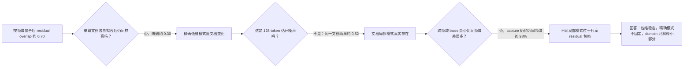

# A15_00_03_E01：Residual 稳定的是精确方向，还是共享包络？

状态：条件聚合、单文档 projector 和有限样本护栏均完成；形成有边界的认识更新。

## 1. 唯一回答的问题

**问题：** residual 在跨文档比较中看起来稳定，究竟表示每篇文档使用相同的低维方向，还是具体方向随文档变化、但都位于一个共享的更宽空间？

**为什么重要：** 前者允许一个固定 residual basis 长期指导 Router；后者说明固定 basis 只能描述总体包络，未必跟得上每批数据的局部学习方向。

## 2. 认识更新

**一句话回答：** Residual 的总体包络稳定，但单篇文档的精确低维模式会明显变化；domain/topic 只解释其中一小部分，因此它更像“共享包络中的文档局部模式”，而不是固定 residual 子空间或彼此割裂的领域空间。

“方向重合度”取值 0 到 1：1 表示两个 64 维空间完全相同，随机 residual 子空间约为 0.09。按 domain 聚合很多文档后，跨 domain overlap 仍约为 0.70；但每篇文档独立拟合后，跨文档 overlap 只有约 0.30。同 domain 只比跨 domain 高约 0.006，说明粗领域标签只解释很小一部分局部变化。

低 overlap 不是因为每篇文档只有 128 个 token 而估不准。把同一文档切成两个不相交的 64-token 半区并改用 rank-32，两半 overlap 仍约 0.52；换成同领域不同文档后降到约 0.18，跨领域约 0.17。

“跨文档捕获”再问：用文档 A 的方向解释文档 B，效果如何？跨领域 basis 的捕获量约为同领域 basis 的 98%，说明 broad envelope 高度共享；但它只达到 B 自己最优 rank-64 捕获的约三分之一，说明最强局部方向仍然是文档特异的。Common/top 方向比 residual 更可迁移。

## 3. 关键证据图

**读图方法：** A 图显示不同文档精确方向只部分重合、但远高于随机；B 图用同一文档两半证明低 overlap 不是估计噪声；C 图显示跨领域与同领域捕获几乎相同，却只保留目标文档自身最强模式的约三分之一。

| 比较层级 | Residual overlap | 它回答什么 |
| --- | ---: | --- |
| 同一文档两个独立 token 半区，rank-32 | 0.516--0.534 | 文档内模式可复现 |
| 同 domain 不同文档，rank-32 | 0.173--0.181 | 换文档后具体模式大幅变化 |
| 跨 domain 文档，rank-32 | 0.168--0.177 | domain 只提供小幅额外一致性 |
| 随机 residual rank-32 q95 | 0.048 | 跨文档仍共享非随机结构 |

**完整证据：** [中文摘要](summary_cn.md)；[证据账本](detailed.md)。

## 4. 解释流程图

## 5. 边界与下一步

- **成立范围：** WOS 7 个 domain、LB/decommon 40k/80k、全部 12 层，以及 Gate 真正接收的表征。
- **仍不能说：** 每个局部模式就是语义 topic、domain 是最优条件变量、动态更新 basis 会改善训练，或 residual 完全随机。
- **最强未决解释：** 文档局部模式可能由更细的语义、句法、位置或任务状态共同决定；当前粗标签只能代理其中一部分。
- **唯一下一决策：** 固定频带已在独立 2B 实验中改变路由但未改善 NLL；是否把下一类 Router 目标改为直接预测专家更新兼容性或任务效用？
- **完成判据：** 新坐标必须在独立 token 上稳定超过 native score、同维随机、错误层与 batch/范数对照，才允许再次大规模训练。
- **恢复时第一动作：** 关闭固定 residual-band dispatch，形式化直接功能目标的最小准入实验。
