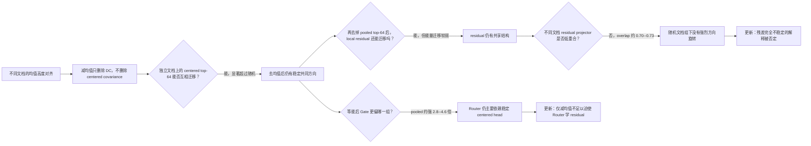

# A15_00_01/03：去掉均值后，Router 是否真的只剩不稳定残差？

状态：两项冻结实验完成；认识更新已形成，等待研究者审核表述。

## 1. 本次唯一回答的问题

**问题：** decommon 去掉表征均值后，剩余空间是否因不同文档而不断变化、难以形成稳定学习方向；当前 Gate 是否仍主要依赖去均值后跨文档稳定的共同方向？

**为什么重要：** 这决定了 decommon 没有额外训练收益，能否归因于“残差坐标不稳定”，以及仅减均值是否足以改变 Router 的归纳偏置。

## 2. 认识更新

**一句话回答：** 减均值没有把 Router 推入彼此无关的局部残差空间；去均值后的主子空间和更深 residual 都能跨文档复现，而且两者的 projector 都高度重合，但当前 Gate 仍明显更依赖主子空间。

先解释“稳定”：在一组文档上找到的 64 个方向，如果能在完全不同文档上继续捕获超过随机 64 维方向的表征变化，就说明这些方向不是该批数据独有。结果显示 pooled top-64 的跨文档迁移量约为 0.56--0.60；去掉它后再找的 local residual-64 仍有约 0.39--0.41，而不是接近随机。

再直接比较 projector：1 表示两个文档组得到完全相同的64维空间，随机64维空间的95%分位只有约0.09。common 的跨组 overlap 为0.76--0.79，residual 也达到0.70--0.73。残差不仅能迁移能量，它的主要方向本身也高度共享；因此“方向随随机文档组强烈旋转”的解释不成立。

最后解释“Gate 偏好”：给 pooled 与 local residual 每个方向完全相同的输入能量，再比较它们能造成多大的专家间分数变化。LB 对 pooled 的增益约为 local 的 3.9--4.6 倍，decommon 约为 2.8--3.1 倍；去除 pooled 也会比去除 local residual 多损失约 1.9--2.1 个原生 margin logit/token。

因此，您的判断中“减均值只移除了最大的 DC 成分，Router 仍会沿去均值后的稳定主子空间学习”得到支持；但“其余 residual 因文档而不稳定、无法形成完整学习方向”被否定。decommon 改变了偏置强度，却没有把稳定 covariance head 从 Router 几何中消除。

## 3. 关键证据表

| 模型状态 | common 迁移 | residual 迁移 | common projector overlap | residual projector overlap | Gate 等能偏好 |
| --- | ---: | ---: | ---: | ---: | ---: |
| LB 40k | 0.584 | 0.409 | 0.791 | 0.729 | 3.94× |
| LB 80k | 0.564 | 0.392 | 0.766 | 0.719 | 4.55× |
| decommon 40k | 0.600 | 0.414 | 0.784 | 0.730 | 2.83× |
| decommon 80k | 0.580 | 0.402 | 0.760 | 0.704 | 3.08× |

**读表结论：** 减去均值后仍有两层可迁移结构；common 捕获更多跨文档能量，但 residual projector 本身也高度重合，而 Gate 主要使用 common。decommon 的 Gate 等能偏好为 11/12 层，第 12 层是例外。

**完整证据：** [稳定性摘要](A15_00_01_E01_cross_document_subspace_stability/summary_cn.md)；[Gate 偏好摘要](A15_00_02_E01_gate_common_residual_preference/summary_cn.md)。

## 4. 解释流程图

## 5. 边界与下一步

- **成立范围：** LB 与 decommon 两个 12 层模型、40k/80k checkpoint、Gate 真正接收的表征和独立 DCLM 文档；30k 按研究者决策未进入结论。
- **仍不能说：** 稳定方向就是语义 common、local residual 没有功能信息、稳定性导致 decommon 训练无收益，或 Gate 偏 pooled 一定有益。
- **最强未决解释：** 当前随机 hash shard 都混合了相似的 DCLM 条件；全局 residual envelope 稳定，并不排除 domain/topic 条件下存在旋转的低维模式。
- **唯一下一决策：** 是否先按 domain/topic 构造条件化文档组，同时比较 residual projector overlap 与 cross-capture？
- **完成判据：** 必须有同条件 half-split 可靠性上限和同维随机 null；只有跨条件 overlap 明显低于同条件、同时 cross-capture 仍高，才支持 A14 式条件低维模式混合。
- **恢复时第一动作：** 先定义可复现的 DCLM domain/topic 条件与分组规则，再写冻结 Protocol；在此之前不启动匹配训练。
