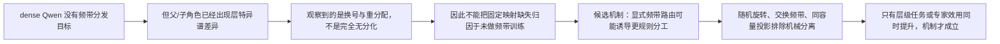

# Qwen3-8B 语义角色频谱画像：为何没有固定层级频带分化？

状态：E02 已完成；当前实验结论与下一项训练假设已分离。

## 1. 本次回答的问题

**问题：** 现有 Qwen3-8B 结果是否足以支持“没有固定父级=head、子级=tail 分化，是因为模型没有按不同频带进行分发训练”这一解释？

head、middle、tail 只表示某层自然语料 covariance 中背景方差从大到小的方向区间；它们不是预先定义的语义标签。

## 2. 认识更新

**一句话回答：** 现有结果不能把缺少固定映射归因于训练方式，因为模型已经出现层特异父/子分化；它只说明 dense Qwen3-8B 没有自发形成跨层恒定的层级—频带规则。

原始能量（raw）保留每个方向平时方差大的优势，回答目标 token 实际把多少激活能量放在该方向；白化能量（white）除以独立自然语料中的背景方差，回答某个语义角色是否相对日常波动特别偏好该方向。

1. 早中层 block 5--19 中有 10 层稳定表现为子级 white head 更强。
2. block 25--32 的 8 层全部稳定表现为父级 white head 更强。
3. block 36 中子级 head 更强、父级 middle/tail 更强，因此是频带重分配，不是“完全没有分化”。
4. Qwen3-8B 是 dense next-token 模型，没有 Router 或固定频带分工目标；所以显式频带训练可能诱导更规则的分化，但这仍是未测试假设。
5. 如果训练后只看到频带分得更开，可能只是模型服从了结构约束；只有同时改善未见层级任务或专家效用，才能称为有益归纳偏置。

## 3. 决定性证据

| Head 白化比较 | 父/子倍数 | 方向 | 判断 |
| --- | ---: | --- | --- |
| block 10 | 0.961 | 子级更强 | 稳定通过 |
| block 29 | 1.080 | 父级更强 | 稳定通过 |
| block 35 | 0.982 | 接近零 | 不能区别于零 |
| block 36 | 0.915 | 子级更强 | 局部显著，但非末层单独反转 |

横轴是 embedding 与 36 个 block 输出；纵轴是父级减子级的每方向平均能量，正值为父级更强、负值为子级更强。左图保留背景方差，右图除去背景方差；虚线标出倒数第二层。曲线多次换号，直接排除一个跨层恒定的父级=head 规则。

## 4. 判断流程图

## 5. 边界与唯一下一决策

- **已经成立：** 在冻结 Qwen3-8B、独立 DCLM covariance 和 128 个同词同位置父/子最小对中，语义角色的 white 频谱差异随层改变。
- **尚未成立：** “没有按频带训练”是固定映射缺失的原因；显式频带路由会产生更好的层级分工；谱分化本身能够改善模型。
- **最强 rival：** 指定频带训练可能只是把任意信息压进被开放的通道；同维随机或普通可学习投影也可能产生同样分化与收益。
- **唯一下一决策：** 是否建立一个匹配的四层小 MoE 因果训练 Protocol，比较 native、指定频带、同维随机旋转、频带—目标层交换和同容量可学习投影。
- **完成判据：** 指定频带条件不仅形成预注册的层 × 频带角色画像，而且在相同数据、参数、FLOPs、负载和容量下，稳定超过全部对照的 held-out 层级关系损失或专家选择 regret；否则不能把频带分化解释为有益机制。
- **恢复时第一动作：** 先冻结训练任务、频带来源、目标层映射、随机/交换/学习投影对照和功能主指标，再决定是否运行；不得以“画像更清楚”作为训练成功标准。

完整实验报告：[summary_cn.md](summary_cn.md)；全部证据：[detailed.md](detailed.md)。
