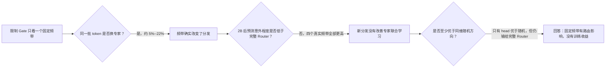

# A15_05_05_E01：固定频带是否能让 2B MoE 分发得更好？

状态：九臂匹配训练与冻结评估已完成；形成确定但有边界的认识更新。

## 1. 唯一回答的问题

**问题：** 当 Router 只能看 head、middle、tail 或 middle+tail 时，它是否会形成不同的专家分发，并比完整 Router 或同维随机方向训练得更好？

**为什么重要：** 静态上“能产生新划分”并不等于该划分能让专家学得更好；只有长期语言模型损失才能裁定这种 Router 设计是否值得保留。

## 2. 认识更新

**一句话回答：** 固定频带确实大幅改变了 token 选择的专家，但没有一种频带分发改善 2B 训练；因此“频谱能制造划分”成立，“这个划分对专家学习有益”不成立。

这里用“平均预测意外程度”衡量语言模型质量：模型越不意外，数值越低。完整 native Router 的结果最好；只看 head、middle、tail、middle+tail 全部更差，而且差异在相同 held-out 文档的配对区间中都稳定大于零。

同维随机方向回答“结果只是因为少看了若干维度吗”。head-only 明显优于随机 64 维，说明 head 的确是特殊方向；但它仍不如完整 Router，说明只保留最强公共方向会丢掉有用信息。middle、tail、middle+tail 不优于自己的随机对照，因此它们造成的是不同划分，不是已验证的功能划分。

## 3. 关键证据图与表

| 只让 Gate 看 | 换专家比例 | 相对 native 的 NLL 变化 | 相对同维随机 | 认识更新 |
| --- | ---: | ---: | ---: | --- |
| head | 5.0% | +0.00178 | -0.00438 | head 特殊，但单独用不够 |
| middle | 19.8% | +0.00560 | +0.00271 | 大幅改分发，训练更差 |
| tail | 21.9% | +0.00370 | 约等于随机 | 大幅改分发，没有收益 |
| middle+tail | 13.3% | +0.00331 | +0.00181 | 新划分没有转化为收益 |

**读图 / 表结论：** 路由变化最大的是 middle/tail，不是效果最好；所以“分发不同”与“专家受益”是两个独立命题。

**完整证据：** [中文摘要](summary_cn.md)；[证据账本](detailed.md)。

## 4. 解释流程图

## 5. 边界与下一步

- **成立范围：** 同一个 H768 四层、8 sparse experts、top-1、DCLM 分叉种子；从 0.629B tokens 分叉并训练到 2.001B；专家始终接收完整表征。
- **仍不能说：** middle/tail 没有任何功能信息、所有模型都同样失败，或可学习的语义/梯度特征也无效。
- **最强未决解释：** 固定 covariance rank 不是“哪些 token 应共同训练”的正确坐标；有用信号可能是任务条件化、跨层或直接与专家更新相关的。
- **唯一下一决策：** 是否把下一类 Router 候选改成直接预测专家更新兼容性或任务效用，而不再用固定频带身份当作分发目标？
- **完成判据：** 新坐标必须先在独立 token 上超过 native score、同维随机、错误层和 batch/范数对照，再允许大规模联合训练。
- **恢复时第一动作：** 形式化一个“专家共同训练收益”的直接目标及最小准入实验，不再提交固定 band-only 复现。
