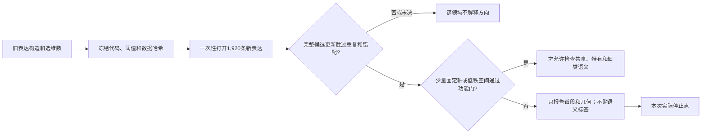

# 不同领域的分类信息在什么谱段和子空间中稳定出现？

## 摘要

本实验服务于逐层路由的长期目标，但只回答它之前的表示问题：第 24、28 层的候选
attention 更新中，八个领域各自区分八个细类的信息，能否在未见表达上稳定定位到
少量谱方向？完整全量实验表明，候选更新在 16 个“层×领域”组合中的 15 个确实
增加了留出分类信息；但自由学习的方法在所有领域都需要八分类的全部 7 个独立对比
维度，三套冻结谱也没有任何方向集合通过完整稳健门。可以稳定更新的认识是：判别
空间整体集中于参数响应谱尾部，并大量位于激活 PCA 前 500 维之外；不同领域之间
还存在显著高于随机的几何重合。不能更新的部分是：目前没有可信的单轴语义、共享
功能方向或领域特有功能方向。因此，不能据此把固定谱段或固定轴直接作为 Router
输入。

## 1. 为什么要做这个实验？

我们的长期目标是让 Router 在不同层依据该层已经形成的信息进行分发。这个设想
隐含了一个前提：每个领域用于区分细类的信号，应当能被一个稳定、足够小的方向集
捕获，而且这些方向在新表达上仍然有效。

过去的 PCA 图只能告诉我们“数据在哪些方向波动最大”，不能告诉我们“哪些方向
最能区分类别”；训练集上的高分类分数又可能来自表达记忆、标签偶然相关或类内方差
这个分母过小。本实验因此只检验一个问题：

> 在固定模型的第 24、28 层，领域内细分类信息究竟需要多大空间、落在哪种谱段，
> 并且是否存在通过未见表达功能检验的固定方向？

如果固定方向成立，才有资格谈共享/特有语义和后续 Router 输入；如果只存在自由
旋转的空间，就不能把某个谱轴当成路由规则。

## 2. 实验对象、任务和数据

### 2.1 研究的表示对象

对第 \(\ell\) 层，\(X_\ell\) 表示 attention 写入前的归一化旧状态，\(U_\ell\) 表示
同一 token 的 attention 更新。我们先在训练表达上拟合一个仿射预测器，扣掉旧状态
已经能线性预测的更新：

\[
R_{U,\ell}=U_\ell-(X_\ell A_\ell+b_\ell).
\]

\(R_U\) 是本实验的“候选层更新”。它避免把旧状态里已经可读的信息重复算作新作用，
但它仍不等于新知识，也不证明原模型在自然推理中因果使用了这些方向。

### 2.2 分类任务

任务包含八个领域：数学、物理、化学、生物、计算机、经济、医学和语言学；每个
领域包含八个细类。每次只在一个领域内部做八分类，因此实验问的是“领域内细类
差异”，不是先区分八个大领域。

### 2.3 三种数据角色

- **构造集：**每个“领域×细类”10 条旧表达，用于拟合旧状态分类器、残差预测器、
  方向评分、特征尺度和分类修正头。
- **开发集：**每格10条不同旧表达，只用于选择岭回归强度和最小维数；不进入最终
  置信区间。
- **密封确认集：**每格30条全新表达，共 \(8\times8\times30=1,920\) 条。它在
  方法、阈值和代码冻结之后才计算激活，只负责最终判断。

密封集仍描述相同的源事实，但更换了句式、事实顺序、模板编号、组合编号、记录编号
和提示哈希。审计结果为 64/64 个单元平衡，文本、模板、事实组合和记录编号与旧数据
的重合均为 0，显式标签泄漏为 0。它检验的是“同一事实换一种没见过的表达”，不
检验新事实、新领域或自然语料总体。

## 3. 两种找方向的方法

### 3.1 固定谱轴判别法

我们先冻结三套坐标尺：

1. **本层参数响应谱：**对本层 MLP 的 gate 和 up 矩阵构造
   \(K_\ell=W_g^\top W_g+W_u^\top W_u\)。头部方向表示该层参数响应最大，不表示
   激活方差最大。
2. **公共参数响应谱：**把所有层的 MLP 响应算子做 trace 归一化后平均，得到一套
   跨层共用的 4,096 维坐标。
3. **激活方差谱：**在 131,072 个 DCLM 训练 token 的完整表征上拟合前 500 个
   PCA 方向。前 500 维之外只记作一个“未解析补空间”，不虚构具体尾部轴。

对冻结基底中的每条轴 \(v_j\)，用训练表达计算

\[
s_j=\frac{v_j^\top Bv_j}{v_j^\top Wv_j+\rho},\qquad
\rho=10^{-2}\frac{\operatorname{tr}(W)}{4096}.
\]

\(B\) 衡量八个细类均值之间的差异，\(W\) 衡量同一细类换表达后的波动。因此高分轴
必须同时满足“类间分得开”和“类内表达稳定”。我们检查 1、2、4、8、16、32、64
条轴，并把 \(\rho\) 放大十倍重新选择方向；如果结论随这个分母保护项变化，就不能
把高分解释为真实判别方向。

### 3.2 自由旋转的监督子空间

固定轴可能错过“多条谱轴旋转组合后才有用”的空间。因此第二种方法不限制基底，
直接把标准化的 \(R_U\) 映射到旧状态分类器尚未解释的类别对比目标。八分类只有 7 个
线性独立的中心化类别对比，所以检查秩 1、2、4、7；其中 7 是代数上限，不能把
“秩 7 有效”称为非平凡低秩发现。

两种方法的关系是：固定轴方法检验“能否指出具体谱轴”，自由旋转方法检验“是否
至少存在某个低维空间”。后者是功能上界和漏检保护，不是固定轴方法的真值标签。

## 4. 功能指标、对照和判定规则

### 4.1 主功能量

对每条确认表达，比较只用旧状态的分类损失，与加入候选方向后的分类损失：

\[
g_i=CE(f_X(x_i),y_i)-CE(f_X(x_i)+f_m(r_i),y_i).
\]

单位是每条样本的 nats；\(g_i>0\) 表示候选更新在旧状态之外降低了交叉熵。保留率是
候选子空间增益除以完整 \(R_U\) 增益。它测量的是冻结线性读出可访问的分类作用，
不是表征重建率，也不是原模型的因果使用率。

### 4.2 为什么需要六类保护

- **重复旧状态：**排除只是再次读取 \(X\) 的解释。
- **领域内错配更新：**排除任意同领域更新都能带来类似增益的解释。
- **谱头前 \(k\) 轴：**直接比较判别选择与“最大响应/最大方差自然更好”的假设。
- **同维随机轴：**排除高维里随便取若干方向就能命中的解释。
- **标签打乱：**端到端重做评分、选维数和分类头，排除训练流程本身制造增益。
- **十倍分母压力：**排除类内方差过小造成的虚高判别比值。

### 4.3 统计规则

每个领域先在八个细类内等权平均，再对细类等权平均。置信区间使用 2,000 次配对
重采样，每次都在“领域×细类”单元内有放回抽样；相同抽样权重用于所有对照。为了
控制同时检查两层、八领域和多种基底带来的假阳性，使用最大统计量构造单侧同时
95%下界。

固定基底只有同时满足以下条件才通过：完整更新先通过入口；开发集选出的方向数
不超过16；确认集保留率同时下界大于0.80；增益同时下界胜过谱头、随机和标签置乱；
十倍分母压力下仍满足，并且两次选轴的 Jaccard 重合至少0.50。自由空间则要求选中
秩不超过4、保留率下界大于0.80且胜过标签置乱。

## 5. 全量运行是否真正完成？

是。正式运行不是冒烟结果的外推，执行链条已经完整落盘：

| 执行证据 | 正式结果 |
| --- | --- |
| 密封数据 | 1,920 条，64 个平衡单元，所有泄漏/重合审计通过 |
| 正式抽取 | 两层全部1,920条；数组形状 `2×1920×2×4096` |
| 模型身份检查 | 两层重放、更新重构、MLP 输入和输出投影误差均为0 |
| 正式分析 | 16 个领域—层结果、400条功能曲线、2,544条候选轴记录、656条谱段能量 |
| 分析耗时 | 1,671.54秒，约27.9分钟；正式抽取65.46秒 |
| 图件 | 三张注册图均有 PNG/PDF，并与源表逐项核对 |
| 当前代码测试 | 8项全部通过 |

正式激活数组 SHA-256 为
`f1675a666272ef831cbd7f1fb52b7d9744aee95e0c7f24e0665db187118c9f41`；
分析清单状态为 `passed=true`。后续两个 amendment 均为机械补全：一项补出协议已
注册但初始写出器漏掉的子空间重合表，另一项重画对应图和调整排版；它们没有改变
数据、方法、阈值或结论资格。

## 6. 结果一：候选更新通常确实增加细分类信息

入口要求完整 \(R_U\) 胜过重复旧状态和领域内错配。16 个组合中15个通过：

| 层 | 领域 | 完整增益 | 相对最强对照的边际 | 同时95%下界 | 结论 |
| ---: | --- | ---: | ---: | ---: | --- |
| 24 | 数学 | 0.02295 | -0.00255 | -0.02811 | 未决 |
| 24 | 物理 | 0.17029 | 0.10380 | 0.07824 | 通过 |
| 24 | 化学 | 0.12735 | 0.09124 | 0.06568 | 通过 |
| 24 | 生物 | 0.12833 | 0.05402 | 0.02846 | 通过 |
| 24 | 计算机 | 0.16621 | 0.13977 | 0.11421 | 通过 |
| 24 | 经济 | 0.11360 | 0.07755 | 0.05199 | 通过 |
| 24 | 医学 | 0.21598 | 0.18690 | 0.16133 | 通过 |
| 24 | 语言学 | 0.09194 | 0.04937 | 0.02381 | 通过 |
| 28 | 数学 | 0.14686 | 0.11575 | 0.09019 | 通过 |
| 28 | 物理 | 0.05820 | 0.03608 | 0.01052 | 通过 |
| 28 | 化学 | 0.08808 | 0.06134 | 0.03577 | 通过 |
| 28 | 生物 | 0.08963 | 0.04829 | 0.02273 | 通过 |
| 28 | 计算机 | 0.10030 | 0.07467 | 0.04911 | 通过 |
| 28 | 经济 | 0.11742 | 0.08459 | 0.05902 | 通过 |
| 28 | 医学 | 0.16235 | 0.07114 | 0.04557 | 通过 |
| 28 | 语言学 | 0.09063 | 0.06379 | 0.03822 | 通过 |

这一步建立的是“旧状态之外仍可线性读取到细类作用”。第24层数学的正点估计很小，
而最强对照更大，不能因为完整增益本身为正就把它算作通过。

## 7. 结果二：分类作用存在，但没有压到真正紧凑的维数

对15个通过入口的组合，自由学习空间在确认集上的平均保留情况为：

| 子空间维数 | 平均保留率 | 领域范围 |
| ---: | ---: | ---: |
| 1 | 0.205 | 0.131–0.281 |
| 2 | 0.337 | 0.192–0.559 |
| 4 | 0.637 | 0.477–0.884 |
| 7 | 1.000 | 0.991–1.009 |

所有领域都在开发集选择了7维；没有一个在1、2、4维达到注册的90%开发集 crossing。
七维在确认集几乎完整复现功能，并且相对标签置乱的增益同时下界为正，但七维就是
八分类的全部独立对比维数。它说明方法能在新表达上重建完整类别对比，却不说明存在
非平凡低秩压缩。

还有一个重要区分：七维点估计很稳定，但其跨全部组合的同时保留率下界只有
0.765–0.783，低于严格的0.80门。因此正式类型表把16个组合都记为
`INSUFFICIENT`，而不是把“点估计接近1”升级为严格通过。与此同时，“没有任何
秩不超过4的合格空间”是注册规则下确定的负结论。

图中紫线是自由学习空间，三条其他曲线是三套固定谱轴；横轴是维数，纵轴是相对
完整更新的留出增益。空心圆表示只根据开发集冻结的维数，横虚线是0.80边界。曲线
可以超过1或小于0，因为这是相对分类增益，不是被限制在0到1之间的重建比例。

## 8. 结果三：三套固定谱都没有产出可信的具体方向

三套谱没有任何一个“层×领域×基底”同时通过维数、留出增益、随机/谱头/置乱对照、
同时置信和分母压力门。开发集得到的最小90% crossing如下；`>64`表示检查到64维
仍没有 crossing，这些都只是候选维数，不是通过结果。

| 层 | 领域 | 本层参数谱 | 公共参数谱 | 激活PCA | 自由空间 |
| ---: | --- | ---: | ---: | ---: | ---: |
| 24 | 数学 | >64 | >64 | >64 | 7 |
| 24 | 物理 | >64 | >64 | 64 | 7 |
| 24 | 化学 | >64 | >64 | >64 | 7 |
| 24 | 生物 | 32 | >64 | >64 | 7 |
| 24 | 计算机 | >64 | >64 | >64 | 7 |
| 24 | 经济 | 64 | >64 | >64 | 7 |
| 24 | 医学 | >64 | >64 | >64 | 7 |
| 24 | 语言学 | >64 | 64 | >64 | 7 |
| 28 | 数学 | >64 | 64 | 64 | 7 |
| 28 | 物理 | 16 | 8 | 32 | 7 |
| 28 | 化学 | >64 | >64 | >64 | 7 |
| 28 | 生物 | 64 | 64 | 8 | 7 |
| 28 | 计算机 | 32 | >64 | 32 | 7 |
| 28 | 经济 | >64 | 32 | 32 | 7 |
| 28 | 医学 | 16 | 16 | 16 | 7 |
| 28 | 语言学 | >64 | 32 | >64 | 7 |

最接近的两个候选也不足以晋级：第28层物理的公共参数谱用8轴时保留率为0.7996，
刚低于点边界；轴的谱排名是511、1715、1893、2095、2216、2353、2925、3393。
第28层医学的本层参数谱用16轴时点保留率0.8310，十倍分母压力后仍有0.8045，
但没有通过跨全部条件的同时置信门。它们提示后续可能关注的位置，却不能被报告为
“物理方向”或“医学方向”。

这也回答了小分母问题：候选不是因为分母保护一改变就全部消失；但即使加入压力
测试和选轴重合，仍没有任何固定方向集合满足完整证据链。因此我们没有把尾部高分
误报为稳定语义轴。

## 9. 结果四：可稳定报告的是谱段，而不是单条谱轴

这里的“分类信息”有精确对象：它是从候选层更新 \(R_U\) 学到的七维输入投影空间，
这个空间用于补充旧状态分类器，并区分同一领域内八个细类的七个独立类别对比。
图的纵轴是这七维投影空间在某个谱段内的投影能量占比；对每个领域，全部谱段相加
为 1。它不是分类准确率、样本数量、总体激活方差或“知识多少”，而是**判别表征在
给定谱坐标中的位置分布**。

把自由学习的七维空间映射回三套谱后，参数响应谱最后 \(1/16\) 段的能量最高：

| 层 | 本层参数谱尾段 | 公共参数谱尾段 | 同秩随机q95 |
| ---: | ---: | ---: | ---: |
| 24 | 0.2461 | 0.2695 | 约0.0659 |
| 28 | 0.4107 | 0.4350 | 约0.0659 |

两个层、两个参数谱的八个领域全部高于随机95%分位。对于激活 PCA，第24层平均
0.751、第28层平均0.621的判别空间能量位于前500维之外；在已识别的前500维内部，
最头部一段仍分别承载0.135和0.265。正确表述因此不是“分类信息只在谱尾”，而是：

> 分类目标学习到的完整对比空间强烈富集于参数响应尾段，并且多数能量不在激活
> PCA 前500维中；同时，PCA 头部仍承载一部分信息。

六张单图使用相同编码：每条细线是一个领域，粗线是八领域平均；第24层用浅蓝，
第28层用深蓝；灰虚线是同秩随机空间的95%分位。激活 PCA 的菱形点与前500维
曲线断开，因为它只表示整个未解析补空间，不能伪装成连续的“第九段”。
本实验只抽取了第24、28层，所以颜色深浅只编码这两个注册层，不能被读成全部层的
连续生成轨迹。

- 本层参数响应谱：[第24层](figures/figure_2a_local_parameter_block24_curve.png)；[第28层](figures/figure_2b_local_parameter_block28_curve.png)
- 公共参数响应谱：[第24层](figures/figure_2c_mean_response_block24_curve.png)；[第28层](figures/figure_2d_mean_response_block28_curve.png)
- 激活 PCA：[第24层](figures/figure_2e_activation_pca_block24_curve.png)；[第28层](figures/figure_2f_activation_pca_block28_curve.png)

这解释了为什么 PCA 最大方差方向不一定适合分类：PCA 优化的是所有样本总体变化，
会优先捕获句长、句式、通用词法和领域共有变化；分类需要的是类间均值差相对类内
表达波动大的方向。两种目标没有排序一致性的保证。本实验的直接证据是，大部分判别
空间位于 PCA 头500之外；但因为补空间没有进一步做完整 PCA，不能声称具体位于
第501名后的哪一条轴。

## 10. 结果五：领域间共享几何随深度增强，但共享功能仍未证明

对两个领域的七维空间 \(Q_p,Q_q\)，用归一化投影重合衡量它们有多少方向相互对齐。
同秩随机空间的95%分位只有0.00230：

| 层 | 跨领域平均重合 | 中位数 | 范围 | 高于随机的领域对 |
| ---: | ---: | ---: | ---: | ---: |
| 24 | 0.1522 | 0.1518 | 0.1486–0.1587 | 28/28 |
| 28 | 0.2970 | 0.2975 | 0.2907–0.3049 | 28/28 |

同一领域跨层重合为0.1475–0.1510，8/8也高于随机。最值得推进的认识是：第28层
不同领域的判别几何更加对齐，但第28层通过入口的完整增益平均约0.107，反而没有
高于第24层七个通过领域的约0.145。因此“几何更共享”和“可读分类作用更强”不是
同一件事，不能仅靠子空间重合决定 Router。

图的上半部显示非随机几何重合；下半部刻意留空，因为没有固定基底通过功能门。
这个空白本身就是结论：如果此处仍画细类热图，就会把训练得到的候选方向误当成
可信语义方向。

## 11. 对实验结论的分层评估

### 11.1 已经由注册规则建立的结论

1. 在当前模型、两层、八领域和受控新表达总体上，完整 \(R_U\) 对15/16个组合具有
   超过旧状态重复和错配更新的线性分类作用。
2. 注册的秩1/2/4自由空间没有建立紧凑充分性；三套固定谱也没有任何合格方向集。
3. 因为功能门没有通过，不能给候选轴贴共享、特有或细类语义标签。

### 11.2 稳定但只属于几何层面的认识

1. 完整七维类别对比空间跨领域一致偏向参数响应谱尾部，并主要位于 PCA 前500维
   之外。
2. 领域间子空间重合远高于同秩随机，且第28层比第24层更强。

这些观察跨八个领域一致，且不依赖密封表达来拟合或选择几何，因此不是单个领域的
偶然现象；但它们仍不能代替共享成分的逐领域留出功能检验。

### 11.3 仍不能回答的内容

- 哪一条具体轴天然表示“量子物理”“几何”或其他细类；
- 哪个共同方向在多个领域都产生独立、正的留出分类增益；
- 模型在原生生成过程中是否因果使用这些方向；
- 把这些方向送入 Router 是否改善专家选择、负载或专家专门化；
- 结果能否迁移到其他层、模型、语言、自然分布或新事实。

## 12. 真正推进后的认识与 Router 决策

实验前较强的直觉是“领域知识可能落在少量非 PCA 头部方向，可以挑出来直接用于
路由”。实验后应把它改成更精确的判断：

> 领域内细分类信息在未见表达上确实存在，并且在谱上有稳定的尾段/补空间偏置；
> 但当前信息单元更像一个可旋转、接近完整类别对比维数、跨领域部分共享的判别
> 空间，而不是几条可稳定命名的固定轴。

因此本实验确实帮助 Router 排除了一个过早方案：不能直接选择参数谱尾段、PCA
非头部或若干高判别比轴作为路由输入。它同时保留了一个更窄的可能性：未来若继续
推进，应单独检验“可学习的逐层投影是否在留出数据上带来真实分发效用”，而不是
先验固定某段谱。本实验本身不修改 Router，也不自动启动该后续实验。

## 13. 证据与复现入口

- [冻结实验协议](protocol.md)
- [英文结果摘要](summary.md)
- [英文完整证据账本](detailed.md)
- [领域—层判定表](tables/domain_layer_atlas.csv)
- [维数—功能曲线源表](tables/functional_curves.csv)
- [候选轴完整记录](tables/selected_axes.csv)
- [谱段能量源表](tables/learned_spectral_energy.csv)
- [跨领域子空间重合源表](tables/learned_subspace_overlap.csv)
- worker：`/data/250010109/MoE_Router/experiments/20260820_a15_07_e02_fixed_axis_low_rank_atlas/`

本报告是 canonical `summary.md`、`detailed.md` 与冻结源表的中文自洽解释；所有
判定数字均来自这些结果记录，不替代原始清单和哈希收据。
