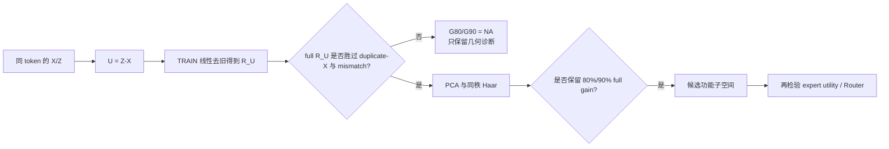

# Detailed: A15_08_07_E01 CLINC150 逐层新增可访问性与 PCA 功能秩

Primary Anchor: [A15_08_02](../../../../problem_anchors/15_spectral_representation_and_functional_routing/15_08_target_conditioned_layer_innovation/subanchors/15_08_02_layerwise_conditional_fine_added_accessibility_anchor.md)  
Frozen Protocol: [protocol.md](protocol.md)  
Summary: [summary.md](summary.md)  
Result eligibility: `ELIGIBLE_AI_DRAFT_AWAITING_DXY_JUDGMENT`

## 0. Quick Recap

- **目的：**在 CLINC150 上恢复逐层 intent 新增可访问性位置，并只对功能准入层定义 PCA \(G_{80}/G_{90}\)。
- **对象：**同层、同 token、同一 RMSNorm 下的 \(X_\ell,Z_\ell,U_\ell,R_{U,\ell}\)。
- **直接结果：**block 2--36 的 simultaneous 95% UCB\((T_\ell)\) 全部小于 0。
- **裁定：**`FAIL_ALL_LAYERS_NONPOSITIVE`；\(\mathcal L^+_{\mathrm{CLINC}}=\varnothing\)。
- **功能秩：**全部 `NA_NO_FULL_ADMISSION`。
- **边界：**几何谱仍可描述，但不得升级成新增信息或 Router 证据。

## 1. 两次会议如何形成这次实验

0813 会议首先修正了统计对象：不是先把每层 token 聚合成边际方差曲线再比较，而是保持 token 一一对应，先得到每个 token 的更新向量，再计算中心化 covariance、PCA，必要时对 token 低维坐标聚类。这回答“token 更新点云沿哪些方向扩展、是否形成群组”。

0817 会议又补上证据边界：token-wise difference 可能含旧 feature 的缩放、旋转、信息搬运和任务无关运动；PCA 只保证方差/重构最优，不保证分类或 gating 最优；总体高秩也可能与低维分类共存。因此最终问题改成：是否存在一个层特异低维子空间，在未见数据上保留旧状态之外的分类增益，并进一步预测 expert utility。

本实验把两条线接起来：先用 \(R_U\) 把“同 token 更新”收紧为线性去旧后的候选更新，再用 same-\(X\) 功能门判断它能否被称为新增可访问性，最后才评估 PCA 功能保留。

## 2. 数据、模型与实验对象

- 数据：CLINC150 in-scope，10 个 domain，每个 domain 15 个 intent；每个 intent 为 100/20/30 TRAIN/DEVELOPMENT/TEST，共 15,000/3,000/4,500 条。
- 任务：domain 作为已知条件；分别训练 10 个 15-way intent 读出，domain 等权汇总。
- 模型：冻结 Qwen3-8B，36 blocks，hidden width 4096。
- block 1：decision token 的 \(X_1\) 结构上恒定，按注册规则标记 `STRUCTURALLY_INELIGIBLE`；主分析为 blocks 2--36。
- TEST 边界：blocks 24/28 曾在此前 CLINC 实验中被查看，本实验是注册稳健性 profile，不是全新的独立确认集。

对 block \(\ell\)：

\[
X_\ell=N_\ell(h_\ell),\qquad
Z_\ell=N_\ell(h_\ell+a_\ell),\qquad
U_\ell=Z_\ell-X_\ell,
\]

\[
R_{U,\ell}=U_\ell-widehat{\mathbb E}_{lin}[U_\ell\mid X_\ell].
\]

\(R_U\) 只表示“当前 TRAIN 拟合线性模型无法由 \(X\) 预测的更新剩余”，本身不等于非线性意义或信息论意义的新信息。

## 3. 协方差、PCA 与功能门分别做什么

| 方法 | 实际问题 | 本实验中的位置 | 不能单独推出 |
| --- | --- | --- | --- |
| 中心化 covariance | token 更新共同沿哪些方向变化 | 描述 \(R_U\) 点云和 variance rank | 高方差方向有任务意义 |
| PCA | 少量线性组合能否概括主要变化 | 构造候选低维空间 | 这些方向是新信息或最优 Router 方向 |
| Haar 同秩对照 | PCA 是否优于随便选同样多方向 | 排除纯维数收益 | full-\(R_U\) 本身已新增功能 |
| duplicate-\(X\) | 第二个同预算分支是否仅靠再看一次旧状态就能获得更多收益 | full-\(R_U\) 功能准入的强 rival | 非线性旧信息已完全耗尽 |
| mismatch \(R_U\) | 与当前样本无关的更新几何能否伪造收益 | 配对性 null | 同-\(X\) 额外容量效应 |

功能主统计量为

\[
G_{\ell,full}=CE(X\text{-only})-CE(X+R_U),
\]

\[
T_\ell=G_{\ell,full}-
\max\{G_{\ell,duplicate\text{-}X},q_{.95}(G_{\ell,mismatch})\}.
\]

当且仅当 simultaneous 95% LCB\((T_\ell)>0\)，block \(\ell\) 进入 Stage 2 的正式功能秩判定。

对准入层和 PCA rank \(r\)，定义

\[
D_{\eta,\ell,r}=G_{\ell,PCA(r)}-
\max\{\eta G_{\ell,full},q_{.95}(G_{\ell,Haar(r)})\},
\qquad \eta\in\{0.8,0.9\}.
\]

最小满足 simultaneous LCB\((D)>0\) 的 rank 才是 \(r_{G80}\) 或 \(r_{G90}\)。

## 4. 执行与资格

| 阶段 | ACP job | 产物 | 状态 |
| --- | --- | --- | --- |
| Smoke | `pt-fb5eki0n` | 160 条、blocks 2--36 对象与 identity guards | PASS |
| TRAIN/DEVELOPMENT extraction | `pt-hspr6s63` | 18,000 条、35 层、约 20.65 GB | PASS |
| Residual/PCA fit | `pt-smj8d3rq` | 35 层 residualizer/PCA | PASS |
| Selection freeze | `pt-m55ktxr6` | 350 functional + 350 nonlinear tasks，64 mismatch，64 Haar | PASS |
| TEST confirmation | `pt-3o8ipsox` | 4,500 条、35 层、冻结分析 | PASS |

TEST gate receipt SHA-256：`0dbeb2d44710f6cd2040350817edf2f062881ff91500606c5b6dea6bebb4eadb`。所有数据、对象、identity、非有限值和 TEST freeze guards 通过。注册主分析使用 2,000 次 bootstrap；Stage 1 全层 simultaneous critical value 为 3.0597，Stage 2 全层×rank×threshold 为 3.9979。

工程测试最终为 58 passed。没有改变主科学对象、层集合、rank grid、null 或判定规则。额外 nonlinear-\(X\) 与监督降秩结果只作为 post-hoc 诊断，不改变主裁定。

## 5. Stage 1：逐层新增可访问性

### 5.1 累计可读性不是层局部新增

| Block | \(X\) intent accuracy | \(Z\) intent accuracy | \(Z-X\) accuracy delta |
| ---: | ---: | ---: | ---: |
| 2 | 0.9082 | 0.9373 | +2.911 pp |
| 8 | 0.9507 | 0.9567 | +0.600 pp |
| 16 | 0.9622 | 0.9662 | +0.400 pp |
| 24 | 0.9764 | 0.9809 | +0.444 pp |
| 28 | 0.9836 | 0.9840 | +0.044 pp |
| 36 | 0.9822 | 0.9818 | -0.044 pp |

浅层高 accuracy 只说明在该 prompt 的 decision token 上，已存在一条线性边界能区分 intent；它不说明模型“理解了 intent”，也不定位该信息在哪一层产生。\(Z-X\) 的累计 readout 差也没有排除增加一条读出分支本身的容量收益。

### 5.2 主裁定

35 层 simultaneous UCB 全部小于 0，因此是注册 Fail，而不是区间过宽导致的 Insufficient。最不负的 block 2 仍有 \(T_2=-0.3032\)；随深度增加，full gain 总体缩小，而 duplicate-\(X\) gain 增大，blocks 24/28 没有复现 synthetic taxonomy 的正证据。

主导 null 是 duplicate-\(X\)：block 24 的 duplicate-\(X\) gain 为 0.6261，而 mismatch q95 约为 0.0003；block 28 对应为 0.6713 与约 -0.0003。换句话说，任意错配更新没有帮助，但“再给读出器一条同样的 \(X\) 分支”帮助巨大。

nonlinear-\(X\) 诊断也远大于 full-\(R_U\)：blocks 24/28 的 gain 分别为 1.5898/1.6661。这进一步支持“旧状态仍包含单线性基线未耗尽的任务结构”这一 rival，但由于它是诊断，不能单独替代下一次能力匹配实验。

## 6. Stage 2：为什么全部 \(G_{80}/G_{90}\) 都是 NA

正式定义先要求 full-\(R_U\) 胜过容量/null envelope。这里 35 层均未通过，所以没有一个被验证的 full effect 作为 80%/90% 分母：

\[
r_{G80,\ell}=r_{G90,\ell}=\texttt{NA\_NO\_FULL\_ADMISSION},
\qquad \ell=2,\ldots,36.
\]

`NA` 与 `>512` 不同：后者表示 full effect 已成立、只是 rank sweep 不够；前者表示功能秩问题尚无合法前提。

图中仍保留描述曲线以便定位：

- block 24，PCA-256 对未准入 full gain 的 80% 有 simultaneous LCB +0.0044，对 90% 为 -0.0039；
- block 28，对应为 +0.0009 与 -0.0053；
- PCA-512 也没有使这两个层的 90% LCB 转正。

这些数值说明 PCA 头部比同秩 Haar 有一定任务结构，但它所“保留”的 full gain 尚不能排除 duplicate-\(X\) 容量解释，因此不能写成“256 维保持功能完整性”。

## 7. 几何秩与语义条件化分析

### 7.1 本次 pooled covariance

| 指标 | 跨层范围 | block 24 | block 28 |
| --- | ---: | ---: | ---: |
| \(r_{80}^{var}\) | 180--434 / 4096 | 264 | 207 |
| \(r_{90}^{var}\) | 298--732 / 4096 | 472 | 342 |
| entropy effective rank | — | 427.12 | 352.07 |

这表明 \(R_U\) 的方差能量相对 4096 全宽有中等程度集中；它回答重构/几何问题，不回答分类增益需要多少维。

### 7.2 与 0817“局部低秩并集”假设的对照

此前 A15_08_07 在 blocks 24/28 上对 domain-conditioned local subspaces 做过验证。本次重新核对确认，两次实验使用的 `ru_train_standard.npy` 与 `ru_validation_standard.npy` 在两层均 bitwise identical，因此可直接连接，而不是跨对象类比。

旧分析结果：

- block 24：cross-minus-within normalized \(r_{90}\) 中位差 0.0020，simultaneous LCB -0.0100；
- block 28：中位差 0.0040，simultaneous LCB -0.0053；
- local direction stability 与 union growth 通过，但 within-domain spectrum narrowing 未通过。

白话：不同 domain 的确激活不同且可重复的判别方向，但把数据限制到单一 domain 后，完整 \(R_U\) 点云仍没有明显变成一个很窄的空间。所以当前证据不能把 pooled 高秩主要归因于“许多低秩 domain 子空间叠加”。这不排除更细的 intent 级局部结构，只是该解释尚未被当前样本和判据支持。

## 8. 结果如何回答导师的问题

导师希望找“对本层新增 feature 敏感的子空间”，用于把 token 分给专家。此次给出的认识更新是：

1. 同 token 差分与 covariance/PCA 是必要的对象和描述方法，但只回答变化的几何形状；
2. 在 CLINC150 上，变化中确有 intent 相关方向，PCA 也优于同秩随机方向；
3. 然而完整 \(R_U\) 尚未超过再看一次同一 \(X\) 的等预算分支，所以目前无法把这些方向归因为 block-local 新增功能；
4. 因而现在训练 Router 会把“可分”误当成“本层新产生且适合分发”，证据链少了一环。

## 9. Claim Boundary

**Can claim：**在注册线性操作化下，CLINC150 blocks 2--36 没有 functionally admitted emergence layer；blocks 24/28 不复现；所有功能 \(G_{80}/G_{90}\) 为 NA；pooled covariance 能量有一定集中但 domain 内谱未显著收窄。

**Cannot claim：**CLINC150 没有细粒度信息；模型不理解 intent；Attention 没有新计算；不存在非线性或其他任务定义下的新增信息；PCA 无任务结构；低维 Router 不可能。

## 10. AI-proposed Next Decision, Awaiting dxy

只推进一个问题：**在完全能力匹配的读出族中，正确配对 \(R_U\) 是否仍有旧状态之外的 held-out intent utility？**

最小实验应让 joint \(X\)-only 与 \(X+R_U\) 使用相同总参数预算、相同 cross-fitting、相同正则搜索和相同 TEST 冻结；duplicate-\(X\) 仍保留为负对照。若 \(R_U\) 获胜，再恢复 PCA \(G_{80}/G_{90}\)；若仍不获胜，则修改“新增信息”的操作化，不进入 Router。

## 11. Artifact Manifest

| Artifact | Purpose | Status |
| --- | --- | --- |
| [protocol.md](protocol.md) | 冻结问题、对象、null、判定 | APPROVED / executed |
| [evidence/layerwise_result.json](evidence/layerwise_result.json) | 35 层最终数组与裁定 | Complete |
| [Figure 1](figures/figure_1_clinc150_layerwise_accessibility.png) | 累计可读性 + \(T_\ell\) | Complete |
| [Figure 2](figures/figure_2_clinc150_pca_g80_g90.png) | PCA \(G_{80}/G_{90}\) | Complete |
| [Prior geometry context](figures/figure_3_prior_domain_conditioned_geometry_context.png) | domain 条件化几何 | Context only |

Raw experiment root: `/data/250010109/MoE_Router/experiments/20260819_a15_08_07_e01_clinc150_layerwise_added_accessibility_and_pca/`  
Code workspace: `/data/250010109/Research_System/Projects/from-attention-to-search/XingyuD/MoE_Routing_Experiments/active/a15_08_07_e01_clinc150_layerwise_conditional_intent_added_accessibility`
