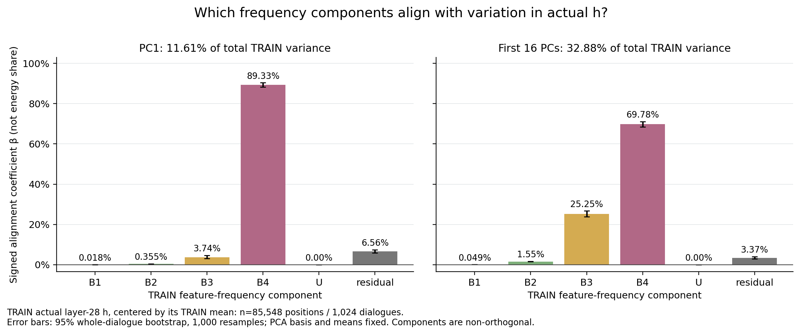
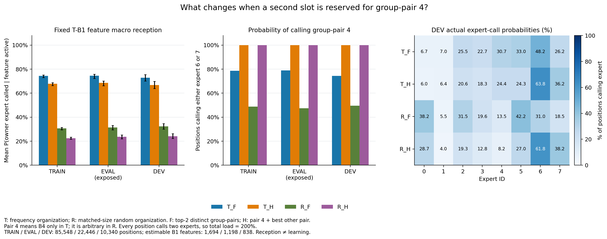
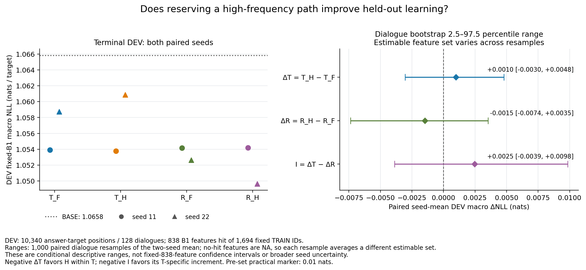

# Frequency-mixed representations and forced high-frequency-path calls

**The representation analysis and all four learning conditions, each with two paired seeds, are complete. This round did not support the hypothesis that forcing a high-frequency path improves learning on inputs containing low-frequency features.** This narrows the intuition that a high-frequency component should receive a fixed expert slot whenever rare features occur. It does not establish that shared structure is useless or that frequency-based routing must fail. This is an AI-derived, bounded interpretation of the frozen design; the researcher's mechanism judgment and next decision remain pending.

Read this page first. The [Detailed record](detailed.md) contains the setup, negative results, recovery, and provenance. The [model and inference note](model_and_inference.md) distinguishes the mathematical objects; the [mentor-intuition audit](mentor_intuitions_audit_cn.md) examines all 18 extracted intuitions.

## Purpose, model, and falsifiable prediction

The goal is to use feature frequency to organize added expert computation so that inputs containing low-frequency features learn better. A feature is an index in the frozen CrossCoder dictionary. Frequency is its positive-activation rate on TRAIN answer-prediction positions, not token frequency or knowledge difficulty.

We reused aligned Tulu instruction–answer caches. Qwen3-0.6B Base, its output head, and CrossCoder remained frozen. Eight ordinary FFN experts were added as a residual branch **after actual model block 28 and before the original final RMSNorm**. Each position calls two distinct experts; their residual outputs receive weights of 1/2 and are added to the complete original hidden state. The branch has 25,165,824 trainable parameters, of which 6,291,456 expert parameters are active per position. The original Base computation remains available, and every called expert receives the full representation.

T organizes the positive-frequency feature pool into four TRAIN frequency bands, each split equally between two experts. R randomly rearranges the same pool while preserving all eight group sizes. Scoring, architecture, paired initialization, data order, and one-epoch budget are matched:

| Condition | Feature organization | Two calls at each position |
|---|---|---|
| T_F | Frequency bands | Select the two highest-scoring bands, then one expert within each |
| T_H | Same T lists | Always call the highest-frequency band, plus the best remaining band |
| R_F | Size-matched random lists | Freely select two group pairs |
| R_H | Same R lists | Always call the predetermined fourth pair, plus another pair |

R's fourth pair has no high-frequency interpretation. T's within-band split does not use the previous φ relation groups, so this round does not test φ utility. Shared z is still jointly encoded from 14 layers; only the final-layer decoder is used for the routing-amplitude proxy.

The learning hypothesis predicts that the forced path reduces held-out B1 feature-macro NLL relative to free selection, with a larger benefit under frequency organization than under the matched random organization. A live rival is that high-frequency features mark broad or high-variance components, while the forced call displaces another useful expert without adding task-relevant computation.

## Finding 1: Mixed representations do not identify a common expert

In these TRAIN/EVAL/DEV panels, every position containing a B1 feature also contains a B4 feature. A current-token-ID predictor fitted only on TRAIN predicts the DEV B1 amplitude share with R² = 0.4335 over all positions. R² is 0.6868 on TRAIN-seen IDs, but 1,636 of 10,340 DEV positions have unseen IDs; the seen subset cannot stand in for the full panel. Variation remains within the same ID, and unexplained variation cannot simply be called contextual semantics.

PCA fitted to centered, real TRAIN hidden states explains 11.61% of total variance with PC1 and 32.88% with the first 16 directions. Within these predetermined subspaces, DEV B4 reconstruction vectors have signed alignment coefficients of 90.13% and 68.30%, respectively. **Alignment with leading variation is neither equivalence to the mean nor ownership of 90% of all information.** The dictionary is nonorthogonal; offsets, reconstruction residuals, and cross-terms are retained. All centering uses the respective frozen TRAIN means: DEV is not re-centered, so DEV beta also includes split-mean shifts and is not a covariance about the DEV mean.

Figure 2 separates variance coverage from signed component alignment. Its vertical quantity is not an exclusive energy share. See the [geometry source table](tables/geometry_signed_components.csv). A negative projection along the old mean direction and positive alignment with centered variation answer different questions and can coexist.

In an exploratory appendix, 114 B1 features with at least five DEV hits have an event-weighted selected-companion hit rate of 58.15%, versus 20.10% for frequency-bin-matched random companions: +38.06 percentage points. Some association therefore exceeds this matched-background comparison, but token identity, source, and context are not isolated, and functional dependence is untested. The appendix was registered after some DEV representation results had been read; it is not independent confirmation. Its macro bootstrap also has a changing-support-set limitation described in the Detailed record.

## Finding 2: Changing reception is different from improving learning

On DEV, mean per-feature B1 reception falls from 72.76% in T_F to 66.75% in T_H. R_F and R_H achieve 32.38% and 24.08%. The forced path uses one call slot, but no high- or low-frequency information is removed from the experts' complete hidden input.

Figure 3 separates owner reception, calls to the predetermined fourth pair, and expert load. Two calls per position mean total load is 200%. See the [source table](tables/routing_summary.csv). These measures describe opportunities to receive updates, not task loss or expert function.

## Finding 3: The predicted extra learning benefit was not observed

Every model trained on 85,548 answer targets in 168 updates. DEV has 128 dialogues and 10,340 positions; terminal loss was evaluated only after all eight models completed. Of the predetermined 1,694 B1 features, 838 have DEV hits and 856 remain NA. None has 20 DEV hits. Lower NLL is better; units are nats.

| Condition, mean of two seeds | Overall NLL | B1 feature-macro NLL | Mean NLL on unique B1-containing positions |
|---|---:|---:|---:|
| Original Base | 1.24887 | 1.06584 | 1.06049 |
| T_F | 1.22614 | 1.05632 | 1.06189 |
| T_H | 1.22714 | 1.05731 | 1.06276 |
| R_F | 1.22720 | 1.05339 | 1.05525 |
| R_H | 1.22698 | 1.05192 | 1.05346 |

Overall NLL improves relative to Base in every condition. That does not certify frequency organization. T_F improves B1 macro NLL but slightly worsens the position mean, illustrating the different weighting of these two quantities.

Define Delta_T = T_H − T_F, Delta_R = R_H − R_F, and interaction I = Delta_T − Delta_R. Both Delta_T and I must be negative for the predicted direction.

| B1 macro-NLL difference | Paired-seed mean | Frozen dialogue-resampling 2.5–97.5% range |
|---|---:|---:|
| Delta_T | +0.00099 | [−0.00304, +0.00479] |
| Delta_R | −0.00147 | [−0.00737, +0.00353] |
| I | +0.00246 | [−0.00389, +0.00984] |

Figure 5 retains both seed values and the paired differences with a zero reference. Delta_T is −0.00015 for seed 11 and +0.00213 for seed 22. The directions disagree; the primary point estimates fail the support rule, the ranges cross zero, and the changes are smaller than the predetermined practical marker of 0.01 nats. Features absent in a resample leave that draw's macro mean, so these ranges do not guarantee reliable confidence coverage for the original fixed set of 838 features. **The round does not support the hypothesis and does not establish universal harm from forced high-frequency calls.** Original tables and ranges were retained; no alternative test was selected to rescue the result.

## What changes, and what remains open

Retain the evidence for mixed representations, high-frequency alignment with leading variation, and selected cross-frequency associations beyond matched random companions. Narrow the claim that these facts justify reserving an expert slot for the high-frequency list. Higher owner reception did not automatically yield lower held-out loss.

The fixed 16-feature text review contains 50 available display slots, including duplicate random/high-activation positions. The four lowest-band examples have DEV supports of only 1/0/1/1 and cannot be named reliably. Common punctuation or word-form proxies account for only a small portion of the high-frequency features' hits. Frequency bands cannot be certified as common/unique semantic modules, gradient-interference classes, knowledge difficulty, or capacity.

**AI suggestion for the single next question:** Do the experts assigned the high-frequency list provide task benefit that survives a controlled call-replacement test, or does frequency mainly label representation background? If pursued, use the fixed trained checkpoints and preserve the two-expert budget during replacement. This has not been started. Mechanism judgment and further authorization remain with the researcher.

This round is stopped. All 8/8 models, five figures, feature-level source tables, text evidence, asset registrations, and the Daily entry are delivered. The failed job and recovery evidence are preserved. Base/CrossCoder were not retrained; no commit or push was performed.

The user-requested [frozen diagnostics of 2026-10-21](diagnostics_20261021/results.md) were executed: replacement structure and paired-position heterogeneity are established, while local residual comparisons remain limited by disagreement with the old NLL replay. They neither replace this primary result nor promote a mechanism conclusion.
