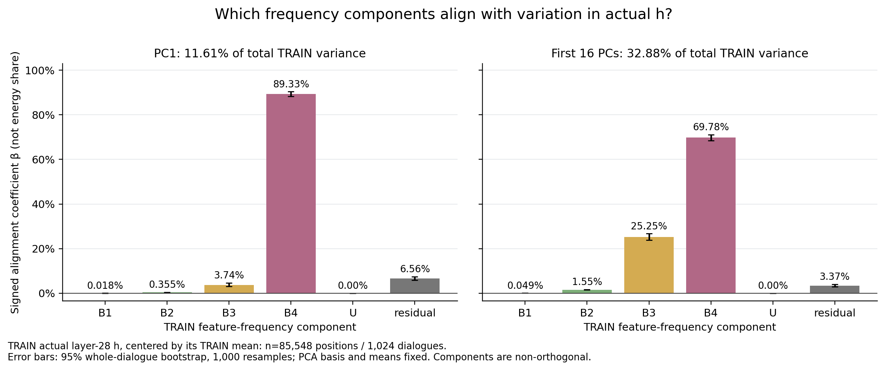
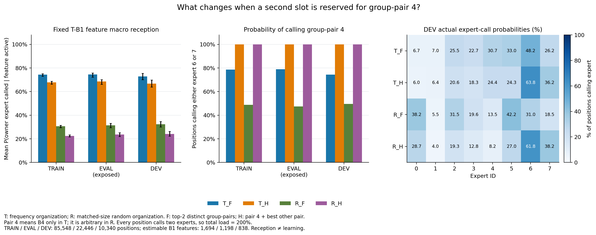
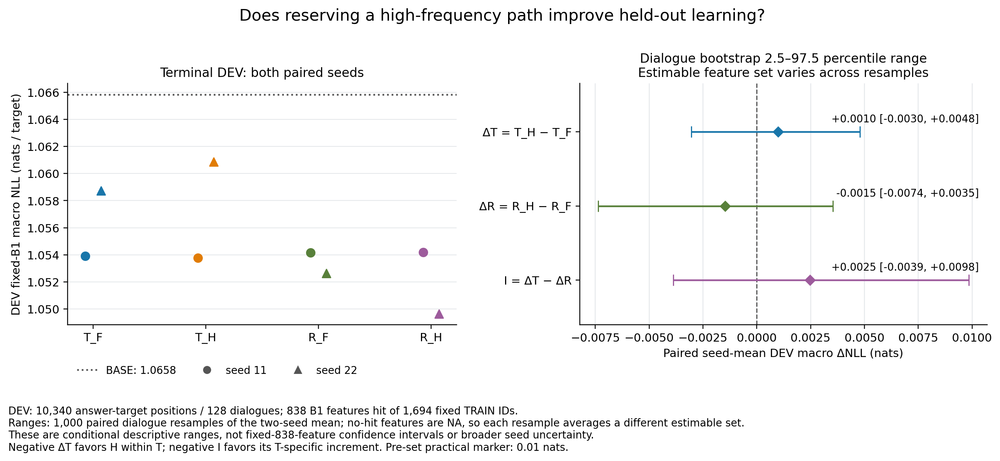

# 频率混合表征与高频路径调用：本轮认识更新

**本轮完成了表征分析及四条件、两配对种子的学习实验。没有得到“固定调用高频路径能改善低频输入学习”的证据。** 这个结果缩小了“低频输入同时含高频成分，所以应固定调用高频专家”的直觉；它没有否定共同规律可能有用，也没有证明按频率分发必然无效。以下为AI依据冻结设计的有界解释，研究者对机制与下一步的判断待讨论。

先读本页；完整设置、负结果、修复及源表见[Detailed](detailed_cn.md)，数学桥见[模型与推断说明](model_and_inference_cn.md)，导师18项直觉见[逐项审计](mentor_intuitions_audit_cn.md)。

## 目的、模型与可证伪预期

我们希望按feature频率安排新增专家计算，让包含低频feature的输入学得更好。这里feature是冻结CrossCoder字典的编号，频率是TRAIN答案预测位置中其激活为正的比例，不是token词频或知识难度。

本轮复用Tulu自然语言指令—回答缓存。冻结Qwen3-0.6B Base、输出头和CrossCoder，在**实际第28层residual-post、原最终RMSNorm之前**加入8个普通FFN专家。每位置调用2个不同专家、输出各乘1/2，再加回完整原hidden。共训练25,165,824个旁支参数；每位置活跃6,291,456个专家参数。Base仍提供原计算，专家输入始终含完整表征。

T先按TRAIN频率分四段，每段名单均分给两个专家；R将同一feature池随机重排，严格保持八组人数。四臂使用相同评分、结构、初始化配对、数据顺序与1轮训练预算：

| 条件 | 名单 | 每位置的两个调用 |
|---|---|---|
| T_F | 按频率组织 | 自由选分数最高的两个频段，每段选一个专家 |
| T_H | 同上 | 固定调用最高频段，再选其他一个频段 |
| R_F | 匹配人数的随机名单 | 自由选两个组对 |
| R_H | 同上 | 固定调用预定第4组对，再选其他一个组对 |

R的第4组对没有高频含义。T的段内均分也没有使用旧φ关系组，因此本轮不验证φ效用。共享z仍来自14个层的联合编码；只用末层decoder计算路由幅度代理。

假设是：固定高频路径相对自由选择能改善最低频段B1的留出NLL，且增量超过随机名单上的同型固定调用。竞争解释是：高频feature只标记普遍或大方差成分，固定调用挤占其他专家机会，并不增加有用任务计算。

## 认识一：混合表征存在，但不能据此指定一个共同专家

在本批TRAIN/EVAL/DEV中，包含B1 feature的位置全部也含B4 feature。只在TRAIN拟合的当前token ID均值预测器，对DEV的B1幅度份额得到全部位置R²=0.4335；TRAIN已见ID子集为0.6868，但有1,636/10,340位置的ID未见，不能只报告已见子集。同一ID内部仍有变化，不能把全部剩余量归为上下文语义。

真实hidden中心化PCA的第一主方向只覆盖总方差11.61%，前16方向覆盖32.88%。在这两个预定子空间内，DEV中B4重建向量的有符号对齐系数分别为90.13%和68.30%。**高频向量与主要变化方向对齐，不等于高频就是均值，也不等于占有90%的所有信息。** 向量非正交，偏置、残差和交叉项已保留。

图2展示TRAIN拟合空间的组成及复核，纵轴是有符号对齐系数，不是能量份额。关键数据见[几何源表](tables/geometry_signed_components.csv)。旧均值方向的负投影和本轮中心化变化的正对齐并不矛盾；它们问的是不同问题。

探索性补充中，对DEV支持至少5次的114个B1 feature，TRAIN预选8个高频伴随项的事件加权命中率为58.15%，频率匹配随机为20.10%，差38.06个百分点。它提示不是所有共现都只是统一背景，但仍未控制token、来源和上下文，也不证明功能依赖。该补充在部分DEV表征已读后登记，不作为独立确认；宏平均重采样另有支持集合变化风险，见Detailed。

## 认识二：接收机会改变，与学习改善是两件事

DEV中最低频feature的逐feature平均接收率从T_F的72.76%降为T_H的66.75%；R_F为32.38%，R_H为24.08%。固定路径确实占用一个调用槽，但完整hidden并未删掉任何高频或低频信息。

图3把目标接收、固定组对调用和专家负载分开。每位置调用两个专家，所以总负载为200%。[源表](tables/routing_summary.csv)。这些指标描述调用机会，不能代替loss或功能测量。

## 认识三：本轮没有跨过“高频调用→额外学习收益”这座桥

所有模型均训练85,548个答案目标、168次更新。DEV共128对话、10,340位置，只在八模型完成后计算终点loss。B1预定1,694项中838项在DEV有命中、856项为NA；没有任何一项达到20次DEV支持。NLL越低越好，单位为nats。

| 条件，双种子均值 | 整体NLL | B1逐feature宏NLL | 含B1位置平均NLL |
|---|---:|---:|---:|
| 原Base | 1.24887 | 1.06584 | 1.06049 |
| T_F | 1.22614 | 1.05632 | 1.06189 |
| T_H | 1.22714 | 1.05731 | 1.06276 |
| R_F | 1.22720 | 1.05339 | 1.05525 |
| R_H | 1.22698 | 1.05192 | 1.05346 |

各条件的整体NLL均比Base低，但这并不认证频率分组有效。特别是T_F的B1宏平均改善、含B1位置平均却略差，说明两个统计单位不能混用。

主比较定义为：Delta_T=T_H−T_F；Delta_R=R_H−R_F；交互量I=Delta_T−Delta_R。只有Delta_T和I都为负，才符合预期方向。

| B1宏NLL差 | 双种子均值 | 预定对话重采样2.5%—97.5%范围 |
|---|---:|---:|
| Delta_T | +0.00099 | [−0.00304, +0.00479] |
| Delta_R | −0.00147 | [−0.00737, +0.00353] |
| I | +0.00246 | [−0.00389, +0.00984] |

图5左边保留两种子原值，右边给配对差及零线。T的两种子Delta_T分别−0.00015、+0.00213，方向不一致；主点估计未满足支持条件，范围也跨0，且小于预定0.01 nats实用量级。重采样中零命中feature会退出当次宏平均，故不能把范围当作固定838项均值的可靠置信覆盖保证。**这轮不支持假设，也不足以宣布固定高频调用普遍有害。** 原表和原区间全部保留，未换检验挽救结果。

## 现在保留什么、缩小什么

保留：低频输入是混合表征；高频与主要变化方向有关；一些高频伴随超出匹配背景。缩小：这些事实并不足以推出固定高频路径应该占一个专家槽。接收率高也没有自动带来更低的留出loss。

对于“更合适的频率分发”，当前不推荐把固定高频槽作为已证有效的改进。动态多频段方案可以保留为候选，但它也未显示出对匹配随机名单的低频学习优势，本轮没有认证一个最佳频率router。

固定16个feature的50个可用文本展示槽（随机／高激活／同ID未激活，位置可能重复）已逐项阅读。最低段四项的DEV命中仅1/0/1/1，无法稳定命名；高频的常见标点或词片代理也只覆盖其一小部分命中。因此不能把本轮频段命名为common/unique语义模块，不能推断梯度干扰、知识难度或容量。

**AI建议的唯一下一问题：在固定已训模型和相同输入上，高频名单对应的专家是否提供可替换检验的任务收益，还是频率只标记了表征背景？** 如继续，应先做保持两专家预算的固定权重调用替换诊断，区分专家实际功能与名单标签；本轮未自动启动。最终机制判断与后续批准仍待研究者讨论。

本轮任务停止。完整学习矩阵8/8完成，五图、逐feature源表、文本、资产登记和Daily入口齐备；曾失败任务及修复均保留。没有重训Base/CrossCoder，也没有commit/push。

2026-10-21用户要求的后续[冻结诊断](diagnostics_20261021/results_cn.md)已执行：明确了替换规则与逐位置异质性，本地残差比较仍受旧NLL重放不一致限制。它不替换上述原主指标或提升机制结论。
