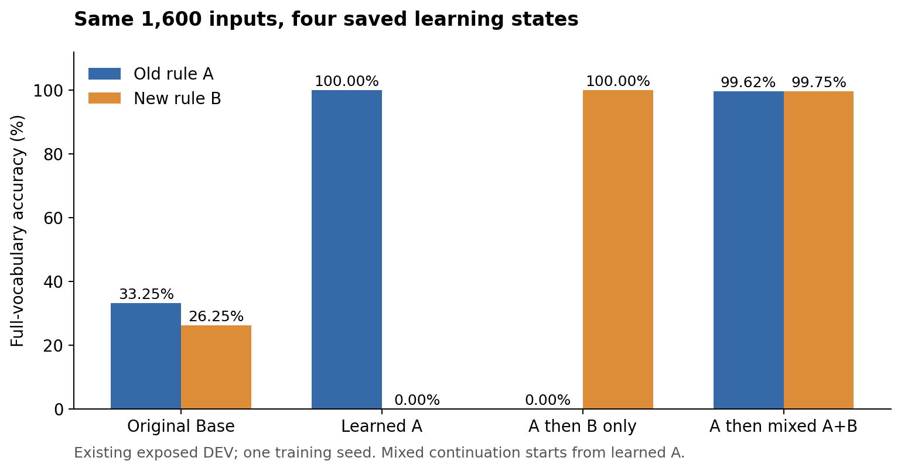
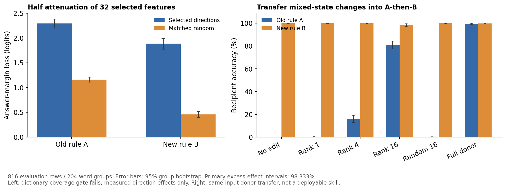

# 学习经历如何改变条件规则的表征，以及哪些方向对任务作答最重要？

**本轮找到了能恢复多数旧题作答的 16 维状态变化子空间，但尚未识别出独立、可跨任务复用的规则模块。** 在独立于本轮选择的 816 条评估样本上，将混合模型与顺序模型之差投影到这 16 个方向，再移入顺序模型，旧任务准确率由 0% 升至 **80.88%**；等维、等扰动范数的随机对照平均为 **0.12%**。新任务准确率从 100% 降至 **98.28%**。现有 CrossCoder 的整体重建资格未通过，所以不能把其特征列表当作完整机制分解。

这是一个训练种子、已有且已暴露 DEV 上的探索结果。方向在发现集选定，但每题转移多少仍使用该题混合模型的表征；本轮没有得到只靠顺序模型就能工作的修复器。[主要证据](evidence_tables_cn.md#主要对比) · [全部干预](evidence_tables_cn.md#全部-253-个干预条件)

## 目的：从学习结果不同，追到哪些变化真正影响答案

我们关心的不是怎样画出更复杂的特征关系，而是：同样的输入经过不同学习经历后，表征哪里改变；哪些改变会影响作答；这些方向是否已经足以解释同时掌握两套规则。

题目含可见模式、口令和三个词。旧任务 A 中，甲取首词、乙取末词；新任务 B 在另一模式下反转映射。例如“红 黄 牛”：模式一加甲应答“红”，模式二加甲应答“牛”。比较原始 Base、学会 A、A 后只学 B、A 后混合学 A+B 四个已保存状态。所有参数在本轮冻结。最后一个状态从已学会 A 的模型继续学习，并非从 Base 开始混合训练。[数据说明](dataset_guide_cn.md)

我们预期，按作答影响选出的方向会比等幅度的一般扰动更重要。竞争解释是：所谓重要方向只是高频背景、输出偏置或任意大扰动。以下三个分析路径分别给出行为、表征和受控干预证据。

## 1. 行为与因素对照：先确认四个模型到底会什么

| 状态 | 旧任务 A 准确率 | 新任务 B 准确率 |
|---|---:|---:|
| 原始 Base | 33.25% | 26.25% |
| 学会 A | 100% | 0% |
| A 后只学 B | 0% | 100% |
| A 后混合学 A+B | 99.625% | 99.75% |

这是全部 1,600 条 DEV 的全词表准确率，每个任务 800 条。只改变模式、保持口令和列表不动时，学会 A、A 后只学 B、混合状态分别有 **0.125%、0%、99.625%** 的配对改变预测。前两者会随甲乙变化作答，却几乎不随模式切换；混合状态的行为可以同时满足两个模式。该观察描述输入与输出的关系，尚未定位内部规则实现。[行为表](evidence_tables_cn.md#原生行为) · [配对因素记录](/data/250010109/MoE_Router/experiments/20261023_learning_history_representation/full/behavior_factor_checks.json)

读图：蓝色为旧规则，橙色为新规则。只学 B 后，变化是两个规则的正确性互换；混合继续学习能兼顾两者。两端点的 B 暴露不同，因此这幅图不单独证明学习顺序的因果作用。

## 2. 表征与层间组织：变化集中在哪里，CrossCoder 能否读准

已有训练只改变最后一块注意力的 Q/K/V/O 参数。对全部同输入样本，所测的前十三个早期层残差逐值相同；变化发生在最后一块。混合与顺序状态的末层余弦相似度平均为 **0.8562**，但差向量范数平均仍为顺序状态范数的 **50.41%**。看起来相似，并不等于作答相同。[原始几何](evidence_tables_cn.md#配对原始几何)

CrossCoder 把十四层一起编码为一个共享激活向量。同一个特征在十四层有不同解码贡献；不是每层各有一套独立特征。因此，共享激活变化不能解释为前面每一层也发生了变化。本轮先检查它能否还原真实表征：四个状态的末层中心化方差解释率均小于零，低于预设 0.8；混合状态整体重建后准确率从 **99.6875% 降至 56.75%**。这说明现有字典及当前接口不能可靠保留本任务所需的表征差异，失败原因不能仅凭本轮归于某一种分布或精度变化。[资格表](evidence_tables_cn.md#字典资格)

[特征热图](figures/03_features.png) 每行是一个候选 ID，颜色只表示它在不同状态和任务中的平均激活相对本行最大值。颜色深不能直接解释为更重要，ID 也不是语义名称。[重建与变化谱](figures/04_qualification_geometry.png) 分别展示工具资格和原始变化的集中程度。

## 3. 功能干预与质量：把“出现”“有影响”“足以恢复”分开

先在 784 条发现样本上选方向，再在 816 条评估样本上修改。评估的 204 个无序词组不参与选择。所有 CrossCoder 修改都加在原始表征上，保留原重建误差；随机对照近邻匹配频率与解码范数，并保持特征数量相同，再逐样本配平实际扰动范数，零支持补救次数为 0。

**CrossCoder 候选有局部作用，但不足以带回旧规则。** 分别按旧/新任务作答影响选择的 32 个候选，有 **30 个重合**。削弱一半后，正确词领先另一端点词的 logit 间隔平均下降 **2.291 / 1.885**；随机对照为 **1.161 / 0.458**。超出随机的损害为 **1.130 [1.037, 1.228] / 1.427 [1.274, 1.575]**，均为 98.333% 组级区间。它们主要降低答案优势，准确率变化很小；把这些候选系数从混合状态移入顺序状态，旧任务准确率仍为 **0%**。最高频的 32 个特征削弱一半后，本次准确率没有下降；出现频率本身不能代替作答重要性。这些集合未被识别为两个分离的任务模块。[候选及完整对照](evidence_tables_cn.md#冻结候选-id)

**原始状态变化的 16 维子空间效果更清楚。** 对每题计算“混合表征减顺序表征”，只在发现集用奇异值分解（SVD）找共同变化方向，再向顺序模型加入相应部分。结果如下；随机对照平均取八个同秩子空间，逐题修改幅度相同。

| 移入顺序模型的变化 | 旧任务准确率 | 新任务准确率 |
|---|---:|---:|
| 不修改 | 0% | 100% |
| 前 1 个变化方向 | 0.25% | 100% |
| 前 4 个变化方向 | 15.93% | 100% |
| 前 16 个变化方向 | **80.88%** | **98.28%** |
| 同秩、等幅随机 16 维 | 0.12% | 100% |
| 完整混合表征替换 | 99.51% | 99.75% |

顺序模型原有的完整表征始终保留，我们只加上 16 维差值；不能说模型只靠 16 维就完成了任务。

这里每个任务 408 条评估样本，故完整替换的准确率与上方全部 DEV 表略有不同。rank-16 的旧准确率 95% 组级区间为 **77.45%–84.31%**；相对随机对照的旧答案间隔改善为 **17.808 [16.739, 18.897]**，后者为预设 98.333% 区间。第一方向虽占变化能量的 **28.34%**，几乎没有恢复旧题；前 16 维占 **75.48%**，才恢复多数答案。**最大变化方向不能直接等同于最重要的作答方向。** [变化谱](evidence_tables_cn.md#发现阶段的变化谱) · [干预表](evidence_tables_cn.md#全部-253-个干预条件)

读图：左图纵轴是答案间隔损失，越高表示这次削弱越伤作答优势；右图纵轴是准确率，比较移入不同变化后是否答对。误差棒为 95% 词组重采样区间；三个主要超额效应另用 98.333% 区间。左图不能证明完整字典分解，右图仍使用同题混合模型作为供体。

一个实际例子贯穿上述步骤：对于“模式一、甲、红 黄 牛”，顺序模型几乎全押“牛”；加入前 16 维变化后，“红”的概率为 **99.81%**。模式二的同题仍以超过 **99.9999%** 的概率答“牛”。这是一个成功例子；总体仍有约 19.1% 的旧题未被该干预恢复，不能以单例代替总体结果。[逐题样例](sample_cards_cn.md)

## 本轮回答与下一问

**直接观察：** 在这两个固定端点之间，一组 16 维原始变化具有超出等幅随机方向的作答作用。**AI 暂定解释：** 它承载了相当一部分能恢复旧题的状态差异；现有 CrossCoder 候选虽有局部影响，却没有给出足以重现该能力的分解。

尚不能判断这 16 维主要携带“根据模式选择规则”，还是具体答案词的信息；也未证明跨任务复用、参数分离、从 Base 混合训练的效应或长期训练收益。一个训练种子、已暴露 DEV、不同 B 暴露，以及需要供体计算每题系数，都限制外推。

**AI 建议下一问：把模式条件与答案词身份分开后，这 16 维的恢复作用是否仍成立？** 研究者的机制判断与下一决策仍为 `Unknown`。执行已完成，问题保持开放。[Detailed 与三类审计](detailed_cn.md) · [冻结 Protocol](protocol_cn.md) · [工程偏差](amendments_cn.md)
