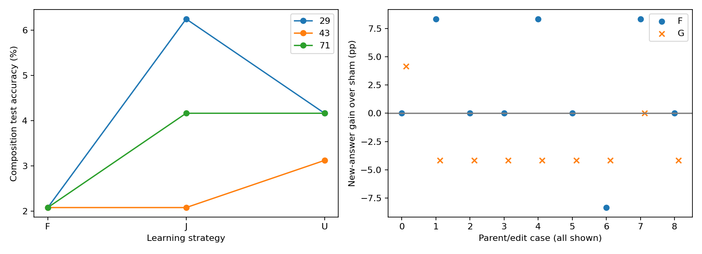

# Detailed: A15_26 / R01 controlled operations

Primary owner: [current A15_26](../../../../problem_anchors/15_spectral_representation_and_functional_routing/15_26_low_frequency_compositional_reuse/15_26_low_frequency_compositional_reuse_anchor.md). Exact scientific design at this round's freeze: [historical snapshot](sources/anchor_at_freeze/15_26_low_frequency_compositional_reuse_anchor.md). [Frozen Protocol](protocol.md) · [Summary](summary.md).

R01 and concurrent order-V2 share the parent owner but have distinct contracts/data/jobs. The current Anchor now includes V2; its later state does not retroactively modify R01. Researcher scientific acceptance remains Unknown.

## Quick result and eligibility

Original atomic maps fit; changed-format competence and held-out composition did not qualify. Every finite registered condition executed. [Full numeric appendix](evidence_tables.md) reports all seeds, capacity checks, revision pairs and carriers; [all trajectories](tables/all_runs.csv) also retain the initial acquisition pilot. The registered experiments completed, but atomic-format and composition guards failed. This round cannot adjudicate reuse after acquiring callable component competence, natural-language benefit or an MoE architecture. Researcher mechanism judgment, next-round choice and question closure remain Unknown.

## How the experiment works

An operation maps one named symbol to another. A composition applies a specified F then G. These are external label semantics. The learner sees a prompt and predicts the next answer token using the complete151936-token vocabulary.32 symbols have stable single-token encodings after actual prompt suffixes. [Task guide](dataset_guide.md) defines splits and controls; [measured sample cards](sample_cards.md) follow actual predictions.

Atomic TRAIN has256 rows covering every operation/input. Atomic-format256 changes wording. Each16 operation pair contributes20/6/6 composition inputs,320/96/96 total. No within-pair input overlaps TRAIN/VAL/TEST. Model-independent integer balancing fixes input/answer counts as well as F/G marginals. Data seed20261024 selects one task world; seeds29/43/71 are repeated training trajectories within it. Pre-freeze imbalanced data were archived and never trained on. A reporting-time audit finds unmatched F–input/G–intermediate joint counts despite matched registered marginals; the exposure contrast therefore also changes specific component-map practice. TEST holds out pair-input mappings, not symbols or whole pairs.

P learns relevant maps; C learns alternate maps under matched format/vocabulary/budget; B remains Base. Help compares these parents under identical later composition teaching. Correct pretraining is extra supervision compared with B; C controls its amount and format. Wrong C mappings can create negative transfer. U updates original selected weights; F freezes them and trains a new adapter; J trains the same adapter and originals. Balanced/skew/swap preserve46,080 targets, each F/G11,520, each input/answer1440. Pair targets are2880 balanced versus5120/640 under skew, reversed under swap.

Revision changes only F0 or G0 tables (fixed derangements601/607/613), paired with sham old-label teaching. Each1024-update batch contains16 revised-operation examples and16 other original-operation rehearsal examples. No composition labels are taught. New expected composition answers are computed externally for TEST, with24 affected and72 unaffected rows per role. Baseline competence and post-edit preservation are required before interpreting transfer.

State tests use original atomic P donors. Centered32 intermediate-symbol means from128 F training states define candidate subspaces at final attention output and final block output. VAL96 selects attention rank8/16, with smaller rank on ties. TEST96 receives locked directed/same-intermediate/other-surface/no-op/five random/half-dose/late/remove conditions. Alternate intermediate values force expected G(z′) to differ from both original and donor answers. Random changes match candidate rank and perturbation norm per example. Late output edits are diagnostic. Remove-then-restore equals same-intermediate replacement algebraically, so it is not counted as independent evidence. No-op confirms unchanged predictions, not full logits equivalence. The half-dose raw `norms` field records the candidate delta before alpha scaling; its applied norm is half that field. This metadata limitation does not change the measured predictions or the full-dose random norm matching.

## Model, fitting and numerical contract

Exact `/data/share/Qwen3-0.6B-Base`: config SHA `504a6b58c4271583724e66584b6b7698aea18450209df6b2f7582df0e89cee59`; weight SHA `cd2a512003e2f9f3cd3c32a9c3573f820bb28c940f73c57b1ddaa983d9223eba`. First27 native blocks remain fixed; their output is cached in FP32. Native final block, position handling, normalization and original head execute. Cache/native replay has zero maximum logit difference and equal argmax on all1024 dataset rows.

The initial pilot trains final q/k/v/o projections (6,291,456 parameters),1440 updates. Its failed format guard triggers the single full-final-block repair (15,730,944 parameters),2880 updates per P/C seed. Composition and revisions use this repaired range; the first27 blocks and head stay frozen. Adapter B·GELU(Ah) is added to native attention output before residual addition; rank32 adds65,536 parameters, rank128 adds262,144. B starts zero, A normal. F/J have bitwise equal initial outputs to the same parent in Smoke. An adapter is an intervention, not a discovered module.

All formal learning uses FP32 deterministic native SDPA, TF32 off, answer-only full-vocabulary CE, AdamW lr1e−4, betas(.9,.999), eps1e−8, decay0, clip1, foreach/fused false, constant schedule. Global batch32 is four microbatches8. One answer token per example gives32 actual targets/update. No auxiliary loss. Each stage starts a fresh optimizer intentionally; matched seed controls order and adapter initialization. Telemetry records LM/total loss, LR, updates and actual answer targets on their specified coordinates; no prompts are counted as supervised answer tokens.

Milestones are0,1,2,8,32,128,360,720,half and final when distinct/in-range. Saved states include trainable tensors, optimizer, scheduler, RNG, cursor/order hash, token/update counters, exact Base and parent references. They are delta states requiring their declared parent, not standalone models. F versions are checked every update. Smoke verifies external-process2→3 continuation against uninterrupted3 updates exactly for weights/optimizer/RNG/scheduler/counters; it does not independently resume every endpoint.

## Protocol conformance before interpretation

| Item | Registered / actual | Status and impact |
| --- | --- | --- |
| Authority | Explicit full delegation; no total GPU limit; single Reserved preferred | Same scope; one H100 throughout |
| Identity | Protocol frozen2026-10-24T15:53:59Z; dataset SHA a394a653…c1614f | Identity checks pass; exact hashes in provenance |
| Acquisition | Attention pilot1440; at most one final-block2880 repair | Triggered on seed29 changed-format guard; all P/C seeds repaired, no relaxation |
| Composition | P U/F/J ×3 exposure ×3 seeds; B/C balanced U ×3 | All33 executed; original-frequency identities retained |
| Capacity | If rank32 F train<95%, balanced rank128 F/J all seeds | All6 executed; primary rank32 retained |
| Revision | 3 parents ×2 roles ×3 derangements ×edit/sham;1024 updates | All36 executed; downstream mechanism ineligible |
| State tests | Atomic-parent donor; VAL rank choice; locked TEST controls | All36 confirmation conditions executed; exploratory |
| Engineering | E01 failure-state handling; E02 input registration; E03 output path | No scientific value change; original snapshots and failure retained |
| Retry | Path-fix job later failed on storage ENOSPC during last revision save128 | 81 cases reused; complete32 restored; no partial128 resume |
| Qualified resume | Actual block1→2 exact state replay before32→1024 | Prefix telemetry rebuilt; metrics33..128 replay exactly; no scientific change |
| Higher-order exposure audit | Registered marginals match; finer joint counts differ | Posthoc reporting audit D01; exposure claim bounded, data unchanged |
| Missing / exclusions | No primary condition missing; no result-based exclusion | Scientific acceptance and closure Unknown |

Source/config/data hashes are frozen in [design_frozen](provenance/design_frozen.json); operational main-job v3 and recovery v4/v5 are separately hashed in [v3](provenance/actual_full_source_manifest_v3.json), [v4](provenance/actual_full_source_manifest_v4.json), and [v5](provenance/actual_full_source_manifest_v5.json). File hashes are provenance, not a claim of complete bytecode attestation. Failed full-job evidence is retained; no scientific thresholds or supervision changed on retry.

## Measurements, criteria and uncertainty

Accuracy is native argmax equal to the specified answer; CE uses the full vocabulary. Original-format versus changed-format atomic performance are distinct. Help requires≥5pp over both controls, positive each seed; exposure requires same-pair high−low≥5pp with consistent direction. Frozen success requires95% composition,90% low-frequency subset, atomic mean loss≤1pp/every operation95%, and F no worse than J by2pp. With96 TEST rows, failure to detect a difference cannot establish2pp equivalence.

Revision requires a qualified parent/combination, revised and unchanged atomic operations≥95%, unaffected edit−sham≥−2pp, new answer≥80% and≥20pp gain. Carrier confirmation requires qualified native/retained atomic performance, directed answer≥80%,≥20pp gap over random, preserved same-intermediate/other-surface behavior within2pp. These guards failed; speculative mechanism conclusions cannot be repaired by averaging exploratory effects.

Paired resampling clusters fixed TEST rows by input symbol,5000 draws,seed20261024; primary intervals98.333%, secondary95%. Group sums/counts preserve original row weighting. Intervals condition on fixed tables, split and trained parents; they do not bootstrap independent task universes or fully cover training randomness. Three seeds are shown separately. Per pair n6; a correct answer changes pair accuracy16.67pp. Every final and learning curve remains visible; no TEST-derived checkpoint selection.

## Evidence lineage

All raw paths below are relative to `/data/250010109/MoE_Router/experiments/20261024_a15_26_compositional_reuse`. The table connects each measure to its registered criterion and curated evidence.

| Result | Raw observation | Computation / criterion | Curated evidence | Eligibility |
| --- | --- | --- | --- | --- |
| Atomic competence | runs/acquisition/*/evaluations/step_002880.json | accuracy per32 rows/operation; each≥95% | tables/factual_results.json | Format qualification failed |
| Explicit composition | analysis/positive_{seed}.json | compose exhaustive atomic predictions; n96 | tables/factual_results.json | Positive control; extra calls/interface |
| Help | runs/combination/{P,B,C}_{seed}_balanced_U/test.json;curve.json | paired final accuracy and VAL AUC; P−B/C≥5pp, all seeds positive | tables/help.csv;learning_curves.csv | BOUNDED; ≥5pp/consistent-sign prediction not met; callable premise failed |
| Exposure | P_{seed}_{skew,swap}_U/test.json | same-pair high−low; input-cluster5000 bootstrap;≥5pp | tables/exposure.csv;pairs.csv | BOUNDED; ≥5pp positive prediction not met; finer component-map exposures differ |
| Freezing | P_*_{F,J}/test.json;final evaluations | combo95%,low90%,atomic retention and F−J≥−2pp | tables/freeze.csv;all_runs.csv | INELIGIBLE for reuse; tested freezing success criterion not met |
| Capacity | runs/capacity128/* | prespecified training-capacity check | tables/all_runs.csv | Secondary; never substitutes rank32 |
| Revision | runs/revision/*/revision_evaluation.json | new edit−sham≥20pp,new≥80%;atomic/unaffected guards | tables/revisions.csv | All baseline-ineligible |
| Carrier | analysis/interventions/{seed}/test_results.json | directed≥80%,random gap≥20pp;native95% and preservation | tables/factual_results.json | All baseline-ineligible |
| Execution fidelity | TensorBoard;step JSON/PT;Smoke;data audit | full coordinates,finite losses,count/save/replay guards | provenance/final_output_audit.json;smoke.json | Engineering PASS; no mechanism implication |

## Complete numeric results and figures

[Full tables](evidence_tables.md) are this record's numeric appendix. [Figure sources](figures/SOURCES.md) give origin, units, axes, aggregation and limitations. Learning curves show matched composition targets, not independent observations. The freezing/transfer plot shows all seeds/edits including ineligible cases; it cannot establish a usable frozen path or causal reuse.

The left panel compares balanced U/F/J TEST for each seed. The right shows affected new-answer edit−sham differences for all nine edits per role. This is descriptive because all baseline guards failed; neither small gains nor degradation isolate a reuse mechanism.

## Failure decomposition and coverage

Data/exposure checks, native replay, exact Smoke continuation, scalar/count/parameter checks passed. The first full failure was our output-path bug, repaired as E03 before any composition TEST result. Later storage ENOSPC interrupted the final revision save128. E04 preserves81 complete cases, losslessly references duplicate files, qualifies actual full-block1→2 replay, and resumes the last case from complete32 with original prefix telemetry. E05 verifies the completed1024 milestone after the redundant end-save fails; the remaining entry performs only measurements. Recovery updates33..128 replay prior metrics exactly; the partial128 file is never loaded. Scientific qualification failed after the finite acquisition repair; every independent registered downstream branch still executed and is labeled bounded/exploratory. No physical prior or unique mathematical neural implementation was falsified. Format binding, interface/depth constraints, optimization and whole-map fitting remain live explanations.

| Stage | Trajectories | Execution | Scientific use |
| --- | --- | --- | --- |
| acquisition | 7 | COMPLETE | Bounded; failed atomic prerequisite |
| combination | 33 | COMPLETE | Bounded; failed atomic prerequisite |
| capacity128 | 6 | COMPLETE | Bounded; failed atomic prerequisite |
| revision | 36 | COMPLETE | EXPLORATORY; no qualified baseline |
| Intervention discovery | 12 VAL candidates;3 parents | COMPLETE | Selection only; no TEST choice |
| Intervention confirmation | 36 conditions;3 parents | COMPLETE | EXPLORATORY; native guards failed |
| Smoke | 3 cases;8 saves | PASS | Engineering qualification only |

Formal totals:82 trajectories,111,744 updates,3,575,808 targets. Family registration inventories788 actual saves (8 Smoke, 780 formal),117,900,159,002 logical payload bytes. Smoke cases are not independent formal replicates. The family inventory includes milestones; it is not a count of models trained from scratch. One additional saved full-block resume probe is separately registered as `checkpoint_a15_26_20261024_recovery_block_probe` outside runs/.96 replayed updates and one probe update are recovery overhead, excluded from planned unique-trajectory totals. [Actual member manifest](provenance/actual_checkpoints_full.json).

## Interpretation, boundary and next decision

The [analysis](result_analysis.md) explains controls. [Conjectures](mechanism_conjectures.md) propose causes; [recognition update](recognition_update.md) changes AI expectations separately. The registered experiments completed, but atomic-format and composition guards failed. This round cannot adjudicate reuse after acquiring callable component competence, natural-language benefit or an MoE architecture. Researcher mechanism judgment, next-round choice and question closure remain Unknown. One AI proposed next decision is whether to establish cross-context callable components before repeating reuse tests. This is not researcher acceptance or an additional run.

[Artifact manifest](artifact_manifest.md) owns run IDs, actual saved assets, access receipts and reproducible entrypoints. No commit, push or external publication was performed.

[Delivery audit](result_audit.md).
