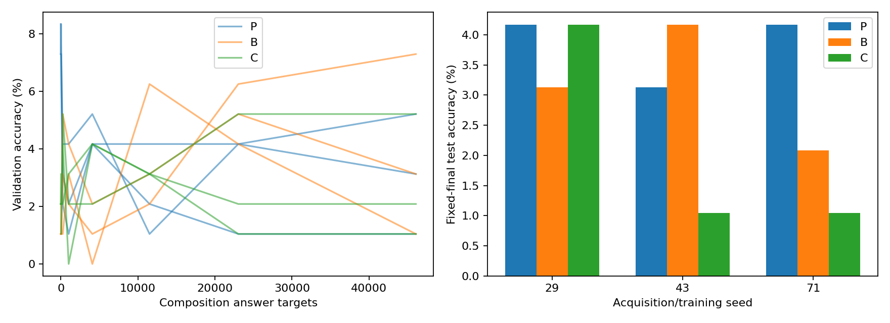

# A15_26 / R01：已有操作的组合学习与复用

**主要事实：原问法的单操作可以全部答对，但没有转化为合格的留出组合能力。** 正确组成预训练P、未训练Base B、另一组操作预训练C的均衡U测试均值分别为3.82%、3.13%、2.08%。P相对两种参照的差值分别为+0.69、+1.74个百分点。[逐种子与区间](tables/help.csv)。

本报告沿三条分析路径阅读：①行为与因素控制，比较曝光和学习条件；②表征与层内组织，记录候选中间状态；③功能干预与测量质量，检查定向改变及其资格。结果分析、原因猜想、认识更新分别成文。

## 目的、任务与假设

核心问题是已有组成计算是否帮助低频组合学习，并实际参与预测。完全冻结旧参数、只学新增路径是更强假设。模型为Qwen3-0.6B Base，前27层固定，训练最后一层或其新增适配器。任务要求对32个符号先执行四个F之一，再执行四个G之一；外部目标y=G_j(F_i(x))，不预设内部算法。[任务解释](dataset_guide_cn.md)。

每个操作对固定20/6/6训练、验证、测试输入，测试留出的是操作对—输入映射。三种曝光都给46,080个组合答案，固定F/G与全局输入/答案边际；更细的操作—输入联合曝光未固定。相关预训练必须同时优于B和C，才能排除部分一般训练解释；内部复用另需合格的操作修订或定向状态干预。F冻结父模型、J使用同结构适配器并联合更新，检验更强冻结主张。

## 决定性测量与资格

| Seed | P TEST | B TEST | C TEST | P−B (pp) | P−C (pp) | VAL AUC P−B / P−C (pp) |
| --- | --- | --- | --- | --- | --- | --- |
| 29 | 4.17% | 3.13% | 4.17% | +1.04 | +0.00 | +1.09 / +1.76 |
| 43 | 3.13% | 4.17% | 1.04% | -1.04 | +2.08 | -2.20 / -0.17 |
| 71 | 4.17% | 2.08% | 1.04% | +2.08 | +3.13 | -1.44 / -0.89 |

组合训练前，P的三种子单操作训练格式准确率均100%；换问法准确率为33.98%、36.72%、38.28%，未达到每项95%资格。此时两次独立调用的显式组合正对照均100%，但增加了调用和中间接口。组合训练后P-U原格式单操作仅8.98%、6.64%、10.94%，同时组合TRAIN均100%、TEST仍低。[资格及正对照](tables/factual_results.json) · [终点保持](tables/all_runs.csv)。

均衡rank32的F、J测试均值为2.08%、4.17%，均未达到组合95%门槛。一次预登记rank128容量检查也完整保留。全部36条操作修订轨迹形成18个edit/sham比较，合格比较数0；三个父种子的36个确认干预条件均已测量，但都未通过原生行为资格。[冻结](tables/freeze.csv) · [修订](tables/revisions.csv) · [干预](tables/factual_results.json)。

左图每条线是一条固定种子的验证轨迹，横轴是实际组合答案监督数；右图给固定终点测试准确率，全部种子展示。曲线与低终点说明本轮没有得到合格留出组合能力；图不显示内部计算，也不把三种子当作三个任务世界。

## 完成与边界

正式矩阵共82条轨迹、111,744次更新、3,575,808个答案监督；另有独立Smoke。有限组成修订、容量修订、全部频率比较、操作修订和候选状态诊断均已执行。详见[完整记录](detailed_cn.md)、[产物清单](artifact_manifest_cn.md)与[输出审计](provenance/final_output_audit.json)。

本轮完成了登记实验，但组成跨问法资格与组合资格均未通过；结果不能裁决“已经获得可调用组成能力之后是否复用”，也不能外推自然语言或MoE收益。研究者对机制、下一轮和问题关闭的判断仍为Unknown。

阅读顺序：[结果分析](result_analysis_cn.md) → [这可能是怎么发生的](mechanism_conjectures_cn.md) → [独立认识更新](recognition_update_cn.md)。这些后两步是受委托的AI分析，尚无研究者科学接受或新运行授权。
