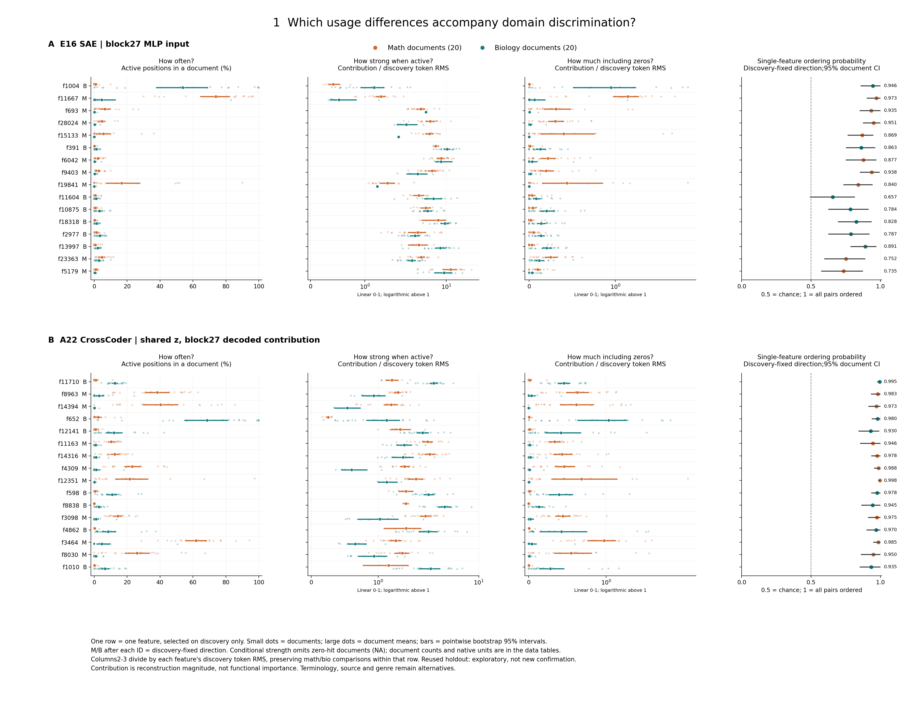
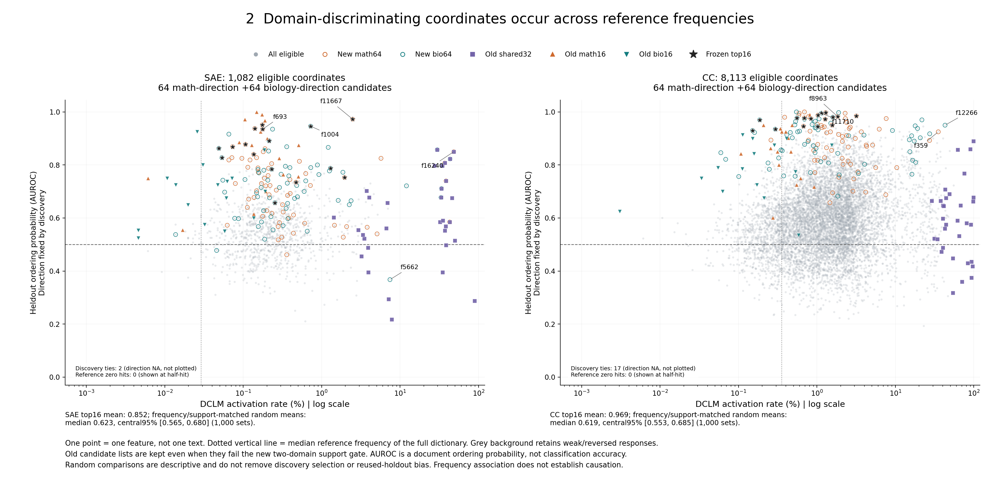
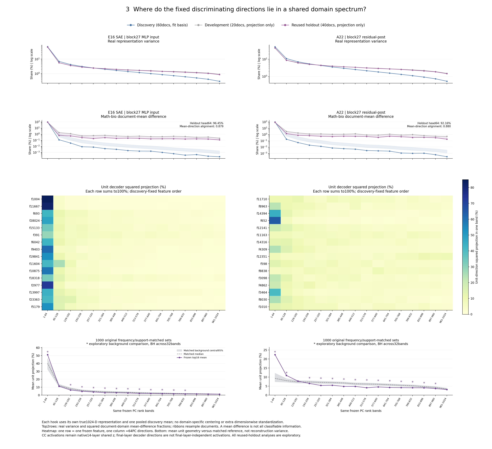

# 三图逐轴解释

## 图1：领域使用与区分

- 问题：同一个坐标的领域差别表现为出现次数、激活时幅度，还是两者都有？
- 一个点／行：每行一个发现集固定feature；小点是一篇留出文档，大点是域内文档均值，横线是分域按文档重采样的95%点态区间。橙色数学，青色生物；ID后M/B为发现固定方向。上排SAE，下排CrossCoder；每排16行，不聚类、不按留出重排。
- 从左到右横轴：①每文档160位置里激活的百分比；②只在激活位置算平均贡献，零命中文档NA；③含零平均贡献；④按发现方向把一数学/一生物文档排对的概率。第②③列为便于逐行比较，除以该feature发现token贡献RMS；0—1线性、1以上对数，原空间值全部在CSV。第四列0.5虚线为机会水平。
- 直接看哪里：SAE f11667的橙色在次数、强度、含零贡献三列都更靠右，排序概率0.9725；SAE f693则次数更高、激活时平均强度并没有更高，不能统一说“数学feature总是用时更强”。后者生物条件强度仅1篇非零文档，支持量写在表中。固定前16的f11604区间跨0.5，是未被删掉的不充分例子。
- 能得出：这批文档的坐标使用差异与领域区分相伴；可以观察次数与强度的方向。
- 不能得出：模型必须依赖它、分类能力由某一项独立造成、排除了词面来源或它是抽象概念。条件均值只在有活动的文档内计算，两个域有效文档不一定相同。

## 图2：区分力与独立频率

- 问题：有区分读数的成员在DCLM频率分布哪里？
- 一个点：一个同字典feature；横轴独立65,536位置DCLM激活率（百分比，对数），纵轴同图1的方向固定文档排序概率。左图SAE，右图CC，不能跨图对齐编号或把两种hook当同一空间。
- 背景：全部合格且发现方向非零的坐标。SAE2个、CC17个发现排序恰为0.5，方向NA，数量在图中注明而非伪造纵轴值。竖虚点线是该字典全坐标DCLM频率中位数。
- 符号：灰点全背景；橙/青空圈分别新64数学/生物方向；紫方块原共有32；上下三角原数学/生物16；黑星固定新前16。原名单即使不满足新双域支持门槛仍保留。部分名单相互重叠，不是互斥簇。
- 直接观察与真实例子：低频SAE f391（0.0488%，0.8625）和高频原共有f16240（48.39%，0.8500）都能提供单坐标区分。反例是仍保留的SAE f5662（7.43%，0.3675），其方向在留出反转；不是所有发现排序好的都复现。
- 匹配背景：固定前16平均排序概率SAE0.8516、CC0.9691；1000个同数量频率/文档支持分箱匹配随机集合的均值中位数0.6228/0.6185，中心95%为[0.5653,0.6803]/[0.5529,0.6855]。这不是随机化p值，不消除发现选优与旧留出再用偏差。其他组匹配不足的完整清单在Detailed，未强制保留候选。
- 能得出：成员分布跨多个频率水平；频率不是领域区分的唯一概括。
- 不能得出：频率造成区分、找到了全字典最重要坐标，或灰点下方的单坐标在组合中无用。图中没有新训练分类器。

## 图3：共同谱中的位置

研究问题：这些区分坐标的decoder方向落在共同表征的哪些变化方向？与真实方差、两域均值差和匹配feature背景相比如何？

**读图顺序。** 左列是SAE的block27 MLP输入空间，右列是CC的block27 residual-post空间，各自独立拟合；两边PC编号不对应。所有横轴都是16个主成分排名区间：第1段PC1—64，最后一段PC961—1024，每段64个方向，既不是频率分桶，也不是模型层号。蓝/灰/紫线分别为发现/开发/原留出，后两者只投影冻结基。

1. 第一行纵轴：真实表征的方差比例（百分比、对数轴）。SAE发现/原留出前64为72.74%/69.39%；CC53.07%/45.29%。前部形状大体保留，尾部在开发/留出相对升高，不能称完整谱逐值复现。
2. 第二行纵轴：数学减生物的文档平均表征差向量，在每段的平方长度占比（百分比、对数轴）。原留出前64为96.45%/92.16%；其方向与发现均值差的cosine约0.879/0.880。这只是两域平均中心差，不是全部可分类信息。
3. 中间热图：一行一个原先固定的前16feature；颜色是单位原空间decoder在该段的平方投影百分比，每行完整1024基合计100%。原空间向量先还原训练尺度，再单位化；没有截断后重新归一化。固定顺序沿用图1，不聚类。深色表示方向的更多平方长度落在这里，不能读成更重要。
4. 最下行：紫线是前16个单位方向的平均投影；灰虚线/灰带是1000组同数量、DCLM频率和文档支持分箱匹配背景的中位数/中心95%。星号表示两字典×16段共32项的探索性背景比较BH q<.05；这不控制发现选优或旧留出再用偏差。

**直接观察。** 两套前16的前64投影51.21%/22.43%，都高于匹配背景的32.71—46.25%/7.42—12.14%中心范围；对应探索性q约0.00376。两套的其余方向仍分布在后续谱段，尤其CC并非全部落在前64。

**真实例子与反例。** SAE f11667有81.95%方向在前64，单坐标文档排序概率0.9725；但f29506有96.75%方向在前64，排序概率只有0.4975。另一边CC f11710排序概率0.995，前64仅10.56%，最大单段是PC129—192。不能只看谱前部，就判断哪个feature有领域区分；也不能把同一64维段内的两个方向视为彼此对齐。

**不确定性怎么读。** 上两行阴影是按文档重采样、冻结基不变的2.5—97.5百分位范围。均值差平方比例是高维非线性量，重采样会加入估计噪声，其范围可偏离原点估计；这里只作为抽样敏感性描述，不当成保证总体覆盖率的置信区间，不据其作显著性宣称。原数值和抽样权重均保留，没有改方法来让范围包含点。

**允许解释：** 固定坐标存在相对于频率/支持匹配背景的谱几何偏置；真实方差、域均值差和feature方向有不同分布。**不能推出：** 前部就是高级语义或全部领域信息，激活频率等于特征值大小，或证明模型实际利用、长程机制、专家分工、簇形成原因。

原未测说明卡保留在`figure3_spectrum_NOT_MEASURED.png`，只记录补取之前的状态，不能与本图混作两次独立实验。
