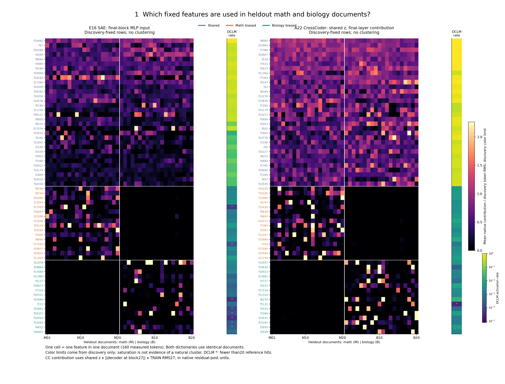
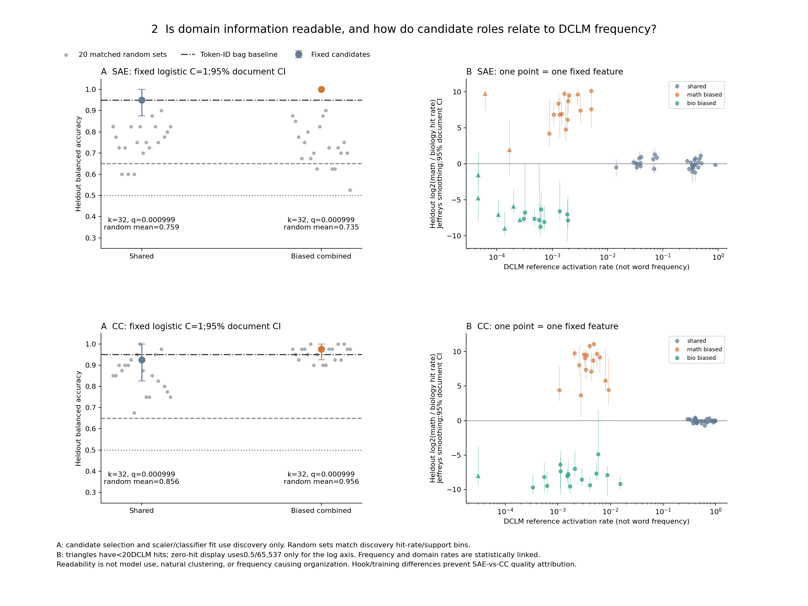
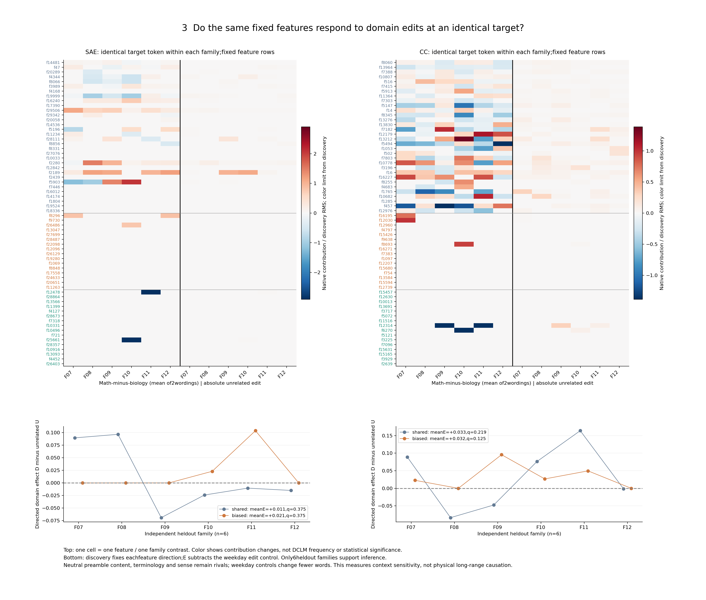

# 三张图怎么读

三张图都使用同一批发现集冻结候选：每字典共享32、数学16、生物16。不是重聚类。行标签灰蓝/橙/绿只是候选角色。SAE和CrossCoder编号彼此独立。

## 图1：留出文档的使用热图

**问题**：发现的领域使用模式能否出现在新文档？**一格**是一个feature在一篇留出文档的160个位置上的平均原空间贡献，除以发现集token贡献RMS。**行**是固定feature，**列**是数学20篇后接生物20篇。旁条为独立DCLM命中率，星号表示<20hits；右侧频率色标用对数，主热图用线性色标且上限由发现集固定，饱和只表示超上限。应先看偏向行能否跨多篇文档保持不对称，再看共享行是否两域均出现。两套heatmap尺度相同不构成不同hook的绝对幅度比较。

**真实例子**：SAE f9730在留出数学命中363/3200、生物0/3200；Positive-definite kernel那篇命中74/160，原空间平均贡献5.21571。**反例**：共享SAE f29506两域命中28.875%/30.875%，但F11两种措辞的数学减生物方向一正一负（归一化差0.97047/−0.02597）。共享使用不保证相同响应或同一功能。

**能得出**：冻结候选在这批留出文档中的使用模式。**不能得出**：无监督发现了自然簇、同色即同语义、字典之间优劣，或某个feature表达整句。

## 图2：领域可读性与DCLM频率

**问题**：固定等维候选能否读出文档领域，其候选角色与参考频率是什么关系？**A大点**是一个32维集合经固定logistic后的留出平衡准确率；纵轴是两类准确率的平均。竖线是2000次整文档bootstrap区间，灰点是20组频率/支持量分箱匹配随机集合；横线含0.5、0.65和token-ID词袋95%。SAE偏向组40篇全对，bootstrap区间[1,1]只是这个小样本无错误，不代表总体准确率无不确定性。

**B一个点**才是一个feature；横轴DCLM参考激活位置比例，纵轴留出log2(数学/生物激活率)，用Jeffreys平滑避免零命中无穷。误差条是整文档bootstrap的描述性95%区间，不是64个feature经多重校正的逐个显著声明。三角是DCLM<20hits；保留，不硬分桶。应看相同参考频率下是否仍有不同领域偏向，不能把频率当成奇异值。

**真实例子**：CC f12314的DCLM频率0.2106%，但留出生物1.9375%、数学0%；SAE f9730的DCLM0.2014%，留出数学11.34375%、生物0%。说明领域内与参考频率不是同一个量。**反例**：CC偏向集合97.5%，匹配随机集合平均95.625%，部分随机集合100%；“可分”不说明指定候选独有领域信息。词袋本身也达95%。

**能得出**：这些有限样本上领域信息可被固定分类器读出，且角色与DCLM频率有描述性关系。**不能得出**：模型实际利用了这些坐标、纯概念、自发自然簇或频率导致形成；共享筛选本来偏爱广泛命中。

## 图3：固定目标的领域编辑与无关编辑

**问题**：文档中选出的同一批feature，换前文后在相同目标token是否还响应？**上图一格**是一个feature/一个留出家族；每字典前六列是两措辞平均的数学减生物贡献，后六列是无关编辑绝对变化，单位都除以发现RMS。红蓝表示差值，白色可能是零或很小值；色标由发现家族固定，不能按图上红色数量裁定显著。**下图一个点**是整个候选集合在一个家族的有向域差D减无关编辑U，即E；方向由发现家族固定。

**真实例子**：F09的CC f12314在末token` method`的最后层重构贡献从数学0变成生物19.35877，两措辞的生物贡献17.73107；组内仅1个成员有相关变化。**反例**：F08的同feature所有版本都是0；CC共享组F08 E=−0.08341，且SAE共享组F09/F10/F11/F12均为负。别把一个有响应案例推广到整组。

**直接观察**：四个集合都未达预设“跨措辞+区间+校正精确检验”联合标准。CC偏向集合E区间虽为正，精确p=.0625、BH q=.125，不能只保留bootstrap结果。SAE偏向32个中28个、CC偏向32个中27个在全部留出目标均未命中。

**能得出**：存在部分局部的领域前文响应，组级跨家族确认不足。**不能得出**：纯概念、物理远距离机制或稳定领域模块。中性前导语补长度、前文术语/词义、星期编辑只改1个词而领域编辑改更多词，仍限制解释。
