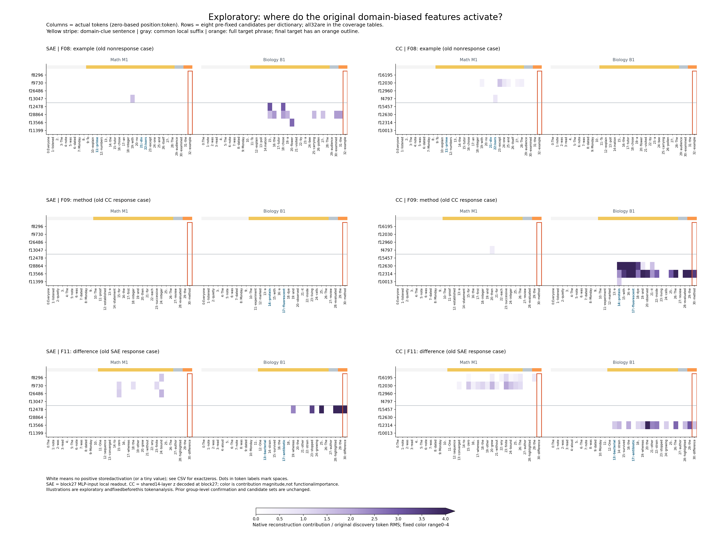

# 探索性诊断：完整核对、token实例与边界

原R04报告、字典、候选、分割和确认结论不改写。本目录所有新增分析均标为探索性；没有新显著性检验或拟合。

## 原结果核对

重新读取61,491,830字节旧zip，SHA256仍为`32cf80b18aa742c1130a10305bff7a0ad2820fadf10d7d6dc74fe9c3a661c055`。包内results.json与执行侧一致。固定分类器用已保存系数和标准化参数重新计算预测，未重新训练。四组预测、随机均值与参考频率一致。

| 字典/集合 | 原留出准确率 | 原95%文档区间 | 20随机均值/范围 | 原目标E/区间 | 原目标q |
|---|---:|---|---|---|---:|
|SAE shared|0.950|[0.875, 1.0]|0.75875 / [0.600,0.900]|0.011256 / [-0.033821719342700375, 0.05825636356914423]|0.37500|
|SAE biased|1.000|[1.0, 1.0]|0.73500 / [0.525,0.900]|0.021146 / [-4.10534019183254e-05, 0.0557977644158446]|0.37500|
|CC shared|0.925|[0.825, 1.0]|0.85625 / [0.675,1.000]|0.032887 / [-0.03629800488552318, 0.101672715198392]|0.21875|
|CC biased|0.975|[0.925, 1.0]|0.95625 / [0.900,1.000]|0.032465 / [0.008273059829156599, 0.06054514533227015]|0.12500|

四个原领域可读性检验q均为.000999；本轮没有新算显著性。原SAE偏向40篇全对，bootstrap区间[1,1]只是样本无错误，不保证总体完美。CC偏向原目标区间>0、精确p=.0625、校正q=.125，没有改写为成功。

| 字典/角色 | DCLM中位激活率 | <20hits候选数 |
|---|---:|---:|
|SAE shared|32.727814%|0|
|SAE math_biased|0.170135%|2|
|SAE bio_biased|0.039673%|6|
|CC shared|58.145142%|0|
|CC math_biased|0.377655%|0|
|CC bio_biased|0.164032%|1|

DCLM计数分母65536位置。频率是参考语料激活比例，不是词频、强度、奇异值或普遍自然语言频率。共享筛选偏好广泛命中，本轮不做形成机制推断。

## 新增覆盖与竞争解释

候选固定为旧偏向32个，来自发现集而非本轮选出。旧40篇留出文档只统计零起始32:192的6400位置；旧36条受控留出版本来自6个家族。前文严格截止完整目标短语的第一个token之前，共1062位置；最终目标36位置。目标短语的另一个token另外记账（各36位置），没有算作领域前文。

| 字典 | 文档候选覆盖 | 受控前文覆盖 | 最终目标覆盖 | 目标短语前一个token覆盖 | 整条覆盖 |
|---|---:|---:|---:|---:|---:|
|SAE|32/32|24/32|4/32|5/32|25/32|
|CC|32/32|26/32|5/32|7/32|26/32|

原目标沉默数量重新得到SAE28/32、CC27/32；其中各21个在严格更早的领域线索句有激活，均不是只在中性日期/开场句中命中。其余SAE7/CC6整条受控文本都没有命中；没有“只在目标前一个冠词出现、整段前文无激活”的第三类沉默候选。

按token位置看，至少有一个偏向候选的比例：文档SAE3843/6400、CC5049/6400；受控前文SAE167/1062、CC305/1062；最终目标SAE11/36、CC14/36。这与“覆盖多少种feature”是不同指标；后者是4/32、5/32。不同长度和文本分布不能作等机会的因果比较。

前文恢复的21个候选中，仅1家族支持的SAE11个、CC7个。多版本重复不等于新独立证据。保留每feature在多少前缀、多少家族、多少token位置命中，而不只报总次数。

| 字典 | 原目标沉默 | 前文有/目标无 | 整条未出现的旧ID |
|---|---:|---:|---|
|SAE|28|21|26129, 24633, 11399, 4127, 28673, 4452, 26403|
|CC|27|21|7383, 12207, 15680, 754, 13584, 13691|

前文token和最终目标token不同，因此不是“同token只改位置”的对照；“位置选择限制”仅指句末读数窗口漏掉较早token，尚未分离位置与token身份的作用。这支持位置选择限制是重要竞争解释；另外的整条缺失更符合内容/格式不匹配。两者并不排他。受控文本只有29–33token，原文档统计160位置，机会数更少、门控更稀疏也会造成缺失。不能据“未命中”说模型没有领域信息。

## 图的选择与读法

行是feature，列是实际token，数学M1在左、生物B1在右；列标签为零起始位置与真实子词，`·`标空格。黄条是领域线索句，灰条是共有后缀，橙条是完整目标；橙框是原来只读取的末token。紫色为原空间重构贡献除旧发现token RMS，固定0–4色标，超4饱和并在图例示出。白色可以为严格0或很小值，精确数值在执行侧display_values.json。不同字典hook不同，不能用色深比较架构优劣。

事前固定F08（旧不响应例）、F09（旧CC正例）、F11（旧SAE正例），每字典固定8行，不按本次结果替换。完整32行都进入表格。选图固定的是案例与展示行，不把这些例子包装为新留出验证。

## 术语、普通词、成功与沉默的实测例子

术语范围在看本次逐token结果前固定为一份窄英文术语表。未命中术语表的词只是“未标术语”，并非纯语义普通词真值；如closed/set在数学中仍可能是术语。下面的with/the/and才是清楚的普通功能词例。子词注释可覆盖整个词，另记录该术语是否在当前可见前缀完整出现；解释只引用当前token及其之前的可见文字，不拿后文解释先前响应。

**位置限制例（SAE f9730）**：在受控目标从未激活，但前文命中18次、涉及2家族。F11数学M1的` the`（位置18）原局部贡献2.8073，末token` difference`（位置30）为0。F07的`its`在两种数学措辞都命中（另存完整命中表），尚非独立语义确认。

**SAE术语正例兼措辞反例（f8296）**：F09数学M2在` induction`（位置13）的局部原空间贡献6.3471，后面的普通词with/and/extending也有激活，但最终method为0。数学M1用逐个整数证明的叙述表达相同领域内容，该feature整条为0。这个不对称保留了具体词面/措辞依赖，不能把一个induction正例叫跨措辞确认。

**术语到普通词，再到沉默目标（CC f12630）**：F09生物M1中` protein`位置14的共享z=.07943、最后层原空间贡献35.0980；` with`位置15为z=.09700、贡献42.8656；` a`位置16贡献35.5295；末` method`位置30为0。生物M2也在`protein`命中、贡献28.4092，但后续普通词响应更窄。它在前文出现，不能推断一定“传播”到目标，也不能因普通词有激活就排除前面protein的词面触发。

**目标成功例（旧CC f12314）**：F09数学末`method`为0，生物为19.3588，第二措辞为17.7311，生物无关编辑15.8321，均为最后层原空间贡献。它也在protein、with、and、后缀evaluated等更早位置响应。该feature在F08的M1/B1整条文本都为0；但F08生物B2的普通词`used`有贡献9.05，目标仍为0——旧“F08目标全0”不能被误说成六条F08整句全0。

**目标成功例（旧SAE f12478）**：F11生物末`difference`两措辞贡献5.2734/2.5414，数学两措辞为0。前面的whereas、stopped、highlighted也激活；F08在chose等前文激活而末example为0。

**整条未出现的内容/格式例**：SAE f26129在原留出文档561个位置命中，三篇文档高响应分别是变量`x`、`z`、`x`，但全部受控前缀无激活。CC f7383原文档495个命中，高响应有`x`、`E`、`2`，全部受控前缀无激活。CC f13691原文档129次，高例为名称中的子词`id`、`ario`、`rop`；受控文字也完全没命中。这些例子支持对公式写法/分类名称覆盖不足的怀疑，不足以验证feature唯一含义。

**只有术语命中的边界例**：SAE f10916前文只有2次命中，均在`bacterial`；CC f3929为3次命中，均在seedlings的`seed`子词。后者尚未看到完整单词，术语跨度注释不表示模型已识别完整词。支持太少，只能保留词面解释。其他feature在普通词处出现，同样不能排除前面术语引发的上下文响应。

### 固定展示行的文档高响应与受控覆盖

下表每行feature来自事前固定8个展示行；文档例按原空间贡献排序、平局按文档ID和位置，最多保留3个不同文档。这是探索性实例，不用于命名或确认。完整命中及零值见执行侧CSV/JSON。

| 字典/feature | 留出文档最高例：token；可见左文 | 文档支持/40 | 受控前文支持/36，家族/6 | 最终目标命中/36 |
|---|---|---:|---|---:|
|SAE f8296|` standard`； log n, it implies the general theorem by a standard|17|5，4|3|
|SAE f9730|`ued`；Consider the set F0(X) of complex-valued|16|5，2|0|
|SAE f26486|` space`；, F0(X) is called the free vector space|21|8，4|2|
|SAE f13047|` an`； to the case where the integers Z is replaced by an|12|6，3|0|
|SAE f12478|` several`； them. On the animal side, there can be several|16|8，3|3|
|SAE f28864|` some`； glabella on the suture line (however, some|4|3，1|0|
|SAE f13566|` species`； the leeward sides of the Hawaiian Islands. The species|8|2，1|0|
|SAE f11399|` species`； numbers by bats, with at least 18 species|12|0，0|0|
|CC f16195|` a`； field of sets, sometimes called a σ-field or a|17|9，4|3|
|CC f12030|` that`； $X = A\cup B$, just note that|18|11，5|3|
|CC f12960|`,`； from weaving together the long exact sequences for, say,|9|3，1|0|
|CC f4797|` are`； D are collinear.  Triangles BAD and BCD are|17|10，4|0|
|CC f15457|` weeks`； been formed by 32 to 36 weeks|16|2，2|0|
|CC f12630|` a`；. It can bind as a monomer or as a|10|4，2|0|
|CC f12314|`,`； allows the addition to the target protein. So really,|7|8，4|6|
|CC f10013|` to`； protein are not known, but it has been shown to|15|2，1|0|

## 字典尺度与本次边界

SAE原空间贡献是z乘其MLP输入decoder列范数。CrossCoder仍由14层同位置表征得到原共享z，最后层贡献是z×原TRAIN RMS27×decoder27范数；是该层解码向量的长度，不是最后层独立编码、解释方差或功能重要性。所有原始z和尺度保留，不训练新读数。

两个主要解读：①只读通用末词确实漏掉前文的许多旧候选；②并非所有缺失都可由位置解释，公式、特定生物词汇、文本长度及门控稀疏仍是内容匹配竞争解释。对新措辞/不同token的正例只能提出下轮候选，本轮没有独立确认或功能因果证据。

## 完成范围与缺项

旧四组分类、20随机组、DCLM频率及同目标统计已核对；全部40篇留出文档及36条受控留出逐token缓存齐全。无缺缓存。241项独立CSR归约/哈希/候选/预算审计通过；原zip、数据、缓存、候选、前向ledger未改变。新模型前向0、拟合0、新任务0、Attention0。中途JSON中NumPy布尔值序列化的显示报错不影响计算文件，修复为普通数值；保留原日志，没有补跑模型。

未做：独立改写验证、词面/语义因果分离、传播机制、功能干预、源外分类验证。没有人工独立复核全部术语标签；技术词表不完整。交付用时与一小时截止、全部源文件hash见provenance/delivery_checks.json。

**唯一下一步建议（未执行）**：对固定“前文有、目标无”候选做独立同义改写，预设术语附近及其后相同普通token的读数，优先检验词面触发和位置选择能否分开。当前不会自动开始。
