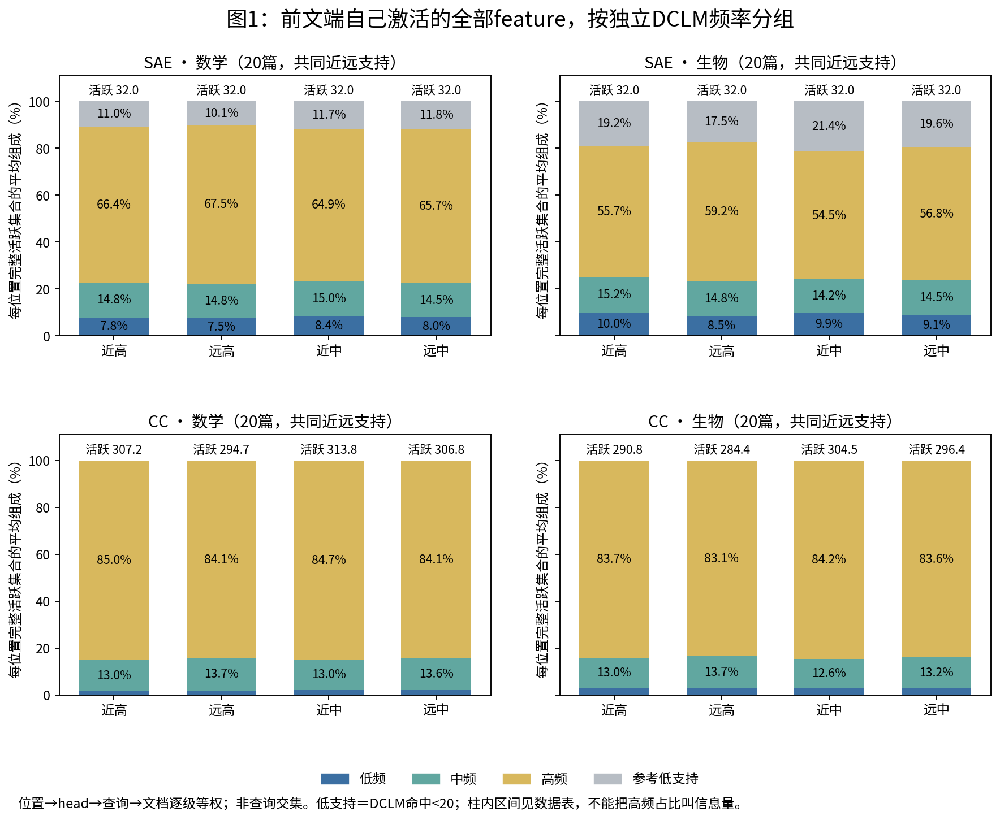
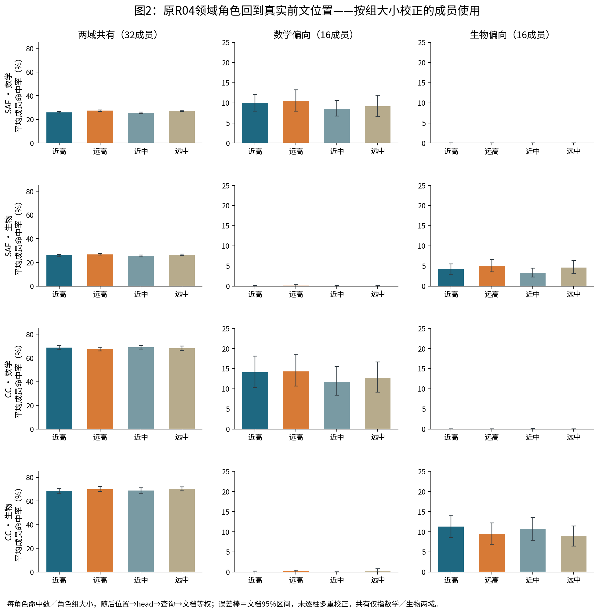
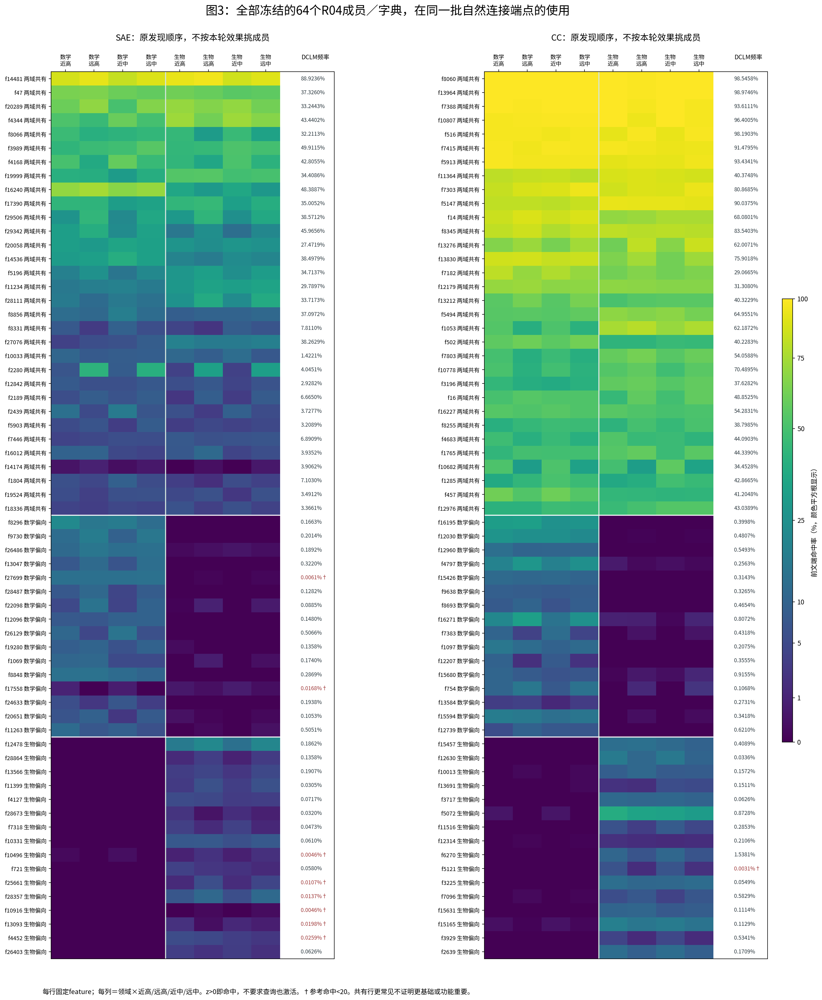
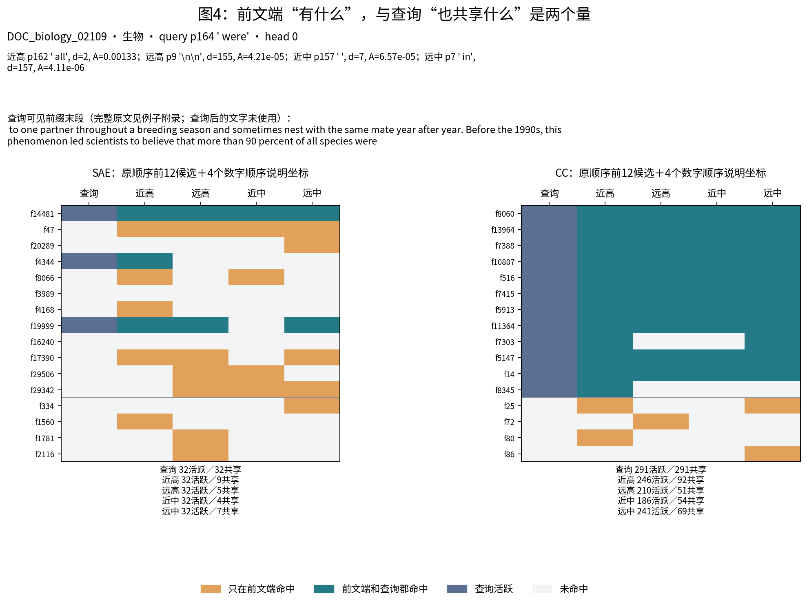
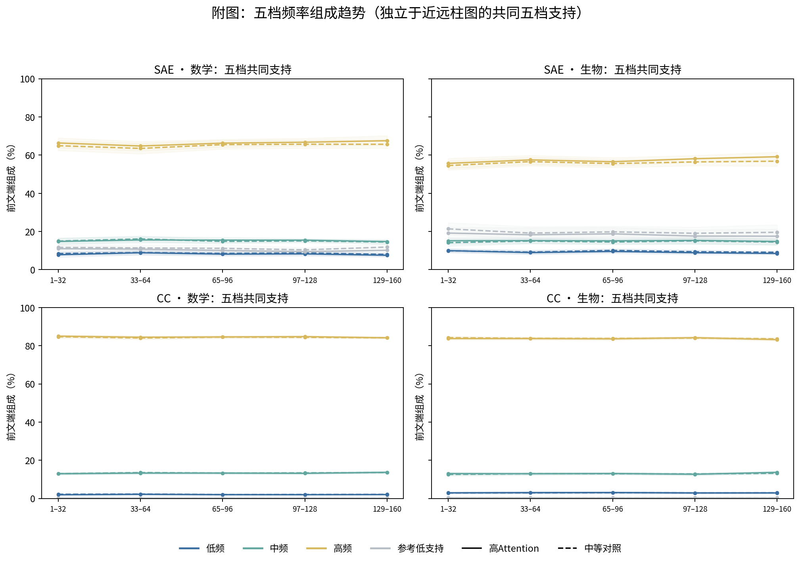
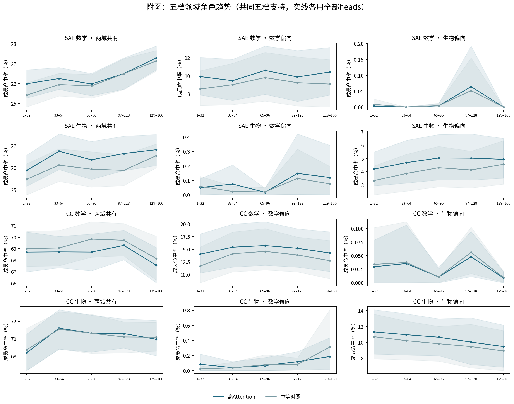
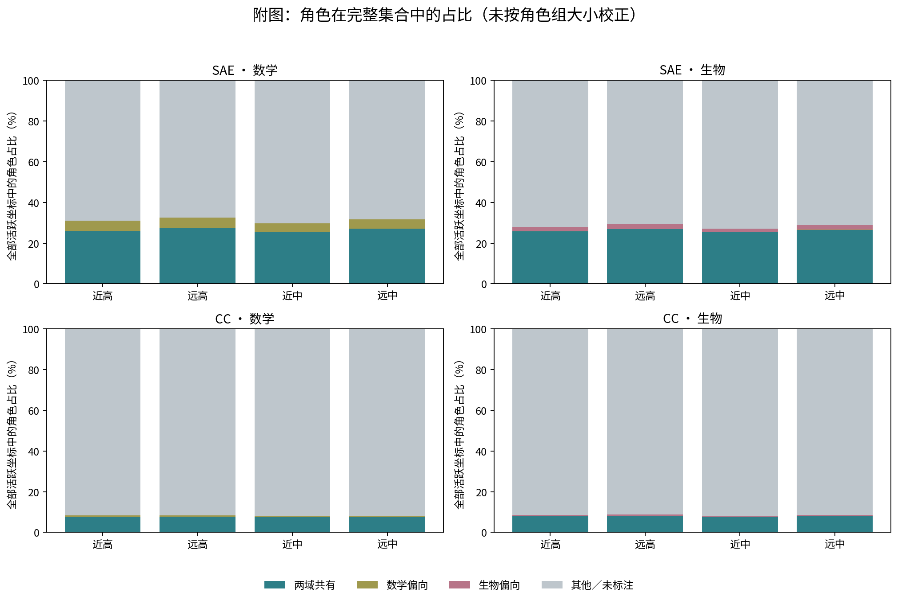

# 四图与附图的读法

图1问“前文端完整集合由哪些参考频段组成”。每柱是该领域20文档内按位置/head/query/document等权的均值，主stratum异ID非标点，使用同query/head近远共同支持；颜色为四组占比，上方是活跃总数均值。看高组变化同时回看中组。SAE生物低频近高9.985%到8.500%，但中组也从9.910%到9.096%；两差再相减不足。不能叫低频必然承担长程。

图2问“固定R04角色成员在各端点多常出现”。每行领域/字典，每列一种角色；各柱是平均成员命中率，已除32或16组大小，误差棒文档95%区间。共有只指两域，不是普遍通用。CC生物偏向远高下降，同时中组也下降，是反对强连接独有解释的实例。角色组平均可能由少数成员驱动，需看图3；单柱区间不表示全部比较已校正。

图3每行原发现冻结feature，全部64行/字典，不按当前留出表现选；8列为数学/生物×近高/远高/近中/远中，颜色是z>0命中率，平方根颜色映射用于看低命中，刻度仍百分数；旁列独立DCLM频率，†表示<20参考命中。白分隔线区分共有32/数学16/生物16，非聚类树。可以看组平均来自哪些成员，不能把未命中称无语义、把少量入选组覆盖外叫无领域信息。

图4固定同一个query，四个前文端和query各一列；棕色仅源端命中、青色源端/查询都命中、蓝色query活跃。主图按原顺序前12冻结候选，加4个数字顺序固定的源独有坐标；完整64候选图另附，只为说明，全部活跃坐标见附录。CC远高210活跃/51共享就是“各自有什么”与“共同有什么”的区别。远高是换行，近中是空白，这是测量示例与竞争解释，不能拿它当生物语义机制的正例。

附图五档曲线仅用五档都有效的同query/head交集，不能强拼不同支持；两域全部20文档仍可用，但query-head数比主柱图少，区间按文档。实线高组、虚线中组（频率图）；领域图用不同颜色。其他strata/逐指标数据保留，支持不足不给确认区间。

角色完整集合占比是另一个问题，以下图未除组大小，因此不能用总占比比较32共有vs16偏向谁更常用；图2才回答平均成员使用。

[例子的全部64冻结候选行及说明坐标](figures/附图_例子全部冻结候选与四前文端.png)。主图截取规则不看本轮表现，全部活跃坐标仍以原始列表为准。
