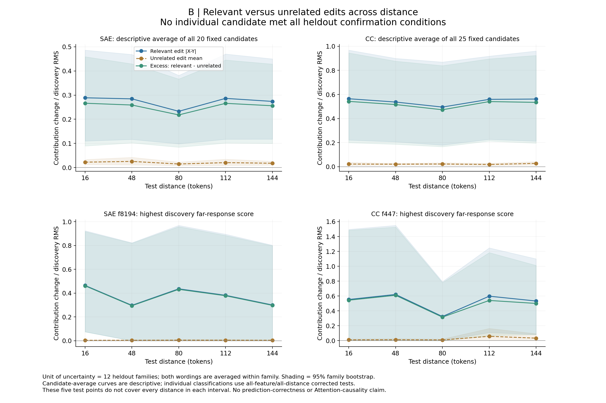
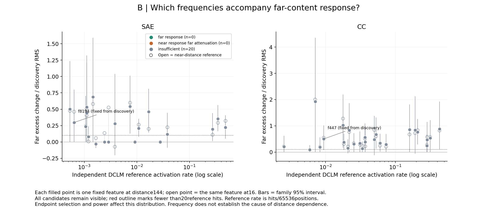
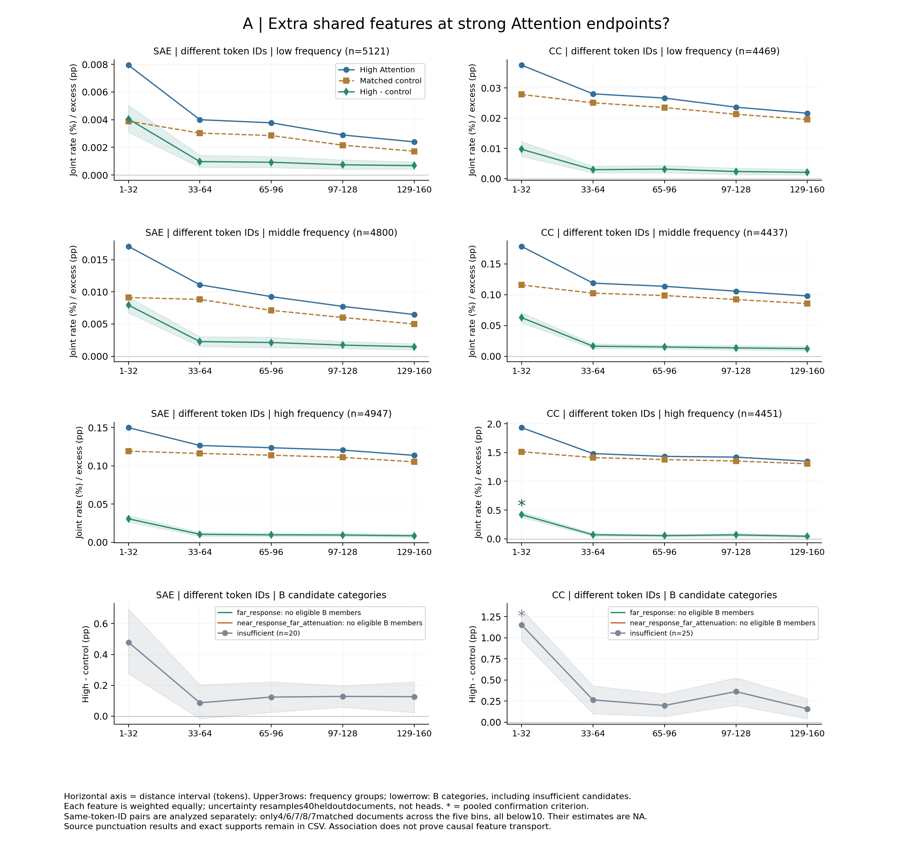
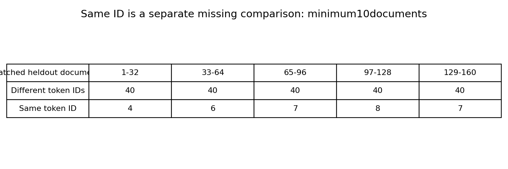
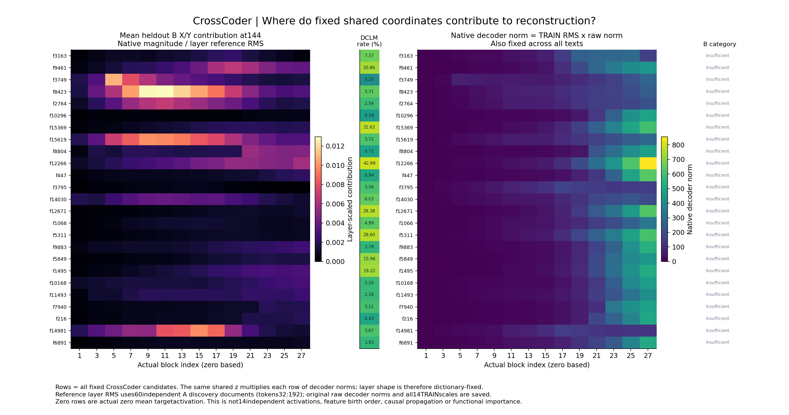

# 四张图逐图解释

这些图没有聚类点。feature是固定字典坐标；频率组与响应类别也不是自然簇。图用英文轴名，以下中文给出每个对象与数字。浅色带为家族／文档区间，不能把它当成所有比较已校正。

## 图1：哪些目标贡献随前文编辑改变？

每个点是12留出家族平均；上排另对固定20/25候选等权平均，下排feature按发现远端排序第一固定，不按留出重挑。横轴测试距离16/48/80/112/144；纵轴贡献变化除以各自发现目标RMS。蓝线相关变化、棕线无关变化、绿线相减，三线各有区间。看绿线是否持续超过无关变化，并回到逐feature确认表。

直接观察：f447在144处相关0.532293、无关0.032658，相减0.499635；其区间[0.081288,1.011454]、q0.404，未确认。局部plant例9.920/0很大，但替换措辞变成0/0，是反例。候选平均曲线为正且不单调，不能推出每feature复现，也不证明语义理解或某Attention边传输。所有候选逐条曲线另有PDF，不只显示这两行。

## 图2：响应大小对应哪些DCLM频率？

一个实心点＝一个固定候选在144处；空心点是同feature在16处。横轴独立DCLM正激活率（对数），纵轴远处相关减无关响应。颜色按冻结确认类别，本轮都灰色“证据不足”，不强制分出长短程组；红描边表示参考命中<20。频率不是词频或奇异值排序。

f447频率617/65536＝0.941467%，远处超额0.499635；SAEf8194频率42/65536＝0.064087%，远处0.296833，但只在3/12家族激活。两个数字是描述，不支持“低频造成长程”。没有已验证远角色，所以不能从散点形状宣称其频率规律。筛选偏向两端可检测响应，频率与统计功效共同影响可见点。

## 图3：强Attention两端额外共享feature吗？

一个点＝40留出文档中的一个组平均。横轴是距离区间，区别于B的五个代表测试点。上三排低／中／高参考频率、下排B候选类别；两列分开SAE与CrossCoder，这里都是异tokenID。纵轴蓝／棕线是共同命中百分比，绿线差值用百分点；先每feature等权，再按head/query/document冻结规则汇总。优先看绿线和星号，而不是只看高频组蓝线较高。

CrossCoder高频组近档1.934869%−1.515126%＝0.419742个百分点，区间[0.372916,0.466901]，q0.0285；支持近距额外共享。反例是同组远档1.349777%−1.306035%＝0.043742个百分点，低于本轮0.1最小效应；它仍为正，不能说“没有联系”。全部B候选合看近档1.153664个百分点但B角色全未确认，不能改称远响应组。没有验证的far/near-decay类别显示无成员，未补零。

同ID单独统计的匹配文档仅4/6/7/8/7，全部不足10，因此给支持表、确认NA。源标点与原R04角色另见表，未拿来救主检验。星号是针对超过非零最小效应并经570格合并校正；某些小正区间与q1不矛盾。额外共享不证明Attention因果传递；SAE在本blockAttention之后，CC依赖14层。

## 图4：共享坐标在哪些层解码贡献较大？

每行是25个冻结CrossCoder候选之一，每列为真实block1/3/…/27。左图颜色是144处B留出X/Y平均的原空间贡献除以该层A发现参考RMS；窄列是DCLM频率（直接打印百分数，颜色为对数尺度）；右图是原空间decoder范数，原训练坐标的参数范数另列CSV。右侧类别均不足。不要把颜色叫功能重要性。

f447最后层共享z均值0.002118929×原空间decoder范数633.710117＝1.342787；除以该层参考RMS609.319126＝0.002203750。block1为0.000244931。可描述字典在各层的固定重构权重。反例是同一f447某plant换说法后z为0，于是所有层贡献同时为0；这不能说明14层独立验证失败或信息消失顺序。同feature层形状受固定decoder和固定参考尺度决定，不能解释逐层产生、传播或专家位置。
