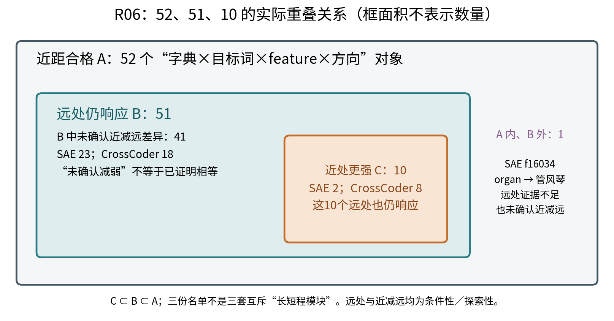
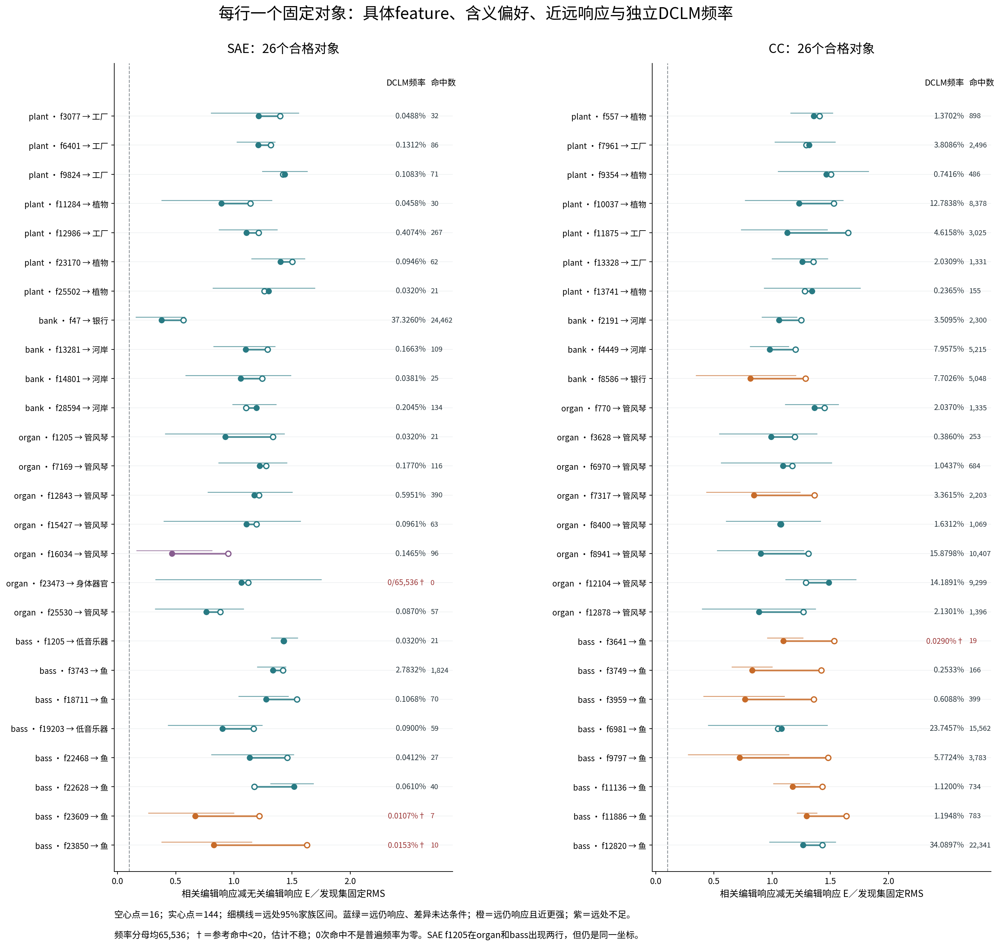
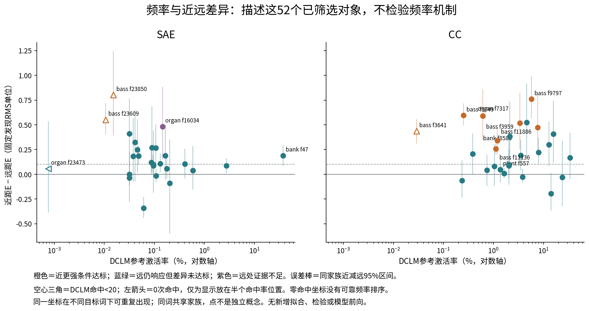

# R06三份名单与DCLM频率：讨论用读图说明

**先看结论：10个近处更强对象全部仍属于51个远处响应对象。这不是“10个短程、51个长程”两套名单。** 本补充只连接既有结果和既有参考频率，不新增模型前向、假设检验、拟合或候选选择；频率关系全部为事后描述。

## 1. 三份名单怎样重叠

A为近距D/E/L完整合格52对象；B为A内远处E满足冻结条件51对象；C为A内近减远E满足条件10对象。B/C沿用R06原有条件性/探索性判定，未重新定阈值。

|互斥展示区|SAE|CrossCoder|合计|可以怎么说|
|---|---:|---:|---:|---|
|远处仍响应，近减远差异未达条件|23|18|41|未确认减弱；不能叫近远相等或完全保持|
|远处仍响应，同时近处更强|2|8|10|有条件性减弱线索，远处没有消失|
|远处证据不足，近减远也不足|1|0|1|不能归为短程或远处无响应|

最后一个是SAE organ f16034，偏好管风琴：远E0.468，95%区间[0.165,0.812]，q0.053；近减远没有达条件。正均值、区间正仍不足以绕过既有校正规则。

## 2. 每个对象的含义、响应和频率

每行是“字典×目标词×feature×方向”，不是一个新概念，也不是簇；箭头含义为发现阶段固定的偏好。空心点读16，实心点读144，实心点旁细横线是远E的95%家族区间。E是同方向相关编辑变化减去同义无关编辑变化，再除该对象发现集RMS；不是激活率，也不是功能重要性。

52行涉及SAE25个不同坐标、CrossCoder26个不同坐标；SAE f1205在organ和bass都偏好乐器侧，所以出现两行。不同字典编号不对应；不能合并成51个跨字典同类feature。

DCLM频率来自R04已匹配原生接口的256窗口/65,536token位置，直接用已有z>0命中数。SAE是E16局部接口，CC是原14层共享z接口，不是最后层独立频率。频率不进入本补充的名单选择。参考命中<20用†标记，不作可靠低/中/高分组；0次命中不等于普遍不存在。

## 3. 哪些更强、哪些未确认减弱

|字典与目标|候选feature|偏好|DCLM命中/65,536|DCLM参考频率|近E → 远E|近减远95%区间|
|---|---|---|---:|---:|---:|---|
|SAE bass|f23609|鱼|7|0.0107%†|1.219 → 0.668|[0.410, 0.715]|
|SAE bass|f23850|鱼|10|0.0153%†|1.627 → 0.826|[0.394, 1.242]|
|CC bank|f8586|银行|5,048|7.7026%|1.287 → 0.813|[0.210, 0.819]|
|CC organ|f7317|管风琴|2,203|3.3615%|1.363 → 0.844|[0.255, 0.821]|
|CC bass|f3641|鱼|19|0.0290%†|1.533 → 1.097|[0.313, 0.555]|
|CC bass|f3749|鱼|166|0.2533%|1.423 → 0.828|[0.496, 0.712]|
|CC bass|f3959|鱼|399|0.6088%|1.358 → 0.767|[0.347, 0.860]|
|CC bass|f9797|鱼|3,783|5.7724%|1.480 → 0.720|[0.569, 0.995]|
|CC bass|f11136|鱼|734|1.1200%|1.433 → 1.177|[0.199, 0.310]|
|CC bass|f11886|鱼|783|1.1948%|1.637 → 1.297|[0.206, 0.467]|

以上10个全部远处仍有超无关编辑响应。8/10来自bass，另bank/organ各1；因此不能把这组频率构成外推为一般长短程规律。†为低参考支持，并不否定受控语义面板的响应；它限制的是参考频率判断。

例如CC plant f557偏好植物，近E1.406、远1.358，近减远区间[-0.080,0.176]；参考命中898/65,536=1.3702%。这是“远处仍响应、没有确认明显减弱”的具体对象，不是证明两距离完全相等。CC bass f3641偏好鱼，近1.533、远1.097、差0.436，差区间[0.313,0.555]；但DCLM只命中19次，0.0290%，参考频率支持不足。

## 4. 能怎样推进导师关于频率与长短程的讨论

每点仍是一个概念×feature对象，横轴为独立DCLM参考激活率，纵轴为近E减远E；橙色点满足原差异条件，三角为频率低支持。没有新相关检验、回归、频率匹配或null，所以这里不能声称频率与衰减已建立统计关系。

**有证据的推进一：用响应轨迹而不是频率命名长短程。** 同一对象可同时近处合格、远处仍响应且远处较弱。41行未达差异条件，不是41行被证明稳定相等；10行也不是短程专属。原有频率与高低阶、长短程的直觉现在有了具体可核对的对象和反例，但尚无互斥分工。

**有证据的推进二：远处候选并不只有一个频率水平。** SAE中，远处仍响应的f47 bank偏好银行，频率37.3260%；同样远处响应的f23609 bass偏好鱼只有7次参考命中，0.0107%，频率估计不稳。CC中，plant f557为1.3702%，bass f6981为23.7457%；差异对象也从低支持f3641的0.0290%到bank f8586的7.7026%。这给出了“频率不能直接充当响应距离标签”的实际例子，不能证明总体无关联。

**仍无法回答：** 是否低频更易减弱/更依赖远处，是否高频更能保持，以及是否频率导致这种组织。候选先按近语义响应筛选、每字典同词只有8留出家族、10个差异对象中8个bass、同坐标会重复、4个参考低支持，加上句序和筛选偏差，都限制频率解释。两字典的频率与稀疏性不能混成一个总体排行。

远处阶段没有诱饵版本，因此B只是远处相关编辑响应，不是远处完整语义资格。近远比较由近留出挑对象，保持同家族虽然改善可比性，仍有筛选和句序混杂，不能把差异归因于距离本身。

## 5. 全部52行（含可追溯数值）

|字典|目标词|feature|偏好含义|DCLM命中|DCLM频率|近E|远E|类别|
|---|---|---|---|---:|---:|---:|---:|---|
|SAE|plant|f3077|工厂|32|0.0488%|1.397|1.213|远处仍响应；近减远未达条件|
|SAE|plant|f6401|工厂|86|0.1312%|1.317|1.209|远处仍响应；近减远未达条件|
|SAE|plant|f9824|工厂|71|0.1083%|1.420|1.437|远处仍响应；近减远未达条件|
|SAE|plant|f11284|植物|30|0.0458%|1.141|0.893|远处仍响应；近减远未达条件|
|SAE|plant|f12986|工厂|267|0.4074%|1.212|1.109|远处仍响应；近减远未达条件|
|SAE|plant|f23170|植物|62|0.0946%|1.503|1.401|远处仍响应；近减远未达条件|
|SAE|plant|f25502|植物|21|0.0320%|1.262|1.298|远处仍响应；近减远未达条件|
|SAE|bank|f47|银行|24,462|37.3260%|0.566|0.377|远处仍响应；近减远未达条件|
|SAE|bank|f13281|河岸|109|0.1663%|1.290|1.101|远处仍响应；近减远未达条件|
|SAE|bank|f14801|河岸|25|0.0381%|1.243|1.059|远处仍响应；近减远未达条件|
|SAE|bank|f28594|河岸|134|0.2045%|1.104|1.193|远处仍响应；近减远未达条件|
|SAE|organ|f1205|管风琴|21|0.0320%|1.336|0.925|远处仍响应；近减远未达条件|
|SAE|organ|f7169|管风琴|116|0.1770%|1.275|1.220|远处仍响应；近减远未达条件|
|SAE|organ|f12843|管风琴|390|0.5951%|1.215|1.176|远处仍响应；近减远未达条件|
|SAE|organ|f15427|管风琴|63|0.0961%|1.194|1.107|远处仍响应；近减远未达条件|
|SAE|organ|f16034|管风琴|96|0.1465%|0.952|0.468|远处证据不足；近减远也未达条件|
|SAE|organ|f23473|身体器官|0|0/65,536†|1.122|1.065|远处仍响应；近减远未达条件|
|SAE|organ|f25530|管风琴|57|0.0870%|0.884|0.763|远处仍响应；近减远未达条件|
|SAE|bass|f1205|低音乐器|21|0.0320%|1.428|1.428|远处仍响应；近减远未达条件|
|SAE|bass|f3743|鱼|1,824|2.7832%|1.421|1.336|远处仍响应；近减远未达条件|
|SAE|bass|f18711|鱼|70|0.1068%|1.543|1.277|远处仍响应；近减远未达条件|
|SAE|bass|f19203|低音乐器|59|0.0900%|1.169|0.902|远处仍响应；近减远未达条件|
|SAE|bass|f22468|鱼|27|0.0412%|1.460|1.136|远处仍响应；近减远未达条件|
|SAE|bass|f22628|鱼|40|0.0610%|1.175|1.516|远处仍响应；近减远未达条件|
|SAE|bass|f23609|鱼|7|0.0107%†|1.219|0.668|远处仍响应；近处更强|
|SAE|bass|f23850|鱼|10|0.0153%†|1.627|0.826|远处仍响应；近处更强|
|CC|plant|f557|植物|898|1.3702%|1.406|1.358|远处仍响应；近减远未达条件|
|CC|plant|f7961|工厂|2,496|3.8086%|1.292|1.319|远处仍响应；近减远未达条件|
|CC|plant|f9354|植物|486|0.7416%|1.506|1.464|远处仍响应；近减远未达条件|
|CC|plant|f10037|植物|8,378|12.7838%|1.529|1.231|远处仍响应；近减远未达条件|
|CC|plant|f11875|工厂|3,025|4.6158%|1.654|1.130|远处仍响应；近减远未达条件|
|CC|plant|f13328|工厂|1,331|2.0309%|1.356|1.257|远处仍响应；近减远未达条件|
|CC|plant|f13741|植物|155|0.2365%|1.281|1.344|远处仍响应；近减远未达条件|
|CC|bank|f2191|河岸|2,300|3.5095%|1.249|1.058|远处仍响应；近减远未达条件|
|CC|bank|f4449|河岸|5,215|7.9575%|1.201|0.978|远处仍响应；近减远未达条件|
|CC|bank|f8586|银行|5,048|7.7026%|1.287|0.813|远处仍响应；近处更强|
|CC|organ|f770|管风琴|1,335|2.0370%|1.450|1.365|远处仍响应；近减远未达条件|
|CC|organ|f3628|管风琴|253|0.3860%|1.196|0.990|远处仍响应；近减远未达条件|
|CC|organ|f6970|管风琴|684|1.0437%|1.172|1.092|远处仍响应；近减远未达条件|
|CC|organ|f7317|管风琴|2,203|3.3615%|1.363|0.844|远处仍响应；近处更强|
|CC|organ|f8400|管风琴|1,069|1.6312%|1.075|1.067|远处仍响应；近减远未达条件|
|CC|organ|f8941|管风琴|10,407|15.8798%|1.310|0.902|远处仍响应；近减远未达条件|
|CC|organ|f12104|管风琴|9,299|14.1891%|1.290|1.487|远处仍响应；近减远未达条件|
|CC|organ|f12878|管风琴|1,396|2.1301%|1.268|0.886|远处仍响应；近减远未达条件|
|CC|bass|f3641|鱼|19|0.0290%†|1.533|1.097|远处仍响应；近处更强|
|CC|bass|f3749|鱼|166|0.2533%|1.423|0.828|远处仍响应；近处更强|
|CC|bass|f3959|鱼|399|0.6088%|1.358|0.767|远处仍响应；近处更强|
|CC|bass|f6981|鱼|15,562|23.7457%|1.048|1.079|远处仍响应；近减远未达条件|
|CC|bass|f9797|鱼|3,783|5.7724%|1.480|0.720|远处仍响应；近处更强|
|CC|bass|f11136|鱼|734|1.1200%|1.433|1.177|远处仍响应；近处更强|
|CC|bass|f11886|鱼|783|1.1948%|1.637|1.297|远处仍响应；近处更强|
|CC|bass|f12820|鱼|22,341|34.0897%|1.433|1.266|远处仍响应；近减远未达条件|

[完整CSV：原始频率、支持、近远效应、区间和q](all52_membership_frequency.csv)。每一行可由源JSON对象key及参考npz对应坐标重建，manifest列出源哈希。旧统计、候选、预算和报告未改写。

## 图的解释边界

图一允许读名单包含，不能读模块结构；图二允许读每对象响应及参考频率，不能把未确认减弱当等效或把贡献当重要性；图三只允许描述有限候选的频率分布，不建立频率机制或独立距离因果。所有新增连接/频率解读均为探索性。研究者机制接受及问题关闭仍Unknown。
