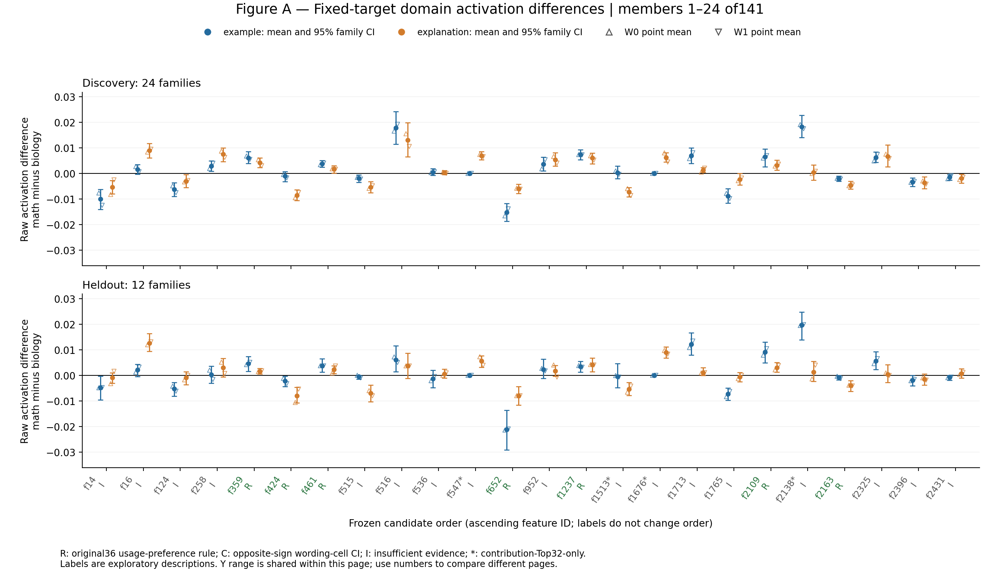
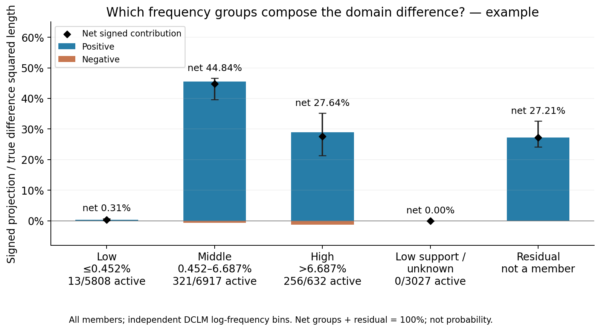
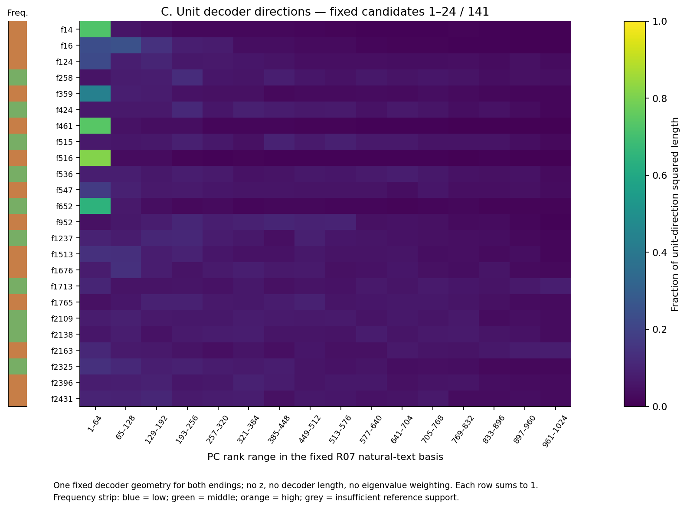
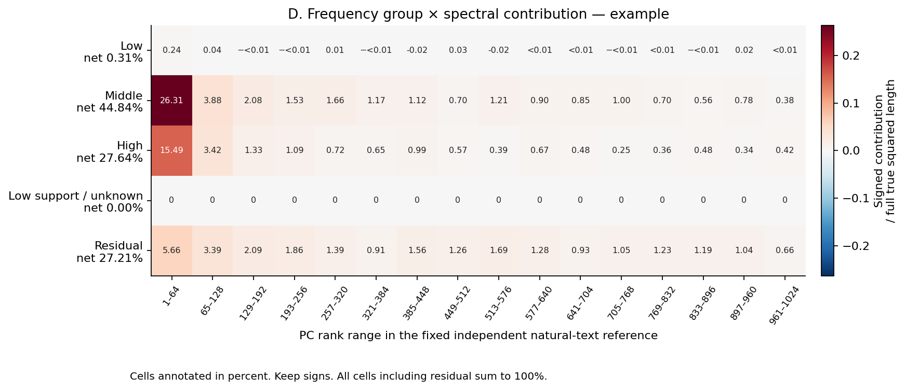
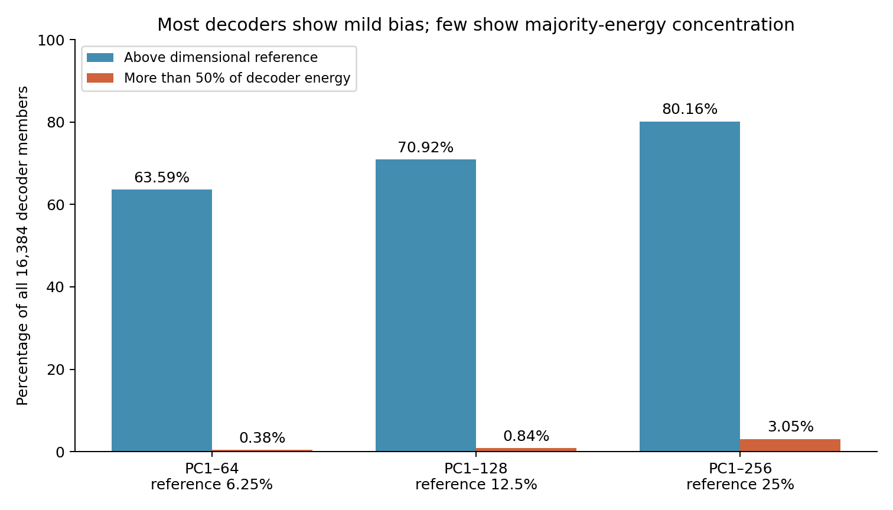

# R09 figure guide: from usage differences to frequency and spectral contributions

[中文](figures_cn.md) · [Question and results](summary.md) · [Computations and supplementary audits](supplement_ABCD.md) · [Complete methods and provenance](detailed.md)

**Read A for reproducibility of domain usage preference, B for the frequency groups composing the true difference, C for decoder direction geometry, and D for the connection between actual contributions and spectral bands. Then use the full-dictionary backgrounds to assess how much candidate alignment reflects general geometry.** The bounded findings are that some usage preferences recur, middle- and high-frequency members contribute to this panel's domain difference, and candidates have a larger average projection onto leading PCs. Frequency and decoder direction do not independently assign semantic or distance-related functions.

This guide links all 38 figures. A–D, the backgrounds and the original main figures reuse the 384 original short-text records from R07/R08. Distance figures use separately constructed 240-token inputs; they are not the same near/far comparison. Images are reading copies of the execution-side originals. Tables link to the original outputs; the [reading-copy manifest](payload_manifest.json) records copy provenance and hashes.

## Four distinct objects

At the last target token, each text yields one **shared activation z** from A22's native joint encoding of fourteen layers, and a 1,024-dimensional true block27 representation from Qwen3-0.6B. The target endings `example` and `explanation` are analyzed separately.

| Object | Actual computation | Figures |
|---|---|---|
| Member usage difference \(\Delta z_f\) | Mean math activation minus mean biology activation, including zeros | A |
| Member contribution vector \(c_f\) | Usage difference times the last-layer decoder and restoration scale: \(c_f=s\Delta z_f d_f\) | B, D |
| Unit decoder direction | Divide each decoder by its own length; apply no activation, length or eigenvalue weight | C, backgrounds |
| True domain difference \(\delta\) | Mean true math representation minus mean true biology representation; residual \(r=\delta-\sum_f c_f\) | B, D and original figures 1, 2, 4 |

The spectral axis is fixed to sixteen 64-dimensional bands of R07's independent natural-text reference PCA: PC1–64, 65–128, through 961–1024. Rank reflects reference representation variance, not domain discrimination or knowledge importance. The original 12 heldout families were previously exposed, so this is exploratory continuation. Where family intervals are reported, 500 whole-family resamples retain all paired conditions; wordings are not independent replicates.

## A: does the same member retain its domain usage preference across conditions?

**Objects and axes.** Each x position is one of 141 frozen candidates, displayed in the original ascending member-ID order. Labels do not change the order. The y axis is the raw-z math-minus-biology mean difference: positive favors math and negative favors biology. The upper panel uses 24 discovery families; the lower panel uses the 12 original heldout families. Blue and orange distinguish the endings. Solid circles and error bars show the equally weighted two-wording mean and its 95% family interval; upward and downward triangles show W0 and W1 point means. Both panels share a y range within a page; different pages can use different ranges.

**Two readings.** Retaining the discovery direction in both endings and both wordings, with the pooled-wording interval excluding zero in each ending, supports the original usage-replication rule. If a cell changes sign, inspect its interval: a reversed point with an interval crossing zero remains insufficient; an interval wholly opposite the discovery direction supplies the conditional opposite-direction evidence used here.

R inherits the original 36-member replication list. C labels seven other members for which at least one heldout ending-by-wording interval is wholly opposite the discovery point direction. I labels 98 insufficient cases. The original 128 domain candidates partition into 36/7/85; the additional 13 members entering only through contribution Top32 are all I and marked with an asterisk. **Forty-eight members show at least one point-sign reversal; that is not forty-eight interval-supported reversals.** C uses exploratory pointwise intervals without multiplicity correction. The original R rule does not require each wording's individual interval to exclude zero.

Three observed examples show why these distinctions matter:

- f13473, page 6, R: heldout differences are 0.005457 [0.002120, 0.008622] for `example` and 0.006877 [0.003360, 0.010456] for `explanation`, both favoring math.
- f12179, page 5, C: the discovery `explanation` difference is −0.003026, whereas heldout W1 is +0.003690 [0.002014, 0.005323]. This cell's interval also reverses direction.
- f516, page 1, I: discovery differences are 0.017860/0.013018 and heldout differences are 0.006100/0.003670. The heldout `explanation` interval [−0.001261, 0.008618] crosses zero. A positive point is not sufficient replication evidence; a crossing interval does not establish disappearance.

All six pages: [members 1–24](evidence/supplement_ABCD_20261029/figure_A/figure_A_page01.png) · [25–48](evidence/supplement_ABCD_20261029/figure_A/figure_A_page02.png) · [49–72](evidence/supplement_ABCD_20261029/figure_A/figure_A_page03.png) · [73–96](evidence/supplement_ABCD_20261029/figure_A/figure_A_page04.png) · [97–120](evidence/supplement_ABCD_20261029/figure_A/figure_A_page05.png) · [121–141](evidence/supplement_ABCD_20261029/figure_A/figure_A_page06.png). Data: [1,692 rows of raw means, differences and intervals](evidence/supplement_ABCD_20261029/figure_A/raw_delta_z.csv) · [labels and point/interval reversal records](evidence/supplement_ABCD_20261029/figure_A/candidate_labels.csv). A measures usage differences, not decoder contributions or behavioral necessity. A recurring usage direction does not automatically imply a positive reconstruction contribution.

## B: which frequency groups actually compose the domain difference?

**Objects and axes.** B reuses the eligible original figure 3 and includes all 16,384 members. The x axis lists independent DCLM frequency groups. The y axis is the signed directional share \(a_f=\langle c_f,\delta\rangle/\|\delta\|^2\). Blue bars sum positive shares within a group, orange bars sum negative shares, and black diamonds mark their net. Error bars are 95% family intervals for the net. The residual is separate and is not a dictionary member.

Frequency is the fraction of 65,536 independent reference positions with native-gated `z>0`. Members with at least 20 hits are divided into equal-width log-frequency intervals: low 0.030518%–0.451726%, middle >0.451726%–6.686506%, and high >6.686506%–98.974609%. Their counts are 5,808/6,917/632. A further 3,027 members have insufficient reference support. Labels also report members active at the current ending, so reference frequency is not substituted for panel coverage.

**Two readings.** A tall positive bar and a large net indicate a substantial contribution aligned with the current true difference. Large positive and negative parts with a small net indicate cancellation; a large residual preserves dictionary omission. Neither the positive bar alone nor its height measures knowledge content.

| Heldout net directional share | Low | Middle | High | Insufficient reference support | Residual |
|---|---:|---:|---:|---:|---:|
| example | 0.31% | 44.84% | 27.64% | 0 | 27.21% |
| explanation | 0.17% | 24.51% | 25.77% | −0.002% | 49.56% |

For `example`, middle-frequency positive/negative parts are 45.54%/−0.71%, and high-frequency parts are 28.89%/−1.25%. For `explanation`, they are 25.68%/−1.17% and 28.32%/−2.55%. Middle and high groups therefore supply the main net contribution at both endings, with different composition. Only 13/11 low-frequency members are active at these targets. Small current contribution does not establish general uselessness of low-frequency members.

[Full example figure](evidence/figures/figure3_frequency_example.png) · [Full explanation figure](evidence/figures/figure3_frequency_explanation.png) · [Positive, negative and net contributions, counts and intervals](evidence/tables/frequency_signed_contributions.csv). Net groups plus residual sum to 100%, but this is an additive directional account, not a probability distribution. Error orthogonal to the true difference requires original figure 1. Boundary sensitivity is retained below.

## C: which spectral bands contain these decoder directions?

**Objects and axes.** Each row is a frozen member in the same order as A. Each column is an explicitly labeled 64-dimensional PC band. Color represents squared projection of the unit decoder, \(e_{f,b}=\|P_b(d_f/\|d_f\|)\|^2\); each row sums to one. The separate frequency strip uses blue/green/orange/gray for low/middle/high/insufficient support. Heatmap color itself represents directional energy only, on a shared zero-to-one scale.

**Two readings.** A bright first cell indicates strong directional concentration in PC1–64; values spread across columns indicate components in multiple bands. Across-row brightness does not measure activation magnitude or actual reconstruction contribution: decoder length has been removed and activation differences are absent.

On page 6, f13964 places 89.28% of its directional energy in PC1–64, whereas f13473 places 9.61% there. Both satisfy A's original usage-replication rule. Recurring domain usage therefore does not require a decoder dominated by the first spectral band. Squared projection also removes directional sign, so C cannot establish whether a member reinforces or opposes the current domain difference.

Page 1 gives a direct comparison with A: f516 has 81.49% in PC1–64, yet its heldout `explanation` usage interval crosses zero and it is I. f424 has only 6.97% in that band, yet it is R, with heldout differences −0.002230 [−0.004427, −0.000348] and −0.008013 [−0.010813, −0.004608]. Leading-PC alignment and usage replication are different measurements.

C has one geometry set because the fixed decoder and fixed PCA basis do not depend on target ending. All six pages: [members 1–24](evidence/supplement_ABCD_20261029/figures/figureC_unit_decoder_page1.png) · [25–48](evidence/supplement_ABCD_20261029/figures/figureC_unit_decoder_page2.png) · [49–72](evidence/supplement_ABCD_20261029/figures/figureC_unit_decoder_page3.png) · [73–96](evidence/supplement_ABCD_20261029/figures/figureC_unit_decoder_page4.png) · [97–120](evidence/supplement_ABCD_20261029/figures/figureC_unit_decoder_page5.png) · [121–141](evidence/supplement_ABCD_20261029/figures/figureC_unit_decoder_page6.png). Also retained: [one long figure with all 141 candidates](evidence/supplement_ABCD_20261029/figures/figureC_unit_decoder_all141.png). Data: [all 16,384 members and 16 bands](/data/250010109/MoE_Router/experiments/20261026_natural_language_feature_response/R09_domain_difference_decomposition_20261029/supplement_ABCD_20261029/background/tables/all_unit_decoder_band_energy.csv). The backgrounds below address general dictionary alignment; D addresses actual contributions.

## D: which frequency group contributes to which part of the true difference?

**Objects and axes.** Sum member contribution vectors within frequency group g to obtain \(v_g=\sum_{f\in g}c_f\). Each cell is \(J_{g,b}=\langle P_bv_g,P_b\delta\rangle/\|\delta\|^2\). Columns are the sixteen spectral bands; rows are four frequency groups plus residual. Cells print percentages, with red for aligned and blue for opposing contributions. Both endings share a color scale. Every cell uses the **full true squared difference** as denominator; individual bands are not renormalized to 100%.

**Two readings.** Reading across a row shows which bands compose that group's net contribution. Reading down a column shows which groups and residual compose that band of the true difference. A negative cell opposes the true direction within that band and must retain its sign. Row sums equal B's net contributions; column sums including residual equal the true squared-projection fractions; all cells sum to 100%. This closure checks the computation rather than establishing a new mechanism.

| PC1–64 share of the full difference | Low | Middle | High | Insufficient reference support | Residual | Column total |
|---|---:|---:|---:|---:|---:|---:|
| example | 0.24% | 26.31% | 15.49% | 0 | 5.66% | 47.70% |
| explanation | −0.03% | 10.41% | 9.60% | 0.005% | 9.88% | 29.87% |

Middle- and high-frequency aligned contributions are largest in PC1–64 in this panel and also extend into later bands. The `explanation` low-frequency first cell is negative although its whole row is +0.17%, an observed example of local opposition and positive net contribution coexisting. D displays heldout point estimates, without cellwise family intervals; color differences do not establish significance.

[Full example figure](evidence/supplement_ABCD_20261029/figures/figureD_joint_example.png) · [Full explanation figure](evidence/supplement_ABCD_20261029/figures/figureD_joint_explanation.png) · [Joint table for three splits and two endings](evidence/supplement_ABCD_20261029/tables/frequency_spectral_joint_contribution.csv). D supplies the actual connection between B and spectral position. Merely juxtaposing B and C does not recover D because C omits activation differences, signs and vector composition.

## Full-dictionary backgrounds: how much candidate alignment reflects general geometry?

All four backgrounds use C's unit-decoder energy. Statistical units are members or random member sets, not text families. The ranges below are not family confidence intervals. The 6.25% horizontal reference for a 64-dimensional band is 64/1,024: an isotropic dimensional reference, not an empirical null fitted to the dictionary.

### Full-dictionary means and member distributions

The [dictionary-versus-candidate figure](evidence/supplement_ABCD_20261029/background/figures/background_all_dictionary.png) uses the sixteen bands on x and unit-decoder squared-projection fractions on y. The gray-blue line is the equal-weight mean of all 16,384 members; its band spans member-level 25th–75th percentiles. The orange line is the mean of the fixed 141 candidates.

Similar lines would allow general dictionary geometry to explain much of candidate alignment. A larger candidate mean requires frequency and activity matching. Observed PC1–64 full-dictionary mean/median are 8.85%/7.14%, versus candidate mean/median 18.15%/9.47%. The candidate mean is higher, but this does not describe every candidate as strongly aligned. Data: [band distributions](/data/250010109/MoE_Router/experiments/20261026_natural_language_feature_response/R09_domain_difference_decomposition_20261029/supplement_ABCD_20261029/background/tables/member_band_distributions.csv) · [cumulative leading-PC distributions](evidence/supplement_ABCD_20261029/background/tables/member_head_distributions.csv).

### Widespread mild bias versus rare majority-energy concentration

The [count figure](evidence/supplement_ABCD_20261029/background/figures/background_mild_vs_majority_concentration.png) has three cumulative ranges on x—PC1–64, 1–128 and 1–256—and the percentage of all dictionary members on y. Blue bars count members above each range's dimensional reference. Orange bars count members with more than half their directional energy in that range.

| Leading-PC range | Above dimensional reference | More than 50% directional energy |
|---|---:|---:|
| PC1–64; reference 6.25% | 10,418/16,384 = 63.59% | 63/16,384 = 0.38% |
| PC1–128; reference 12.5% | 11,619/16,384 = 70.92% | 138/16,384 = 0.84% |
| PC1–256; reference 25% | 13,134/16,384 = 80.16% | 499/16,384 = 3.05% |

A high blue bar supports widespread mild bias; a high orange bar would support many members concentrating most of their energy there. Observed blue proportions are large and orange proportions are small. Rare majority-energy concentration does not eliminate general bias, and exceeding the dimensional reference does not mean that most energy lies in the leading range. The 50% threshold answers the numerical meaning of “most,” not a new semantic gate. Source: [cumulative distributions and counts](evidence/supplement_ABCD_20261029/background/tables/member_head_distributions.csv).

### Non-candidate background matched by frequency bin

The [frequency-matched figure](evidence/supplement_ABCD_20261029/background/figures/background_frequency_matched_non_candidates.png) retains the same spectral and energy axes. Each random set draws one low-, 62 middle- and 78 high-frequency non-candidates, matching candidate composition. There are 1,000 sets, without replacement within each set. The blue line averages set means; the blue band gives their 2.5th–97.5th percentiles. Orange remains the candidate mean.

Orange within the blue range would mean that this frequency composition covers the candidate average geometry. Orange above it means that the three bin counts do not cover the difference. For PC1–64 the observed candidate mean is 18.15%, versus background 10.44% [9.07%, 11.98%]. PC1–128 is 27.09% versus 18.72% [17.18%, 20.63%]; PC1–256 is 41.75% versus 33.66% [32.10%, 35.62%]. Matching uses bins, not exact continuous occurrence rates. Data: [bandwise random-set distribution](/data/250010109/MoE_Router/experiments/20261026_natural_language_feature_response/R09_domain_difference_decomposition_20261029/supplement_ABCD_20261029/background/tables/random_set_band_background.csv) · [cumulative ranges](evidence/supplement_ABCD_20261029/background/tables/random_set_head_background.csv).

### Discovery-active background matched by frequency bin

The [active and frequency-matched figure](evidence/supplement_ABCD_20261029/background/figures/background_discovery_active_frequency_matched_non_candidates.png) additionally requires at least one activation at a target in the 192 original discovery records. Axes, quotas and 1,000-set procedure remain unchanged. Available low/middle/high pools contain 19/438/298 members, enough for the 1/62/78 quotas without relaxing eligibility.

If orange approached the new blue range, target activity would explain some alignment. If it remained above it, this coarse activity match would be insufficient. Observed background PC1–64 is 10.69% [9.46%, 11.92%], still below candidate 18.15%; PC1–128 is 19.39% [17.91%, 20.87%], and PC1–256 is 35.07% [33.56%, 36.73%]. Sources: [pool support](/data/250010109/MoE_Router/experiments/20261026_natural_language_feature_response/R09_domain_difference_decomposition_20261029/supplement_ABCD_20261029/background/tables/background_pool_support.csv) · [matched-set ranges](evidence/supplement_ABCD_20261029/background/tables/random_set_head_background.csv).

Together these comparisons narrow general geometry, frequency-bin composition and ever-active status as explanations, but they do not eliminate candidate selection effects. Selection partly used contribution along a domain difference already concentrated toward leading PCs, which can favor aligned decoders. Only 12/141 candidates put more than half their energy in the first band. Directional backgrounds are not independent evidence that domain knowledge resides in leading PCs.

## Original main-figure index: omission, concentration and aggregate spectra

### Figures 1a and 1b: has the dictionary fully described the difference?

[1a, relative residual](evidence/figures/figure1a_dictionary_relative_error.png), has the two endings on x and residual length divided by true-difference length on y. Lower values indicate more complete reconstruction; higher values indicate omission. Values are 53.68% [52.12%, 57.96%] and 72.14% [68.40%, 76.50%], with 12-family bootstrap intervals. These cannot be restated as 46.32%/27.86% of information explained.

[1b, directional cosine](evidence/figures/figure1b_dictionary_cosine.png), uses the same x axis and the cosine between true and reconstructed differences on y. Values near one indicate directional similarity, while lower values indicate misalignment. Observed values are 0.844 [0.815, 0.854] and 0.693 [0.649, 0.732]. High cosine can coexist with large residual, so read both figures together. Source: [dictionary reconstruction table](evidence/tables/dictionary_reconstruction.csv).

### Figure 2: do a few fixed members approach full-dictionary reconstruction?

[Example](evidence/figures/figure2_cumulative_example.png) · [Explanation](evidence/figures/figure2_cumulative_explanation.png). The x axis adds 1/4/8/16/32 members in discovery-fixed order; y remains relative residual. Blue is original heldout, dashed green is discovery selection data, gray represents 1,000 equal-size random sets, and orange is the whole dictionary. A short fixed list approaching orange would support concentration relative to this dictionary. A persistent gap prevents claiming that a few members explain the full difference.

Observed heldout Top32 errors are 71.96% [69.14%, 77.58%] and 82.89% [77.31%, 88.17%], versus random sets around 100% and whole-dictionary errors 53.68%/72.14%. The selected lists outperform this random reference but do not supply a complete explanation. Blue bands are family intervals; gray bands are random-set distributions, and these sets are not activity-matched. Vectors are added before residuals are measured; member lengths cannot be summed and monotonicity is not imposed. Source: [all k and random references](evidence/tables/cumulative_reconstruction.csv).

### Figure 4: spectra of the true and reconstructed aggregate vectors

[Example](evidence/figures/figure4_spectrum_example.png) · [Explanation](evidence/figures/figure4_spectrum_explanation.png). The x axis contains sixteen 64-dimensional bands. Blue/orange bars are bandwise squared lengths of the true/reconstructed **aggregate vectors**. Both divide by the full true squared length, so reconstructed bars need not sum to 100%. Similar bars show similar band energy; large gaps show incomplete recovery. Even similar energy does not guarantee aligned directions within that band.

Observed true/reconstructed PC1–64 values are 47.70%/39.30% and 29.87%/17.65%. PC961–1024 values are 1.47%/1.12% and 2.05%/1.06%. These are neither C's unit directions nor D's signed inner products. Squaring an aggregate vector includes cross terms between members. Source: [full spectral table, including residual](evidence/tables/spectral_decomposition.csv).

### Bin sensitivity: does the same low/middle/high name change the impression?

[Example](evidence/figures/supplement_binning_sensitivity_example.png) · [Explanation](evidence/figures/supplement_binning_sensitivity_explanation.png). The x axis uses low/middle/high labels and y is net directional contribution. Colors distinguish original equal-count bins, main equal-log-width bins and equal-raw-frequency-width bins. Similar values under a shared label would imply less boundary dependence; changing values require explicit boundaries and continuous rates.

For `example`, the “high” net changes from 65.13% under equal counts to 27.64% under log width and 7.63% under raw-frequency width. For `explanation` it is 48.58%/25.77%/4.74%. The groups contain different members; these are not contradictory measurements of one fixed population. Main group counts are 5,808/6,917/632, versus 13,281/63/13 under raw-frequency width. The plot does not identify a universally correct binning scheme. Sources: [boundaries and counts](evidence/frequency_family/tables/frequency_group_counts.csv) · [contributions under all schemes](evidence/tables/frequency_signed_contributions.csv).

## Frequency and family supplements: frequency is not domain exclusivity

The [frequency distribution](evidence/frequency_family/figures/supp_frequency_distribution.png) has independent reference occurrence on a log x axis and member counts on y; vertical lines mark the main boundaries. Across orders of magnitude, read multiplicative differences. Concentration toward one end makes raw-frequency equal-width groups unbalanced. The supported range is 0.030518%–98.974609%. Insufficient support consists of 749 zero-hit and 2,278 one-to-19-hit members. This distribution does not measure contribution or functional importance. Source: [all-member frequency table](/data/250010109/MoE_Router/experiments/20261026_natural_language_feature_response/R09_domain_difference_decomposition_20261029/frequency_family/tables/all_feature_frequency.csv).

The [example variance-share figure](evidence/frequency_family/figures/supp_domain_family_variance_example.png) and [explanation variance-share figure](evidence/frequency_family/figures/supp_domain_family_variance_explanation.png) have frequency groups on x. The y axis is an equal-member mean of individually normalized activation-variance shares. Orange B is between-domain-center variation, blue F is family variation within domains, and gray W is wording variation within families. For each variable member, T=B+F+W. T=0 remains NA; labels give variable/total member counts.

A large orange share means that domain-center separation occupies more of these members' own variation. Larger blue and gray shares mean more family and wording variation. Observed low/middle/high B/T values are 8.94%/12.93%/11.23% for `example` and 18.55%/10.07%/7.74% for `explanation`, without a consistent ordering across endings. Low-frequency means contain only 13/11 members. The insufficient-support group has no variable member for `example` and remains NA; it has one member for `explanation`. Most variation belonging to families and wordings does not eliminate B's domain reconstruction contribution. Sources: [group shares and intervals](/data/250010109/MoE_Router/experiments/20261026_natural_language_feature_response/R09_domain_difference_decomposition_20261029/frequency_family/tables/group_variance_shares.csv) · [memberwise decomposition](/data/250010109/MoE_Router/experiments/20261026_natural_language_feature_response/R09_domain_difference_decomposition_20261029/frequency_family/tables/all_feature_variance_components.csv).

## Six distance figures: read response and coverage separately

These inputs have length 240 and target position 239. Distances from the last domain-core token to the target are 16/32/64/96/144. The same filler inventory is relocated across distances. Monday→Tuesday immediately after the core supplies a length- and position-matched unrelated-edit control. **The new distance-16 condition also differs from the original short text.** A preference already changed at the new near condition cannot be called far-distance decay. Domain replacement and a one-token date edit have different edit magnitudes; E retains that limitation.

### Two candidate-direction figures

[Example](evidence/distance/figures/distance_candidate_direction_example.png) · [Explanation](evidence/distance/figures/distance_candidate_direction_explanation.png). The x axis is actual distance. The y axis divides the mean math-minus-biology activation difference by the fixed original discovery RMS, then multiplies by that ending's original discovery sign. Positive plotted values retain the original preference; negative values reverse it. Each color denotes an illustrative member; shading is the 95% interval across twelve families.

A positive far response with wording agreement supports retention in that condition. Reversal and insufficient intervals require separate reporting. For `example`, middle-frequency f424 has values 0.722/0.703/0.747/0.479/0.699, a nonmonotonic curve. f8624 changes from 1.075 to 0.419; high-frequency f9900 changes from 1.900 to 1.718; f14 already reverses at the new near condition. For `explanation`, f424 and f8624 retain biology preference: before orienting the plotted sign, their D values are −0.168→−0.192 and −0.756→−0.502. f9900 is zero at the far condition and has an unstable near ratio denominator. The same frequency label does not imply the same curve; overlapping intervals are not equivalence evidence. Sources: [candidate distance measurements](/data/250010109/MoE_Router/experiments/20261026_natural_language_feature_response/R09_domain_difference_decomposition_20261029/distance/tables/candidate_distance_metrics.csv) · [far/near ratios and intervals](/data/250010109/MoE_Router/experiments/20261026_natural_language_feature_response/R09_domain_difference_decomposition_20261029/distance/tables/candidate_retention_intervals.csv).

### Two frequency-group response figures

[Example](evidence/distance/figures/distance_frequency_response_example.png) · [Explanation](evidence/distance/figures/distance_frequency_response_explanation.png). The x axis is distance and y is mean E over members in each group. Within each family/wording, E subtracts the mean absolute date-edit response across domains from the absolute domain activation difference, then divides by the member's fixed original discovery RMS. Zero RMS remains unestimated; legends report eligible/total counts. Shading is family-resampling uncertainty.

Positive far E means domain-core replacement changes activation more than this date control. Near-zero E or an interval crossing zero leaves this comparison insufficient. E removes domain direction and can be positive after reversal, so it cannot replace the candidate-direction figures.

| Ending | Low E: 16→144 | Middle E: 16→144 | High E: 16→144 |
|---|---:|---:|---:|
| example | 0.0389→0.0286 | 0.2569→0.1863 | 0.3150→0.2261 |
| explanation | 0.0106→0.0326 | 0.1166→0.0990 | 0.1959→0.1791 |

The low-frequency far interval for `explanation` is [−0.0658, 0.1318], so its rising point estimate does not establish stable enhancement. Group means do not show that high-frequency members are generally more long-range: normalization eligibility, activity coverage and denominator support differ. Source: [full-dictionary frequency-group distance statistics](/data/250010109/MoE_Router/experiments/20261026_natural_language_feature_response/R09_domain_difference_decomposition_20261029/distance/tables/all_feature_frequency_distance.csv).

### Two frequency-coverage figures

[Example](evidence/distance/figures/distance_frequency_support_example.png) · [Explanation](evidence/distance/figures/distance_frequency_support_explanation.png). The x axis has four frequency groups and y is member count on a log scale. Gray is total group size, blue is ever-active membership in the 192 original discovery inputs, and orange is ever-active membership at the new heldout distance-144 target. Zero bars use a display baseline and are explicitly labeled zero.

Greater coverage supplies more members whose distance changes can be compared. Near-silence mainly indicates inadequate observation. The total→discovery-active→far-active counts for low/middle/high groups are 5,808→20→4, 6,917→500→198 and 632→376→195 for `example`; the last counts are 6, 156 and 181 for `explanation`. Insufficient reference support is 3,027→1→0 at both endings. Counts are not activation strength or causal effect, and limited low-frequency observation does not establish absence of far-context response. Source: [coverage and ratio denominator support](evidence/distance/tables/frequency_near_far_support.csv).

The aggregate far result uses all 141 frozen candidates, not these four examples. At distance 144, E passes multiplicity correction and both wordings retain the original direction for 37/26 members; fourteen satisfy both endings. Requiring original-direction retention also at the new distance 16 leaves ten. The corresponding intersections for the original 36-member replication list are seven/three; only nine of those 36 retain both endings at the new near condition in the first place. Complete texts, controls and statistics are in the [distance result](/data/250010109/MoE_Router/experiments/20261026_natural_language_feature_response/R09_domain_difference_decomposition_20261029/distance/summary.md) and [F06 texts and raw values](/data/250010109/MoE_Router/experiments/20261026_natural_language_feature_response/R09_domain_difference_decomposition_20261029/distance/tables/fixed_F06_raw_examples.csv). These figures describe frozen-dictionary responses, not Attention weights, functional necessity or gains from splitting experts.
