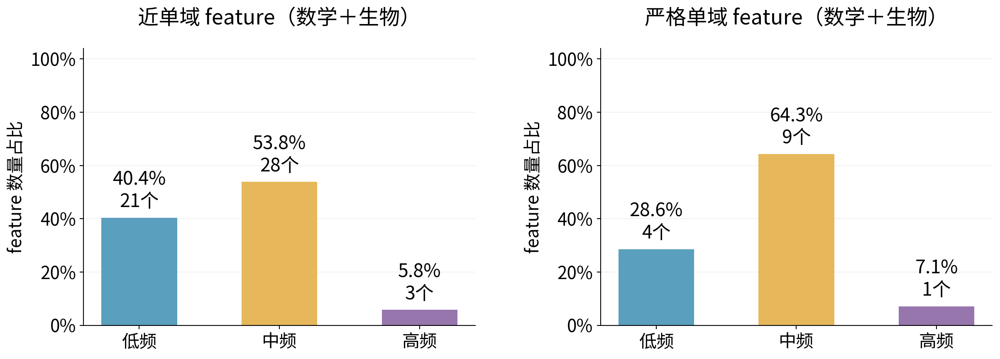
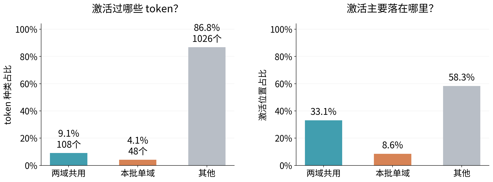
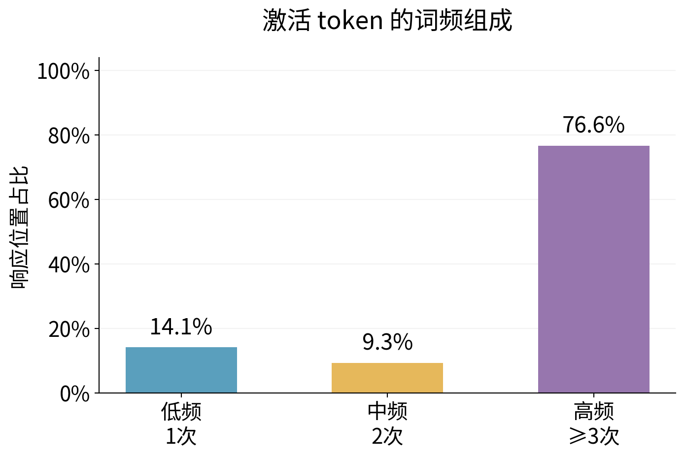

# Pooled simple figures: single-domain use, feature frequency and activated tokens

[中文](README_cn.md) · [Parent R10](/data/250010109/Research_System/Projects/from-attention-to-search/main/experiments/A15/15_27_natural_language_feature_response/R10_domain_member_atlas_20261030/summary.md) · [Discovery-frozen supplement](/data/250010109/Research_System/Projects/from-attention-to-search/main/experiments/A15/15_27_natural_language_feature_response/R10_domain_member_atlas_20261030/supplement_near_domain_tokens.md)

## Belief update

**Under the original frequency bins, near-domain and panel-strict members concentrate in low/middle reference ranges. Single-domain use does not imply lexical exclusivity: members activate on shared token surfaces, while the high-frequency-token share is close to input composition and does not establish special preference.**

Pool math and biology with equal member weights. Three sets remain distinct: near55(31/24),discovery-strict29(14/15),and a new descriptive all-cached-strict16(7/9). The last requires zero native activation in every opposite-domain analysis position across all120documents,including development/oldheldout. It does not replace frozen discovery lists or establish independent heldout generalization. No frequency/token outcome determines membership; no global exclusive-knowledge claim.

## Analysis1: feature reference frequency

X:low/middle/high independent DCLM frequency.Y:classified-member count fraction.Near55has52classified:21/28/3(40.4/53.8/5.8%).Panel-strict16has14classified:4/9/1(28.6/64.3/7.1%).Three/two insufficient-reference members remain in tables.Frequency=z>0count/65,536;≥20hits;original lower-inclusive cuts.002593994140625/.0134429931640625.Majority-bin names depend on the binning rule;oldlog sensitivity is retained.

## Analysis2: distinct activated types versus activated positions

Same16members,nativez>0,on6,400oldheldoutpositions.X:shared/panel-single-domain/other.LeftY:deduplicated exact-token-ID fraction;rightY:position fraction normalized within each member then averaged.1,182types comprise108shared(9.1%),48panel-single-domain(4.1%),1,026other/insufficient(86.8%).Member-equal activated-position shares33.1%/8.6%/58.3%.Do not confuse type and position denominators.

NEWdescriptive input categories use all120documents:shared appears in≥5documents in EACH domain;panel-single-domain in≥5of one and0of the other;remainingother/insufficient.This differs from the older discovery-frozen,≤1opposite-document associated category;old numbers are preserved rather than relabeled.It is a panel coverage description,not semantic ground truth;subwords,format and symbols remain.Shared surfaces operationalize the requested common-token comparison without assuming high frequency or generic meaning.Exact IDs/strings/document support are in token_ID_details.csv.

All-position background is43.3/5.2/51.5%;document-exposure-matched42.7/5.2/52.1%.Shared-token activation is not shared-token enrichment.Panel-single-domain8.6%versus5.2%is an observational composition shift,not semantic or causal evidence.

## Analysis3: frequency of activated tokens

X:within-panel exact-ID type-count groups(low1,middle2,high≥3);Y:member-equal activated-position share.Native16gives14.1/9.3/76.6%.Groups preserve originalR10type-count quantiles1/2and ties over19,200validpositions.High here is panel-relative,not global everyday vocabulary.Type and position counts are separate in token_frequency_composition.csv.The all-available-position high-frequency share is77.1%,close to76.6%,so a high share alone does not demonstrate preference.Token frequency and DCLM FEATURE frequency remain distinct.

## Preserved high-response sensitivity and reproduction

Frozen discovery-positivep90thresholds are unchanged.12/16members meet original≥5high positions/2documents support;4remain insufficient.High-response243types split61shared/15single/167other,type fractions25.1/6.2/68.7%;member-equal high-position fractions35.5/14.1/50.4%;token-frequency fractions12.4/7.9/79.7%.See appendix_high_token_categories.png and appendix_high_token_frequency.png.Native and high-response denominators are not mixed.

presentation_amendment.json declares the new all-activation main view and preserved high-response appendix.Raw plotting/member/coverage tables and exact IDs,config/freeze/source/output hashes are saved.Old lists,thresholds,classification and findings remain unchanged.Checks verify parent-subset identity,all opposite counts zero,original high counts,equal-member weighting,deduplication and sum-to-one.No new forward/training/PCAfit/domain.Canonical raw caches remain execution-side.Reproduce with local spectral-hierPython scripts/pooled_simple_figures.py then scripts/package_pooled_simple.py.Scientific acceptance remains Unknown;no semantic referent labels or causal functional result were added.Stop after this cached supplement.
