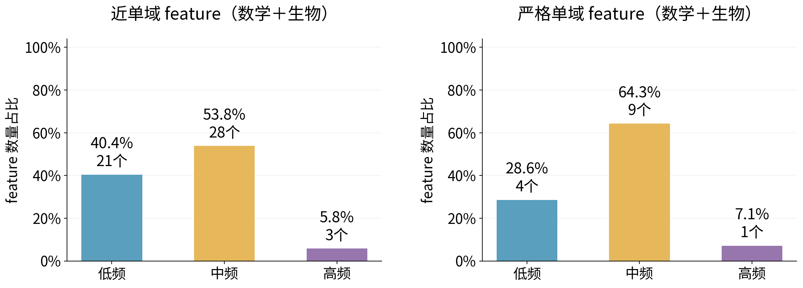
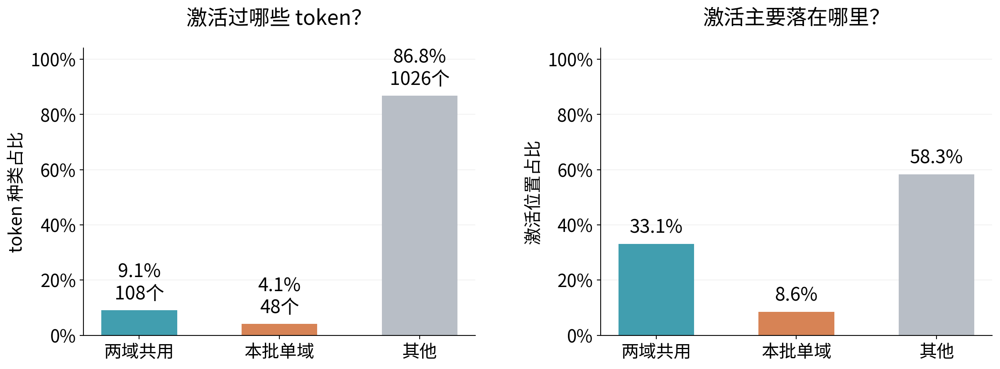
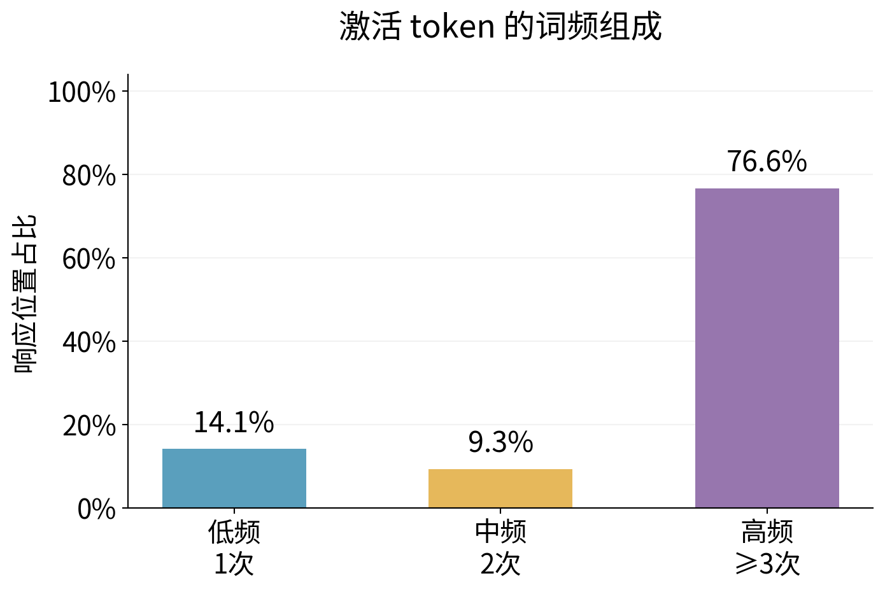

# 合并简图：单域使用、feature频率与激活token

[English](README.md) · [原R10完整结果](/data/250010109/Research_System/Projects/from-attention-to-search/main/experiments/A15/15_27_natural_language_feature_response/R10_domain_member_atlas_20261030/summary_cn.md) · [发现集冻结补充](/data/250010109/Research_System/Projects/from-attention-to-search/main/experiments/A15/15_27_natural_language_feature_response/R10_domain_member_atlas_20261030/supplement_near_domain_tokens_cn.md)

## 认识更新

**在原频率规则下，近单域和本批严格单域成员都以低中频为主；但单域使用不等于只响应单域词面。严格单域成员也响应两域共用token，而激活位置中的高频token占比与语料背景接近，尚不能称特殊偏好。**

目的：把用户截图第二条结论画成可直接读懂的比例图，并回答严格单域成员响应多少种共用或本批单域token、激活token有多常见。数学、生物合并后每名成员等权。所有图只用缓存；科研接受Unknown。

## 结果分析一：feature自身的发生率

横轴为独立DCLM参考激活频率组，纵轴为feature人数比例，柱顶同时标比例和人数。左图原近单域55名，频率可判定52名：低21（40.4%）、中28（53.8%）、高3（5.8%）。右图本批严格单域16名，频率可判定14名：低4（28.6%）、中9（64.3%）、高1（7.1%）。支持不足3/2名保留另表，不算低频。

参考频率=独立DCLM中原生z>0次数/65,536，至少20次；原切点0.259399414%和1.344299316%，相等归低一组。该规则下中频最多，不能把“中频”当所有分组规则下的不变标签；旧log敏感性仍保留。

三份名单必须分开：①近单域55（31数学+24生物），发现集偏向域≥5篇、另一域≤1篇、≥95%正激活位置来自偏向域；②发现集严格单域29（14+15），发现集另一域零激活，旧留出仍严格21名；③**本批严格单域16（7+9）**，从29名中要求全部120缓存文档的另一域60篇、9,600分析位置均零激活。16是本次追加的描述性子集，不替换55或29。

“全缓存严格”只指本批分析位置，不能称全语料领域专有。它用到了开发及旧留出，因此下面不是独立留出泛化证据。没有按频率或token图再挑成员。

## 结果分析二：响应多少种token，各占多少位置？

两图均为严格16名，在旧留出40篇×160位置=6,400位置观察原生z>0。左图对不同token ID去重，纵轴为种类比例；右图先在每名feature内算位置比例，再对16名等权。两种百分比的分母不同，不能互换。

| token类别 | 不同ID数／1,182 | 种类占比 | 成员等权激活位置占比 |
|---|---:|---:|---:|
| 两域共用 | 108 | 9.1% | 33.1% |
| 本批单域 | 48 | 4.1% | 8.6% |
| 其他／支持不足 | 1,026 | 86.8% | 58.3% |

“常用”在此落实为可核对的“两域共用”，不是凭词义判断。**本次新描述分类**使用全部120篇输入：两域各≥5篇出现为共用；一域≥5篇且另一域0篇出现为本批单域；其余为其他／支持不足。单域类别会包含子词、数学符号和格式，不能自动称领域术语。精确ID、标点、大小写和空格均保留。[逐token表](token_ID_details.csv)可查看具体词形与两域文档覆盖。

这套全缓存分类与前版“发现集冻结、偏域允许另一域≤1篇”的分类不同，旧结果不重写、不直接拼接。它回答当前语料内的覆盖，不能作为独立语义验证。其他类别尚不能判断，也不能全部叫通用或领域专有。

同文档暴露量匹配背景，共用42.7%、本批单域5.2%、其他52.1%；全部可用位置背景为43.3%/5.2%/51.5%。共用位置有激活不等于对共用词富集；本批单域8.6%相对背景5.2%是描述性组成偏移，尚无语义或因果认定。

## 结果分析三：激活token的低中高频组成

横轴为token语料内频率组，纵轴为成员等权激活位置比例。数学、生物合并；同一16名，原生z>0。低频14.1%、中频9.3%、高频76.6%。

词频计数沿用原R10：在全部120篇有效19,200位置上统计同一tokenizer的精确ID，按token类型计数分位点1、2分组，计数并列不拆分。低=出现1次，中=2次，高=至少3次。“高频”是本批类型分组，不是日常语言或全语料常用程度。类型数与位置数见[token频率表](token_frequency_composition.csv)，此图纵轴分母为激活位置，不是token类型数。

全部可用位置的高频token占77.1%，与激活位置76.6%接近。因此“激活大多发生在高频token上”成立，但“特别偏好高频token”尚未建立。feature的DCLM频率与这里的token词频是两个不同变量。

## 原高响应阈值对照、方法变化与复现

原发现集正激活p90阈值没有改变；作为单独[高响应词频图](appendix_high_token_frequency.png)及[高响应类别图](appendix_high_token_categories.png)保留。16名中12名满足原≥5高响应位置、≥2文档的构成支持，4名支持不足不换人。12名高响应对应243种ID：共用61种（25.1%）、本批单域15种（6.2%）、其他167种（68.7%）；成员等权高响应位置比例35.5%/14.1%/50.4%，低中高词频12.4%/7.9%/79.7%。原生激活与高响应不能混用分母。

本轮变化明确为：数学/生物合并；追加全缓存零异域16名描述子集；全缓存token覆盖分类；新增原生z>0的全激活视图。旧发现名单、分类、阈值与结果全部保留。presentation_amendment.json记录了新增全激活主视图与旧高响应附录的关系。没有新增模型前向、训练、PCA或领域。

原始绘图数据、16名名单、29/55映射、每成员组成、确切token ID及语料计数、输入与输出哈希均在本目录；原始缓存留执行侧。核查包括：16名均属于旧29、全部异域分析位置零激活、高响应计数与原表逐成员一致、ID去重以及比例合计1。脚本为`/data/250010109/Research_System/Projects/from-attention-to-search/main/experiments/A15/15_27_natural_language_feature_response/R10_domain_member_atlas_20261030/scripts/pooled_simple_figures.py`，再运行`package_pooled_simple.py`整理稿件；使用本地spectral-hier Python，零模型调用。

汇报追问：**为什么能区分“数量多”与“偏好”？** 比较激活位置和全部可用位置的组成，并保留同文档背景。**为什么不能说领域语义专有？** 单域只在本批中观察到，类别含格式/子词，大量token支持不足，且未进行对象语义人工确认或因果干预。缓存补统计与简图完成后停止。
