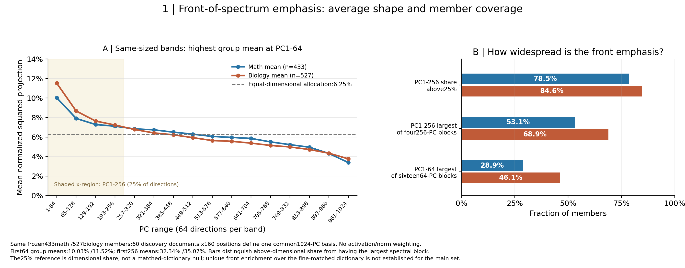
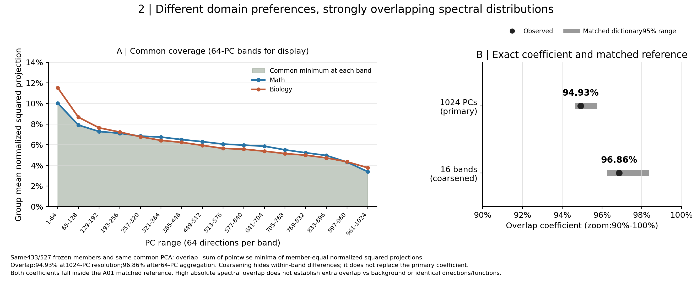
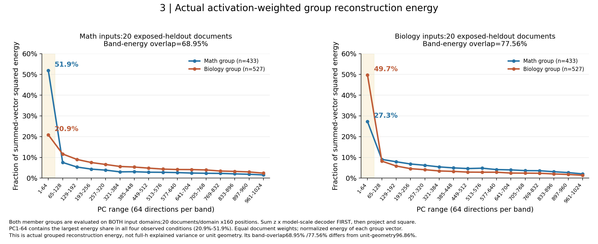

# Spectral location and overlap: derived R10 explanation

[中文](README_cn.md) · [Canonical R10 results](../../summary.md). Same frozen433math/527biology members, A22 native shared z,block27 decoder and one pooled discovery1024-PC basis. This is a derived explanation with descriptive cache supplements, not an Anchor/Protocol/state amendment. Researcher scientific acceptance remains Unknown.

Recommended bounded insight: domain discrimination need not imply separated spectral bands. These member groups have modest front-weighted relative spectral shapes and highly overlapping member-equal squared-projection distributions. This does not establish uniquely front-biased geometry, extra overlap over dictionary reference, or identical functions.

For one active member, the reconstruction term is z_f*d_f; normalizing its projected squared energy by its full squared norm cancels z_f. Unit geometry therefore describes the shape of that member's normalized reconstruction contribution, while ignoring occurrence and magnitude. Summing multiple members introduces weights/cross terms and is a different quantity.

Equal64-PC bands: first-band mean shares10.03%/11.52%, first256 shares32.34%/35.07% versus25% dimensions. Member coverage differs by criterion:340/433(78.5%)/446/527(84.6%) exceed the25% first-quarter baseline;230/433(53.1%)/363/527(68.9%) have their largest256-PC quarter first;125/433(28.9%)/243/527(46.1%) peak in the first64-PC band. Thus group-average front emphasis does not imply most members peak in PC1-64. PC1 itself accounts for only.053%/.120%; PC2-64 carries most of the first-band share. Matched main-set head means were inside the R10 fine-reference range. All new counts are descriptive, never selection criteria.

Left:common minimum of the mean band profiles. Right:1024-PC overlap94.93%,16-band overlap96.86%;x-axis zoom90%-100%,full coefficient range0-1. Coarsening hides within-band differences. Both observations are inside A01 matched-dictionary95% ranges; pool includes selected members, so this is a conditional reference. No matched within-domain split comparison is newly performed. Report high absolute overlap, not extra cross-domain overlap over background/within-domain, and do not infer equal directions/semantics/functions.

Both member groups on both input domains,20 exposed-heldout documents/domain x160positions. Sum native z times model-scale decoder before projecting/squaring, retain cross terms, average documents, then normalize each group-vector energy. First64 shares:math group51.93% on math and27.27% on biology;biology group20.88% on math and49.70% on biology. All four peak in the first band. Actual16-band group-energy overlaps are68.95% on math and77.56% on biology, versus unit-geometry16-band96.86%. Similar orientation profiles can coexist with different use. This is not full-h explained variance.

Three measured-view figure groups plus fixed-member descriptive coverage/peak/energy-overlap counts; no forwards/training/reselection/newPCA. Original outputs preserved. Reproduce using [script](../../scripts/render_spectral_evidence.py); [summary values](summary.json),[member table](member_front_summary.csv),[band table](band_profiles.csv),[actual-energy source table](group_reconstruction_energy.csv),[source hashes](provenance.json). PDF versions have matching figure basenames.
