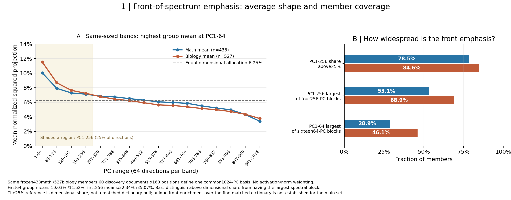
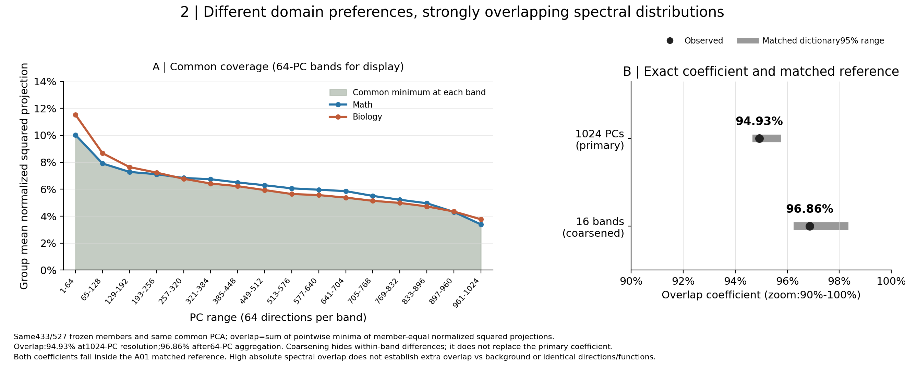
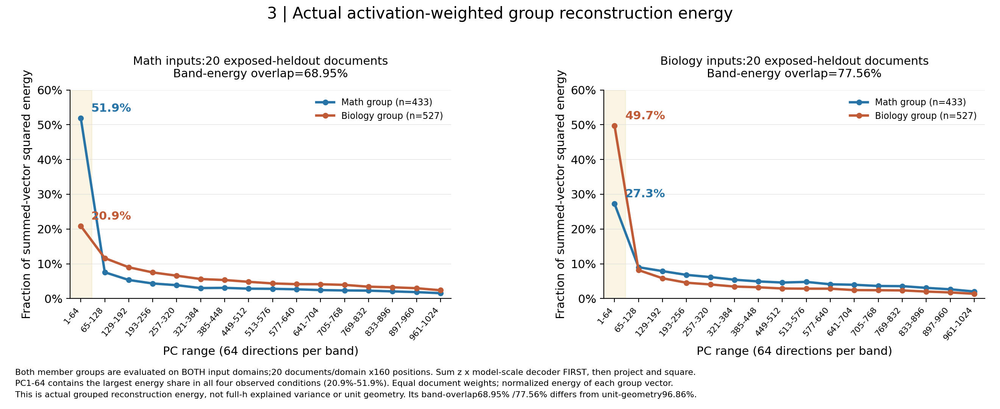

# 领域区分成员的谱位置与重合：解释及佐证图

[原R10完整结果](../../summary_cn.md) · [English](README.md)。这是对冻结主集合的派生解释及缓存描述补统计，不修改Anchor、Protocol、主名单或科研接受状态。数学433、生物527；同一A22共享z、block27 decoder、60发现文档×160位置的共同1024-PC谱。无新模型前向、训练或PCA。

建议认识：**领域区分成员的相对谱能量总体温和前偏；两域偏向成员高度共享谱位置，领域响应差异未表现为谱带的清晰分离。** 这是本批数据上的AI解释，等待研究者判断。不能预写成“每个成员首段最高”或“比字典背景更重合”。

## “激活能量”指什么

单成员在一个位置的最后层重构贡献为 \(v_f=z_fd_f\)，其中 \(z_f\) 是原生共享激活，\(d_f\) 是尺度还原后的最后层decoder。激活非零时，其归一化谱份额为

\[
\frac{|\langle z_fd_f,p_j\rangle|^2}{\|z_fd_f\|^2}
=\left\langle\frac{d_f}{\|d_f\|},p_j\right\rangle^2.
\]

因此单位decoder图可以解释**单成员激活贡献的相对能量形状**，但组内成员等权，忽略发生次数和激活大小。对多个成员先求向量和时，权重及交叉项会改变能量分布，要另看图3。谱前部指协方差较大特征值对应的PC，和feature发生频率不同。

## 认识一：领域区分可以利用共同谱的前部，未必位于独立的谱尾部

左图：横轴16个等宽谱段，每段64PC；纵轴为组内成员等权的归一化平方投影均值，每组全谱合计1。蓝/橙为数学/生物，虚线6.25%是64/1024维数比例，浅黄色覆盖PC1–256。两组最高平均段均为PC1–64（10.03%/11.52%）；前256总份额32.34%/35.07%，高于其25%维数比例。第一方向PC1本身仅0.053%/0.120%，前偏主要发生在PC2–64。不能把32%/35%说成“多数能量集中在前四分之一”。

右图：每根柱的分母为433或527，三个口径回答不同问题：

| 描述口径 | 数学 | 生物 |
|---|---:|---:|
| 前256份额超过25%维数比例 | 340/433=78.5% | 446/527=84.6% |
| 四个等宽256-PC区间中，首区间份额最大 | 230/433=53.1% | 363/527=68.9% |
| 十六个等宽64-PC区间中，首区间份额最大 | 125/433=28.9% | 243/527=46.1% |

所以建议称“总体温和前偏，生物组更一致，个体存在明显差异”，不能称“多数成员在前64达到峰值”。这是相对维数基线的描述；原R10细匹配检查中，主集合前64均值落在字典参照内，特殊前偏尚未建立。新增覆盖/峰值计数只是固定成员上的探索性补描述，不参与筛选。

## 认识二：不同领域偏向可以发生在相近的谱位置上

左图横轴同上，纵轴为两组等权平均谱份额；灰绿色阴影是每段两组中较小的份额。右图黑点为重合系数：逐1024PC为94.93%，每64PC合并后为96.86%。右图坐标放大到90%–100%；系数的完整定义域仍为0–1。灰线是1000次A01匹配字典参照的95%范围，池含入选成员，属于条件字典比较，不是独立零假设。

这里的“高度重合”有明确对象：**组平均平方投影分布**。两组的响应排序方向可以不同，同时它们的平均能量形状覆盖相似谱带。两个点均位于匹配参照内，因此不能说“相对背景更强”；也没有做本轮跨域对域内同规模子组的比较，不能说跨域强于域内。平方分布隐藏符号和组合，不证明相同方向、语义或功能。分段会掩盖段内差异，应以94.93%为主。

## 使用“真实激活能量”时的佐证与限制

每幅图固定输入领域（每域20篇旧留出文档×160位置），两条曲线分别为433数学成员组和527生物成员组。横轴为相同64PC谱段，纵轴是该组重构向量自身的谱能量份额。先求 \(\sum_f z_fd_f\) 再投影平方，保留交叉项；按文档等权平均后归一化。不是完整表征的方差解释率。

| 成员组 | 数学输入前64份额 | 生物输入前64份额 |
|---|---:|---:|
| 数学偏向组 | 51.93% | 27.27% |
| 生物偏向组 | 20.88% | 49.70% |

四种组×输入条件的最高能量谱段均为前64。可以说“本面板上的实际组重构能量也前偏”。但相同输入上的两组分段重合为数学输入68.95%、生物输入77.56%，低于相同分段分辨率下单位几何的96.86%。因此“几何位置高度重合”和“实际使用方式仍有差异”可以同时成立，不能把94.93%直接贴给真实激活能量。

## 复现与文件

已有测量为R10缓存；本次新增3组展示图及上述覆盖/峰值/能量段重合描述。新前向0、训练0、重选0、PCA重拟合0。原主图和统计不覆盖。原留出已经暴露，仍属探索性复用。

[逐成员补统计](member_front_summary.csv) · [谱段均值](band_profiles.csv) · [真实能量原表](group_reconstruction_energy.csv) · [精确值](summary.json) · [来源](provenance.json) · [绘图脚本](../../scripts/render_spectral_evidence.py)

PDF：[谱位置](evidence1_front_location.pdf) · [谱重合](evidence2_spectral_overlap.pdf) · [实际能量](evidence3_actual_energy.pdf)
