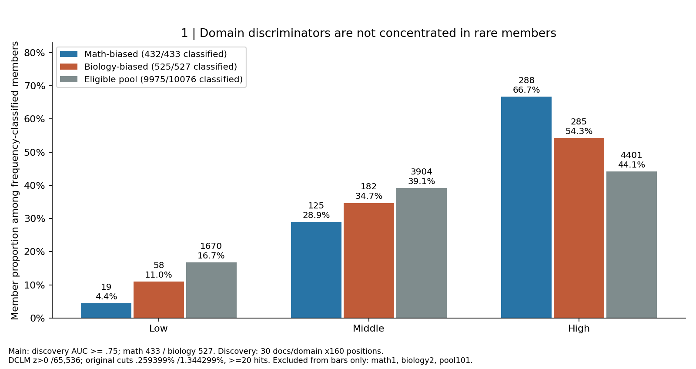
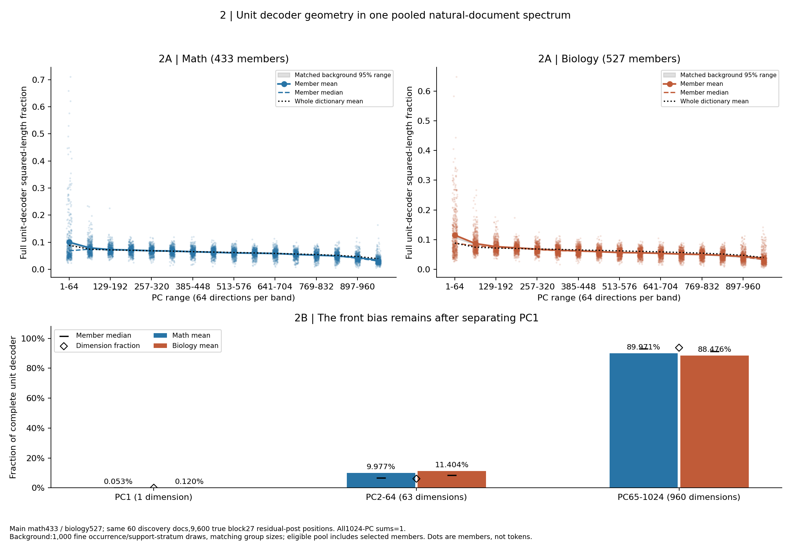
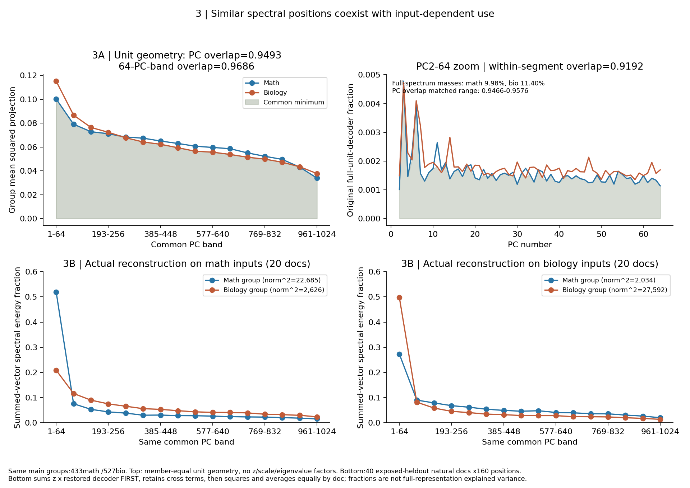
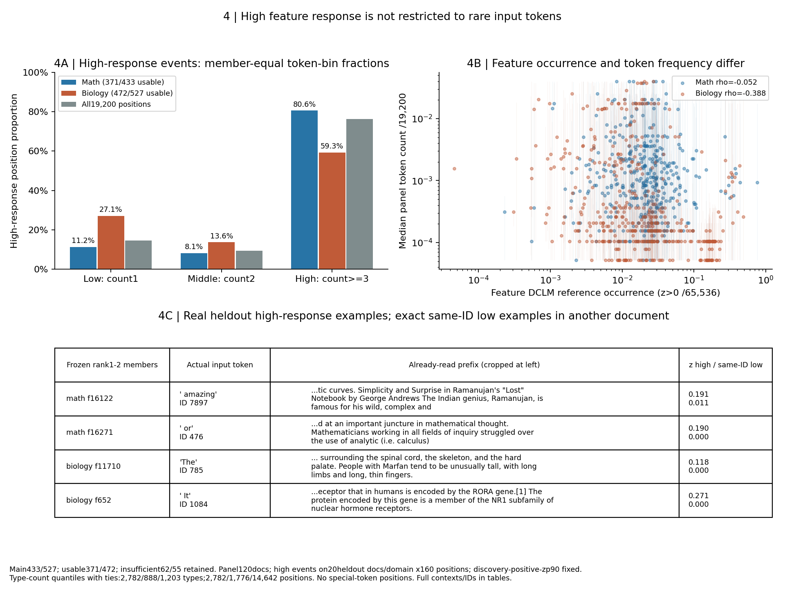
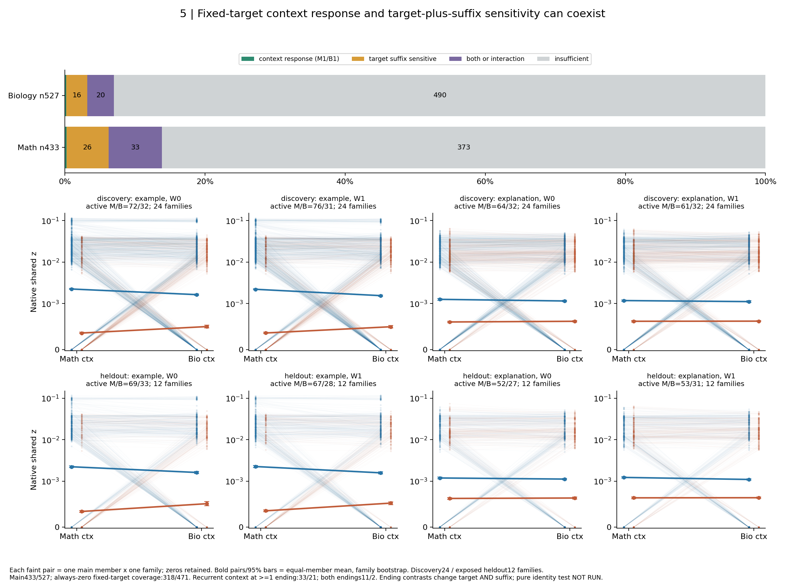

# R10: A whole-dictionary atlas of domain-biased CrossCoder members

[中文](summary_cn.md) · [Protocol](protocol.md) · [Detailed](detailed.md) · [Definitions](definitions.md) · [Member master](tables/master_members.csv)

Purpose: determine whether strong math/biology document discriminators are uncommon, occupy distinct positions in a common representation spectrum, and respond to vocabulary versus context. Three hypotheses compete with frequent reuse/intensity differences, similar spectral position, and vocabulary/format/interaction explanations. The following bounded conceptual updates are AI interpretations; researcher acceptance and closure remain Unknown.

The subsequent [near-domain/token supplement](supplement_near_domain_tokens.md) freezes31math/24biology within this960-member parent and adds frequency, token figuresA/B, full match/support states and pending human referent annotation. It does not replace this page's population. The [current meeting brief](/data/250010109/Research_System/daily_research_reports/1031/meeting_report/meeting_brief_crosscoder_domain_members.md) integrates the bounded results.

## Selection and coverage

Start with all16,384 A22 native shared-z coordinates. Each discovery document contributes one mean over positions32–191 including zeros. There are30 documents/domain. Require >=5 active documents in EITHER domain, rank the math-over-biology pair probability with half-credit ties, and freeze every direction-corrected AUC>=.75. This operational threshold is not a semantic definition. There are13,997 discovery-active coordinates;10,076 eligible, including17 exact AUC ties;433 math/527 biology main members. Of the6,308 rejected for support,2,387 are discovery-zero and3,921 positive but under5 documents in both domains. Support failure does not establish no information.

On the exposed original heldout20 documents/domain,429/433 and525/527 retain direction;357/431 have oriented AUC pointwise95% document-bootstrap lower bounds>.5. Keep all960 main IDs. ID disjointness follows the scoring directions and is not evidence for spatial separation. These are exploratory checks, not blind confirmation. The same master connects supports, reference rates, all five tests and missing statuses.

## Update1: domain discrimination need not be carried mainly by rare members

Frequency-classified math members are19low/125middle/288high (n432, one insufficient); biology58/182/285 (n525, two insufficient). Eligible-pool counts are1670/3904/4401 (n9975,101 insufficient). High proportions66.7%/54.3% exceed pool44.1%; low4.4%/11.0% fall below pool16.7%. Feature occurrence is positive native-z positions/65,536 independent DCLM positions. Original cutpoints are.002593994140625/.0134429931640625, inclusive below; at least20 hits are required.

Read Figure1: x=low/middle/high reference-occurrence groups; y=member proportions among classified members; bars=math433,biology527 and eligible10076, with exact plotted denominators/counts. Selection used30 discovery docs/domain. Compare a group against gray before claiming enrichment. This updates the rare-member intuition; occurrence is not spectrum location or activation intensity. Top16 is middle-dominated whereas the full set is high-dominated. Log-width sensitivity gives middle83.3%/65.0%, yet low remains depleted versus its pool. Top16/64/128 and AUC.70/.80 are frozen appendix views. Selection favors repeatable document response and may miss extremely rare information.

## Update2: different domain responses do not require separate spectral locations; use can still differ

The common PCA is the pooled9,600 true block27 residual-post positions from60 discovery documents, with one common mean, equal domains/documents/positions, no within-domain recentering/whitening or h unit normalization. All1024 PCs are retained. Raw-h covariance auditing shows the old R04 basis already implements exactly this definition. R07 reused it; it is NOT an independent natural-reference corpus. Unit decoder squared projections sum to1 without z, eigenvalue or norm weighting.

Math/biology mean PC1–64 shares are10.03%/11.52%, medians6.84%/8.79%; fine-matched dictionary mean95% reference ranges9.11–10.21%/10.59–11.76%, both containing the observations. A01 matches half-octave occurrence bins (within-stratum rate ratio<=sqrt2), total/max-domain support bins of5 and group size, drawing disjoint sets from the whole eligible pool, including selected members. Mean selected inclusion is40.0%/40.5%; this is a conditional dictionary reference, not an independent null or selection bootstrap. PC1 shares are only.053%/.120%; PC2–64 shares9.98%/11.40% versus63/1024=6.15% dimensions. Mean front bias does not come from PC1. About55.0%/74.0% of members exceed the64/1024 dimensional share; higher means than medians retain an upper-tail effect.

Read Figure2: same433/527 members and60 discovery documents. Upper x=16 equal64-PC bands; y=complete-unit-decoder fraction. Pale points=members, solid=mean,dashed=median,gray=matched reference,black dotted=whole dictionary. Read mean and median together. Lower x splits1/63/960 dimensions; diamonds are dimensional fractions, preventing comparisons of unequal-dimensional absolute totals. This is orientation, not knowledge amount or actual contribution.

PCwise overlap is.9493;64-PC-band overlap.9686. Matched PC overlap range.9466–.9576 contains the observation, so similarity is not above dictionary reference. The preserved coarse-v1 range.9508–.9610 is a method sensitivity, not the active reference. Within-PC2–64 renormalized overlap.9192 is separate from its full-vector masses9.98%/11.40%. Actual decoder subspace ranks433/527 have trace/minrank=.5314; mean cross-member absolute cosine=.0251. These measure different objects and do not imply common functions.

Actual heldout reconstruction sums z times TRAIN-RMS-restored decoder BEFORE squaring, preserving cross terms. Math-group first64 energy on math/bio inputs is51.93%/27.27%; biology-group values20.88%/49.70%. Total mean squared norms are22684.6/2034.1 and2625.8/27591.6, all away from zero. Each input-domain curve averages20 documents×160 positions. This is energy of the group's own reconstructed vector, not full-representation explained variance.

Read Figure3: top uses the EXACT unit geometry of Figure2; x=PC/band,y=member-equal mean squared projections,shade=common minimum. Right zoom keeps original full-unit mass on y while reporting the separately normalized segment overlap. Bottom fixes input domain per panel and compares both member groups: x=same band,y=summed-vector energy fraction. Compare same input first, then same color across inputs. Similar orientations and different use coexist. Squared projection hides signs/combinations; none of these overlaps implies same semantics or learning direction. Top16/64/128 PC overlap=.7652/.8797/.9110 and AUC.70/.80=.9593/.9295; list size matters. The spectrum was constructed from these domains, so containing their difference is not independent validation.

## Update3: domain bias is neither lexical exclusivity nor pure token identity; coverage limits the context judgment

Token counts use this120-document19,200-position panel, separately from DCLM feature occurrence. Count-type quantiles land at1/2, with ties kept:2782/888/1203 token types and2782/1776/14642 positions. Punctuation/subwords stay; no special IDs occur. High response is strictly above discovery-positive-z p90. Composition support is adequate for371/433 math and472/527 biology;62/55 remain insufficient. Member-equal token-bin means are11.2/8.1/80.6% and27.1/13.6/59.3%, versus all-position14.5/9.25/76.3%. High responses are not limited to rare words. Median distinct high-response IDs are17/20, and median top5-ID event fractions45%/40%, showing both diversity and concentration. Feature-occurrence/token-count Spearman rho is−.052/−.388; no shared stable positive relation is established.

Read Figure4: left x=panel token count bins, y=per-feature high-event fractions averaged equally across371/472 usable members; gray=all positions. Right each point=a main member; x=DCLM feature rate, y=median panel token count/19200 at high events, thin lines=10–90% range; both axes log, no unseen IDs treated as zero. Bottom fixes discovery ranks1–2/domain, displaying real heldout input IDs/prefixes and exact-ID low examples elsewhere. Full rank1–3 examples plus all-member high/ordinary/same-ID-low instances remain execution-side. These are inputs, not vocabulary-decoded outputs.

The384 controlled rows contain48 families,2domains,2wordings,2target-plus-suffix endings, split24/12/12. Target IDs3110/16148 and positions match within every domain pair; global target indices range30–38. Recurrent fixed-target context response occurs for33math/21bio members at >=1 ending,11/2 at both. Only22/12 of the context-recurring members also agree with their natural-document direction;11/9 reverse in the controlled panel. Recurrent target-plus-suffix59/35 and interaction26/19 can overlap these tags. All are exploratory pointwise-bootstrap tags without multiple-member confirmatory claims. Mutually exclusive summaries are context1/1, suffix26/16, both-or-interaction33/20, insufficient373/490. No response anywhere in all splits occurs for318/471 (789 total); this is coverage failure, not identity.

Read Figure5: top bars count all960 main IDs. Lower columns facet target/wording; rows separate discovery24 from exposed-heldout12 families. Each faint pair is one member×family math/bio z; zeros are retained. Bold pairs and95% bars are equal-member means with family bootstrap. Native-z axis is linear below.001 and logarithmic above; each panel labels active-member counts. Blue/orange retain natural-domain bias group colors. Strength changes count even without on/off switching.

Pure target-only B is **unanswered**: example/explanation also changes the suffix. A minimum NOT RUN proposal reuses48 E0 rows and adds48 identical-prefix `explanation` rows, 1728 valid tokens or12288256-padded model positions; wall-clock/GPU cost Unknown. It needs separate forward authorization. Target replacement still changes meaning, so even that does not prove pure identity. Vocabulary,source,format and preceding terminology remain competing explanations.

## Frozen sensitivity: conclusions that depend on truncation

| Set | Math/bio n | Largest original frequency class M/B | Head mean above fine95% reference M/B | PC overlap |
|---|---:|---|---|---:|
| main | 433/527 | high/high | False/False | 0.9493 |
| top16 | 16/16 | middle/middle | False/False | 0.7652 |
| top64 | 64/64 | middle/middle | True/True | 0.8797 |
| top128 | 128/128 | high/middle | True/True | 0.9110 |
| auc0.70 | 852/894 | high/high | False/False | 0.9593 |
| auc0.80 | 188/266 | high/high | True/True | 0.9295 |

Main.75 and.70 head means are inside fine references; .80 and Top64/128 exceed them, while Top16 does not. Thus special front orientation depends on screening strength, not a uniform whole-main property or confirmatory multi-threshold result. Low shares are below pool at.70/.75/.80; biology Top16/128 has18.75% versus pool16.74%, a small descriptive comparison, so depletion is not universal across rank cutoffs. Large spectral overlap persists, but its magnitude depends on group size.

## Five direct answers and completion

1. Feature frequency: full main sets are high-dominated; low is not enriched; majority labels change with TopK/binning.
2. Decoder position: modest orientation in PC2–64, not PC1; observed means are inside fine-matched reference ranges, so special front bias is unestablished.
3. Spectral overlap: PC.9493 / band.9686, not above matched reference; actual use energies depend on input.
4. True tokens: responses span multiple IDs, with different within-panel frequency compositions; no universal stable feature/token frequency law.
5. Context/identity: some recur across wordings, most lack target coverage; pure identity remains unanswered.

Existing measurements: R04 text/z/true h/reference counts; R07/R08 panel target z; R09 decoder scale. New work is offline screening/statistics/matching/vector composition/token/context tables and figures. Zero model forwards,training or distance expansion. 5009 numerical/contract assertions pass, with3000 additional A01 background checks; full projection conservation error~1.1e−15. Five main groups plus four appendix images, with all raw tables and reproducible scripts saved. Old outputs unchanged; no commit/push. Stop after cache-supported delivery; researcher scientific acceptance remains Unknown.
